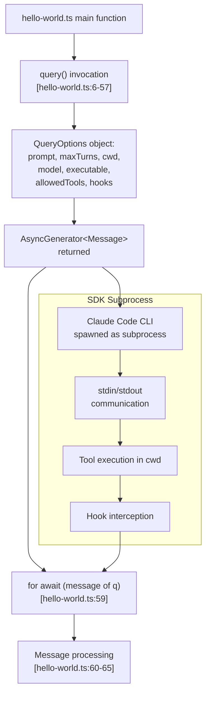
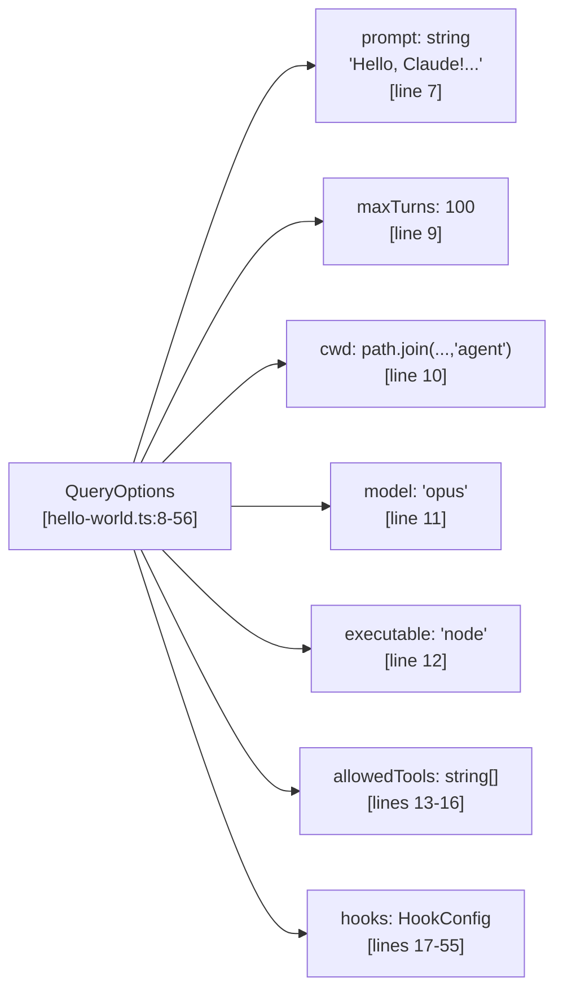
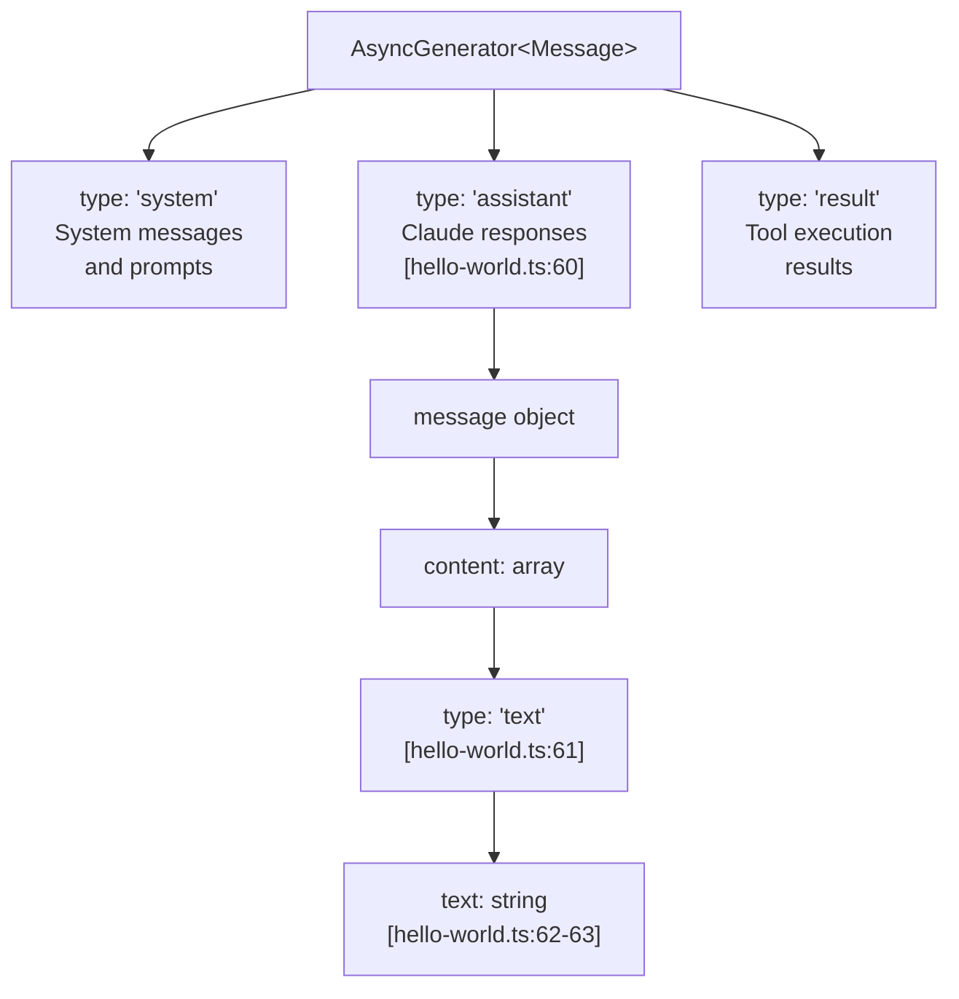
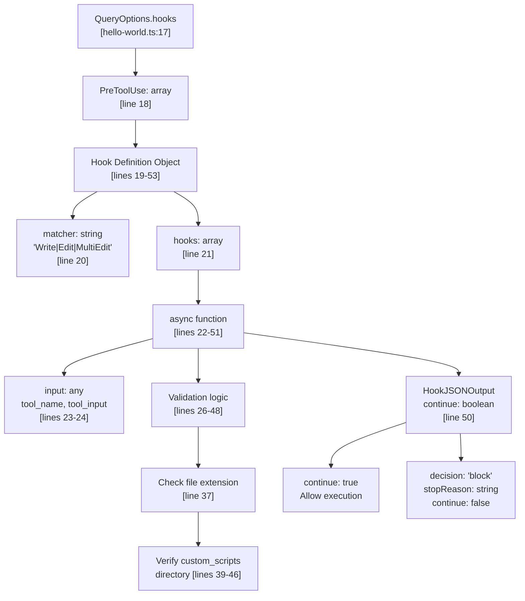
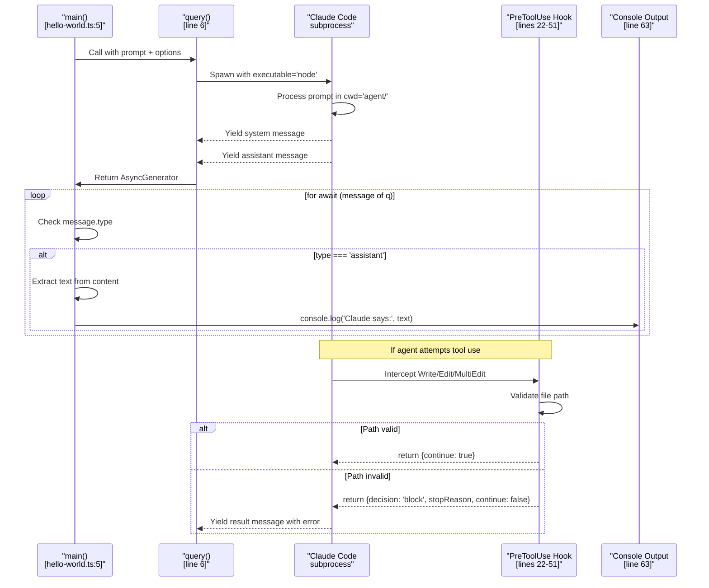
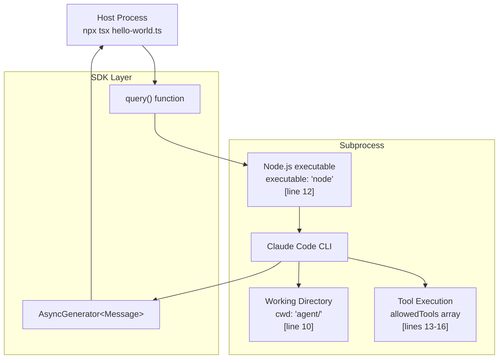

<!-- source: DeepWiki mcp.deepwiki.com · repo anthropics/claude-agent-sdk-demos · page 7.1 Hello World (V1 API) · fetched 2026-10-26 -->

# Hello World (V1 API)

<details>
<summary>Relevant source files</summary>

The following files were used as context for generating this wiki page:

- [.gitignore](.gitignore)
- [hello-world/README.md](hello-world/README.md)
- [hello-world/hello-world.ts](hello-world/hello-world.ts)
- [hello-world/package-lock.json](hello-world/package-lock.json)
- [hello-world/package.json](hello-world/package.json)
- [hello-world/tsconfig.json](hello-world/tsconfig.json)

</details>


This page documents the Hello World demonstration using the Claude Agent SDK V1 API, which centers on the `query()` function for single-turn or simple multi-turn agent interactions. This demo illustrates basic SDK usage including configuration, tool restrictions, and message handling.

For information about the Session-based API pattern with explicit multi-turn conversation management, see [Hello World V2 (Session API)](#7.2). For comprehensive documentation of the V1 API across all demos, see [V1 API: Query Function](#8.2).

---

## Overview

The Hello World V1 demo provides a minimal working example of the Claude Agent SDK's original API pattern. The demo showcases:

- Basic `query()` function usage with async iteration
- Agent configuration including working directory, model selection, and tool restrictions
- Hook system implementation for enforcing file path constraints
- Message extraction and display

**Location**: [hello-world/]()

**Key Files**:
- [hello-world/hello-world.ts]() - Main demonstration script
- [hello-world/package.json]() - SDK dependency configuration

Sources: [hello-world/hello-world.ts:1-70](), [hello-world/README.md:1-152]()

---

## Installation and Setup

### Dependencies

The demo requires the following packages:

| Package | Version | Purpose |
|---------|---------|---------|
| `@anthropic-ai/claude-agent-sdk` | ^0.1.14 | Core SDK functionality |
| `zod` | ^4.1.12 | Schema validation (peer dependency) |
| `typescript` | ^5.9.3 | TypeScript support |
| `tsx` | ^4.20.6 | TypeScript execution runtime |
| `@types/node` | ^24.7.2 | Node.js type definitions |

Sources: [hello-world/package.json:1-11]()

### Environment Setup

**API Key Configuration**:
```bash
export ANTHROPIC_API_KEY="your-api-key"
```

**Directory Structure**:
```bash
mkdir -p agent/custom_scripts
```

The `agent/` directory serves as the current working directory (`cwd`) for agent execution, while `custom_scripts/` is enforced as the mandatory location for JavaScript and TypeScript files via hooks.

Sources: [hello-world/README.md:17-27]()

### Execution

```bash
npx tsx hello-world.ts
```

Sources: [hello-world/README.md:117-119]()

---

## V1 API Architecture

### Query Function Flow



**Diagram: V1 API Query Function Execution Flow**

The `query()` function at [hello-world/hello-world.ts:6]() accepts a prompt string and options object, spawns a Claude Code subprocess configured with the specified `executable` binary, and returns an `AsyncGenerator<Message>` that yields messages as the agent operates. Messages are consumed via async iteration at [hello-world/hello-world.ts:59]().

Sources: [hello-world/hello-world.ts:6-67](), [hello-world/README.md:30-46]()

---

## Configuration Options

### QueryOptions Structure



**Diagram: Query Configuration Parameters**

Sources: [hello-world/hello-world.ts:6-57]()

### Option Details

| Option | Type | Value in Demo | Description |
|--------|------|---------------|-------------|
| `prompt` | `string` | "Hello, Claude! Please introduce yourself in one sentence." | Initial prompt sent to the agent |
| `maxTurns` | `number` | 100 | Maximum conversation turns before termination |
| `cwd` | `string` | `path.join(process.cwd(), 'agent')` | Working directory for agent subprocess |
| `model` | `string` | "opus" | Claude model selection: "sonnet", "opus", "haiku", or "inherit" |
| `executable` | `string` | "node" | Path to Node.js binary for subprocess |
| `allowedTools` | `string[]` | 15 tools | Whitelist of tools the agent can invoke |
| `hooks` | `object` | PreToolUse hooks | Tool interception configuration |

Sources: [hello-world/hello-world.ts:7-56](), [hello-world/README.md:50-57]()

### Allowed Tools Array

The demo configures the following tools at [hello-world/hello-world.ts:13-16]():

**File Operations**: `Read`, `Write`, `Edit`, `MultiEdit`, `NotebookEdit`

**Search and Discovery**: `Glob`, `Grep`, `LS`

**Execution**: `Bash`, `Task`, `BashOutput`, `KillBash`

**Network**: `WebFetch`, `WebSearch`

**Utilities**: `TodoWrite`, `ExitPlanMode`

Sources: [hello-world/hello-world.ts:13-16](), [hello-world/README.md:58-66]()

---

## Message Types and Handling

### Message Type Hierarchy



**Diagram: Message Type Structure and Text Extraction**

Sources: [hello-world/hello-world.ts:59-66](), [hello-world/README.md:88-105]()

### Text Extraction Pattern

The demo extracts Claude's text response using type-based filtering:

```typescript
// Pattern from hello-world.ts:60-65
if (message.type === 'assistant' && message.message) {
  const textContent = message.message.content.find((c: any) => c.type === 'text');
  if (textContent && 'text' in textContent) {
    console.log('Claude says:', textContent.text);
  }
}
```

**Key Checks**:
1. Filter for `message.type === 'assistant'` to isolate Claude's responses
2. Verify `message.message` exists (contains the actual response)
3. Search `content` array for blocks with `type === 'text'`
4. Extract the `text` property from matching blocks

Sources: [hello-world/hello-world.ts:59-66](), [hello-world/README.md:97-105]()

---

## Hook System

### Hook Architecture



**Diagram: PreToolUse Hook Configuration and Validation Flow**

Sources: [hello-world/hello-world.ts:17-55](), [hello-world/README.md:68-86]()

### Hook Implementation Details

**Matcher Pattern**: The string `"Write|Edit|MultiEdit"` at [hello-world/hello-world.ts:20]() specifies which tools trigger the hook, using pipe-delimited regular expression syntax.

**Hook Function Signature**: 
```typescript
async (input: any): Promise<HookJSONOutput>
```

**Input Structure**:
- `input.tool_name`: String identifying the tool being invoked
- `input.tool_input`: Object containing tool parameters (e.g., `file_path`)

**Output Structure** (`HookJSONOutput` type from [hello-world/hello-world.ts:2]()):

| Field | Type | Purpose |
|-------|------|---------|
| `continue` | `boolean` | Whether to proceed with tool execution |
| `decision` | `'block'` (optional) | Indicates rejection when `continue: false` |
| `stopReason` | `string` (optional) | Human-readable explanation for blocking |

Sources: [hello-world/hello-world.ts:2](), [hello-world/hello-world.ts:17-55]()

### File Path Validation Logic

The hook enforces that `.js` and `.ts` files must reside in the `custom_scripts/` directory:

**Validation Steps** ([hello-world/hello-world.ts:31-48]()):

1. **Tool Type Check**: Verify tool is `Write`, `Edit`, or `MultiEdit`
2. **Path Extraction**: Retrieve `file_path` from `tool_input` based on tool type
3. **Extension Check**: Test if file extension is `.js` or `.ts`
4. **Path Validation**: Ensure path starts with `agent/custom_scripts/`
5. **Block or Allow**: Return `HookJSONOutput` with appropriate decision

**Blocking Response Structure** ([hello-world/hello-world.ts:42-46]()):
```typescript
{
  decision: 'block',
  stopReason: `Script files (.js and .ts) must be written to the custom_scripts directory. Please use the path: ${customScriptsPath}/${path.basename(filePath)}`,
  continue: false
}
```

Sources: [hello-world/hello-world.ts:22-51]()

---

## Example Execution Flow

### Complete Interaction Sequence



**Diagram: End-to-End Message and Hook Flow**

Sources: [hello-world/hello-world.ts:1-70]()

### Sample Output

Given the prompt at [hello-world/hello-world.ts:7](), the expected output follows this pattern:

```
Claude says: I'm Claude, an AI assistant created by Anthropic to be helpful, harmless, and honest.
```

The actual response varies based on the model's output, but the demo extracts and displays only the text content from assistant messages.

Sources: [hello-world/hello-world.ts:7](), [hello-world/hello-world.ts:63]()

---

## Architecture Summary

### Code Entity Mapping

| Natural Language Concept | Code Entity | Location |
|--------------------------|-------------|----------|
| Agent interaction function | `query()` | [hello-world/hello-world.ts:6]() |
| SDK import | `@anthropic-ai/claude-agent-sdk` | [hello-world/hello-world.ts:1]() |
| Hook output type | `HookJSONOutput` | [hello-world/hello-world.ts:2]() |
| Working directory | `path.join(process.cwd(), 'agent')` | [hello-world/hello-world.ts:10]() |
| Restricted directory | `agent/custom_scripts` | [hello-world/hello-world.ts:39]() |
| Model selection | `"opus"` | [hello-world/hello-world.ts:11]() |
| Message loop | `for await (const message of q)` | [hello-world/hello-world.ts:59]() |
| Text extraction | `message.message.content.find()` | [hello-world/hello-world.ts:61]() |
| Hook matcher | `"Write|Edit|MultiEdit"` | [hello-world/hello-world.ts:20]() |
| Validation function | `async (input: any): Promise<HookJSONOutput>` | [hello-world/hello-world.ts:22]() |

Sources: [hello-world/hello-world.ts:1-70]()

### Subprocess Architecture



**Diagram: Process and Directory Architecture**

The SDK spawns a separate Node.js process running the Claude Code CLI, communicating via stdin/stdout. All file operations occur within the specified `cwd`, and the agent can only invoke tools listed in `allowedTools`.

Sources: [hello-world/hello-world.ts:9-16](), [hello-world/README.md:107-114]()

---

## Common Patterns

### Minimal Configuration

For basic interactions without hooks or tool restrictions:

```typescript
const q = query({
  prompt: 'Your prompt here',
  options: {
    cwd: path.join(process.cwd(), 'agent'),
    executable: "node",
  }
});
```

This configuration uses SDK defaults for `maxTurns`, `model`, and `allowedTools`.

Sources: [hello-world/README.md:35-46]()

### Error Handling

The demo uses top-level error catching:

```typescript
main().catch(console.error);
```

Located at [hello-world/hello-world.ts:69](), this pattern ensures subprocess errors and unhandled rejections are logged.

Sources: [hello-world/hello-world.ts:69]()

### Directory Setup

The `cwd` directory must exist before calling `query()`. The demo assumes this directory is created manually or via setup script.

**Required Structure**:
```
hello-world/
├── agent/              # Working directory (must exist)
│   └── custom_scripts/ # Script directory (must exist)
└── hello-world.ts      # Demo script
```

Sources: [hello-world/README.md:22-27](), [hello-world/hello-world.ts:10]()

---

## Troubleshooting

### Common Errors

| Error | Cause | Solution |
|-------|-------|----------|
| `spawn node ENOENT` | Node binary not found in PATH | Set `executable: "node"` or use `process.execPath` |
| `ENOENT` on `cwd` | Working directory doesn't exist | Create `agent/` directory before execution |
| Hook blocks all writes | Hook logic too restrictive | Verify file path validation logic in hooks |
| No text output | Incorrect message type check | Ensure filtering for `type === 'assistant'` |

Sources: [hello-world/README.md:121-145]()

### Debugging Tips

**Enable verbose logging** by inspecting all message types:
```typescript
for await (const message of q) {
  console.log('Message type:', message.type);
  console.log('Message:', JSON.stringify(message, null, 2));
}
```

**Verify subprocess spawn** by checking the `executable` path exists:
```typescript
import * as fs from 'fs';
console.log('Node exists:', fs.existsSync('node'));
```

**Test hook logic** independently before integrating into `query()` options.

Sources: [hello-world/README.md:121-145]()

---

## Comparison to V2 API

The V1 API demonstrated here differs from the V2 Session API in several key aspects:

| Aspect | V1 API (This Demo) | V2 API (See [#7.2](#7.2)) |
|--------|-------------------|---------------------------|
| Entry Function | `query()` | `unstable_v2_createSession()` |
| State Management | Stateless per call | Session object with persistent state |
| Multi-turn Pattern | Manual history in prompt | Automatic via session context |
| Input/Output | Combined AsyncGenerator | Separated `send()` and `stream()` |
| Resumption | Not supported | `unstable_v2_resumeSession()` |
| Lifecycle | Implicit | Explicit with `await using` |

For multi-turn conversational applications or session persistence, see [Hello World V2 (Session API)](#7.2).

Sources: [hello-world/hello-world.ts:1-70]()

---

