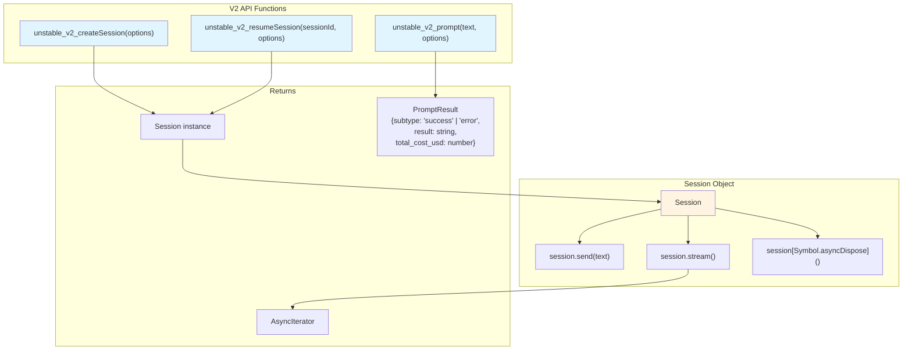
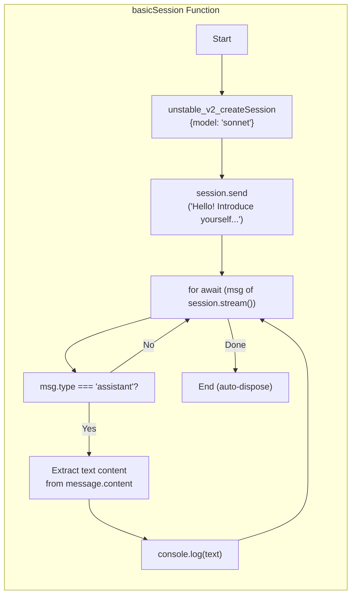
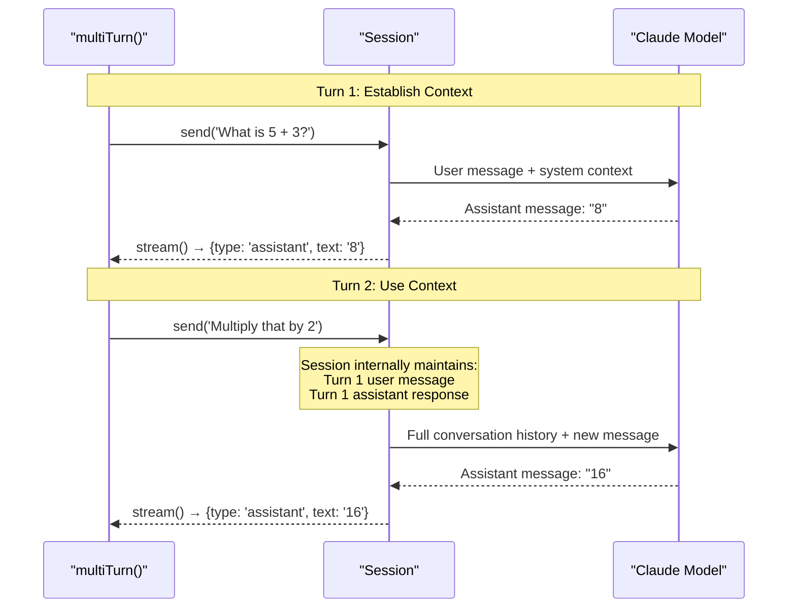
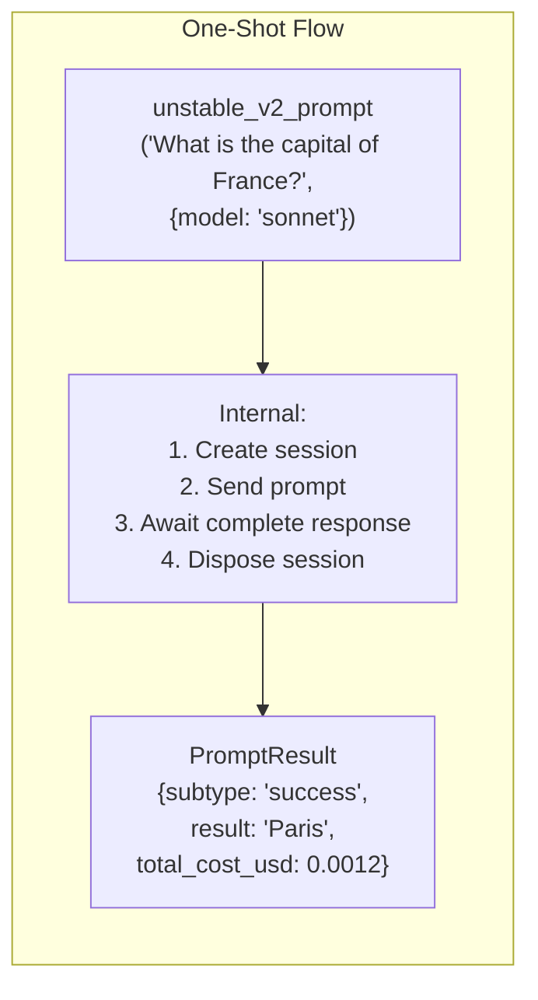
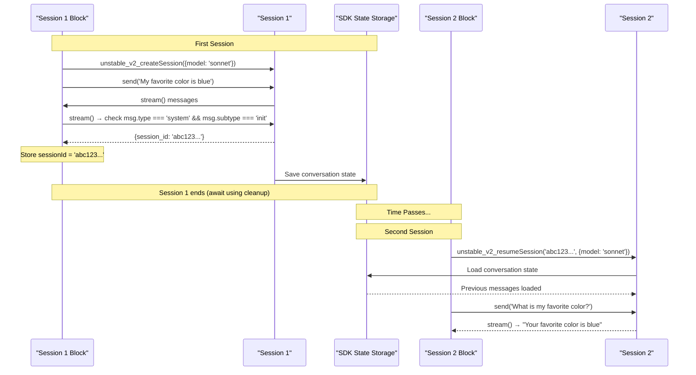
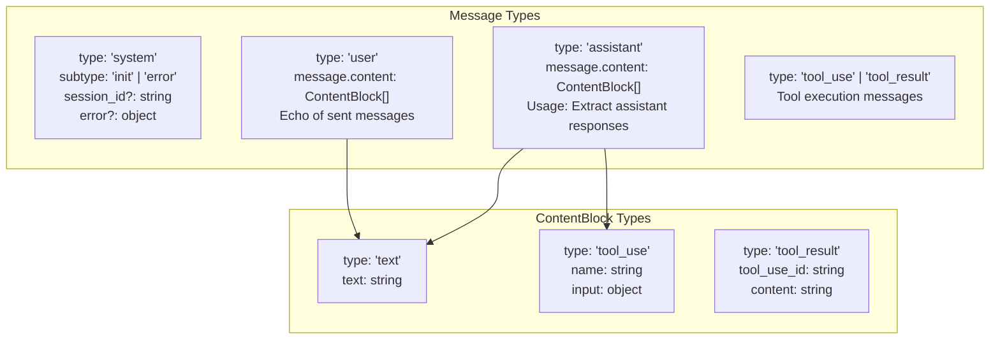

<!-- source: DeepWiki mcp.deepwiki.com · repo anthropics/claude-agent-sdk-demos · page 7.2 Hello World V2 (Session API) · fetched 2026-10-26 -->

# Hello World V2 (Session API)

<details>
<summary>Relevant source files</summary>

The following files were used as context for generating this wiki page:

- [hello-world-v2/README.md](hello-world-v2/README.md)
- [hello-world-v2/package.json](hello-world-v2/package.json)
- [hello-world-v2/tsconfig.json](hello-world-v2/tsconfig.json)
- [hello-world-v2/v2-examples.ts](hello-world-v2/v2-examples.ts)

</details>


## Purpose and Scope

This page documents the Hello World V2 demo, which demonstrates the V2 Session API of the Claude Agent SDK. The V2 API introduces explicit session management with separate `send()` and `stream()` methods, enabling cleaner multi-turn conversations with automatic context management.

For basic V1 API usage with the `query()` function, see [Hello World (V1 API)](#7.1). For comprehensive V2 API documentation including advanced configuration options, see [V2 API: Session Management](#8.3).

**Sources:** [hello-world-v2/README.md:1-37]()

---

## V2 Session API Overview

The V2 API represents a paradigm shift from V1's single `query()` function to an explicit session-based model. The key innovation is separating input (`send()`) from output (`stream()`), making multi-turn conversations more natural.

### V1 vs V2 Comparison

| Feature | V1: `query()` | V2: Session API |
|---------|---------------|-----------------|
| **Entry Point** | Single `query()` function | `unstable_v2_createSession()` / `unstable_v2_resumeSession()` |
| **Message Flow** | AsyncGenerator combining input/output | Separate `send()` and `stream()` methods |
| **Multi-turn** | Manual history management via prompt | Automatic context retention within session |
| **Usage Pattern** | `for await (msg of query({prompt}))` | `await session.send()` then `for await (msg of session.stream())` |
| **Session Persistence** | Not available | `sessionId` enables session resumption |
| **Resource Cleanup** | Manual | `await using` pattern with automatic disposal |

**Sources:** [hello-world-v2/README.md:5-11](), [hello-world-v2/v2-examples.ts:1-6]()

### Core API Functions



**Sources:** [hello-world-v2/v2-examples.ts:8-12](), [hello-world-v2/README.md:23-36]()

---

## Session Lifecycle and Resource Management

The V2 API uses the `await using` pattern (JavaScript Explicit Resource Management) to ensure proper session cleanup.

```mermaid
sequenceDiagram
    participant Code as "User Code"
    participant Create as "unstable_v2_createSession"
    participant Session as "Session Object"
    participant SDK as "SDK Internal Process"
    participant Dispose as "asyncDispose"
    
    Code->>Create: unstable_v2_createSession({model: 'sonnet'})
    Create->>Session: Initialize session
    Session->>SDK: Spawn subprocess
    Session-->>Code: Return session (with using binding)
    
    Code->>Session: send('Hello!')
    Session->>SDK: Write to stdin
    
    Code->>Session: stream()
    Session->>SDK: Read from stdout
    SDK-->>Session: Messages
    Session-->>Code: AsyncIterator<Message>
    
    Note over Code,Dispose: Block scope ends (await using)
    Code->>Dispose: Automatic cleanup
    Dispose->>SDK: Kill subprocess
    Dispose->>Session: Release resources
```

**Sources:** [hello-world-v2/v2-examples.ts:39](), [hello-world-v2/v2-examples.ts:54]()

### The `await using` Pattern

The `await using` syntax ensures that the session's `[Symbol.asyncDispose]()` method is called automatically when the block exits, even if an error occurs:

```typescript
await using session = unstable_v2_createSession({ model: 'sonnet' });
// Session is active here
await session.send('Hello!');
// Session automatically disposed when block exits
```

This is equivalent to manual cleanup but safer:

```typescript
const session = unstable_v2_createSession({ model: 'sonnet' });
try {
  await session.send('Hello!');
} finally {
  await session[Symbol.asyncDispose]();
}
```

**Sources:** [hello-world-v2/v2-examples.ts:39](), [hello-world-v2/v2-examples.ts:95](), [hello-world-v2/README.md:26-27]()

---

## Basic Session Example

The `basicSession()` function demonstrates the fundamental send/stream pattern:



**Key Implementation Details:**

1. **Session Creation** [hello-world-v2/v2-examples.ts:39](): Creates session with `model: 'sonnet'` option
2. **Send Input** [hello-world-v2/v2-examples.ts:40](): `await session.send()` sends the prompt to Claude
3. **Stream Output** [hello-world-v2/v2-examples.ts:42-47](): Loop over `session.stream()` to receive messages
4. **Message Filtering** [hello-world-v2/v2-examples.ts:43](): Filter for `type === 'assistant'` messages
5. **Content Extraction** [hello-world-v2/v2-examples.ts:44](): Find text content blocks using type narrowing

**Sources:** [hello-world-v2/v2-examples.ts:36-48]()

---

## Multi-Turn Conversation Example

The V2 API's primary advantage is automatic context management across multiple turns:



**Key Features:**

1. **Same Session Object** [hello-world-v2/v2-examples.ts:54](): Both turns use the same session instance
2. **Context Retention** [hello-world-v2/v2-examples.ts:65-66](): Claude remembers "that" refers to "8" from Turn 1
3. **No Manual History** [hello-world-v2/v2-examples.ts:57-72](): Session automatically maintains conversation state
4. **Sequential Pattern** [hello-world-v2/v2-examples.ts:57-72](): `send()` → `stream()` → `send()` → `stream()`

**Sources:** [hello-world-v2/v2-examples.ts:50-73]()

---

## One-Shot Prompt Example

The `unstable_v2_prompt()` function provides a simplified API for single-turn interactions:



**Usage Pattern:**

[hello-world-v2/v2-examples.ts:76-85]() demonstrates the convenience function:

```typescript
const result = await unstable_v2_prompt('What is the capital of France?', { model: 'sonnet' });

if (result.subtype === 'success') {
  console.log(`Answer: ${result.result}`);
  console.log(`Cost: $${result.total_cost_usd.toFixed(4)}`);
}
```

**Return Type:**

```typescript
type PromptResult = {
  subtype: 'success' | 'error';
  result: string;              // Full text response
  total_cost_usd: number;      // API usage cost
}
```

**When to Use:**

- ✅ Single-turn interactions
- ✅ Quick prototyping
- ✅ Simple Q&A without context
- ❌ Multi-turn conversations (use session API instead)

**Sources:** [hello-world-v2/v2-examples.ts:75-85](), [hello-world-v2/README.md:33-35]()

---

## Session Resume and Persistence

Session persistence enables conversations to span multiple program executions:



**Implementation Details:**

1. **Capture Session ID** [hello-world-v2/v2-examples.ts:100-102](): Extract `session_id` from `system` message with `subtype === 'init'`
2. **Store Persistently** [hello-world-v2/v2-examples.ts:91](): Save `sessionId` to variable, database, or file
3. **Resume Session** [hello-world-v2/v2-examples.ts:115](): Call `unstable_v2_resumeSession(sessionId, options)`
4. **Context Available** [hello-world-v2/v2-examples.ts:117-125](): All previous messages available in resumed session

**Complete Example:**

```typescript
let sessionId: string | undefined;

// First session - establish memory
{
  await using session = unstable_v2_createSession({ model: 'sonnet' });
  await session.send('My favorite color is blue. Remember this!');

  for await (const msg of session.stream()) {
    if (msg.type === 'system' && msg.subtype === 'init') {
      sessionId = msg.session_id;  // Capture for later
    }
  }
}

// Later... resume and verify
{
  await using session = unstable_v2_resumeSession(sessionId!, { model: 'sonnet' });
  await session.send('What is my favorite color?');
  // Claude correctly answers: "blue"
}
```

**Sources:** [hello-world-v2/v2-examples.ts:87-126]()

---

## Message Types and Structure

The V2 API streams various message types through `session.stream()`:



### Common Message Patterns

**Extract Assistant Text Response:**

[hello-world-v2/v2-examples.ts:44-45]() shows the type narrowing pattern:

```typescript
if (msg.type === 'assistant') {
  const text = msg.message.content.find(
    (c): c is { type: 'text'; text: string } => c.type === 'text'
  );
  console.log(text?.text);
}
```

**Capture Session ID:**

[hello-world-v2/v2-examples.ts:100-102]() demonstrates system message handling:

```typescript
if (msg.type === 'system' && msg.subtype === 'init') {
  sessionId = msg.session_id;
}
```

**Sources:** [hello-world-v2/v2-examples.ts:42-47](), [hello-world-v2/v2-examples.ts:100-108]()

---

## Running the Examples

### Prerequisites

1. **Install Dependencies** [hello-world-v2/package.json:7-8]():
   ```bash
   npm install
   ```

2. **Environment Variables**:
   ```bash
   export ANTHROPIC_API_KEY=your-api-key
   ```

### Execute Examples

The demo includes four runnable examples [hello-world-v2/v2-examples.ts:14-32]():

```bash
# Basic send/stream pattern
npx tsx v2-examples.ts basic

# Multi-turn conversation with context
npx tsx v2-examples.ts multi-turn

# One-shot convenience function
npx tsx v2-examples.ts one-shot

# Session persistence and resumption
npx tsx v2-examples.ts resume
```

### Example Output

**Basic Session:**
```
=== Basic Session ===

Claude: I'm Claude, an AI assistant created by Anthropic.
```

**Multi-Turn:**
```
=== Multi-Turn Conversation ===

Turn 1: 8
Turn 2: 16
```

**One-Shot:**
```
=== One-Shot Prompt ===

Answer: Paris
Cost: $0.0012
```

**Session Resume:**
```
=== Session Resume ===

[Session 1] Telling Claude my favorite color...
[Session 1] ID: agent_session_20240115_abc123
[Session 1] Claude: I'll remember that your favorite color is blue!

--- Session closed. Time passes... ---

[Session 2] Resuming and asking Claude...
[Session 2] Claude: Your favorite color is blue.
```

**Sources:** [hello-world-v2/v2-examples.ts:1-128](), [hello-world-v2/README.md:14-21](), [hello-world-v2/package.json:4-6]()

---

## Configuration Options

Both `unstable_v2_createSession()` and `unstable_v2_resumeSession()` accept an options object:

| Option | Type | Description | Default |
|--------|------|-------------|---------|
| `model` | `'sonnet' \| 'haiku' \| 'opus'` | Claude model to use | Required |
| `cwd` | `string` | Working directory for file operations | `process.cwd()` |
| `maxTurns` | `number` | Maximum conversation turns | `30` |
| `allowedTools` | `string[]` | Tools available to agent | All tools |
| `settingSources` | `'project' \| 'global'` | Skill discovery location | `'global'` |

**Example with Options:**

```typescript
await using session = unstable_v2_createSession({
  model: 'sonnet',
  cwd: '/path/to/workspace',
  maxTurns: 50,
  allowedTools: ['Bash', 'Write', 'Read'],
  settingSources: 'project'
});
```

**Sources:** [hello-world-v2/v2-examples.ts:39](), [hello-world-v2/v2-examples.ts:54]()

---

## When to Use V2 vs V1

### Use V2 Session API When:

- ✅ Building **multi-turn conversational interfaces**
- ✅ Need **session persistence** across program restarts
- ✅ Want **explicit control** over send/receive timing
- ✅ Building **chat applications** with clear turn boundaries
- ✅ Need **cleaner separation** of input/output logic

### Use V1 Query API When:

- ✅ **Single-turn** interactions suffice
- ✅ Using **hooks** for tool interception (V2 doesn't support hooks)
- ✅ Prefer **simpler API** with single function call
- ✅ Building **stateless agents** without conversation memory

For V1 API documentation, see [Hello World (V1 API)](#7.1). For comprehensive comparison and migration guidance, see [V2 API: Session Management](#8.3).

**Sources:** [hello-world-v2/README.md:5-11]()

---

