<!-- source: DeepWiki mcp.deepwiki.com · repo anthropics/claude-agent-sdk-demos · page 8 Claude Agent SDK Integration · fetched 2026-10-26 -->

# Claude Agent SDK Integration

<details>
<summary>Relevant source files</summary>

The following files were used as context for generating this wiki page:

- [hello-world-v2/README.md](hello-world-v2/README.md)
- [hello-world-v2/package.json](hello-world-v2/package.json)
- [hello-world-v2/tsconfig.json](hello-world-v2/tsconfig.json)
- [hello-world-v2/v2-examples.ts](hello-world-v2/v2-examples.ts)
- [resume-generator/.claude/skills/docx/SKILL.md](resume-generator/.claude/skills/docx/SKILL.md)
- [resume-generator/.claude/skills/docx/docx-js.md](resume-generator/.claude/skills/docx/docx-js.md)
- [resume-generator/.gitignore](resume-generator/.gitignore)
- [resume-generator/README.md](resume-generator/README.md)
- [resume-generator/package.json](resume-generator/package.json)
- [resume-generator/resume-generator.ts](resume-generator/resume-generator.ts)

</details>


## Purpose and Scope

This document provides a comprehensive overview of integrating the `@anthropic-ai/claude-agent-sdk` package across different application patterns. It covers the SDK's architecture, available API surfaces, configuration options, and message flow patterns used throughout the demonstration applications.

For detailed information on specific API versions, see [V1 API: Query Function](#8.2) and [V2 API: Session Management](#8.3). For extending agent capabilities, see [Tools and Hooks](#8.4), [Skills System](#8.5), and [Custom MCP Servers](#8.6).

---

## SDK Package Architecture

The Claude Agent SDK provides two distinct API surfaces exported from the `@anthropic-ai/claude-agent-sdk` package. All demos import directly from this package and select the appropriate API based on their use case.

### SDK Exports and API Surfaces

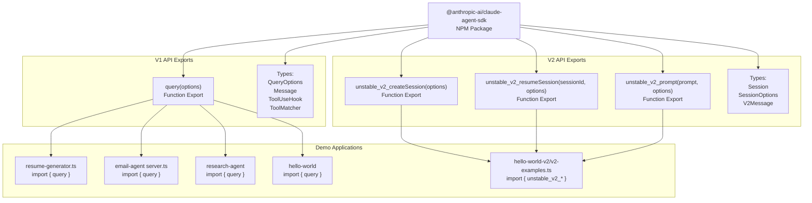

**Sources:** [resume-generator/resume-generator.ts:10](), [hello-world-v2/v2-examples.ts:8-12]()

---

## Integration Patterns by Demo

Each demonstration application uses the SDK in a specific way, showcasing different integration patterns and configuration approaches.

### Demo Application SDK Usage Map

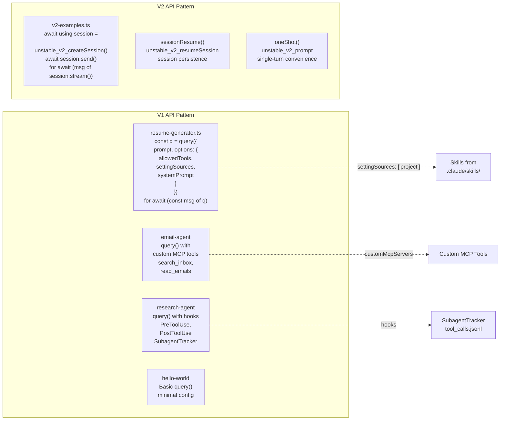

**Sources:** [resume-generator/resume-generator.ts:43-53](), [hello-world-v2/v2-examples.ts:36-48](), [hello-world-v2/v2-examples.ts:88-126]()

---

## Core Integration Components

### Required Imports and Type Definitions

The SDK provides strongly-typed interfaces for all integration points. Applications import only what they need based on their API choice.

**V1 API Core Imports:**
```typescript
import { query } from '@anthropic-ai/claude-agent-sdk';
```
[resume-generator/resume-generator.ts:10]()

**V2 API Core Imports:**
```typescript
import {
  unstable_v2_createSession,
  unstable_v2_resumeSession,
  unstable_v2_prompt,
} from '@anthropic-ai/claude-agent-sdk';
```
[hello-world-v2/v2-examples.ts:8-12]()

### Configuration Object Structure

Both API versions accept a configuration object with common fields and version-specific options.

#### Common Configuration Fields

| Field | Type | Purpose | Example |
|-------|------|---------|---------|
| `model` | `string` | Claude model selection | `'sonnet'`, `'haiku'`, `'opus'` |
| `cwd` | `string` | Current working directory for file operations | `process.cwd()` |
| `maxTurns` | `number` | Maximum conversation turns before stopping | `30` |
| `allowedTools` | `string[]` | Whitelist of tool names agent can use | `['Bash', 'Write', 'Read']` |
| `systemPrompt` | `string` | System instructions prepended to conversation | Workflow guidance |

#### V1-Specific Configuration

| Field | Type | Purpose | Example |
|-------|------|---------|---------|
| `prompt` | `string` | Initial user prompt (required) | `"Research and create resume"` |
| `settingSources` | `string[]` | Sources for skill discovery | `['project']` loads `.claude/skills/` |
| `hooks` | `object` | Pre/post tool execution callbacks | `{ preToolUse: [...], postToolUse: [...] }` |

**Sources:** [resume-generator/resume-generator.ts:43-53]()

#### V2-Specific Configuration

The V2 API separates session creation from message sending, so the prompt is not part of session options.

```typescript
// Session creation
await using session = unstable_v2_createSession({ 
  model: 'sonnet',
  // other options but NO prompt
});

// Separate send operation
await session.send('Hello! Introduce yourself.');
```

**Sources:** [hello-world-v2/v2-examples.ts:39-40]()

---

## Message Flow Architecture

### V1 Query Function Message Stream

The V1 API returns an `AsyncGenerator<Message>` that yields messages representing the entire conversation flow, including both input specifications and output results.

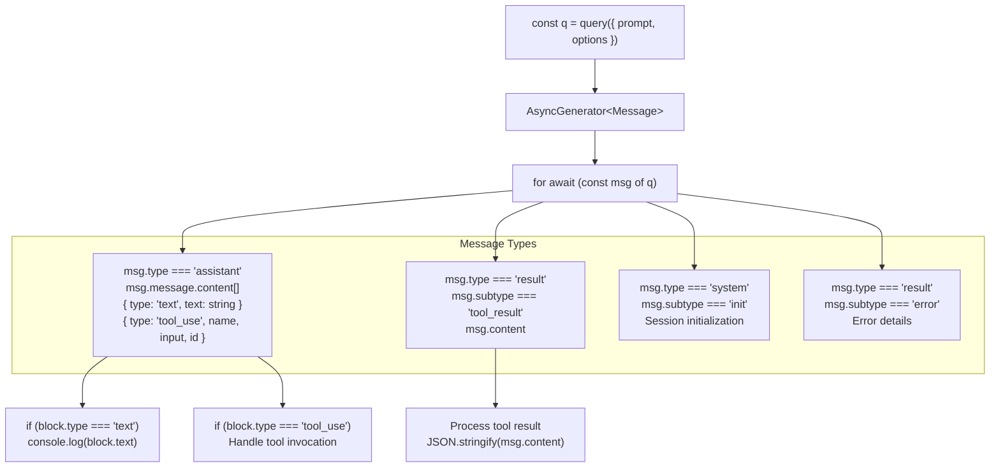

**Resume Generator Message Processing:**
```typescript
for await (const msg of q) {
  if (msg.type === 'assistant' && msg.message) {
    for (const block of msg.message.content) {
      if (block.type === 'text') {
        console.log(block.text);
      }
      if (block.type === 'tool_use') {
        console.log(`\n🔧 Using tool: ${block.name}`);
      }
    }
  }
  if (msg.type === 'result' && msg.subtype === 'tool_result') {
    console.log(`   ↳ Result: ${JSON.stringify(msg.content)}`);
  }
}
```
[resume-generator/resume-generator.ts:55-76]()

**Sources:** [resume-generator/resume-generator.ts:55-76]()

---

### V2 Session API Message Stream

The V2 API separates input (`send()`) from output (`stream()`), providing a cleaner separation of concerns for multi-turn conversations.

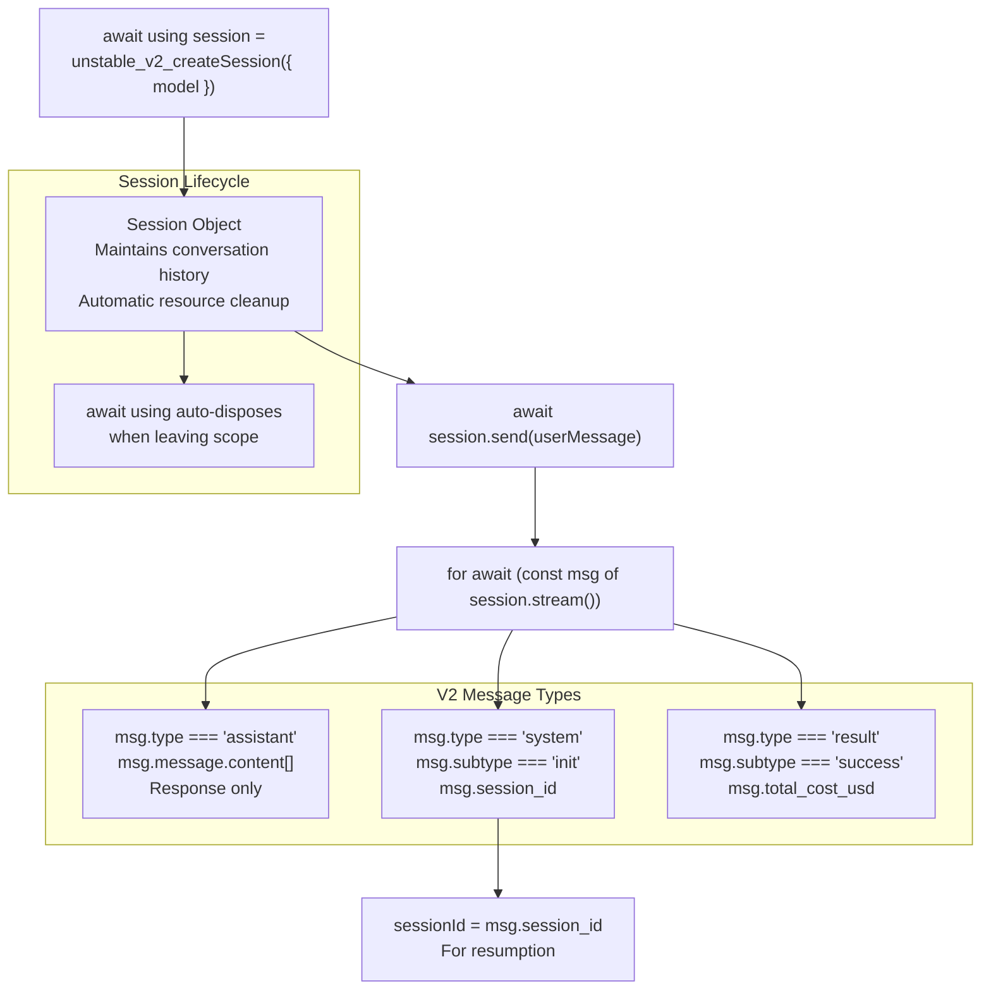

**Basic V2 Session Pattern:**
```typescript
await using session = unstable_v2_createSession({ model: 'sonnet' });
await session.send('Hello! Introduce yourself in one sentence.');

for await (const msg of session.stream()) {
  if (msg.type === 'assistant') {
    const text = msg.message.content.find(
      (c): c is { type: 'text'; text: string } => c.type === 'text'
    );
    console.log(`Claude: ${text?.text}`);
  }
}
```
[hello-world-v2/v2-examples.ts:39-47]()

**Sources:** [hello-world-v2/v2-examples.ts:36-48]()

---

## Model Selection and Capabilities

The SDK supports multiple Claude model variants, each with different performance characteristics.

### Available Models

| Model Identifier | Description | Typical Use Case |
|------------------|-------------|------------------|
| `'sonnet'` | Claude 3.5 Sonnet | Default choice, balanced performance |
| `'haiku'` | Claude 3 Haiku | Fast, cost-effective for simple tasks |
| `'opus'` | Claude 3 Opus | Most capable, highest cost |

**Resume Generator uses Sonnet:**
```typescript
const q = query({
  prompt,
  options: {
    model: 'sonnet',
    maxTurns: 30,
    // ...
  },
});
```
[resume-generator/resume-generator.ts:43-53]()

**Sources:** [resume-generator/resume-generator.ts:48]()

---

## Working Directory and File System Access

The SDK's file system operations (via `Bash`, `Write`, `Read`, `Glob` tools) execute relative to a configured current working directory.

### Current Working Directory Configuration

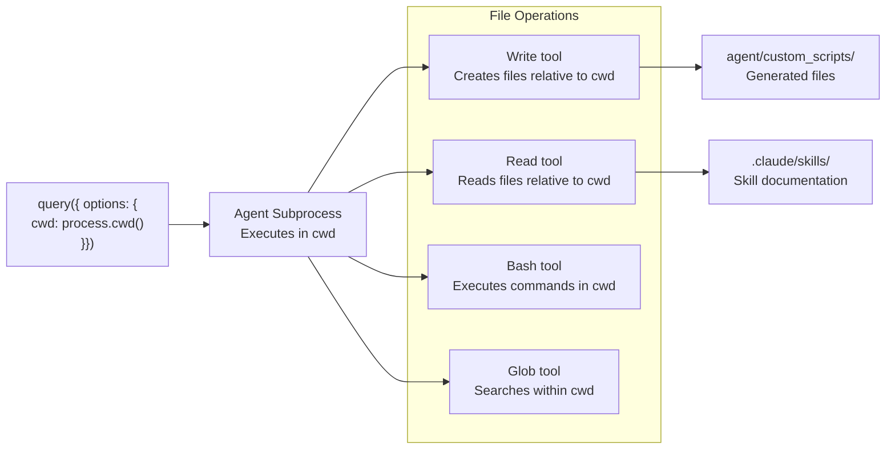

**Resume Generator CWD Setup:**
```typescript
const outputDir = path.join(process.cwd(), 'agent', 'custom_scripts');
if (!fs.existsSync(outputDir)) {
  fs.mkdirSync(outputDir, { recursive: true });
}

const q = query({
  prompt,
  options: {
    cwd: process.cwd(),
    // Agent can now write to agent/custom_scripts/
  },
});
```
[resume-generator/resume-generator.ts:29-53]()

**Sources:** [resume-generator/resume-generator.ts:34-47]()

---

## Tool Allowlist Configuration

The `allowedTools` array restricts which tools the agent can invoke, providing security and scope control.

### Standard Tool Names

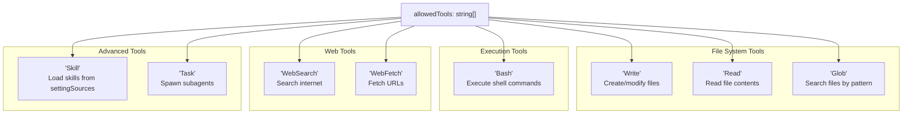

**Resume Generator Tool Configuration:**
```typescript
allowedTools: [
  'Skill',      // Load docx skill from .claude/skills/
  'WebSearch',  // Research person online
  'WebFetch',   // Fetch specific pages
  'Bash',       // Execute generated script
  'Write',      // Write generate_resume.js
  'Read',       // Read skill documentation
  'Glob',       // Search for existing files
],
```
[resume-generator/resume-generator.ts:49]()

**Sources:** [resume-generator/resume-generator.ts:49]()

---

## Skills Discovery and Loading

When `settingSources: ['project']` is specified, the SDK automatically discovers skills from the `.claude/skills/` directory relative to the configured `cwd`.

### Skill Loading Architecture

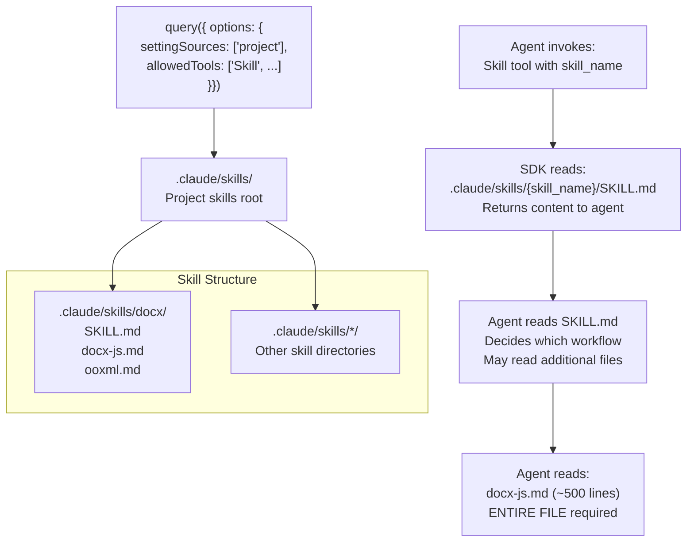

**Resume Generator Skill Configuration:**
```typescript
const q = query({
  prompt,
  options: {
    allowedTools: ['Skill', 'WebSearch', 'WebFetch', 'Bash', 'Write', 'Read', 'Glob'],
    settingSources: ['project'],  // Load skills from .claude/skills/
    // ...
  },
});
```
[resume-generator/resume-generator.ts:43-53]()

The docx skill's `SKILL.md` provides a decision tree that directs the agent to read specific documentation files completely before proceeding:

```markdown
### Creating New Document
Use "Creating a new Word document" workflow

### Workflow
1. **MANDATORY - READ ENTIRE FILE**: Read [`docx-js.md`](docx-js.md) (~500 lines) 
   completely from start to finish. **NEVER set any range limits when reading this file.**
```
[resume-generator/.claude/skills/docx/SKILL.md:58-60]()

**Sources:** [resume-generator/resume-generator.ts:50](), [resume-generator/.claude/skills/docx/SKILL.md:1-5](), [resume-generator/.claude/skills/docx/SKILL.md:58-60]()

---

## System Prompt Configuration

The `systemPrompt` option prepends instructions to the conversation, providing workflow guidance and constraints.

### System Prompt Architecture

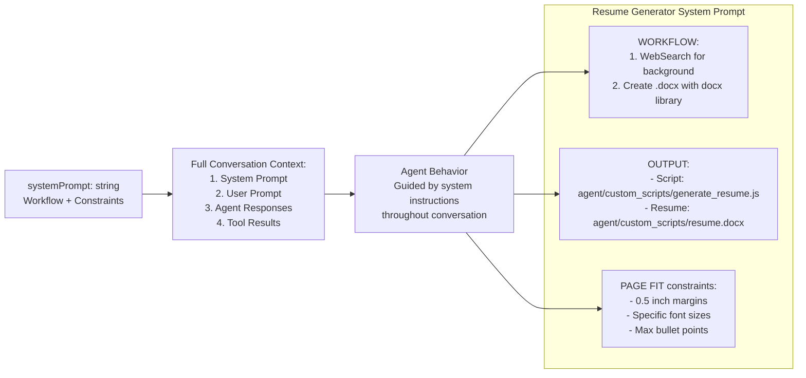

**Resume Generator System Prompt:**
```typescript
const SYSTEM_PROMPT = `You are a professional resume writer. Research a person and create a 1-page .docx resume.

WORKFLOW:
1. WebSearch for the person's background (LinkedIn, GitHub, company pages)
2. Create a .docx file using the docx library

OUTPUT:
- Script: agent/custom_scripts/generate_resume.js
- Resume: agent/custom_scripts/resume.docx

PAGE FIT (must be exactly 1 page):
- 0.5 inch margins, Name 24pt, Headers 12pt, Body 10pt
- 2-3 bullet points per job, ~80-100 chars each
- Max 3 job roles, 2-line summary, 2-line skills`;

const q = query({
  prompt,
  options: {
    systemPrompt: SYSTEM_PROMPT,
    // ...
  },
});
```
[resume-generator/resume-generator.ts:14-27](), [resume-generator/resume-generator.ts:51]()

**Sources:** [resume-generator/resume-generator.ts:14-27]()

---

## Session Lifecycle Management

### V1 API Lifecycle

The V1 API has no explicit session management. Each `query()` call is independent, and conversation history must be managed manually if multi-turn behavior is needed.

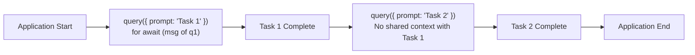

**Sources:** [resume-generator/resume-generator.ts:43-76]()

---

### V2 API Lifecycle with Session Persistence

The V2 API provides explicit session management with automatic resource cleanup and optional persistence via `sessionId`.

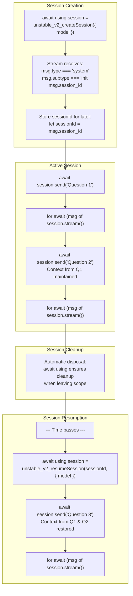

**Session Resume Example:**
```typescript
let sessionId: string | undefined;

// First session
{
  await using session = unstable_v2_createSession({ model: 'sonnet' });
  await session.send('My favorite color is blue. Remember this!');
  
  for await (const msg of session.stream()) {
    if (msg.type === 'system' && msg.subtype === 'init') {
      sessionId = msg.session_id;  // Capture for later
    }
  }
} // Session auto-disposed here

// Later: Resume with context
{
  await using session = unstable_v2_resumeSession(sessionId!, { model: 'sonnet' });
  await session.send('What is my favorite color?');  // Claude remembers "blue"
  
  for await (const msg of session.stream()) {
    // Process response...
  }
}
```
[hello-world-v2/v2-examples.ts:88-126]()

**Sources:** [hello-world-v2/v2-examples.ts:88-126]()

---

## One-Shot Convenience Function

The V2 API provides `unstable_v2_prompt()` as a convenience function for single-turn interactions that don't require session management.

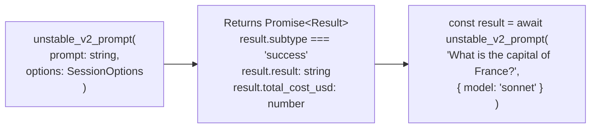

**One-Shot Example:**
```typescript
const result = await unstable_v2_prompt(
  'What is the capital of France? One word.',
  { model: 'sonnet' }
);

if (result.subtype === 'success') {
  console.log(`Answer: ${result.result}`);
  console.log(`Cost: $${result.total_cost_usd.toFixed(4)}`);
}
```
[hello-world-v2/v2-examples.ts:76-84]()

**Sources:** [hello-world-v2/v2-examples.ts:75-85]()

---

## Package Dependencies

All demo applications depend on the same core SDK package with consistent versioning.

### NPM Package Configuration

**Resume Generator:**
```json
{
  "dependencies": {
    "@anthropic-ai/claude-agent-sdk": "^0.1.59",
    "docx": "^9.5.1"
  }
}
```
[resume-generator/package.json:8-11]()

**Hello World V2:**
```json
{
  "dependencies": {
    "@anthropic-ai/claude-agent-sdk": "^0.1.59"
  }
}
```
[hello-world-v2/package.json:7-9]()

**Sources:** [resume-generator/package.json:8-11](), [hello-world-v2/package.json:7-9]()

---

## TypeScript Configuration

Demo applications use modern TypeScript with ESNext modules for compatibility with the SDK's module system.

### Shared TypeScript Configuration Pattern

```json
{
  "compilerOptions": {
    "target": "ES2022",
    "module": "ESNext",
    "moduleResolution": "bundler",
    "esModuleInterop": true,
    "strict": true,
    "skipLibCheck": true
  }
}
```
[hello-world-v2/tsconfig.json:2-10]()

**Key Configuration Requirements:**
- `"module": "ESNext"` - Required for SDK's ESM exports
- `"moduleResolution": "bundler"` - Enables modern import resolution
- `"esModuleInterop": true` - Ensures compatibility with CommonJS modules
- `"target": "ES2022"` - Supports modern JavaScript features like `await using`

**Sources:** [hello-world-v2/tsconfig.json:1-13]()

---

