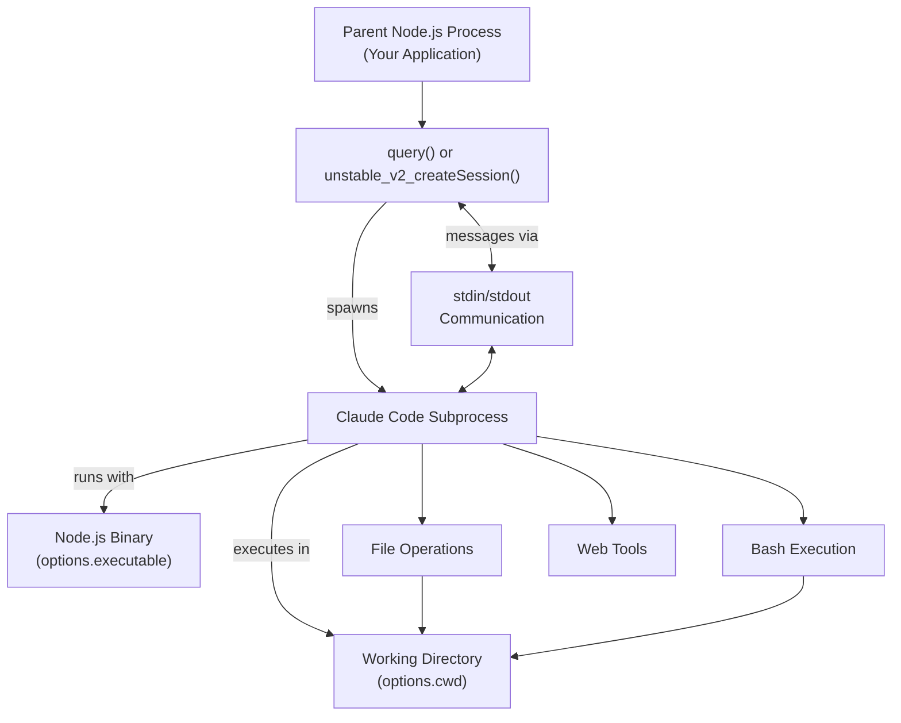
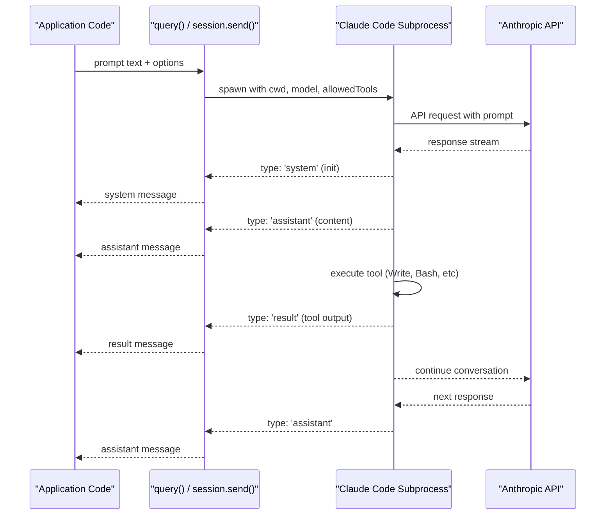
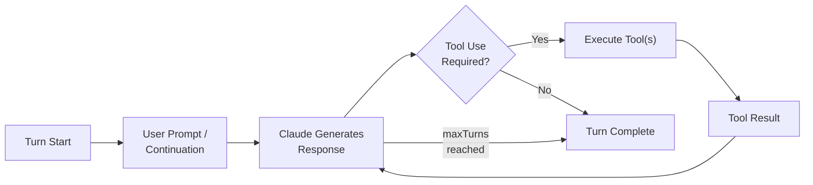
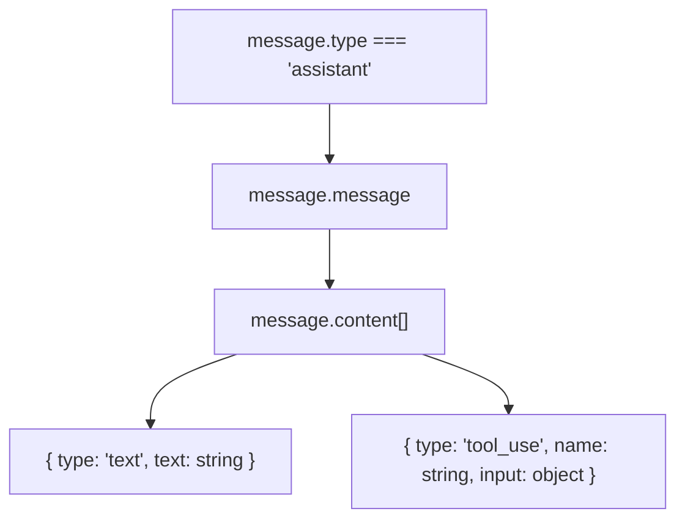
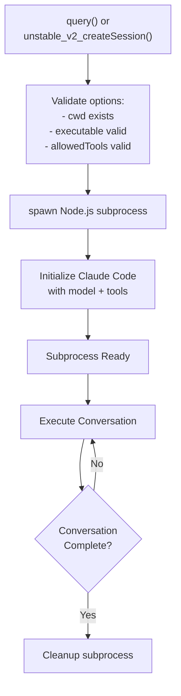
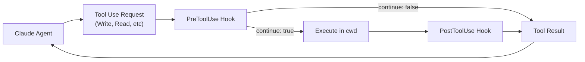

<!-- source: DeepWiki mcp.deepwiki.com · repo anthropics/claude-agent-sdk-demos · page 8.1 SDK Core Concepts · fetched 2026-10-26 -->

# SDK Core Concepts

<details>
<summary>Relevant source files</summary>

The following files were used as context for generating this wiki page:

- [.gitignore](.gitignore)
- [hello-world-v2/README.md](hello-world-v2/README.md)
- [hello-world-v2/package.json](hello-world-v2/package.json)
- [hello-world-v2/tsconfig.json](hello-world-v2/tsconfig.json)
- [hello-world-v2/v2-examples.ts](hello-world-v2/v2-examples.ts)
- [hello-world/README.md](hello-world/README.md)
- [hello-world/hello-world.ts](hello-world/hello-world.ts)
- [hello-world/package-lock.json](hello-world/package-lock.json)
- [hello-world/package.json](hello-world/package.json)
- [hello-world/tsconfig.json](hello-world/tsconfig.json)

</details>


This page documents the foundational concepts of the Claude Agent SDK, including the agent execution model, subprocess architecture, models, turns, working directories, and message flow patterns. These concepts apply to both V1 and V2 APIs.

For specific API usage patterns, see [V1 API: Query Function](#8.2) and [V2 API: Session Management](#8.3). For tool capabilities and interception mechanisms, see [Tools and Hooks](#8.4).

## Core Architecture

### Agent Subprocess Model

The Claude Agent SDK operates by spawning a Claude Code CLI process as a subprocess. The parent Node.js process communicates with this subprocess via stdin/stdout, enabling autonomous agent behavior while maintaining process isolation.

**Subprocess Architecture**



Sources: [hello-world/README.md:30-47](), [hello-world/README.md:107-115]()

### Message Flow Pattern

The SDK implements a unidirectional message stream from the subprocess back to the parent process. The parent sends prompts and receives three types of messages: `system`, `assistant`, and `result`.

**Message Communication Flow**



Sources: [hello-world/README.md:32-46](), [hello-world/README.md:88-105]()

## Fundamental Concepts

### Agents

An **agent** is an instance of Claude running in an isolated subprocess with specific capabilities (tools), operating within a designated working directory. Agents are autonomous—they can perform multi-step tasks, execute tools, read and write files, and make decisions without human intervention within a single conversation.

| Agent Characteristic | Description | Configuration |
|---------------------|-------------|---------------|
| **Autonomy** | Can execute multiple tools in sequence | `maxTurns` option |
| **Isolation** | Runs in dedicated subprocess | Subprocess spawn |
| **Capabilities** | Limited to allowed tools | `allowedTools` array |
| **Workspace** | Operates in specific directory | `cwd` option |
| **Model** | Uses specific Claude model | `model` option |

An agent's lifecycle begins when `query()` (V1) or `unstable_v2_createSession()` (V2) is called and ends when the conversation completes or reaches `maxTurns`.

Sources: [hello-world/README.md:5-8](), [hello-world/hello-world.ts:6-16]()

### Models

The SDK supports four model specifications via the `model` option:

| Model Value | Description | Use Case |
|-------------|-------------|----------|
| `"sonnet"` | Claude 3.5 Sonnet | Balanced performance and speed |
| `"opus"` | Claude 3 Opus | Maximum capability tasks |
| `"haiku"` | Claude 3 Haiku | Fast, lightweight operations |
| `"inherit"` | Use model from parent session | Multi-agent delegation (V1 only) |

```typescript
// Example from hello-world.ts
const q = query({
  prompt: '...',
  options: {
    model: "opus",  // Specify Claude model
    // ...
  }
});

// Example from V2 API
await using session = unstable_v2_createSession({ 
  model: 'sonnet' 
});
```

The `"inherit"` value is primarily used in multi-agent scenarios where a lead agent spawns subagents that should use the same model.

Sources: [hello-world/README.md:54](), [hello-world/hello-world.ts:11](), [hello-world-v2/v2-examples.ts:39]()

### Turns and Conversation Flow

A **turn** represents one complete cycle of: prompt/continuation → Claude response → tool execution(s) → result. The `maxTurns` option controls how many turns an agent can take before automatically terminating.

**Turn Lifecycle**



In V1, each call to `query()` is a fresh conversation. In V2, sessions maintain turn history automatically across multiple `send()`/`stream()` cycles.

```typescript
// V1: Single conversation with max 100 turns
const q = query({
  prompt: 'Complete this task',
  options: { maxTurns: 100 }
});

// V2: Multi-turn conversation with session
await using session = unstable_v2_createSession({ model: 'sonnet' });
await session.send('What is 5 + 3?');  // Turn 1
for await (const msg of session.stream()) { /* ... */ }
await session.send('Multiply that by 2.');  // Turn 2 - context preserved
```

Sources: [hello-world/README.md:52](), [hello-world-v2/v2-examples.ts:50-73]()

### Working Directory (cwd)

The **current working directory** (`cwd`) defines the file system location where the agent operates. All relative file paths in tool operations (Read, Write, Bash, etc.) are resolved relative to this directory.

| Requirement | Details |
|-------------|---------|
| **Must Exist** | Directory must be created before spawning agent |
| **Isolation** | Agent cannot access files outside this directory tree |
| **Tool Context** | All file operations use this as root |
| **Security** | Enforced by subprocess execution environment |

```typescript
// Specify working directory
const q = query({
  prompt: '...',
  options: {
    cwd: path.join(process.cwd(), 'agent'),  // Must exist
    // ...
  }
});
```

Common pattern: Create a dedicated `agent/` directory with subdirectories for different purposes (e.g., `agent/custom_scripts/` for generated code).

Sources: [hello-world/README.md:22-27](), [hello-world/hello-world.ts:10](), [hello-world/README.md:53]()

### Executable Path

The `executable` option specifies which Node.js binary the subprocess should use. This is critical for ensuring the subprocess has access to the correct Node.js runtime.

```typescript
options: {
  executable: "node",  // Use system node
  // OR
  executable: process.execPath,  // Use current Node.js binary
}
```

**Common Issue**: Omitting `executable` or using an incorrect path causes `spawn node ENOENT` errors because the subprocess cannot locate the Node.js binary.

Sources: [hello-world/README.md:55](), [hello-world/README.md:122-133](), [hello-world/hello-world.ts:12]()

## Message Types

The SDK emits three distinct message types through the async generator/stream:

### System Messages

**Type**: `message.type === 'system'`

System messages contain initialization data, session metadata, and system-level prompts.

```typescript
for await (const msg of q) {
  if (msg.type === 'system' && msg.subtype === 'init') {
    const sessionId = msg.session_id;  // V2 session ID
    console.log(`Session started: ${sessionId}`);
  }
}
```

Sources: [hello-world/README.md:92](), [hello-world-v2/v2-examples.ts:100-103]()

### Assistant Messages

**Type**: `message.type === 'assistant'`

Assistant messages contain Claude's text responses and tool use requests. The content is in the `message.message.content` array.

```typescript
if (message.type === 'assistant' && message.message) {
  const textContent = message.message.content.find(
    (c: any) => c.type === 'text'
  );
  if (textContent && 'text' in textContent) {
    console.log('Claude:', textContent.text);
  }
}
```

**Content Structure**:



Sources: [hello-world/README.md:92-105](), [hello-world/hello-world.ts:60-65](), [hello-world-v2/v2-examples.ts:43-46]()

### Result Messages

**Type**: `message.type === 'result'`

Result messages contain the output of tool executions (file operations, bash commands, web searches, etc.). These are internal to the conversation—the agent uses them to continue reasoning, but applications typically don't need to process them directly.

Sources: [hello-world/README.md:94]()

## Execution Environment

### Subprocess Lifecycle

**Subprocess Creation and Management**



The subprocess automatically terminates when:
- The conversation reaches `maxTurns`
- Claude indicates task completion
- An unrecoverable error occurs
- The parent process terminates (V2: via `await using` disposal)

**V2 Session Disposal Pattern**:

```typescript
{
  await using session = unstable_v2_createSession({ model: 'sonnet' });
  await session.send('Hello');
  for await (const msg of session.stream()) { /* ... */ }
  // session.dispose() called automatically at block exit
}
```

Sources: [hello-world/README.md:107-115](), [hello-world-v2/v2-examples.ts:39]()

### File System Access

Agents interact with the file system through tools like `Read`, `Write`, `Edit`, `MultiEdit`, `Glob`, and `Grep`. All operations are scoped to the `cwd` directory.

**File Operation Flow**



**Security Pattern**: Applications commonly use `PreToolUse` hooks to enforce path restrictions:

```typescript
hooks: {
  PreToolUse: [{
    matcher: "Write|Edit|MultiEdit",
    hooks: [
      async (input: any) => {
        const filePath = input.tool_input.file_path;
        const ext = path.extname(filePath);
        
        if ((ext === '.js' || ext === '.ts') && 
            !filePath.startsWith(customScriptsPath)) {
          return {
            decision: 'block',
            stopReason: 'Scripts must be in custom_scripts/',
            continue: false
          };
        }
        return { continue: true };
      }
    ]
  }]
}
```

This pattern prevents agents from writing executable code to arbitrary locations.

Sources: [hello-world/README.md:60-66](), [hello-world/README.md:69-86](), [hello-world/hello-world.ts:17-55]()

### Tool Execution Model

Tools execute synchronously within the subprocess during a turn. The agent receives tool results and can use them to inform subsequent actions within the same turn or across multiple turns.

| Tool Category | Examples | Execution Context |
|---------------|----------|-------------------|
| **File I/O** | `Read`, `Write`, `Edit`, `Glob` | `cwd` file system |
| **Execution** | `Bash`, `Task` | `cwd` as working directory |
| **Web** | `WebSearch`, `WebFetch` | External network |
| **Planning** | `ExitPlanMode`, `TodoWrite` | Internal state |

Sources: [hello-world/README.md:60-66](), [hello-world/hello-world.ts:13-16]()

---

