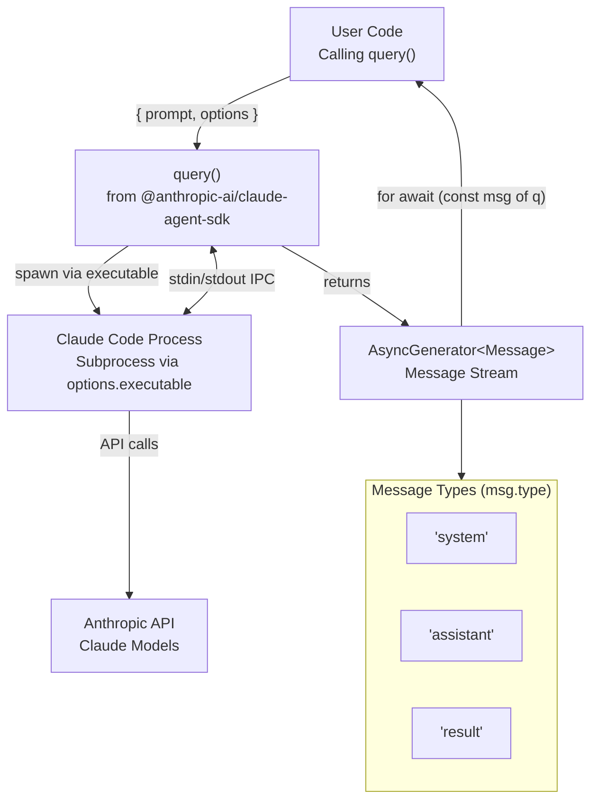
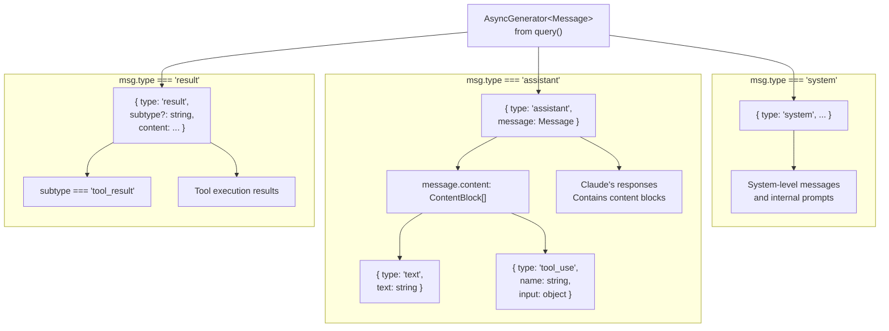
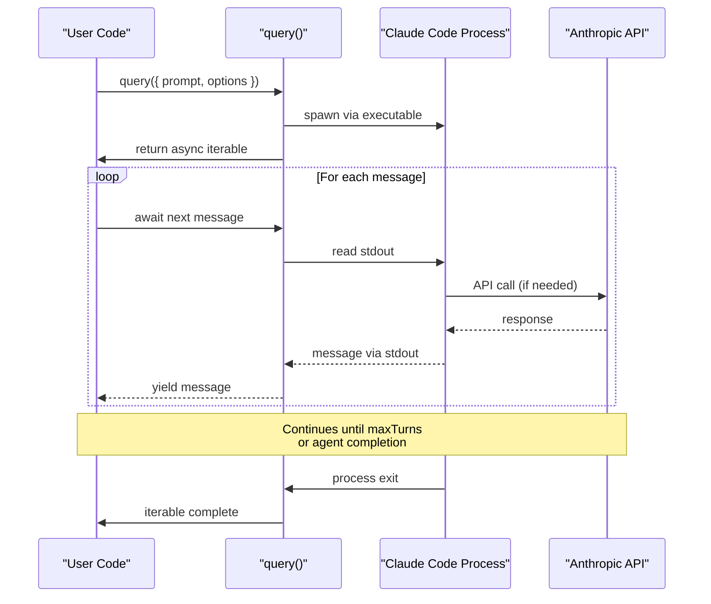

<!-- source: DeepWiki mcp.deepwiki.com · repo anthropics/claude-agent-sdk-demos · page 8.2 V1 API: Query Function · fetched 2026-10-26 -->

# V1 API: Query Function

<details>
<summary>Relevant source files</summary>

The following files were used as context for generating this wiki page:

- [.gitignore](.gitignore)
- [hello-world/README.md](hello-world/README.md)
- [hello-world/hello-world.ts](hello-world/hello-world.ts)
- [hello-world/package-lock.json](hello-world/package-lock.json)
- [hello-world/package.json](hello-world/package.json)
- [hello-world/tsconfig.json](hello-world/tsconfig.json)
- [resume-generator/.claude/skills/docx/SKILL.md](resume-generator/.claude/skills/docx/SKILL.md)
- [resume-generator/.claude/skills/docx/docx-js.md](resume-generator/.claude/skills/docx/docx-js.md)
- [resume-generator/.gitignore](resume-generator/.gitignore)
- [resume-generator/README.md](resume-generator/README.md)
- [resume-generator/package.json](resume-generator/package.json)
- [resume-generator/resume-generator.ts](resume-generator/resume-generator.ts)

</details>


## Purpose and Scope

This page documents the V1 API's `query()` function from the Claude Agent SDK. The `query()` function is the primary entry point for the V1 API pattern, used for creating and interacting with Claude agents. It spawns a Claude Code subprocess, manages communication, and returns an async generator stream of messages.

The V1 API uses a single-function pattern optimized for single-prompt interactions. For multi-turn conversations with session management, see the V2 Session API documented in page [8.3](#8.3). For information about tools and hooks that can be used with `query()`, see page [8.4](#8.4). For details on creating custom MCP servers, see page [8.6](#8.6). For general SDK concepts, see page [8.1](#8.1).

**Sources:** [hello-world/README.md:1-151](), [hello-world/hello-world.ts:1-70](), [resume-generator/resume-generator.ts:1-98]()

---

## The query() Function

The `query()` function is imported from `@anthropic-ai/claude-agent-sdk` and serves as the primary interface for V1 API agent creation and communication. It accepts a prompt and configuration options, spawns a Claude Code CLI process as a subprocess, and returns an async generator (AsyncGenerator<Message>) that yields messages throughout the agent's execution.



**Diagram: query() Function Architecture and Message Flow**

The basic usage pattern from [hello-world/hello-world.ts:6-57]() demonstrates the function signature:

```typescript
const q = query({
  prompt: 'Hello, Claude! Please introduce yourself in one sentence.',
  options: {
    maxTurns: 100,
    cwd: path.join(process.cwd(), 'agent'),
    model: "opus",
    executable: "node",
    allowedTools: [...],
    hooks: {...}
  }
});
```

The function returns an async generator that must be consumed using `for await...of` syntax, as shown in [hello-world/hello-world.ts:59-66]().

**Sources:** [hello-world/hello-world.ts:1-70](), [hello-world/README.md:33-46](), [resume-generator/resume-generator.ts:10](), [resume-generator/resume-generator.ts:43-53]()

---

## Configuration Options

The `options` object passed to `query()` controls agent behavior, execution environment, and capabilities. The table below summarizes available configuration parameters:

| Option | Type | Default | Description |
|--------|------|---------|-------------|
| `maxTurns` | `number` | 100 | Maximum number of conversation turns before agent terminates |
| `cwd` | `string` | - | Working directory for the agent process (must exist) |
| `model` | `string` | - | Claude model: `"sonnet"`, `"opus"`, `"haiku"`, or `"inherit"` |
| `executable` | `string` | `"node"` | Path to Node.js binary for spawning subprocess |
| `allowedTools` | `string[]` | - | Array of tool names the agent is permitted to use |
| `hooks` | `object` | - | Hook configurations for intercepting tool usage (see page [8.4](#8.4)) |
| `systemPrompt` | `string` | - | System-level instructions that guide agent behavior |
| `settingSources` | `string[]` | - | Sources for loading settings (e.g., `['project']` loads skills from `.claude/skills/`) |

**Sources:** [hello-world/README.md:50-56](), [hello-world/hello-world.ts:8-16](), [resume-generator/resume-generator.ts:43-53]()

### maxTurns

Controls the maximum number of conversation turns (user/assistant message exchanges) before the agent automatically terminates. Prevents infinite loops and runaway execution. Set to 100 in [hello-world/hello-world.ts:9]().

### cwd (Current Working Directory)

Specifies the working directory where the Claude Code subprocess executes. All file operations (`Read`, `Write`, etc.) are relative to this directory. The directory **must exist** before calling `query`, otherwise the process spawn will fail with `ENOENT` errors.

Example from [hello-world/hello-world.ts:10]():
```typescript
cwd: path.join(process.cwd(), 'agent')
```

The [hello-world/README.md:136-140]() documentation recommends creating this directory before running:
```bash
mkdir -p agent
```

### model

Selects the Claude model for agent execution. Available values:

- `"opus"` - Most capable model, best for complex reasoning
- `"sonnet"` - Balanced performance and cost
- `"haiku"` - Fastest and most cost-effective
- `"inherit"` - Uses model from parent agent (for subagents)

Used in [hello-world/hello-world.ts:11]() as `model: "opus"`.

**Sources:** [hello-world/README.md:54]()

### executable

Path to the Node.js binary used to spawn the Claude Code subprocess. The SDK communicates with this subprocess via stdin/stdout. Common values:

- `"node"` - Uses `node` from system PATH
- `process.execPath` - Uses the same Node.js binary running the current process

The [hello-world/README.md:124-132]() documentation notes that failing to set this option can cause `spawn node ENOENT` errors on some systems.

Example from [hello-world/hello-world.ts:12]():
```typescript
executable: "node"
```

**Sources:** [hello-world/hello-world.ts:12](), [hello-world/README.md:109-114](), [hello-world/README.md:124-132]()

### allowedTools

An array of tool names that the agent is permitted to invoke. Restricting tools provides security boundaries and controls agent capabilities. The agent will not be able to use tools not in this list. Tool availability also depends on the `Skill` tool when using custom skills via `settingSources`.

```mermaid
graph TB
    allowedTools["options.allowedTools: string[]"]
    
    subgraph FileOps["File Operations"]
        Read["'Read'"]
        Write["'Write'"]
        Edit["'Edit'"]
        MultiEdit["'MultiEdit'"]
        NotebookEdit["'NotebookEdit'"]
    end
    
    subgraph SearchOps["Search Operations"]
        Glob["'Glob'"]
        Grep["'Grep'"]
        LS["'LS'"]
    end
    
    subgraph ExecTools["Execution Tools"]
        Bash["'Bash'"]
        Task["'Task'"]
        BashOutput["'BashOutput'"]
        KillBash["'KillBash'"]
    end
    
    subgraph UtilTools["Utility Tools"]
        WebFetch["'WebFetch'"]
        WebSearch["'WebSearch'"]
        TodoWrite["'TodoWrite'"]
        ExitPlanMode["'ExitPlanMode'"]
        Skill["'Skill'<br/>(for custom skills)"]
    end
    
    allowedTools --> Read
    allowedTools --> Write
    allowedTools --> Edit
    allowedTools --> MultiEdit
    allowedTools --> NotebookEdit
    allowedTools --> Glob
    allowedTools --> Grep
    allowedTools --> LS
    allowedTools --> Bash
    allowedTools --> Task
    allowedTools --> BashOutput
    allowedTools --> KillBash
    allowedTools --> WebFetch
    allowedTools --> WebSearch
    allowedTools --> TodoWrite
    allowedTools --> ExitPlanMode
    allowedTools --> Skill
```



**Diagram: Available Tools by Category (Code Entity Names)**

Example from [hello-world/hello-world.ts:13-16]():
```typescript
allowedTools: [
  "Task", "Bash", "Glob", "Grep", "LS", "ExitPlanMode", "Read", "Edit", 
  "MultiEdit", "Write", "NotebookEdit", "WebFetch", "TodoWrite", 
  "WebSearch", "BashOutput", "KillBash"
]
```

Resume generator example from [resume-generator/resume-generator.ts:49]():
```typescript
allowedTools: ['Skill', 'WebSearch', 'WebFetch', 'Bash', 'Write', 'Read', 'Glob']
```

Tool categories as documented in [hello-world/README.md:59-65]():

- **File operations**: `Read`, `Write`, `Edit`, `MultiEdit`, `NotebookEdit`
- **Search**: `Glob`, `Grep`, `WebSearch`
- **Execution**: `Bash`, `Task`
- **Utilities**: `TodoWrite`, `WebFetch`, `BashOutput`, `KillBash`, `Skill`
- **Planning**: `ExitPlanMode`

**Sources:** [hello-world/hello-world.ts:13-16](), [hello-world/README.md:59-65](), [resume-generator/resume-generator.ts:49]()

### hooks

Hook configurations for intercepting tool usage. Hooks execute before (`PreToolUse`) or after (`PostToolUse`) tool invocation, enabling validation, logging, or modification of tool calls. This is covered in detail in page [8.4](#8.4).

Example structure from [hello-world/hello-world.ts:17-55]():
```typescript
hooks: {
  PreToolUse: [
    {
      matcher: "Write|Edit|MultiEdit",
      hooks: [
        async (input: any): Promise<HookJSONOutput> => {
          // Validation logic
          return { continue: true }; // or { decision: 'block', ... }
        }
      ]
    }
  ]
}
```

**Sources:** [hello-world/hello-world.ts:17-55](), [hello-world/README.md:67-86]()

### systemPrompt

A system-level prompt that provides instructions guiding agent behavior throughout execution. This prompt is prepended to the conversation and influences how the agent interprets and responds to the user prompt.

Example from [resume-generator/resume-generator.ts:14-27]():
```typescript
const SYSTEM_PROMPT = `You are a professional resume writer. Research a person and create a 1-page .docx resume.

WORKFLOW:
1. WebSearch for the person's background (LinkedIn, GitHub, company pages)
2. Create a .docx file using the docx library

OUTPUT:
- Script: agent/custom_scripts/generate_resume.js
- Resume: agent/custom_scripts/resume.docx

PAGE FIT (must be exactly 1 page):
- 0.5 inch margins, Name 24pt, Headers 12pt, Body 10pt
- 2-3 bullet points per job, ~80-100 chars each
- Max 3 job roles, 2-line summary, 2-line skills`;
```

Used in options as shown in [resume-generator/resume-generator.ts:51]():
```typescript
options: {
  systemPrompt: SYSTEM_PROMPT,
  // ... other options
}
```

**Sources:** [resume-generator/resume-generator.ts:14-27](), [resume-generator/resume-generator.ts:51]()

### settingSources

An array of sources for loading settings and skills. When set to `['project']`, the SDK loads skills from the `.claude/skills/` directory in the project root. This enables the agent to use custom skills defined in the project.

Example from [resume-generator/resume-generator.ts:50]():
```typescript
options: {
  settingSources: ['project'],  // Load skills from .claude/skills/
  // ... other options
}
```

This option is essential for demos that use the Skills system (see page [8.5](#8.5)). The resume-generator uses this to load the `docx` skill from [resume-generator/.claude/skills/docx/]().

**Sources:** [resume-generator/resume-generator.ts:50](), [resume-generator/.claude/skills/docx/SKILL.md:1-198]()

---

## Message Types

The async generator returned by `query()` yields three types of messages throughout agent execution. Each message has a `type` field identifying its category. Messages are yielded in response to agent actions and tool executions.



**Diagram: Message Type Structure and Content Blocks (Code Entity Structure)**

### system Messages

System-level messages including prompts and internal SDK communications. These messages typically don't require user handling but can be logged for debugging.

### assistant Messages

Messages from Claude containing the agent's responses. The `message` field contains a `content` array with multiple content blocks. Each block has a `type` field:

- `{ type: 'text', text: string }` - Text responses from Claude
- `{ type: 'tool_use', name: string, input: object }` - Tool invocations

Example processing from [resume-generator/resume-generator.ts:56-69]():
```typescript
if (msg.type === 'assistant' && msg.message) {
  for (const block of msg.message.content) {
    if (block.type === 'text') {
      console.log(block.text);
    }
    if (block.type === 'tool_use') {
      if (block.name === 'WebSearch' && block.input && typeof block.input === 'object' && 'query' in block.input) {
        console.log(`\n🔍 Searching: "${block.input.query}"`);
      } else {
        console.log(`\n🔧 Using tool: ${block.name}`);
      }
    }
  }
}
```

### result Messages

Tool execution results returned after the agent invokes a tool. Contains the output or error from tool execution. May have a `subtype` field to indicate the specific result type.

Example processing from [resume-generator/resume-generator.ts:70-75]():
```typescript
if (msg.type === 'result') {
  if (msg.subtype === 'tool_result') {
    const resultStr = JSON.stringify(msg.content).slice(0, 200);
    console.log(`   ↳ Result: ${resultStr}${resultStr.length >= 200 ? '...' : ''}`);
  }
}
```

**Sources:** [hello-world/README.md:88-105](), [resume-generator/resume-generator.ts:55-76]()

---

## Async Generator Pattern and Message Processing

The V1 API uses an async generator pattern where `query()` returns an `AsyncGenerator<Message>`. This must be consumed using the `for await...of` syntax to iterate through messages as they are yielded.

### Basic Iteration Pattern

The pattern from [hello-world/hello-world.ts:59-66]() demonstrates basic iteration:

```typescript
for await (const message of q) {
  if (message.type === 'assistant' && message.message) {
    const textContent = message.message.content.find(
      (c: any) => c.type === 'text'
    );
    if (textContent && 'text' in textContent) {
      console.log('Claude says:', textContent.text);
    }
  }
}
```

This pattern:
1. Uses `for await...of` to consume the async generator
2. Checks `message.type === 'assistant'` to filter for assistant messages
3. Verifies `message.message` exists
4. Searches `message.message.content` array for blocks with `type === 'text'`
5. Extracts the `text` field from the matching block

### Processing Multiple Content Types

More comprehensive processing from [resume-generator/resume-generator.ts:55-76]():

```typescript
for await (const msg of q) {
  // Process assistant messages
  if (msg.type === 'assistant' && msg.message) {
    for (const block of msg.message.content) {
      if (block.type === 'text') {
        console.log(block.text);
      }
      if (block.type === 'tool_use') {
        console.log(`🔧 Using tool: ${block.name}`);
      }
    }
  }
  
  // Process result messages
  if (msg.type === 'result') {
    if (msg.subtype === 'tool_result') {
      console.log(`↳ Result: ${JSON.stringify(msg.content)}`);
    }
  }
}
```

This demonstrates:
- Iterating through all content blocks in `message.content`
- Processing both `text` and `tool_use` blocks
- Handling result messages with subtypes

**Sources:** [hello-world/hello-world.ts:59-66](), [hello-world/README.md:96-105](), [resume-generator/resume-generator.ts:55-76]()

---

## Process Lifecycle and Communication

The `query` function manages a subprocess lifecycle with specific communication patterns:



**Diagram: Query Function Process Lifecycle and Message Exchange**

The subprocess architecture details from [hello-world/README.md:107-114]():

1. SDK spawns a Claude Code CLI process as a subprocess
2. Uses the Node.js binary specified in `executable` option
3. Communication occurs via stdin/stdout with the subprocess
4. Agent runs in the specified `cwd` directory
5. Hooks can intercept and modify tool calls before execution

**Sources:** [hello-world/README.md:107-114]()

---

## Common Configuration Patterns

### Basic Agent with Minimal Configuration

Minimal setup for simple tasks:

```typescript
const q = query({
  prompt: 'Your task here',
  options: {
    cwd: './agent',
    executable: 'node'
  }
});
```

### Restricted Agent with Tool Limits

Agent limited to read-only file operations:

```typescript
const q = query({
  prompt: 'Analyze these files',
  options: {
    cwd: './data',
    executable: 'node',
    allowedTools: ['Read', 'Glob', 'Grep']
  }
});
```

### Production Agent with Hooks

Agent with validation hooks for security (from [hello-world/hello-world.ts:6-57]()):

```typescript
const q = query({
  prompt: 'Process user request',
  options: {
    maxTurns: 50,
    cwd: path.join(process.cwd(), 'agent'),
    model: 'sonnet',
    executable: process.execPath,
    allowedTools: ['Read', 'Write', 'Bash', 'WebSearch'],
    hooks: {
      PreToolUse: [
        {
          matcher: 'Write|Edit',
          hooks: [async (input) => {
            // Validate file paths, content, etc.
            return { continue: true };
          }]
        }
      ]
    }
  }
});
```

### Agent with Skills and System Prompt

Resume generator pattern with skills and instructions (from [resume-generator/resume-generator.ts:29-53]()):

```typescript
const q = query({
  prompt: `Research "${personName}" and create a professional 1-page resume as a .docx file.`,
  options: {
    maxTurns: 30,
    cwd: process.cwd(),
    model: 'sonnet',
    allowedTools: ['Skill', 'WebSearch', 'WebFetch', 'Bash', 'Write', 'Read', 'Glob'],
    settingSources: ['project'],  // Load skills from .claude/skills/
    systemPrompt: SYSTEM_PROMPT,
  }
});
```

This pattern demonstrates:
- Loading custom skills via `settingSources: ['project']`
- Including the `'Skill'` tool in `allowedTools`
- Using `systemPrompt` to provide workflow instructions
- Setting appropriate `maxTurns` for the task complexity

**Sources:** [hello-world/hello-world.ts:6-57](), [resume-generator/resume-generator.ts:29-53]()

---

## Error Handling

Common errors and their resolutions:

### "Failed to spawn Claude Code process: spawn node ENOENT"

**Cause:** The `executable` binary is not found in system PATH.

**Solution:** Set `executable` option explicitly:
```typescript
options: {
  executable: "node"  // or process.execPath
}
```

**Sources:** [hello-world/README.md:123-132]()

### "ENOENT" errors on spawn

**Cause:** The `cwd` directory does not exist.

**Solution:** Ensure the directory exists before calling `query`:
```bash
mkdir -p agent
```

**Sources:** [hello-world/README.md:134-140]()

### Permission errors for file operations

**Cause:** Agent attempts to use tools not in `allowedTools`, or hooks block the operation.

**Solution:** 
1. Add required tools to `allowedTools` array
2. Review hook logic to ensure it's not inadvertently blocking operations

**Sources:** [hello-world/README.md:142-144]()

---

## Integration with Demo Applications

Different demos use the `query` function with distinct configuration patterns:

| Demo | Key Configuration | Purpose |
|------|-------------------|---------|
| **Hello World** | Basic options, PreToolUse hook | Demonstrates fundamentals with file path validation |
| **Email Agent** | Custom MCP server via `createSdkMcpServer` | Extends SDK with domain-specific tools |
| **Research Agent** | Task tool for subagent spawning | Multi-agent coordination |
| **Excel Demo** | Python and JavaScript contexts | Cross-language agent creation |

The Email Agent demonstrates advanced integration by creating a custom MCP server rather than using `query` directly. See [Custom MCP Servers](#7.4) for details on this pattern.

The Research Agent uses the `Task` tool from `allowedTools` to spawn subagents, creating a hierarchical agent structure. See page [5](#5) for multi-agent coordination patterns.

**Sources:** [hello-world/hello-world.ts:1-70]()

---

