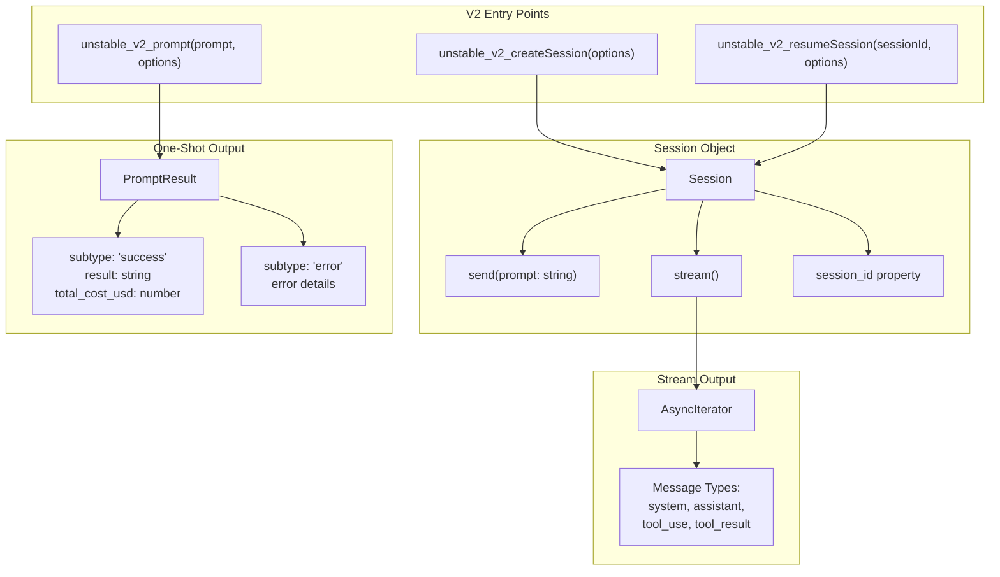
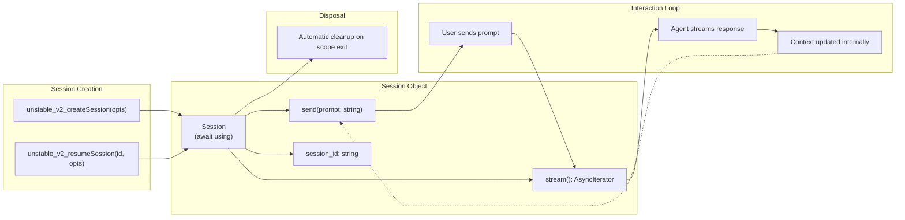
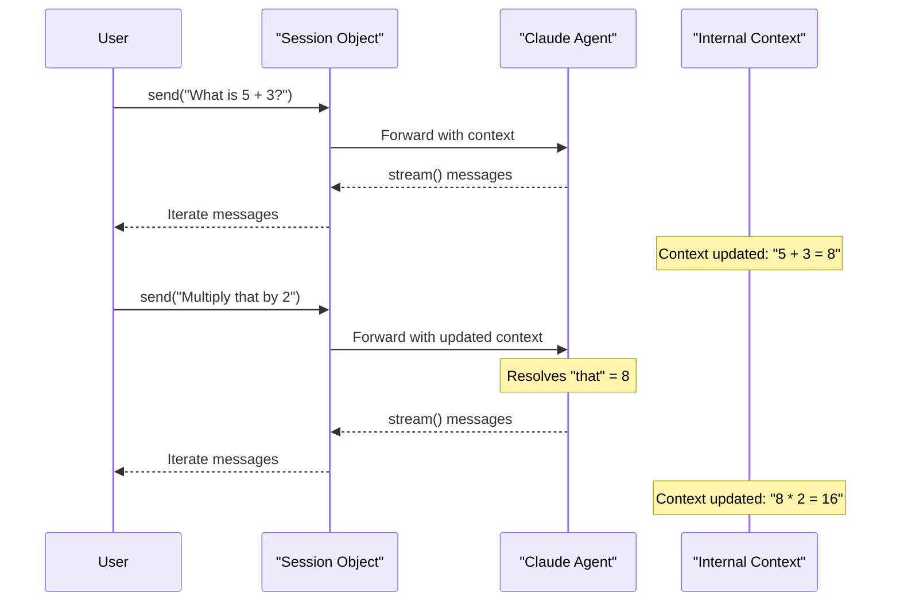
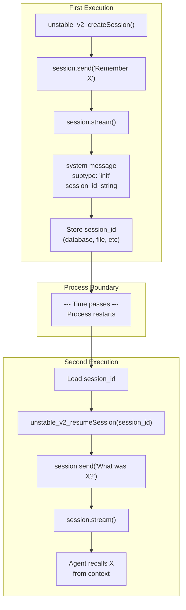
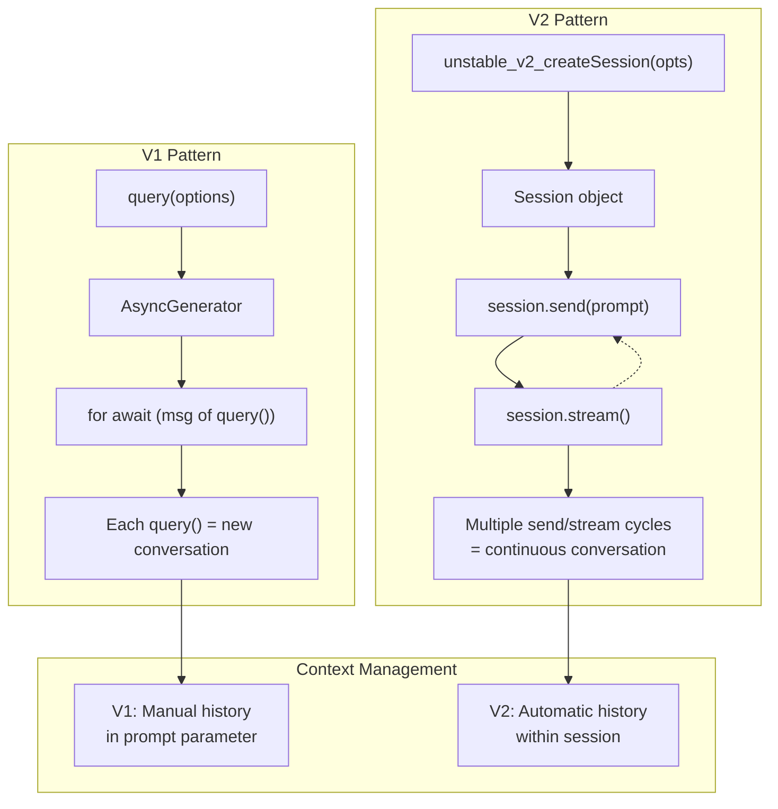

<!-- source: DeepWiki mcp.deepwiki.com · repo anthropics/claude-agent-sdk-demos · page 8.3 V2 API: Session Management · fetched 2026-10-26 -->

# V2 API: Session Management

<details>
<summary>Relevant source files</summary>

The following files were used as context for generating this wiki page:

- [hello-world-v2/README.md](hello-world-v2/README.md)
- [hello-world-v2/package.json](hello-world-v2/package.json)
- [hello-world-v2/tsconfig.json](hello-world-v2/tsconfig.json)
- [hello-world-v2/v2-examples.ts](hello-world-v2/v2-examples.ts)

</details>


## Purpose and Scope

This document covers the V2 Session API (`unstable_v2_*` functions) for the Claude Agent SDK. The V2 API provides explicit session management with separate `send()` and `stream()` methods, optimized for multi-turn conversations where context persists across multiple prompts. This API enables session persistence via `sessionId`, allowing conversations to resume across process restarts.

For the V1 `query()` function API, see [V1 API: Query Function](#8.2). For general SDK concepts applicable to both V1 and V2, see [SDK Core Concepts](#8.1).

Sources: [hello-world-v2/README.md:1-37](), [hello-world-v2/v2-examples.ts:1-7]()

---

## Core API Functions

The V2 API provides three entry points for creating and managing agent sessions:

| Function | Purpose | Returns |
|----------|---------|---------|
| `unstable_v2_createSession()` | Create new session with fresh context | `Session` object |
| `unstable_v2_resumeSession()` | Resume existing session from `sessionId` | `Session` object |
| `unstable_v2_prompt()` | One-shot convenience function | `Promise<PromptResult>` |

### API Function Signatures



Sources: [hello-world-v2/v2-examples.ts:8-12](), [hello-world-v2/README.md:23-36]()

---

## unstable_v2_createSession

Creates a new session with fresh conversation context. The session object supports the `await using` disposal pattern for automatic cleanup.

**Signature:**
```typescript
unstable_v2_createSession(options: SessionOptions): Session
```

**Options:**
- `model`: Model name (`'sonnet'`, `'opus'`, `'haiku'`)
- `cwd`: Current working directory for file operations
- `maxTurns`: Maximum conversation turns (default: 30)
- `allowedTools`: Array of tool names to enable
- `settingSources`: Skill discovery sources

**Example Usage:**

The basic session pattern uses `await using` for automatic resource cleanup:

[hello-world-v2/v2-examples.ts:36-48]()

Sources: [hello-world-v2/v2-examples.ts:36-48](), [hello-world-v2/README.md:26-29]()

---

## unstable_v2_resumeSession

Resumes an existing session using its `session_id`, restoring full conversation history and context. This enables persistent conversations across process restarts.

**Signature:**
```typescript
unstable_v2_resumeSession(sessionId: string, options: SessionOptions): Session
```

**Session ID Acquisition:**

The `session_id` is available from the `init` system message in the stream:

[hello-world-v2/v2-examples.ts:99-103]()

**Resume Example:**

[hello-world-v2/v2-examples.ts:114-126]()

Sources: [hello-world-v2/v2-examples.ts:87-126](), [hello-world-v2/README.md:31-32]()

---

## unstable_v2_prompt

Convenience function for single-prompt interactions that don't require session management. Returns result directly without requiring manual stream iteration.

**Signature:**
```typescript
unstable_v2_prompt(prompt: string, options: SessionOptions): Promise<PromptResult>
```

**Result Structure:**
```typescript
type PromptResult = {
  subtype: 'success' | 'error';
  result?: string;           // Assistant's text response
  total_cost_usd: number;    // Cost of the interaction
  // ... error fields if subtype === 'error'
}
```

**Example Usage:**

[hello-world-v2/v2-examples.ts:76-85]()

Sources: [hello-world-v2/v2-examples.ts:75-85](), [hello-world-v2/README.md:34-35]()

---

## Session Object Interface

The `Session` object provides two primary methods for interaction: `send()` to submit prompts and `stream()` to receive responses.

### Session Lifecycle and Methods



### send() Method

Submits a user prompt to the agent. Does not return values; response is received via `stream()`.

**Usage Pattern:**
```typescript
await session.send('Your prompt here');
```

The `send()` method is non-blocking and does not return the response. Call `stream()` immediately after to receive the agent's messages.

### stream() Method

Returns an `AsyncIterator<Message>` that yields messages from the agent's response. Must be called after each `send()` to retrieve the complete response.

**Usage Pattern:**
```typescript
for await (const msg of session.stream()) {
  // Process each message
}
```

**Important:** The stream iterator must be fully consumed before calling `send()` again. Each `send()`/`stream()` cycle represents one conversation turn.

Sources: [hello-world-v2/v2-examples.ts:36-73](), [hello-world-v2/README.md:8-11]()

---

## Multi-Turn Conversation Pattern

The V2 API's key advantage is automatic context management across multiple turns. The session internally maintains conversation history, allowing the agent to reference previous exchanges.

### Multi-Turn Flow Diagram



### Code Example: Multi-Turn Conversation

[hello-world-v2/v2-examples.ts:51-73]()

The agent successfully resolves "that" in Turn 2 because the session automatically includes Turn 1's context.

Sources: [hello-world-v2/v2-examples.ts:50-73](), [hello-world-v2/README.md:9-10]()

---

## Session Persistence

Sessions can be persisted and resumed using the `session_id` property. This enables long-lived conversations that survive process restarts or span multiple execution contexts.

### Session Persistence Architecture



### Extracting session_id

The `session_id` appears in the first system message with `subtype: 'init'`:

[hello-world-v2/v2-examples.ts:100-103]()

### Resuming a Session

[hello-world-v2/v2-examples.ts:114-126]()

**Persistence Strategy:**

The SDK manages session state internally. Store the `session_id` string in your persistence layer (database, file, cache) and use `unstable_v2_resumeSession()` to restore the session with full history.

Sources: [hello-world-v2/v2-examples.ts:87-126]()

---

## Message Types in Stream

The `stream()` method yields `Message` objects of different types. Each message represents a specific event in the conversation flow.

### Message Type Hierarchy

| Type | Subtype | Description | Key Fields |
|------|---------|-------------|------------|
| `system` | `init` | Session initialization | `session_id`, `model` |
| `system` | `completion` | Conversation completed | `total_cost_usd` |
| `assistant` | - | Claude's text response | `message.content[]` |
| `tool_use` | - | Agent requesting tool execution | `tool_name`, `tool_input` |
| `tool_result` | - | Result of tool execution | `output`, `success` |

### Processing Assistant Messages

Assistant messages contain text in a content array:

[hello-world-v2/v2-examples.ts:43-46]()

The `content` array may contain multiple blocks. Text blocks have `type: 'text'` and include a `text` property with the actual content.

### System Message: init

Emitted at the start of streaming, provides session metadata:

```typescript
{
  type: 'system',
  subtype: 'init',
  session_id: string,
  model: string,
  // ... other metadata
}
```

### System Message: completion

Emitted when conversation reaches completion or `maxTurns`:

```typescript
{
  type: 'system',
  subtype: 'completion',
  total_cost_usd: number,
  // ... other metadata
}
```

Sources: [hello-world-v2/v2-examples.ts:42-46](), [hello-world-v2/v2-examples.ts:99-107]()

---

## Session Lifecycle Management

The V2 API uses TypeScript's `await using` syntax for automatic resource cleanup. When the session goes out of scope, resources are automatically disposed.

### Lifecycle Pattern

```typescript
{
  await using session = unstable_v2_createSession({ model: 'sonnet' });
  
  // Use session here
  await session.send('prompt');
  for await (const msg of session.stream()) { /* ... */ }
  
  // Automatically cleaned up when block exits
}
// Session resources released here
```

**Disposal Timing:**

Resources are disposed when:
1. Block scope exits normally
2. Exception is thrown within the block
3. Function returns

**Manual Cleanup (if not using `await using`):**

If not using `await using`, ensure session cleanup by calling disposal methods according to the SDK's disposal interface.

Sources: [hello-world-v2/v2-examples.ts:39](), [hello-world-v2/v2-examples.ts:54](), [hello-world-v2/v2-examples.ts:95]()

---

## V2 vs V1 Comparison

The V2 Session API differs fundamentally from the V1 `query()` function in its approach to conversation management:

| Aspect | V1: query() | V2: Session API |
|--------|-------------|-----------------|
| **Entry Point** | Single `query()` function | `unstable_v2_createSession()`, `unstable_v2_resumeSession()` |
| **Message Flow** | Single `AsyncGenerator` for all messages | Separate `send()` and `stream()` methods |
| **Multi-Turn** | Manual history management via prompt | Automatic context management |
| **Session State** | Stateless, one call per task | Stateful, maintains context across turns |
| **Resumption** | Not supported | `unstable_v2_resumeSession()` with `sessionId` |
| **Primary Use Case** | Single-prompt tasks | Multi-turn conversations |

### Architectural Comparison Diagram



**When to Use V2:**
- Multi-turn conversations with context dependencies
- Interactive chat interfaces
- Sessions that need to persist across restarts
- Applications where conversation history is managed by the SDK

**When to Use V1:**
- Single-prompt tasks
- Custom hook integration (PreToolUse, PostToolUse)
- Applications managing their own conversation history
- Tasks where statefulness is not required

For detailed V1 documentation, see [V1 API: Query Function](#8.2).

Sources: [hello-world-v2/README.md:5-11](), [hello-world-v2/v2-examples.ts:1-7]()

---

## Usage Examples Summary

The hello-world-v2 demo provides four example patterns:

### Example Invocations

```bash
# Basic session with send/stream pattern
npx tsx v2-examples.ts basic

# Multi-turn conversation demonstrating context retention
npx tsx v2-examples.ts multi-turn

# One-shot convenience function
npx tsx v2-examples.ts one-shot

# Session persistence across sessions
npx tsx v2-examples.ts resume
```

### Quick Reference

```typescript
// 1. Basic session
await using session = unstable_v2_createSession({ model: 'sonnet' });
await session.send('Hello!');
for await (const msg of session.stream()) {
  // Process messages
}

// 2. Multi-turn
await session.send('First question');
for await (const msg of session.stream()) { /* ... */ }
await session.send('Follow-up question');
for await (const msg of session.stream()) { /* ... */ }

// 3. One-shot
const result = await unstable_v2_prompt('Question?', { model: 'sonnet' });

// 4. Resume
await using session = unstable_v2_resumeSession(sessionId, { model: 'sonnet' });
```

Sources: [hello-world-v2/v2-examples.ts:14-33](), [hello-world-v2/README.md:13-21]()

---

