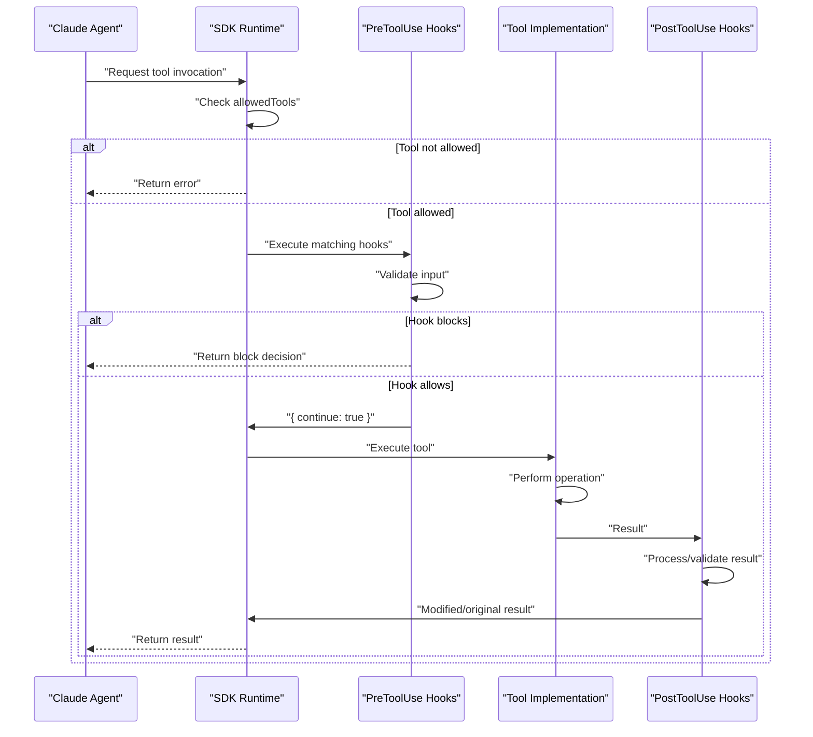
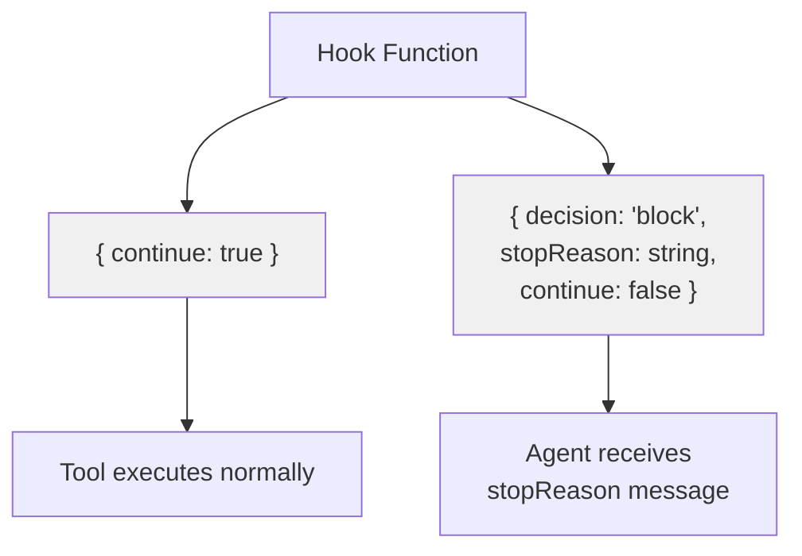
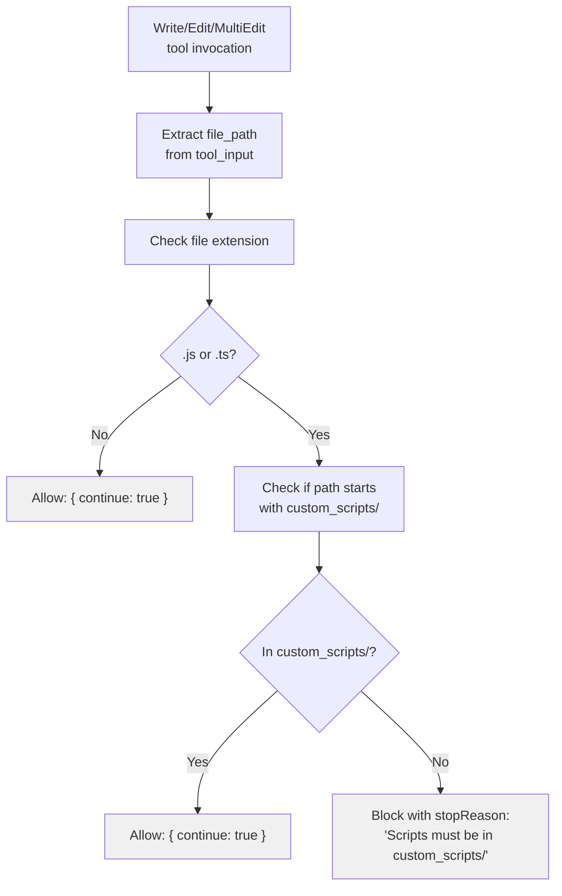
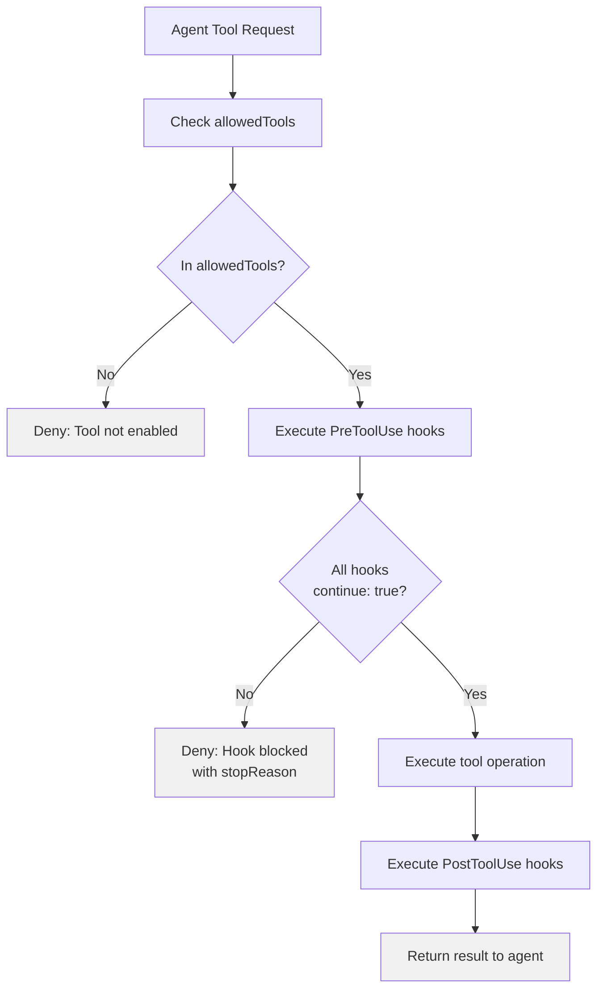

<!-- source: DeepWiki mcp.deepwiki.com · repo anthropics/claude-agent-sdk-demos · page 8.4 Tools and Hooks · fetched 2026-10-26 -->

# Tools and Hooks

<details>
<summary>Relevant source files</summary>

The following files were used as context for generating this wiki page:

- [research-agent/research_agent/utils/message_handler.py](research-agent/research_agent/utils/message_handler.py)
- [research-agent/research_agent/utils/subagent_tracker.py](research-agent/research_agent/utils/subagent_tracker.py)
- [resume-generator/.claude/skills/docx/SKILL.md](resume-generator/.claude/skills/docx/SKILL.md)
- [resume-generator/.claude/skills/docx/docx-js.md](resume-generator/.claude/skills/docx/docx-js.md)
- [resume-generator/.gitignore](resume-generator/.gitignore)
- [resume-generator/README.md](resume-generator/README.md)
- [resume-generator/package.json](resume-generator/package.json)
- [resume-generator/resume-generator.ts](resume-generator/resume-generator.ts)

</details>


This page documents the built-in tool system and hook mechanism provided by the Claude Agent SDK. Tools enable agents to perform operations like file manipulation, command execution, and web searches. Hooks provide interception points to validate, modify, or block tool invocations before and after execution. For information about creating custom domain-specific tools via MCP servers, see [Custom MCP Servers](#7.4). For general SDK usage patterns, see [Query Function and Options](#7.2).

## Built-in Tool System

The Claude Agent SDK provides a comprehensive set of built-in tools that agents can use to interact with the file system, execute commands, and access external resources. Tools are enabled by specifying their names in the `allowedTools` configuration array when calling `query()`.

### Tool Categories

The SDK organizes tools into functional categories:

**File Operations**
- `Read`: Read file contents
- `Write`: Create or overwrite files
- `Edit`: Modify existing files with targeted edits
- `MultiEdit`: Apply multiple edits to a single file
- `NotebookEdit`: Edit notebook cells

**Search and Discovery**
- `Glob`: Pattern-based file discovery
- `Grep`: Search file contents with regex patterns
- `LS`: List directory contents
- `WebSearch`: Search the web for information

**Execution**
- `Bash`: Execute shell commands
- `BashOutput`: Capture and process command output
- `KillBash`: Terminate running bash processes
- `Task`: Spawn subagents for delegation

**Utilities**
- `TodoWrite`: Manage todo lists
- `WebFetch`: Retrieve web page content

**Planning**
- `ExitPlanMode`: Exit planning mode and proceed with execution

**Sources:** [hello-world/README.md:58-66](), [hello-world/hello-world.ts:13-16]()

### Tool Configuration

Tools are enabled via the `allowedTools` option in query configuration:

```typescript
const q = query({
  prompt: 'Your task',
  options: {
    allowedTools: [
      "Read", "Write", "Edit", "MultiEdit",
      "Bash", "Glob", "Grep", "WebSearch", "Task"
    ]
  }
});
```

Only tools explicitly listed in `allowedTools` can be invoked by the agent. This provides security control over agent capabilities.

**Sources:** [hello-world/hello-world.ts:13-16]()

## Tool Invocation Flow



**Sources:** [hello-world/hello-world.ts:17-55](), [hello-world/README.md:67-86]()

## Hook System

Hooks provide interception points in the tool execution lifecycle, enabling custom validation, modification, or blocking of tool invocations. The SDK supports two hook types:

### PreToolUse Hooks

`PreToolUse` hooks execute before tool invocation, enabling validation and access control. Each hook configuration includes:

- **`matcher`**: Pattern matching tool names (pipe-delimited regex)
- **`hooks`**: Array of async functions that receive tool input

```typescript
hooks: {
  PreToolUse: [
    {
      matcher: "Write|Edit|MultiEdit",
      hooks: [
        async (input: any): Promise<HookJSONOutput> => {
          const toolName = input.tool_name;
          const toolInput = input.tool_input;
          
          // Validation logic
          if (violatesPolicy) {
            return {
              decision: 'block',
              stopReason: 'Policy violation message',
              continue: false
            };
          }
          
          return { continue: true };
        }
      ]
    }
  ]
}
```

**Sources:** [hello-world/hello-world.ts:17-55](), [hello-world/README.md:67-86]()

### Hook Input Structure

Hook functions receive an input object containing:

| Field | Type | Description |
|-------|------|-------------|
| `tool_name` | `string` | Name of the tool being invoked |
| `tool_input` | `object` | Tool-specific input parameters |

For file operation tools (`Write`, `Edit`, `MultiEdit`), `tool_input` typically includes:
- `file_path`: Target file path
- `content` or `edits`: Content to write or modifications to apply

**Sources:** [hello-world/hello-world.ts:22-35]()

### Hook Return Types



Hook functions must return a `HookJSONOutput` object:

**Allow Execution:**
```typescript
return { continue: true };
```

**Block Execution:**
```typescript
return {
  decision: 'block',
  stopReason: 'Reason for blocking the operation',
  continue: false
};
```

The `stopReason` message is returned to the agent, enabling it to understand why the operation was blocked and potentially retry with corrected parameters.

**Sources:** [hello-world/hello-world.ts:42-47](), [hello-world/README.md:77-81]()

### PostToolUse Hooks

`PostToolUse` hooks execute after tool completion, enabling result processing, logging, or validation of tool outputs. While not demonstrated in the provided files, they follow the same structural pattern as `PreToolUse` hooks but receive tool results instead of inputs.

**Sources:** [hello-world/README.md:67-86]()

## Hook Validation Patterns

### Path-Based Access Control

The Hello World demo demonstrates path validation for script files:



Implementation pattern:

1. Extract `file_path` from tool input
2. Check file extension using `path.extname()`
3. For restricted extensions, validate against allowed directory
4. Return block decision with helpful error message if validation fails

**Sources:** [hello-world/hello-world.ts:19-51]()

### Multi-Tool Matching

The matcher field supports pipe-delimited patterns to apply hooks to multiple tools:

```typescript
matcher: "Write|Edit|MultiEdit"
```

This applies the hook to all file modification operations, ensuring consistent policy enforcement across related tools.

**Sources:** [hello-world/hello-world.ts:20]()

### Type-Safe Hook Implementation

The SDK provides TypeScript types for hook implementation:

```typescript
import type { HookJSONOutput } from "@anthropic-ai/claude-agent-sdk";

async (input: any): Promise<HookJSONOutput> => {
  // Hook logic
}
```

The `HookJSONOutput` type ensures hooks return valid decision structures.

**Sources:** [hello-world/hello-world.ts:2](), [hello-world/hello-world.ts:22]()

## Tool Usage Across Demos

### Hello World: Basic Tool Restriction

The Hello World demo enables a comprehensive toolset while enforcing directory-based security:

```typescript
allowedTools: [
  "Task", "Bash", "Glob", "Grep", "LS", "ExitPlanMode",
  "Read", "Edit", "MultiEdit", "Write", "NotebookEdit",
  "WebFetch", "TodoWrite", "WebSearch", "BashOutput", "KillBash"
]
```

The `PreToolUse` hook restricts `.js` and `.ts` files to the `agent/custom_scripts/` directory, preventing script creation in arbitrary locations.

**Sources:** [hello-world/hello-world.ts:13-16](), [hello-world/hello-world.ts:17-55]()

### Research Agent: Subagent Delegation

The Research Agent leverages the `Task` tool exclusively for the Lead Agent, which spawns researcher and report-writer subagents. Each subagent type has access to different toolsets appropriate to its role:

- **Lead Agent**: Only `Task` tool for delegation
- **Researchers**: `WebSearch` and file writing tools
- **Report Writer**: `Glob`, `Read`, `Write` for synthesis

**Sources:** Based on architecture diagrams and system description

### Email Agent: Custom MCP Tools

The Email Agent extends beyond built-in tools by creating custom MCP tools (`search_inbox`, `read_emails`) that integrate with the email database. These custom tools are registered via `createSdkMcpServer()` and provide domain-specific capabilities not available in the standard toolset. See [Custom MCP Servers](#7.4) for implementation details.

**Sources:** Based on architecture diagrams

## Tool Security Model



The SDK implements a defense-in-depth security model:

1. **Capability Control**: Only explicitly allowed tools can be invoked
2. **Pre-execution Validation**: Hooks validate inputs before execution
3. **Post-execution Processing**: Hooks can validate or sanitize outputs

This layered approach enables fine-grained control over agent capabilities while maintaining flexibility for different use cases.

**Sources:** [hello-world/README.md:67-86](), [hello-world/hello-world.ts:17-55]()

---

