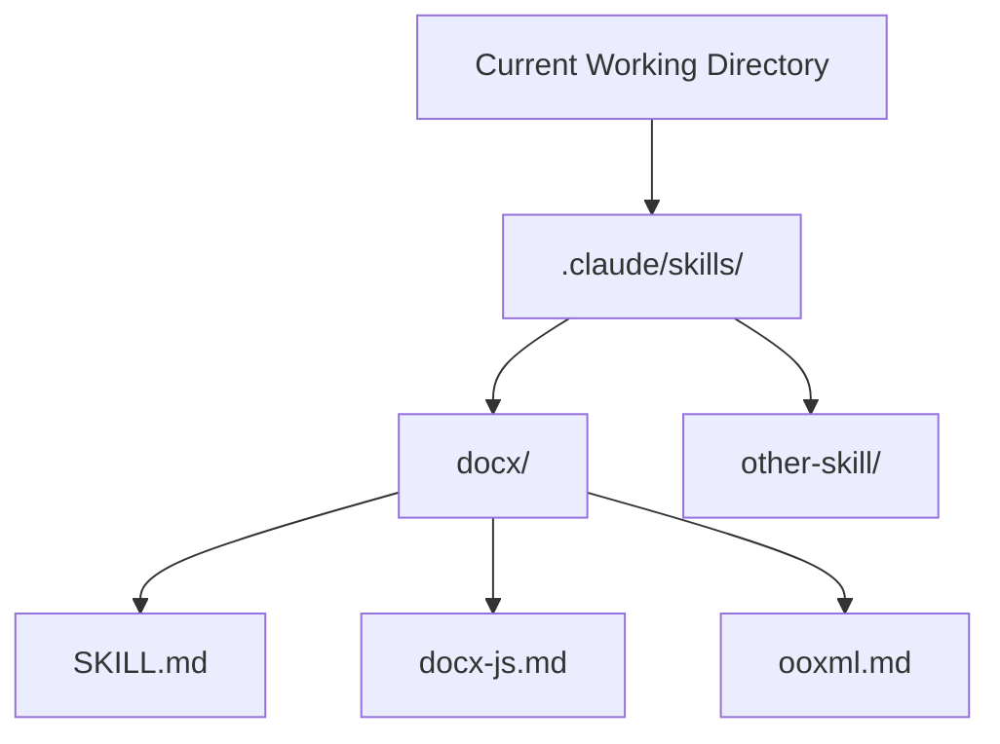
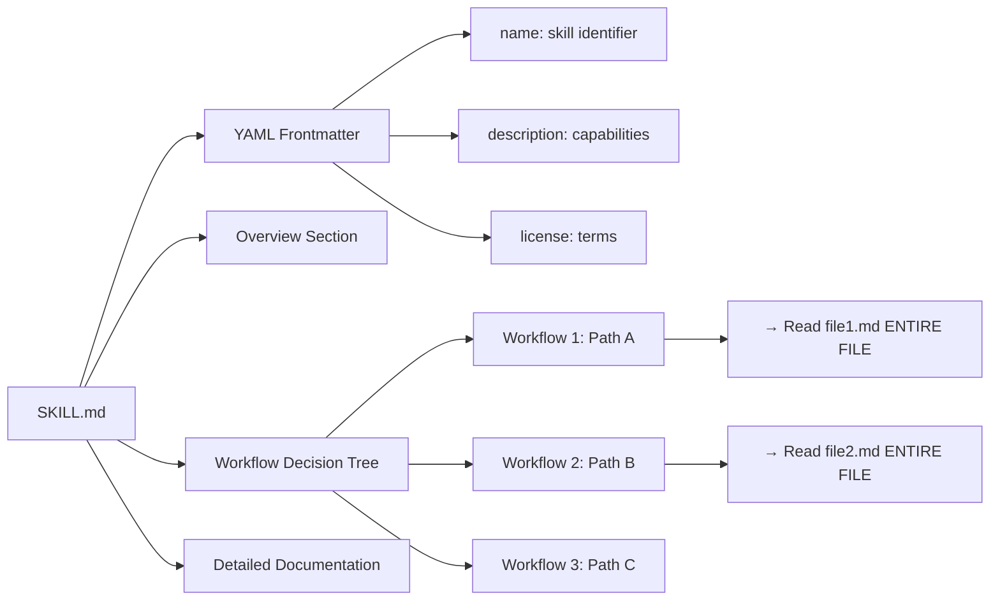
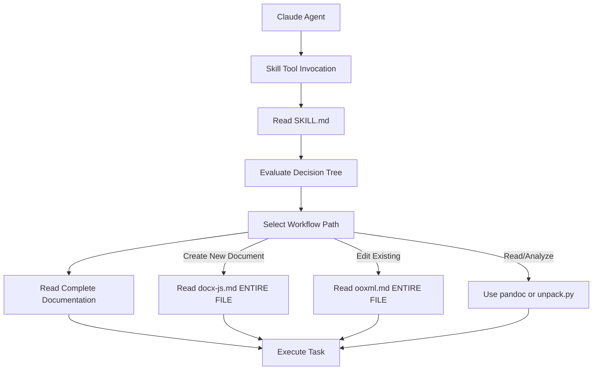
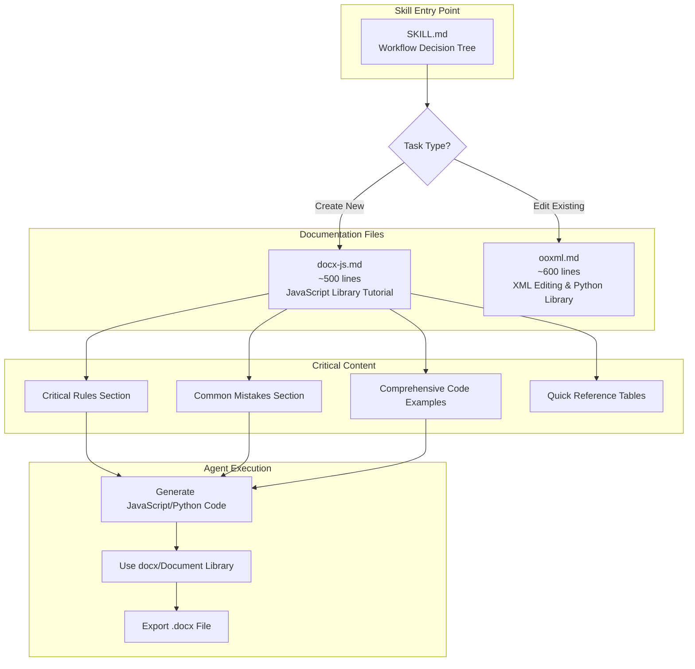
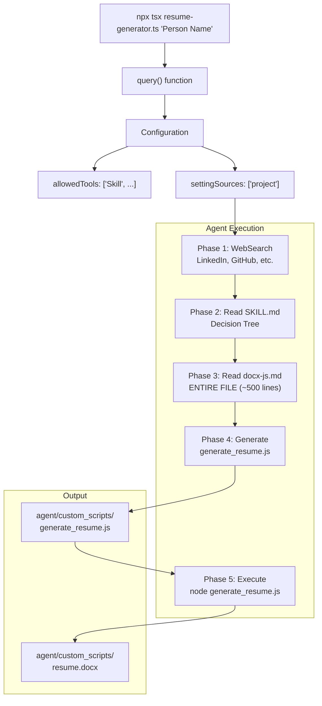
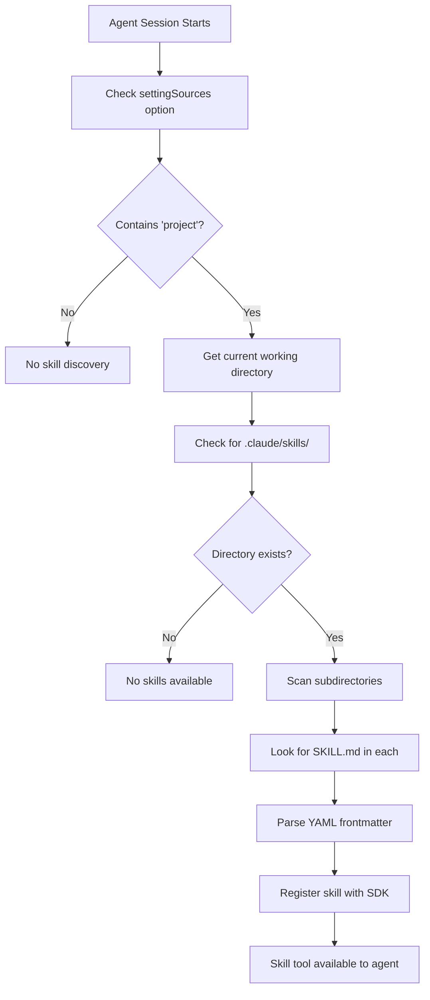

<!-- source: DeepWiki mcp.deepwiki.com · repo anthropics/claude-agent-sdk-demos · page 8.5 Skills System · fetched 2026-10-26 -->

# Skills System

<details>
<summary>Relevant source files</summary>

The following files were used as context for generating this wiki page:

- [resume-generator/.claude/skills/docx/SKILL.md](resume-generator/.claude/skills/docx/SKILL.md)
- [resume-generator/.claude/skills/docx/docx-js.md](resume-generator/.claude/skills/docx/docx-js.md)
- [resume-generator/.gitignore](resume-generator/.gitignore)
- [resume-generator/README.md](resume-generator/README.md)
- [resume-generator/package.json](resume-generator/package.json)
- [resume-generator/resume-generator.ts](resume-generator/resume-generator.ts)

</details>


## Purpose and Scope

The Skills System is an architectural pattern for providing Claude agents with domain-specific expertise through curated documentation. This page documents how skills are discovered, structured, invoked, and best practices for creating them. For information about the Claude Agent SDK itself, see [SDK Core Concepts](#8.1). For the specific tools available to agents, see [Tools and Hooks](#8.4).

The skills system transforms agents into domain experts by requiring them to read comprehensive documentation before executing tasks. The primary example in this repository is the `docx` skill, which enables professional document generation.

**Sources:** [resume-generator/.claude/skills/docx/SKILL.md:1-11]()

## Skill Discovery and Configuration

Skills are discovered automatically when the agent configuration specifies `settingSources: 'project'`. This instructs the SDK to search for skills in the `.claude/skills/` directory relative to the current working directory.

```typescript
const q = query({
  prompt: "Create a document...",
  options: {
    allowedTools: ['Skill', 'WebSearch', 'Bash', 'Write', 'Read'],
    settingSources: ['project'],  // Enables skill discovery
    cwd: process.cwd()
  }
});
```

**Sources:** [resume-generator/resume-generator.ts:43-53]()

### Directory Structure



**Skill Discovery Pattern:**

| Component | Location | Purpose |
|-----------|----------|---------|
| Skills directory | `.claude/skills/` | Root directory for all project skills |
| Skill subdirectory | `.claude/skills/docx/` | Individual skill namespace |
| Entry point | `SKILL.md` | Skill metadata and workflow decision tree |
| Documentation files | `docx-js.md`, `ooxml.md` | Comprehensive tutorials and reference material |

**Sources:** [resume-generator/.claude/skills/docx/SKILL.md:1-11](), [resume-generator/resume-generator.ts:50]()

## Skill Structure

Each skill is a directory containing markdown files that provide structured documentation. The `SKILL.md` file serves as the entry point with metadata and workflow guidance.

### SKILL.md Metadata Format

```yaml
---
name: docx
description: "Comprehensive document creation, editing, and analysis..."
license: Proprietary. LICENSE.txt has complete terms
---
```

**Sources:** [resume-generator/.claude/skills/docx/SKILL.md:1-5]()

### Required Components



**Sources:** [resume-generator/.claude/skills/docx/SKILL.md:1-31]()

## Skill Invocation Pattern

When an agent needs to use a skill, it invokes the `Skill` tool. The skill system operates on a mandatory full-file reading principle to ensure agents have complete context.



**Sources:** [resume-generator/.claude/skills/docx/SKILL.md:12-31]()

### Workflow Decision Tree Example

The docx skill demonstrates a comprehensive decision tree that routes agents to appropriate documentation based on their task:

| Task Type | Condition | Documentation Required | Tools Used |
|-----------|-----------|------------------------|------------|
| Creating New Document | Building from scratch | `docx-js.md` (ENTIRE FILE) | JavaScript `docx` library |
| Editing Existing (Own Document) | Simple changes, your document | `ooxml.md` (ENTIRE FILE) | Python Document library |
| Editing Existing (Others' Document) | Any external document | `ooxml.md` with redlining workflow | Python Document library + tracked changes |
| Reading/Analyzing | Text extraction needed | Pandoc conversion | `pandoc --track-changes=all` |
| Raw XML Access | Comments, complex formatting | Unpack and read XML | `unpack.py` script |

**Sources:** [resume-generator/.claude/skills/docx/SKILL.md:12-31]()

## The docx Skill: Comprehensive Example

The docx skill exemplifies best practices for skill design, providing over 1,000 lines of structured documentation across multiple files.



**Sources:** [resume-generator/.claude/skills/docx/SKILL.md:1-197](), [resume-generator/.claude/skills/docx/docx-js.md:1-350]()

### docx-js.md: Library Tutorial Structure

The `docx-js.md` file is a 500-line comprehensive tutorial that must be read entirely before document creation. Its structure:

| Section | Lines | Purpose | Critical Content |
|---------|-------|---------|------------------|
| Setup | 7-22 | Library imports and basic usage | `Document`, `Packer`, core classes |
| Text & Formatting | 24-48 | TextRun and Paragraph API | **NEVER use `\n` - always use separate Paragraph elements** |
| Styles & Professional Formatting | 52-107 | Style definitions and hierarchy | Override built-in styles, set default font to Arial |
| Lists | 109-156 | Numbering configuration | **CRITICAL: Use `LevelFormat.BULLET` constant, NOT string "bullet"** |
| Tables | 158-228 | Table creation with borders | **CRITICAL: Set `columnWidths` array + individual cell widths** |
| Links & Navigation | 230-255 | TOC, hyperlinks, bookmarks | **CRITICAL: TOC requires HeadingLevel ONLY, no custom styles** |
| Images & Media | 257-270 | ImageRun with sizing | **CRITICAL: Always specify `type` parameter** |
| Page Breaks | 272-286 | Manual and automatic breaks | **CRITICAL: PageBreak must ALWAYS be inside Paragraph** |
| Headers/Footers & Page Setup | 288-314 | Section properties | Page margins, orientation, page numbers |
| Tabs | 316-326 | Tab stops and alignment | Tab positions and types |
| Constants & Quick Reference | 328-334 | Common values | Symbols, formats, border styles |
| Critical Issues & Common Mistakes | 336-350 | Comprehensive gotchas list | **All rules enforced - missing them = corrupted documents** |

**Sources:** [resume-generator/.claude/skills/docx/docx-js.md:1-350]()

### Mandatory Full-File Reading Pattern

The skill documentation explicitly requires complete file reading:

```markdown
1. **MANDATORY - READ ENTIRE FILE**: Read [`docx-js.md`](docx-js.md) 
   (~500 lines) completely from start to finish. **NEVER set any range 
   limits when reading this file.** Read the full file content for 
   detailed syntax, critical formatting rules, and best practices 
   before proceeding with document creation.
```

This pattern appears multiple times throughout the skill documentation to emphasize its importance:

- In the "Creating a new Word document" workflow
- In the "Editing an existing Word document" workflow  
- In the "Redlining workflow for document review"

**Why Full-File Reading Is Required:**

1. **Critical rules are distributed throughout** - Skipping sections may miss essential gotchas
2. **Rules reference each other** - Understanding requires complete context
3. **Common mistakes section at end** - Preventable errors are documented after examples
4. **Pattern consistency** - Code examples build on earlier patterns

**Sources:** [resume-generator/.claude/skills/docx/SKILL.md:59-60](), [resume-generator/.claude/skills/docx/SKILL.md:68](), [resume-generator/.claude/skills/docx/SKILL.md:116]()

### Critical Rules Pattern

The docx skill demonstrates an effective pattern for highlighting critical rules that prevent errors:

```markdown
## Critical Issues & Common Mistakes
- **CRITICAL: PageBreak must ALWAYS be inside a Paragraph** - standalone 
  PageBreak creates invalid XML that Word cannot open
- **ALWAYS use ShadingType.CLEAR for table cell shading** - Never use 
  ShadingType.SOLID (causes black background).
- **ALWAYS use columnWidths array for tables** + individual cell widths 
  for compatibility
- **NEVER use unicode symbols for bullets** - always use proper 
  numbering configuration
- **CRITICAL for images**: ImageRun REQUIRES `type` parameter
```

This pattern uses:
- Bold **CRITICAL** / **ALWAYS** / **NEVER** markers
- Consequences explanation (e.g., "creates invalid XML")
- Correct vs incorrect examples throughout the document

**Sources:** [resume-generator/.claude/skills/docx/docx-js.md:336-350]()

## Resume Generator Integration

The resume generator demonstrates the complete skill system workflow:



**Skill System Configuration:**

```typescript
const q = query({
  prompt: `Research "${personName}" and create a professional 1-page resume...`,
  options: {
    maxTurns: 30,
    cwd: process.cwd(),
    model: 'sonnet',
    allowedTools: ['Skill', 'WebSearch', 'WebFetch', 'Bash', 'Write', 'Read', 'Glob'],
    settingSources: ['project'],  // Enables .claude/skills/ discovery
    systemPrompt: SYSTEM_PROMPT
  }
});
```

The system prompt provides high-level guidance while the skill provides detailed technical documentation:

```typescript
const SYSTEM_PROMPT = `You are a professional resume writer. Research a person and create a 1-page .docx resume.

WORKFLOW:
1. WebSearch for the person's background (LinkedIn, GitHub, company pages)
2. Create a .docx file using the docx library

OUTPUT:
- Script: agent/custom_scripts/generate_resume.js
- Resume: agent/custom_scripts/resume.docx

PAGE FIT (must be exactly 1 page):
- 0.5 inch margins, Name 24pt, Headers 12pt, Body 10pt
- 2-3 bullet points per job, ~80-100 chars each
- Max 3 job roles, 2-line summary, 2-line skills`;
```

**Sources:** [resume-generator/resume-generator.ts:14-27](), [resume-generator/resume-generator.ts:43-53]()

## Best Practices for Skill Creation

### When to Create a Skill

Skills are appropriate when:

1. **Complex library or tool** - Requires extensive documentation (e.g., docx library API)
2. **Domain-specific workflows** - Multiple paths depending on context (create vs edit vs analyze)
3. **Critical rules and gotchas** - Common mistakes that break functionality
4. **Reusable across projects** - The expertise can be applied to multiple use cases

**Do NOT create a skill for:**
- Simple tool usage that fits in a system prompt
- One-time operations without complex decision trees
- Well-known APIs with minimal gotchas

**Sources:** [resume-generator/.claude/skills/docx/SKILL.md:1-197]()

### Documentation Structure Guidelines

| Component | Required | Purpose | Example |
|-----------|----------|---------|---------|
| YAML frontmatter | Yes | Metadata for skill discovery | `name`, `description`, `license` |
| Overview section | Yes | Brief capability description | "Comprehensive document creation..." |
| Workflow decision tree | Yes | Route agents to correct workflow | "Creating New Document? → Read docx-js.md" |
| Detailed documentation | Yes | Complete technical reference | 500-line tutorial with examples |
| Critical rules section | Recommended | Highlight gotchas and mistakes | "CRITICAL: PageBreak must be inside Paragraph" |
| Code examples | Recommended | Show correct usage patterns | Complete working examples |
| Quick reference | Optional | Constants and common values | Symbol codes, measurement conversions |

**Sources:** [resume-generator/.claude/skills/docx/SKILL.md:1-197](), [resume-generator/.claude/skills/docx/docx-js.md:1-350]()

### The "Mandatory Full-File Reading" Pattern

For comprehensive documentation (>300 lines), use explicit mandatory reading instructions:

```markdown
1. **MANDATORY - READ ENTIRE FILE**: Read [`documentation.md`](documentation.md) 
   (~500 lines) completely from start to finish. **NEVER set any range limits 
   when reading this file.** Read the full file content for detailed syntax, 
   critical formatting rules, and best practices before proceeding.
```

**Why this pattern works:**

- Explicit emphasis prevents agents from trying to read only sections
- Line count gives agents context for scope
- Consequence explanation ("detailed syntax, critical rules") justifies the requirement
- Multiple repetitions throughout the skill reinforce the importance

**Sources:** [resume-generator/.claude/skills/docx/SKILL.md:59-60](), [resume-generator/.claude/skills/docx/SKILL.md:68]()

### Critical Rules Documentation Pattern

Effective critical rules documentation includes:

1. **Visual markers**: Bold `**CRITICAL:**`, `**ALWAYS:**`, `**NEVER:**`
2. **Consequence explanation**: "creates invalid XML that Word cannot open"
3. **Correct vs incorrect examples**: Show both patterns side-by-side
4. **Placement**: Both inline (near relevant content) and collected (end of file)

```markdown
## Lists (ALWAYS USE PROPER LISTS - NEVER USE UNICODE BULLETS)

// ⚠️ CRITICAL: NEVER use unicode bullets - they create fake lists
// new TextRun("• Item")           // WRONG
// new SymbolRun({ char: "2022" }) // WRONG
// ✅ ALWAYS use numbering config with LevelFormat.BULLET
```

**Sources:** [resume-generator/.claude/skills/docx/docx-js.md:109-156]()

### Code Example Best Practices

Code examples in skills should:

1. **Be complete and executable** - Not fragments that won't run
2. **Include all imports** - Show required dependencies
3. **Demonstrate common patterns** - Cover typical use cases
4. **Highlight critical points inline** - Comments at relevant lines
5. **Show anti-patterns** - Demonstrate what NOT to do

```javascript
// IMPORTANT: Never use \n for line breaks - always use separate Paragraph elements
// ❌ WRONG: new TextRun("Line 1\nLine 2")
// ✅ CORRECT: 
//    new Paragraph({ children: [new TextRun("Line 1")] }), 
//    new Paragraph({ children: [new TextRun("Line 2")] })
```

**Sources:** [resume-generator/.claude/skills/docx/docx-js.md:24-28]()

## Skill Discovery Mechanism

The skill discovery process operates through the following sequence:



**Configuration Options:**

| Option | Value | Effect |
|--------|-------|--------|
| `settingSources` | `['project']` | Enable skill discovery from `.claude/skills/` |
| `settingSources` | `undefined` or `[]` | No skill discovery |
| `settingSources` | `['project', 'user']` | Project skills + user-level skills (if configured) |

**Sources:** [resume-generator/resume-generator.ts:50]()

## Skill Invocation and Tool Usage

When an agent invokes the `Skill` tool, the following parameters are typically provided:

**Skill Tool Parameters:**

| Parameter | Type | Purpose | Example |
|-----------|------|---------|---------|
| `skill_name` | string | Identifies which skill to use | `"docx"` |
| `operation` | string | Describes the intended operation | `"read"`, `"create"`, `"edit"` |
| `context` | string | Additional context for the skill | Task requirements, file paths |

The agent then follows the workflow decision tree in `SKILL.md` to determine which documentation files to read.

**Sources:** [resume-generator/.claude/skills/docx/SKILL.md:12-31]()

## Skills vs System Prompts

Understanding when to use skills versus system prompts:

| Aspect | System Prompt | Skill |
|--------|---------------|-------|
| Size | 1-2 paragraphs | 500+ lines of documentation |
| Structure | Unstructured guidance | Structured workflows with decision trees |
| Updates | Requires code changes | Update markdown files only |
| Reusability | Task-specific | Domain-specific, reusable |
| Documentation depth | High-level guidance | Comprehensive technical reference |
| Examples | General instructions | Complete code examples |
| Error prevention | Basic guidelines | Detailed gotchas and anti-patterns |

**Combined Usage Pattern:**

The resume generator demonstrates effective combination:
- **System prompt**: High-level workflow and output constraints
- **Skill**: Detailed technical implementation guidance

```typescript
const SYSTEM_PROMPT = `You are a professional resume writer...
WORKFLOW:
1. WebSearch for the person's background
2. Create a .docx file using the docx library

PAGE FIT (must be exactly 1 page):
- 0.5 inch margins, Name 24pt, Headers 12pt, Body 10pt`;

// Skill provides the detailed "how" for step 2
```

**Sources:** [resume-generator/resume-generator.ts:14-27](), [resume-generator/resume-generator.ts:43-53]()

## File Organization and Dependencies

The `.gitignore` configuration for skill-based projects:

```
node_modules/
package-lock.json
*.docx                    # Generated outputs
agent/custom_scripts/     # Agent-generated code
.claude/settings*         # Local settings (not committed)
```

**Why exclude `.claude/settings*`:**
- Settings may contain user-specific configurations
- Skills themselves (`.claude/skills/`) should be committed for team use
- Local overrides and customizations remain private

**Sources:** [resume-generator/.gitignore:1-5]()

### Required Dependencies for docx Skill

The docx skill requires specific global or project dependencies:

```json
{
  "dependencies": {
    "@anthropic-ai/claude-agent-sdk": "^0.1.59",
    "docx": "^9.5.1"
  }
}
```

Additional system dependencies for full skill functionality:
- `pandoc` - Text extraction and markdown conversion
- `libreoffice` - PDF conversion (for document preview)
- `poppler-utils` - PDF to image conversion
- `defusedxml` - Secure XML parsing (Python)

**Sources:** [resume-generator/package.json:8-11](), [resume-generator/.claude/skills/docx/SKILL.md:189-197]()

---

