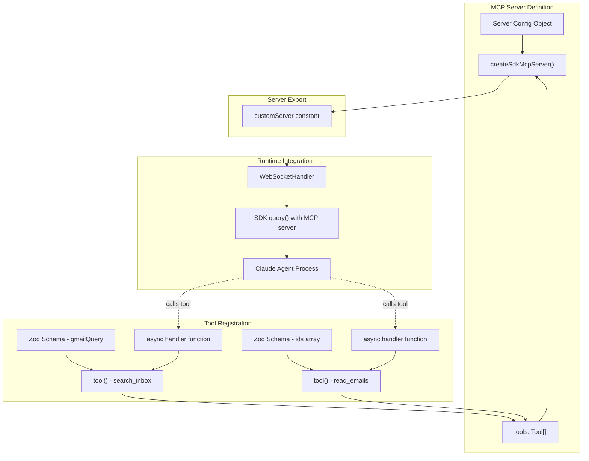
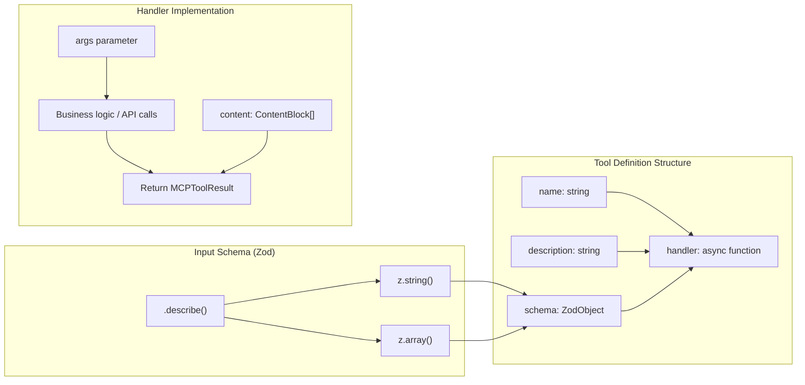
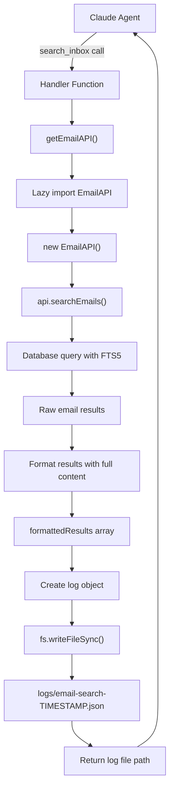
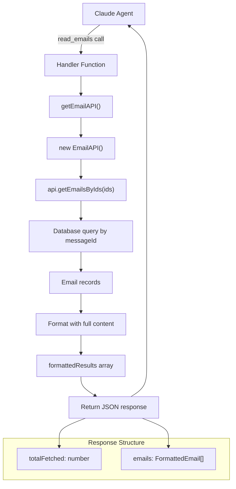
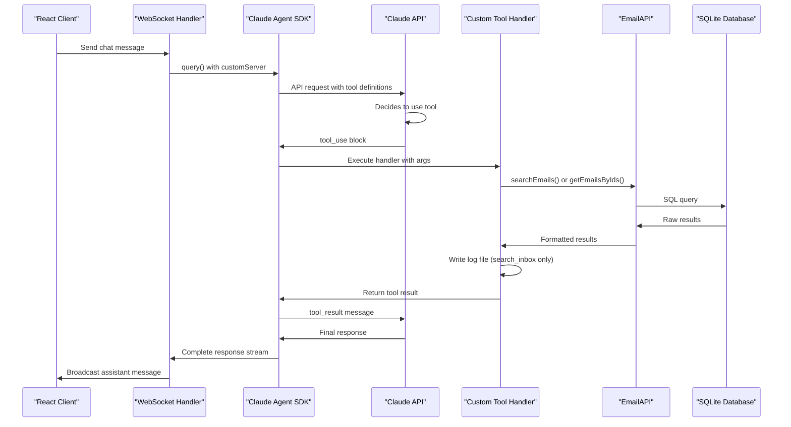

<!-- source: DeepWiki mcp.deepwiki.com · repo anthropics/claude-agent-sdk-demos · page 8.6 Custom MCP Servers · fetched 2026-10-26 -->

# Custom MCP Servers

<details>
<summary>Relevant source files</summary>

The following files were used as context for generating this wiki page:

- [email-agent/README.md](email-agent/README.md)
- [email-agent/ccsdk/custom-tools.ts](email-agent/ccsdk/custom-tools.ts)
- [email-agent/ccsdk/email-agent-prompt.ts](email-agent/ccsdk/email-agent-prompt.ts)
- [email-agent/ccsdk/types.ts](email-agent/ccsdk/types.ts)
- [email-agent/client/components/message/AssistantMessage.tsx](email-agent/client/components/message/AssistantMessage.tsx)

</details>


## Purpose and Scope

This document explains how to create custom Model Context Protocol (MCP) servers using the Claude Agent SDK's `createSdkMcpServer` function. Custom MCP servers extend Claude's capabilities with domain-specific tools that can access application data, external APIs, or specialized business logic.

The primary example is the Email Agent's custom MCP server, which provides two specialized tools (`search_inbox` and `read_emails`) for querying email data. For general SDK concepts, see [SDK Core Concepts](#7.1). For information about built-in tools and the hook system, see [Tools and Hooks](#7.3).

**Sources:** [email-agent/ccsdk/custom-tools.ts:1-170]()

---

## MCP Server Creation Pattern

Custom MCP servers are created using the `createSdkMcpServer` function, which takes a configuration object specifying the server name, version, and an array of tool definitions.



**Diagram: MCP Server Creation and Registration Flow**

The server is exported as a constant that can be passed to the SDK's query function or integrated into WebSocket handlers:

| Component | Code Entity | Purpose |
|-----------|-------------|---------|
| Server Creator | `createSdkMcpServer()` | Factory function for MCP servers |
| Server Instance | `customServer` | Exported server with registered tools |
| Tool Definition | `tool(name, description, schema, handler)` | Individual tool registration |
| Schema Validation | `z.string()`, `z.array()` | Zod schemas for input validation |

**Sources:** [email-agent/ccsdk/custom-tools.ts:24-170]()

---

## Tool Definition and Registration

Tools are defined using the `tool()` function, which requires four parameters: name, description, input schema, and handler function.



**Diagram: Tool Definition Components**

The handler function receives validated arguments matching the schema and must return an object with a `content` array containing response blocks:

```typescript
{
  content: [{
    type: "text",
    text: string // JSON or plain text response
  }]
}
```

**Sources:** [email-agent/ccsdk/custom-tools.ts:28-113](), [email-agent/ccsdk/custom-tools.ts:115-168]()

---

## Email Agent Custom Tools

The Email Agent implements two custom tools that provide Claude with the ability to query the local email database.

### search_inbox Tool

The `search_inbox` tool enables Gmail query syntax searches against the local email database.

**Tool Signature:**
- **Name:** `search_inbox`
- **Input Schema:** `{ gmailQuery: string }`
- **Description:** "Search emails in the inbox using Gmail query syntax"

**Implementation Flow:**



**Diagram: search_inbox Tool Execution Flow**

**Key Components:**

| Component | Code Entity | Line Reference |
|-----------|-------------|----------------|
| Tool handler | `async (args) => { ... }` | [email-agent/ccsdk/custom-tools.ts:37-112]() |
| API loader | `getEmailAPI()` | [email-agent/ccsdk/custom-tools.ts:16-22]() |
| Search call | `api.searchEmails({ gmailQuery, limit: 30 })` | [email-agent/ccsdk/custom-tools.ts:45-48]() |
| Result formatting | `formattedResults.map()` | [email-agent/ccsdk/custom-tools.ts:51-64]() |
| Log directory | `path.join(__dirname, '..', 'logs')` | [email-agent/ccsdk/custom-tools.ts:70]() |
| Log file naming | `email-search-${timestamp}.json` | [email-agent/ccsdk/custom-tools.ts:77]() |

**Formatted Result Schema:**

```typescript
{
  index: number,
  id: string,           // messageId
  messageId: string,
  date: string,
  from: string,
  to: string,
  subject: string,
  body: string,         // Full email content
  hasAttachments: boolean,
  isRead: boolean,
  folder: string,
  labels: string[]
}
```

**Sources:** [email-agent/ccsdk/custom-tools.ts:28-113]()

---

### read_emails Tool

The `read_emails` tool fetches full details for multiple emails by their message IDs.

**Tool Signature:**
- **Name:** `read_emails`
- **Input Schema:** `{ ids: string[] }`
- **Description:** "Read multiple emails by their IDs to get full content and details"

**Implementation Flow:**



**Diagram: read_emails Tool Execution Flow**

**Key Differences from search_inbox:**

| Aspect | search_inbox | read_emails |
|--------|-------------|-------------|
| Input | Gmail query string | Array of message IDs |
| Query type | Search with FTS5 | Direct lookup by ID |
| Result limit | 30 emails | No limit (all requested IDs) |
| Logging | Writes to timestamped file | Returns inline JSON |
| Use case | Exploratory search | Fetch known emails |

**Sources:** [email-agent/ccsdk/custom-tools.ts:115-168]()

---

## Tool Execution Flow

When Claude invokes a custom tool, the following sequence occurs:



**Diagram: End-to-End Tool Execution Sequence**

**Tool Result Types:**

The SDK expects tools to return an object conforming to the `MCPToolResult` interface:

```typescript
{
  content: ContentBlock[]
}

// ContentBlock types:
{ type: "text", text: string }
{ type: "image", data: string, mimeType: string }
{ type: "resource", uri: string, mimeType?: string }
```

All email tools return text content with JSON-stringified data for structured parsing by Claude.

**Sources:** [email-agent/ccsdk/custom-tools.ts:93-102](), [email-agent/ccsdk/custom-tools.ts:149-157]()

---

## Log File Strategy

The `search_inbox` tool implements a persistent logging strategy that writes full search results to timestamped JSON files in the `logs/` directory.

**Log File Structure:**

| Field | Type | Purpose |
|-------|------|---------|
| `query` | string | Original Gmail query |
| `timestamp` | ISO string | Search execution time |
| `totalResults` | number | Count of emails found |
| `ids` | string[] | Array of message IDs |
| `emails` | FormattedEmail[] | Full email objects |

**File Naming Convention:**

```
logs/email-search-<ISO_TIMESTAMP>.json

Example:
logs/email-search-2024-01-15T14-30-22-456Z.json
```

**Directory Creation:**

The handler ensures the logs directory exists before writing:

[email-agent/ccsdk/custom-tools.ts:69-73]()

**Rationale:**

This approach provides several benefits:

1. **Reduced token usage:** Tool results contain only the log file path, not the full email content
2. **Persistent history:** Logs can be reviewed later for debugging or auditing
3. **File system access:** Claude can use the `Read` tool to access log files when needed
4. **Structured data:** JSON format enables programmatic analysis

**Agent Prompt Integration:**

The Email Agent prompt does not explicitly mention log files, allowing Claude to discover and use them naturally through the tool's return value. The agent can subsequently use the built-in `Read` tool to examine log files.

**Sources:** [email-agent/ccsdk/custom-tools.ts:69-91]()

---

## Integration with Agent Prompt

Custom tools are referenced in the agent's system prompt to guide usage patterns and formatting conventions.

**Email Reference Format:**

The `EMAIL_AGENT_PROMPT` instructs Claude to reference emails using a special format that the client can parse and render as interactive components:

[email-agent/ccsdk/email-agent-prompt.ts:30-34]()

Format: `[email:MESSAGE_ID]`

Example: `[email:<abc123@example.com>]`

**Client-Side Rendering:**

The React client's `AssistantMessage` component parses these references and renders them as `EmailDisplay` components:

[email-agent/client/components/message/AssistantMessage.tsx:345-404]()

**Tool Usage Patterns:**

```mermaid
graph TB
    Prompt["EMAIL_AGENT_PROMPT"]
    
    subgraph "Tool Usage Guidance"
        SearchGuidance["Search by sender, subject, date, content"]
        FilterGuidance["Filter by read/unread, attachments"]
        TypeGuidance["Find specific types (invoices, receipts)"]
        AnalysisGuidance["Analyze patterns and history"]
    end
    
    subgraph "Formatting Instructions"
        MarkdownFormat["Use markdown formatting"]
        EmailRef["Reference emails as [email:ID]"]
        KeyDetails["Show subject, sender, date"]
        Concise["Keep responses concise"]
    end
    
    subgraph "Related Skills"
        ListenerCreator["listener-creator skill"]
        ActionCreator["action-creator skill"]
    end
    
    Prompt --> SearchGuidance
    Prompt --> FilterGuidance
    Prompt --> TypeGuidance
    Prompt --> AnalysisGuidance
    
    Prompt --> MarkdownFormat
    Prompt --> EmailRef
    Prompt --> KeyDetails
    Prompt --> Concise
    
    Prompt --> ListenerCreator
    Prompt --> ActionCreator
```



**Diagram: Agent Prompt Structure for Custom Tools**

**Tool Discovery:**

The MCP server definition makes tools available to Claude automatically. The agent prompt provides context for when and how to use them, but tool discovery occurs through the tool descriptions passed in the `tool()` function.

**Sources:** [email-agent/ccsdk/email-agent-prompt.ts:1-36](), [email-agent/client/components/message/AssistantMessage.tsx:336-404]()

---

## Custom MCP Server Export

The custom server is exported as a module-level constant that can be imported and used in WebSocket handlers or direct SDK query calls.

**Export Pattern:**

[email-agent/ccsdk/custom-tools.ts:24-170]()

**Integration Example:**

```typescript
import { customServer } from './custom-tools';
import { query } from '@anthropic-ai/claude-agent-sdk';

// Use in query call
const response = await query({
  messages: [...],
  mcpServers: [customServer],
  // ... other options
});
```

**Environment Setup:**

The custom tools module loads environment variables before initializing the EmailAPI to ensure IMAP credentials are available:

[email-agent/ccsdk/custom-tools.ts:7-9]()

**Lazy Loading Pattern:**

The EmailAPI is lazily imported to ensure environment variables are loaded first:

[email-agent/ccsdk/custom-tools.ts:13-22]()

This prevents initialization errors when environment variables are required by imported modules.

**Sources:** [email-agent/ccsdk/custom-tools.ts:1-22](), [email-agent/ccsdk/custom-tools.ts:24-26]()

---

