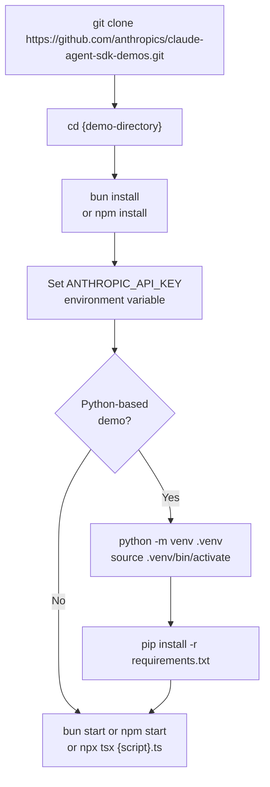
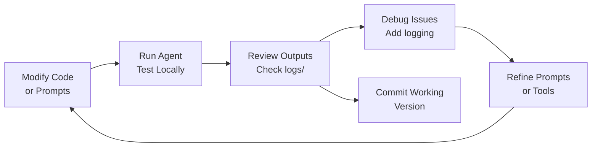
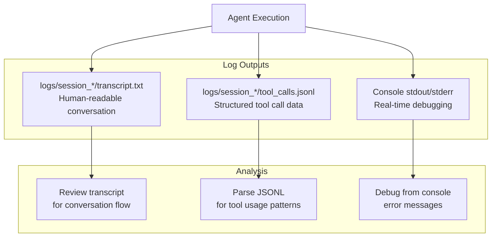
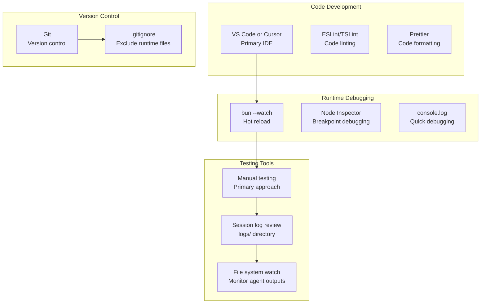

<!-- source: DeepWiki mcp.deepwiki.com · repo anthropics/claude-agent-sdk-demos · page 9 Development Guide · fetched 2026-10-26 -->

# Development Guide

<details>
<summary>Relevant source files</summary>

The following files were used as context for generating this wiki page:

- [README.md](README.md)
- [excel-demo/.gitignore](excel-demo/.gitignore)
- [excel-demo/README.md](excel-demo/README.md)

</details>


This document provides practical guidance for developing applications using the Claude Agent SDK, based on patterns and practices demonstrated across the demo applications in this repository. It covers development environment setup, testing strategies, debugging techniques, and best practices for building reliable agent-based applications.

For SDK-specific integration patterns, see [Claude Agent SDK Integration](#8). For information about the skills system, see [Skills System](#8.5). For custom tool development, see [Custom MCP Servers](#8.6).

---

## Development Environment Setup

### Required Tools and Dependencies

All demo applications share common prerequisites that must be installed before development:

| Tool | Version | Purpose | Installation |
|------|---------|---------|--------------|
| Bun or Node.js | Bun latest or Node.js 18+ | JavaScript runtime | https://bun.sh or https://nodejs.org |
| Anthropic API Key | N/A | Claude model access | https://console.anthropic.com |
| Python | 3.9+ | Python-based demos (excel-demo, research-agent) | https://python.org |
| LibreOffice | Latest | Excel formula recalculation (optional) | Platform-specific |

**Environment Variables**

The primary environment variable required across all demos:

```bash
ANTHROPIC_API_KEY=your_api_key_here
```

Additional environment variables vary by demo. For example, the email-agent requires IMAP credentials (see [Configuration and Setup](#4.8)), while other demos may prompt for credentials on first run.

### Initial Setup Workflow



**Sources:** [README.md:33-51]()

### Project Structure Patterns

Each demo follows a consistent structure pattern:

```mermaid
graph TB
    Root["demo-directory/"]
    
    subgraph "Standard Files"
        README["README.md<br/>Setup instructions"]
        Package["package.json<br/>Dependencies"]
        TSConfig["tsconfig.json<br/>TypeScript config"]
        GitIgnore[".gitignore<br/>Excluded files"]
    end
    
    subgraph "Source Code"
        Src["src/ or root level .ts files"]
        Agent["agent/<br/>Working directory for SDK"]
        Skills[".claude/skills/<br/>Custom skills"]
    end
    
    subgraph "Generated/Runtime"
        Logs["logs/<br/>Session logs"]
        Files["files/<br/>Agent-generated content"]
        CustomScripts["agent/custom_scripts/<br/>Agent-generated scripts"]
        NodeModules["node_modules/<br/>Dependencies"]
    end
    
    Root --> README
    Root --> Package
    Root --> TSConfig
    Root --> GitIgnore
    
    Root --> Src
    Root --> Agent
    Root --> Skills
    
    Root --> Logs
    Root --> Files
    Root --> CustomScripts
    Root --> NodeModules
```



**Sources:** [excel-demo/README.md:89-100](), [excel-demo/.gitignore:1-34]()

---

## Working Directory Management

### Agent Execution Context

The `cwd` (current working directory) option in SDK calls defines the agent's execution sandbox. This is critical for security and file organization:

```typescript
// Example from resume-generator
const cwd = path.join(process.cwd(), 'agent');
query(prompt, { cwd, ... });
```

The agent can only access files within this directory using the `Read`, `Write`, `Glob`, and `Bash` tools.

**Directory Structure Best Practices:**

| Directory | Purpose | Managed By |
|-----------|---------|------------|
| `agent/` | Agent working directory root | Developer |
| `agent/custom_scripts/` | Agent-generated scripts | Agent |
| `agent/files/` | Agent-generated content | Agent |
| `agent/.claude/` | Agent settings (excluded from git) | SDK |
| `agent/.claude/skills/` | Custom skills (included in git) | Developer |

### .gitignore Patterns

Critical exclusions for agent-based projects:

```
.claude
!**/.claude/skills

logs
*.log
node_modules
```

**Explanation:**
- `.claude` directory is excluded (contains runtime state)
- `.claude/skills/` is explicitly included (custom skills are source code)
- `logs/` contains session transcripts and debugging information
- `node_modules/` is standard Node.js exclusion

**Sources:** [excel-demo/.gitignore:1-34]()

---

## Development Workflow Patterns

### Iterative Development Cycle



### Testing Individual Components

For demos with multiple components, test incrementally:

**1. Test SDK Integration:**
```bash
# Test basic SDK connectivity
cd hello-world
npx tsx hello-world.ts "test query"
```

**2. Test Skills:**
```bash
# Test skill loading and execution
cd resume-generator
npx tsx resume-generator.ts "Test Person"
# Check agent/custom_scripts/ for generated files
```

**3. Test Custom Tools:**
```bash
# Test MCP server tools in isolation
# Example: test email search without UI
cd email-agent/server
bun test
```

### Prompt Development Workflow

Prompts are typically defined as constants in the codebase. To iterate on prompts:

1. **Locate the prompt constant** (usually named `SYSTEM_PROMPT`, `LEAD_AGENT_PROMPT`, etc.)
2. **Modify the prompt text** directly in the source file
3. **Test the change** by running the demo
4. **Review agent behavior** in session logs
5. **Iterate** based on results

For example, in research-agent, prompts are loaded from files in the `prompts/` directory, allowing external editing without code changes.

---

## Testing Strategies

### Manual Testing Approaches

The demo applications primarily use manual testing patterns. Key testing dimensions:

**1. Functional Testing:**
- Test each major workflow end-to-end
- Verify generated files match expectations
- Confirm tool usage is appropriate

**2. Prompt Robustness Testing:**
- Test with various input queries
- Test edge cases (empty inputs, very long inputs)
- Test with ambiguous or conflicting instructions

**3. Error Recovery Testing:**
- Test with invalid API keys
- Test with network interruptions
- Test with file system permission issues

### Session Logging for Test Analysis

All demos generate session logs that are invaluable for testing:



**Transcript Analysis:**
- Located in `logs/session_{timestamp}/transcript.txt`
- Contains full conversation including tool uses
- Search for `<tool_use>` blocks to see tool invocations

**JSONL Analysis:**
- Located in `logs/session_{timestamp}/tool_calls.jsonl`
- One JSON object per line
- Contains structured tool call data with timestamps

**Sources:** Based on patterns in research-agent and email-agent implementations

---

## Debugging Techniques

### Console Logging

Add strategic `console.log` statements to track execution flow:

```typescript
// Before SDK call
console.log('Starting agent with prompt:', prompt.substring(0, 100));

// During streaming
for await (const message of query(prompt, options)) {
  console.log('Message type:', message.type);
  if (message.type === 'tool_use') {
    console.log('Tool:', message.tool, 'Input:', message.input);
  }
}
```

### Hook-Based Debugging

Use SDK hooks to intercept and log tool usage:

```typescript
const preToolUseHook: PreToolUseHook = async (args) => {
  console.log(`[HOOK] Tool: ${args.tool}`);
  console.log(`[HOOK] Input:`, JSON.stringify(args.input, null, 2));
  return { action: 'proceed' };
};

query(prompt, {
  hooks: {
    preToolUse: [preToolUseHook]
  }
});
```

This pattern is demonstrated in the resume-generator for validating document generation.

### Real-Time Message Inspection

For V1 API, inspect messages as they stream:

```typescript
for await (const message of query(prompt, options)) {
  console.log('---MESSAGE---');
  console.log(JSON.stringify(message, null, 2));
  console.log('---END MESSAGE---');
}
```

For V2 API, inspect during the stream phase:

```typescript
const stream = session.stream();
for await (const message of stream) {
  console.log('---MESSAGE---');
  console.log(JSON.stringify(message, null, 2));
  console.log('---END MESSAGE---');
}
```

### File System Debugging

Monitor the agent's working directory during execution:

```bash
# In a separate terminal, watch for file changes
watch -n 1 'ls -lR agent/'

# Or use inotify-tools
inotifywait -m -r agent/
```

### Error Message Patterns

Common error messages and their meanings:

| Error Pattern | Cause | Solution |
|---------------|-------|----------|
| `ENOENT: no such file or directory` | Agent trying to read non-existent file | Check file paths in prompts |
| `API key not found` | Missing ANTHROPIC_API_KEY | Set environment variable |
| `Maximum turns reached` | Agent exceeded maxTurns limit | Increase maxTurns or refine prompt |
| `Tool use rejected` | Hook returned reject action | Review hook logic |
| `Permission denied` | File system permission issue | Check cwd directory permissions |

---

## Best Practices

### Prompt Engineering

**1. Be Explicit About Constraints:**
```typescript
const SYSTEM_PROMPT = `
You must follow these rules:
1. NEVER use more than 3 turns
2. ALWAYS verify file existence before reading
3. MUST check output meets requirements before finishing
`;
```

**2. Provide Clear Success Criteria:**
```typescript
const SYSTEM_PROMPT = `
Your task is complete when:
- A file named output.pdf exists
- The file size is > 10KB
- The file contains at least 3 pages
`;
```

**3. Break Complex Tasks into Steps:**
```typescript
const SYSTEM_PROMPT = `
Follow this workflow:
Step 1: Research the topic using WebSearch
Step 2: Synthesize findings into notes
Step 3: Generate code to create the output
Step 4: Execute the code
Step 5: Verify the output meets requirements
`;
```

### Tool Configuration

**Minimize Tool Access:**
Only include tools the agent actually needs:

```typescript
// Bad: too permissive
allowedTools: ['Bash', 'Write', 'Read', 'WebSearch', 'WebFetch', 'Glob']

// Good: specific to task
allowedTools: ['WebSearch', 'Write']
```

**Use Tool Restrictions:**
Configure tools with appropriate limits:

```typescript
{
  tool: 'Bash',
  options: {
    timeout: 30000,  // 30 second timeout
    allowNetworkAccess: false
  }
}
```

### Error Handling

**Graceful Degradation:**
```typescript
try {
  for await (const message of query(prompt, options)) {
    // Process messages
  }
} catch (error) {
  if (error.message.includes('API key')) {
    console.error('API key issue:', error.message);
    console.log('Please set ANTHROPIC_API_KEY environment variable');
  } else if (error.message.includes('rate limit')) {
    console.error('Rate limited. Please wait and retry.');
  } else {
    console.error('Unexpected error:', error);
  }
  process.exit(1);
}
```

**Retry Logic:**
```typescript
async function queryWithRetry(prompt, options, maxRetries = 3) {
  for (let i = 0; i < maxRetries; i++) {
    try {
      return await query(prompt, options);
    } catch (error) {
      if (i === maxRetries - 1) throw error;
      console.log(`Retry ${i + 1}/${maxRetries} after error:`, error.message);
      await new Promise(resolve => setTimeout(resolve, 1000 * (i + 1)));
    }
  }
}
```

### Resource Management

**Session Cleanup (V2 API):**
```typescript
await using session = await unstable_v2_createSession({
  model: 'sonnet',
  cwd: './agent'
});
// Session automatically cleaned up when scope exits
```

**Subprocess Monitoring:**
The SDK spawns subprocesses for tool execution. Monitor resource usage:

```bash
# Check for orphaned processes
ps aux | grep claude-agent

# Monitor subprocess creation
watch -n 1 'ps aux | grep -E "node|bun|python" | wc -l'
```

---

## Common Pitfalls

### 1. Working Directory Confusion

**Problem:** Agent cannot find files that exist in the project.

**Cause:** Files are outside the `cwd` specified in the SDK call.

**Solution:** Ensure all files the agent needs are within the `cwd`:

```typescript
// Bad: agent cannot access ../data/
const cwd = path.join(process.cwd(), 'agent');

// Good: copy data into agent directory or adjust cwd
const cwd = process.cwd(); // if data/ is at project root
```

### 2. Insufficient maxTurns

**Problem:** Agent stops mid-task with "maximum turns reached" error.

**Cause:** Complex tasks require multiple tool uses and responses.

**Solution:** Increase `maxTurns` based on task complexity:

```typescript
// Simple tasks
{ maxTurns: 10 }

// Complex multi-step tasks (like resume generation)
{ maxTurns: 30 }

// Research with many web searches
{ maxTurns: 50 }
```

### 3. Prompt Ambiguity

**Problem:** Agent produces unexpected results or gets confused.

**Cause:** Prompt lacks clarity or contains contradictory instructions.

**Solution:** Test prompts with explicit step-by-step instructions and review session logs to identify where the agent diverged.

### 4. Skills Not Loaded

**Problem:** Agent doesn't follow skill instructions or claims skill doesn't exist.

**Cause:** `settingSources` not set to `'project'` or skills not in `.claude/skills/`.

**Solution:**

```typescript
// Enable project skills
{
  settingSources: 'project',
  cwd: './agent' // must contain .claude/skills/
}
```

Verify skills directory structure:
```
agent/
  .claude/
    skills/
      my-skill/
        SKILL.md
        other-docs.md
```

### 5. Hook Rejection Without Logging

**Problem:** Agent stops unexpectedly during tool use.

**Cause:** A hook returned `{ action: 'reject' }` without explanation.

**Solution:** Always log rejection reasons:

```typescript
const preToolUseHook: PreToolUseHook = async (args) => {
  if (shouldReject(args)) {
    console.error(`Rejecting ${args.tool}: ${reason}`);
    return { 
      action: 'reject',
      message: reason // Sent to agent
    };
  }
  return { action: 'proceed' };
};
```

---

## Performance Considerations

### Token Usage Optimization

**Minimize Context Size:**
- Use focused system prompts (avoid including unnecessary information)
- For skills, ensure documentation is concise but complete
- Use `Read` tool selectively rather than reading entire codebases

**Track Token Consumption:**
Monitor the session logs for token counts to identify inefficiencies:

```typescript
for await (const message of query(prompt, options)) {
  if (message.type === 'usage') {
    console.log('Tokens used:', message.input_tokens, 'input,', 
                message.output_tokens, 'output');
  }
}
```

### Execution Time Management

**Tool Timeout Configuration:**
Set appropriate timeouts for long-running tools:

```typescript
{
  tool: 'Bash',
  options: { timeout: 60000 } // 60 seconds for complex scripts
}
```

**Parallel vs Sequential Execution:**
- The Task tool in research-agent enables parallel subagent execution
- For independent tasks, spawn multiple agents concurrently
- For dependent tasks, enforce sequential execution in the prompt

### Caching Strategies

**File System Caching:**
- Research-agent caches web search results in files
- Email-agent caches emails in SQLite database
- Consider implementing similar caching for repeated data access

**Session State Persistence (V2 API):**
```typescript
// Save session for later resumption
const session = await unstable_v2_createSession({ model: 'sonnet' });
const sessionId = session.sessionId; // Save this

// Later, resume
const resumed = await unstable_v2_resumeSession(sessionId);
```

---

## Security Considerations

### API Key Management

**Never commit API keys:**
```gitignore
.env
.env.local
.anthropic
```

**Use environment variables:**
```typescript
const apiKey = process.env.ANTHROPIC_API_KEY;
if (!apiKey) {
  throw new Error('ANTHROPIC_API_KEY environment variable required');
}
```

### File System Sandboxing

**Always restrict agent to a specific directory:**
```typescript
// Good: agent limited to ./agent subdirectory
const cwd = path.join(process.cwd(), 'agent');

// Bad: agent has access to entire file system
const cwd = '/';
```

**Use absolute paths for cwd:**
```typescript
const cwd = path.resolve('./agent'); // Resolves to absolute path
```

### Tool Restrictions

**Limit Bash tool access:**
```typescript
{
  allowedTools: [
    'Write',
    'Read',
    // Include Bash only if absolutely necessary
    // Never include Bash with network access in production
  ]
}
```

**Validate tool inputs in hooks:**
```typescript
const preToolUseHook: PreToolUseHook = async (args) => {
  if (args.tool === 'Bash') {
    const cmd = args.input.command;
    if (cmd.includes('rm -rf') || cmd.includes('curl')) {
      return { action: 'reject', message: 'Dangerous command blocked' };
    }
  }
  return { action: 'proceed' };
};
```

### Input Validation

**Sanitize user inputs:**
```typescript
function sanitizeInput(userInput: string): string {
  // Remove control characters
  const sanitized = userInput.replace(/[\x00-\x1F\x7F]/g, '');
  
  // Limit length
  return sanitized.substring(0, 10000);
}

const prompt = `Research: ${sanitizeInput(userQuery)}`;
```

**Validate file paths:**
```typescript
function isPathSafe(filePath: string, baseDir: string): boolean {
  const resolved = path.resolve(baseDir, filePath);
  return resolved.startsWith(path.resolve(baseDir));
}
```

---

## Debugging Integration with External Services

### IMAP Debugging (Email Agent)

The email-agent integrates with IMAP servers. Debug connection issues:

```typescript
// Enable IMAP debug logging
const config = {
  imap: {
    host: 'imap.gmail.com',
    port: 993,
    tls: true,
    debug: console.log // Enable debug output
  }
};
```

**Common IMAP Issues:**

| Issue | Cause | Solution |
|-------|-------|----------|
| Authentication failed | App password required | Generate app-specific password |
| Connection timeout | Firewall blocking port 993 | Check network settings |
| IDLE not supported | Server doesn't support IDLE | Fall back to polling |

### WebSocket Debugging (Email Agent)

For real-time communication debugging:

```typescript
// Client-side
const ws = new WebSocket('ws://localhost:3000/ws');
ws.addEventListener('message', (event) => {
  console.log('Received:', event.data);
});
ws.addEventListener('error', (error) => {
  console.error('WebSocket error:', error);
});

// Server-side
const server = Bun.serve({
  websocket: {
    message(ws, message) {
      console.log('Received message:', message);
    },
    error(ws, error) {
      console.error('WebSocket error:', error);
    }
  }
});
```

---

## Development Tool Recommendations

### Essential Tools



### Recommended VS Code Extensions

- **TypeScript and JavaScript Language Features** - Built-in TypeScript support
- **ESLint** - Linting support
- **Prettier** - Code formatting
- **Error Lens** - Inline error highlighting
- **Rest Client** - Test API endpoints
- **SQLite Viewer** - View SQLite databases (for email-agent)

### Log Analysis Tools

**Parse JSONL logs:**
```bash
# Extract all tool uses
cat logs/session_*/tool_calls.jsonl | jq -r '.tool'

# Count tool usage
cat logs/session_*/tool_calls.jsonl | jq -r '.tool' | sort | uniq -c

# Extract failed tool uses
cat logs/session_*/tool_calls.jsonl | jq 'select(.status == "error")'
```

**Watch logs in real-time:**
```bash
tail -f logs/session_*/transcript.txt
```

---

## Continuous Integration Considerations

While the demo applications don't include CI/CD configurations, production applications should consider:

### Automated Testing

```typescript
// Example test structure
describe('Agent Integration', () => {
  it('should generate resume successfully', async () => {
    const result = await generateResume('Test Person');
    expect(result.success).toBe(true);
    expect(fs.existsSync(result.outputPath)).toBe(true);
  });
});
```

### Environment Variable Management

**For CI/CD pipelines:**
- Store `ANTHROPIC_API_KEY` in secrets management (GitHub Secrets, AWS Secrets Manager)
- Use separate API keys for development, staging, and production
- Implement key rotation policies

### Build Validation

**Pre-commit checks:**
```bash
# Run linting
npm run lint

# Type checking
npx tsc --noEmit

# Format checking
npx prettier --check .
```

---

## Migration Between SDK Versions

### V1 to V2 Migration

When migrating from V1 (`query`) to V2 (Session API):

**V1 Pattern:**
```typescript
for await (const message of query(prompt, options)) {
  // Process messages
}
```

**V2 Pattern:**
```typescript
await using session = await unstable_v2_createSession({
  model: 'sonnet',
  cwd: './agent'
});

await session.send(prompt);
const stream = session.stream();
for await (const message of stream) {
  // Process messages
}
```

**Key Differences:**
1. Explicit session lifecycle management
2. Separated `send()` and `stream()` operations
3. Built-in session persistence via `sessionId`
4. Multi-turn context maintained automatically

For complete V2 API documentation, see [V2 API: Session Management](#8.3).

---

## Conclusion

Effective development with the Claude Agent SDK requires:
- Proper working directory isolation
- Strategic use of logging and session transcripts
- Careful prompt engineering with clear constraints
- Appropriate tool selection and configuration
- Robust error handling and retry logic
- Security-conscious practices around API keys and file system access

The demo applications in this repository provide concrete examples of these practices. Study the implementations in [Resume Generator](#3), [Email Agent](#4), and [Research Agent](#5) for production-ready patterns.

**Sources:** [README.md:1-69](), [excel-demo/README.md:1-122](), [excel-demo/.gitignore:1-34]()