<!-- source: DeepWiki mcp.deepwiki.com · repo anthropics/claude-agent-sdk-demos · extra page AI Assistant Messages · fetched 2026-10-26 -->

# AI Assistant Messages

<details>
<summary>Relevant source files</summary>

The following files were used as context for generating this wiki page:

- [email-agent/README.md](email-agent/README.md)
- [email-agent/ccsdk/custom-tools.ts](email-agent/ccsdk/custom-tools.ts)
- [email-agent/ccsdk/email-agent-prompt.ts](email-agent/ccsdk/email-agent-prompt.ts)
- [email-agent/ccsdk/types.ts](email-agent/ccsdk/types.ts)
- [email-agent/client/components/message/AssistantMessage.tsx](email-agent/client/components/message/AssistantMessage.tsx)

</details>


This page documents the `AssistantMessage` component, which renders AI responses from Claude in the Email Agent client interface. This includes text content with markdown formatting, tool use displays, embedded email/listener references, executable action buttons, and dynamic component instances.

For information about the overall client architecture, see [Application Structure](#3.4.1). For the AI integration that generates these messages, see [AI Integration](#3.5). For the custom tools being displayed, see [Custom MCP Tools](#3.5.1).

## Component Architecture

The `AssistantMessage` component is the primary renderer for Claude's responses in the chat interface. It handles multiple content types within a single message and provides collapsible sections for tool details and metadata.

### Message Structure

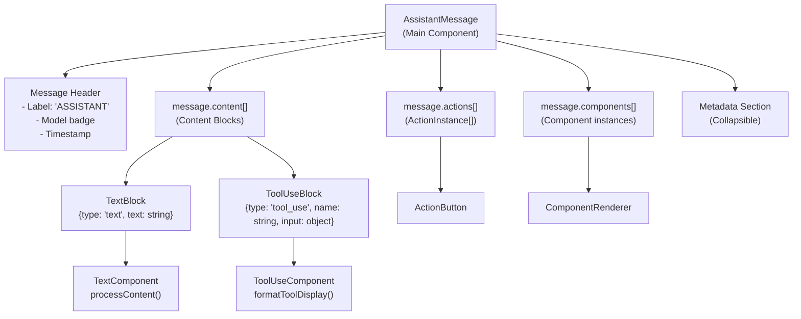

**Sources:** [email-agent/client/components/message/AssistantMessage.tsx:1-514]()

### Component Hierarchy and Props

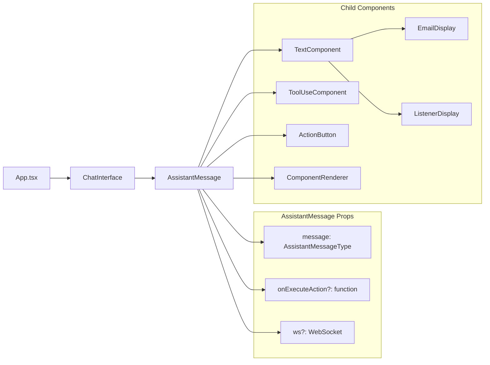

**Sources:** [email-agent/client/components/message/AssistantMessage.tsx:10-14](), [email-agent/client/components/message/AssistantMessage.tsx:413-514]()

## Text Content Rendering

The `TextComponent` handles rendering text blocks with markdown formatting and special reference parsing. It processes `[email:ID]` and `[listener:ID]` patterns to embed interactive components.

### Reference Parsing Flow

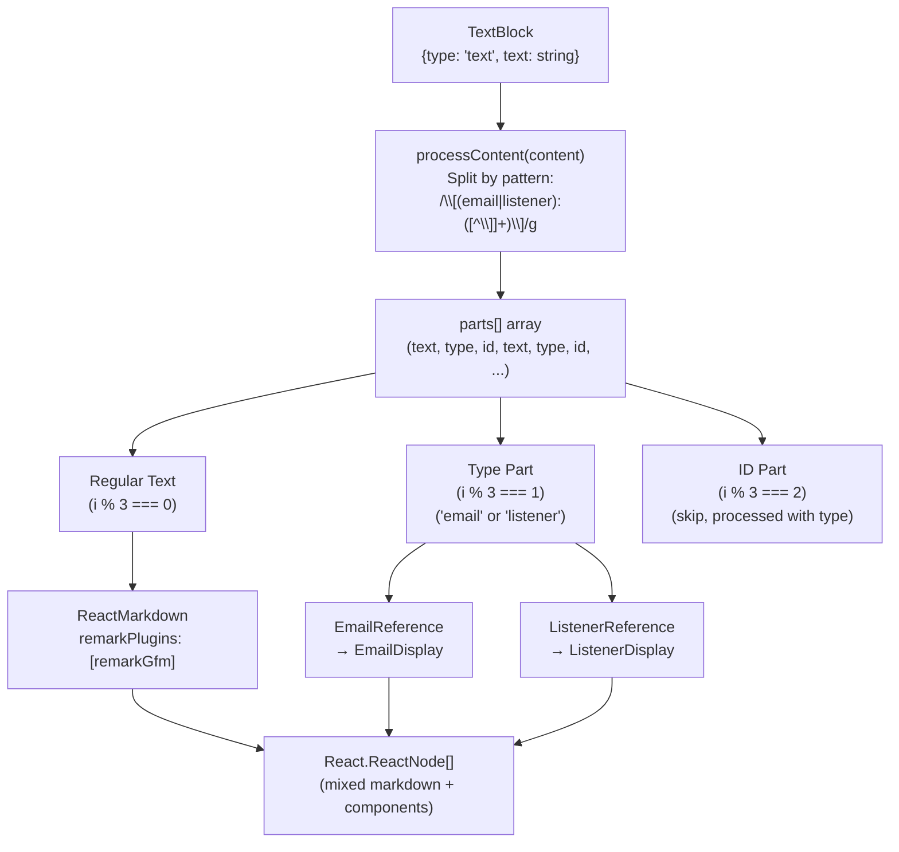

**Sources:** [email-agent/client/components/message/AssistantMessage.tsx:334-411]()

### Markdown Customization

The `TextComponent` uses `react-markdown` with `remark-gfm` for GitHub-flavored markdown support. Custom renderers are provided for consistent styling:

| Element | Customization | Purpose |
|---------|--------------|---------|
| `a` | Gray text with underline | Consistent link styling |
| `code` (inline) | `bg-gray-100 px-1 py-0.5` | Inline code highlighting |
| `code` (block) | `bg-gray-100 p-2 border` | Block code with border |
| `ul` | `list-disc pl-5 space-y-1` | Bulleted lists with spacing |
| `ol` | `list-decimal pl-5 space-y-1` | Numbered lists with spacing |
| `p` | `mb-2` | Paragraph bottom margin |

**Sources:** [email-agent/client/components/message/AssistantMessage.tsx:357-386]()

### Email and Listener References

The agent uses special syntax to embed references in responses:

- **Email references**: `[email:<message-id@example.com>]` - Renders as `EmailDisplay` with `compact={true}`
- **Listener references**: `[listener:filename.ts]` - Renders as `ListenerDisplay` with `compact={true}`

These patterns are documented in the `EMAIL_AGENT_PROMPT`:

```
When presenting email results:
- Reference emails using [email:MESSAGE_ID] format for clickable links
- Reference listeners using [listener:filename] format
```

**Sources:** [email-agent/client/components/message/AssistantMessage.tsx:336-343](), [email-agent/client/components/message/AssistantMessage.tsx:389-399](), [email-agent/ccsdk/email-agent-prompt.ts:30-34]()

## Tool Use Display

The `ToolUseComponent` renders tool invocations with collapsible details. It provides specialized formatting for each SDK tool type.

### Tool Display Structure

```mermaid
graph TB
    ToolUseBlock["ToolUseBlock<br/>{type: 'tool_use'<br/>name: string<br/>input: object<br/>id: string}"]
    
    Header["Tool Header<br/>- 'TOOL: {name}'<br/>- Expand/collapse button"]
    
    FormatToolDisplay["formatToolDisplay()<br/>Switch on toolUse.name"]
    
    ReadFormat["Read Tool<br/>- file_path<br/>- offset (optional)<br/>- limit (optional)"]
    WriteFormat["Write Tool<br/>- file_path<br/>- content (truncated)"]
    EditFormat["Edit/MultiEdit Tool<br/>- file_path<br/>- old_string/new_string<br/>- replace_all flag"]
    BashFormat["Bash Tool<br/>- command<br/>- description<br/>- run_in_background<br/>- timeout"]
    GrepFormat["Grep Tool<br/>- pattern<br/>- path/glob<br/>- flags (-i, -n, multiline)"]
    GlobFormat["Glob Tool<br/>- pattern<br/>- path"]
    WebSearchFormat["WebSearch Tool<br/>- query<br/>- allowed_domains"]
    WebFetchFormat["WebFetch Tool<br/>- url<br/>- prompt"]
    TaskFormat["Task Tool<br/>- subagent_type<br/>- description<br/>- prompt"]
    TodoWriteFormat["TodoWrite Tool<br/>- todos array<br/>- status indicators"]
    NotebookEditFormat["NotebookEdit Tool<br/>- notebook_path<br/>- cell_id<br/>- cell_type<br/>- edit_mode"]
    ExitPlanFormat["ExitPlanMode Tool<br/>- plan (text)"]
    DefaultFormat["Default<br/>JSON.stringify(input)"]
    
    ToolUseBlock --> Header
    ToolUseBlock --> FormatToolDisplay
    
    FormatToolDisplay --> ReadFormat
    FormatToolDisplay --> WriteFormat
    FormatToolDisplay --> EditFormat
    FormatToolDisplay --> BashFormat
    FormatToolDisplay --> GrepFormat
    FormatToolDisplay --> GlobFormat
    FormatToolDisplay --> WebSearchFormat
    FormatToolDisplay --> WebFetchFormat
    FormatToolDisplay --> TaskFormat
    FormatToolDisplay --> TodoWriteFormat
    FormatToolDisplay --> NotebookEditFormat
    FormatToolDisplay --> ExitPlanFormat
    FormatToolDisplay --> DefaultFormat
```

**Sources:** [email-agent/client/components/message/AssistantMessage.tsx:20-332]()

### Tool Formatting Examples

#### Read Tool Display

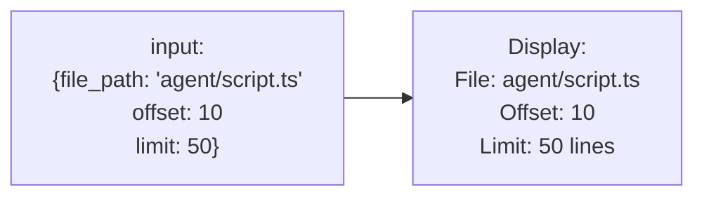

#### Bash Tool Display

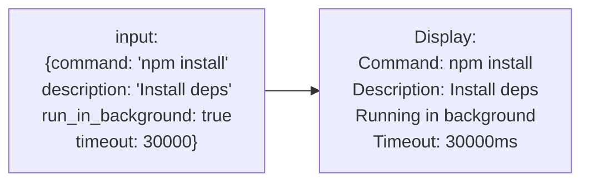

#### Task Tool Display

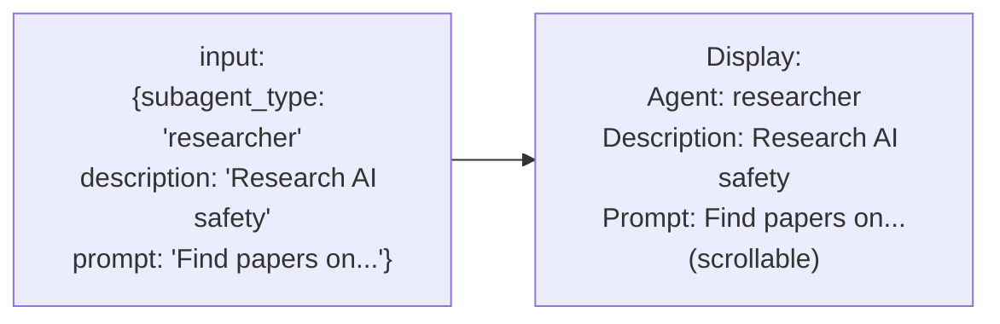

**Sources:** [email-agent/client/components/message/AssistantMessage.tsx:28-295]()

### Expandable Tool Details

Each tool display has an expand/collapse state controlled by `useState`:

```
[isExpanded, setIsExpanded] = useState(false)
```

The header shows:
- Tool name in uppercase: `TOOL: {toolUse.name}`
- Toggle button: `[+]` (collapsed) or `[-]` (expanded)

When expanded, the formatted tool parameters are displayed with appropriate styling (borders, backgrounds, mono fonts for code).

**Sources:** [email-agent/client/components/message/AssistantMessage.tsx:20-22](), [email-agent/client/components/message/AssistantMessage.tsx:307-331]()

## Action Buttons

The `AssistantMessage` component renders executable action buttons when `message.actions` is present. These are one-click templates created by the action-creator skill.

### Action Rendering Flow

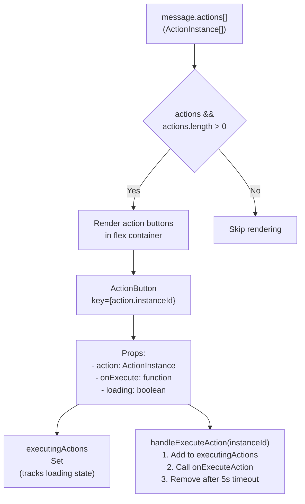

**Sources:** [email-agent/client/components/message/AssistantMessage.tsx:414-428](), [email-agent/client/components/message/AssistantMessage.tsx:458-469]()

### Action Execution State Management

The component maintains a `Set<string>` of executing action IDs to show loading states:

```typescript
const [executingActions, setExecutingActions] = useState<Set<string>>(new Set());
```

When an action is triggered:
1. The `instanceId` is added to `executingActions`
2. The parent's `onExecuteAction` callback is invoked
3. After 5 seconds, the ID is removed (timeout fallback)

This provides visual feedback during action execution.

**Sources:** [email-agent/client/components/message/AssistantMessage.tsx:415](), [email-agent/client/components/message/AssistantMessage.tsx:417-428]()

## Dynamic Component Rendering

The `AssistantMessage` component can render dynamic component instances created by the AI. These are managed through the `ComponentRenderer`.

### Component Instance Flow

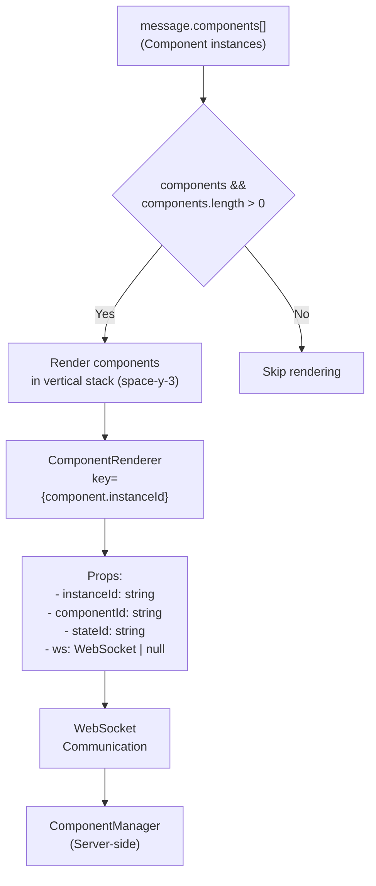

**Sources:** [email-agent/client/components/message/AssistantMessage.tsx:472-484]()

### Component Props Structure

Each component instance has:

| Property | Type | Description |
|----------|------|-------------|
| `instanceId` | string | Unique identifier for this instance |
| `componentId` | string | Type/template of the component |
| `stateId` | string | Associated state identifier |

The `ComponentRenderer` uses these IDs to:
- Fetch component definition from server
- Subscribe to state updates via WebSocket
- Render the appropriate UI

**Sources:** [email-agent/client/components/message/AssistantMessage.tsx:474-481]()

## Metadata Display

The `AssistantMessage` component includes a collapsible metadata section showing model information and token usage.

### Metadata Structure

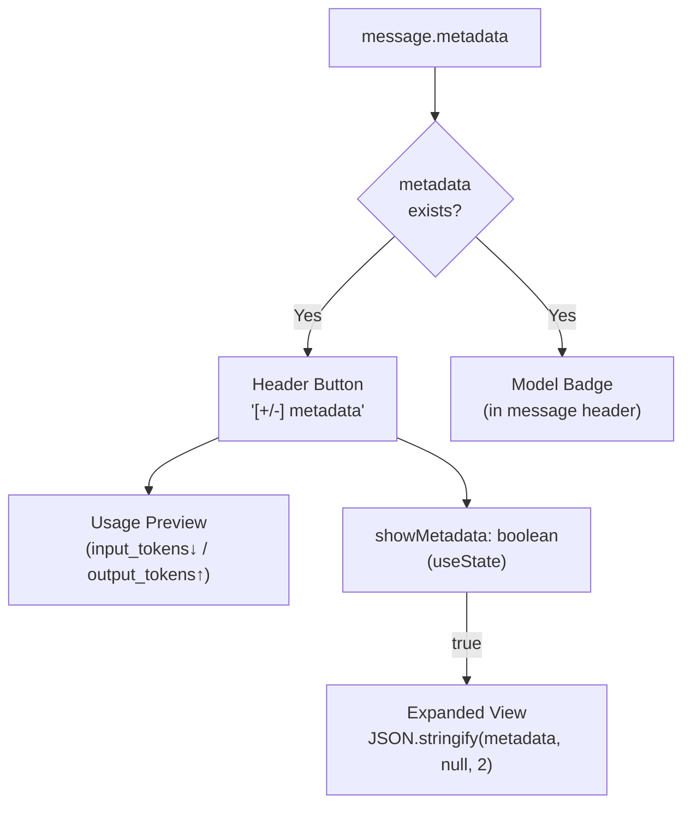

**Sources:** [email-agent/client/components/message/AssistantMessage.tsx:434-439](), [email-agent/client/components/message/AssistantMessage.tsx:486-511]()

### Metadata Display Elements

**In Message Header:**
- Model badge: `message.metadata.model` displayed as a gray badge (e.g., "claude-3-5-sonnet-20241022")

**In Collapsible Section:**
- Collapsed: Shows token counts as `(input_tokens↓ / output_tokens↑)`
- Expanded: Shows full metadata JSON with 2-space indentation in a bordered, scrollable container

**Sources:** [email-agent/client/components/message/AssistantMessage.tsx:434-439](), [email-agent/client/components/message/AssistantMessage.tsx:495-499](), [email-agent/client/components/message/AssistantMessage.tsx:503-509]()

## TypeScript Types

The component uses types defined in `types.ts`:

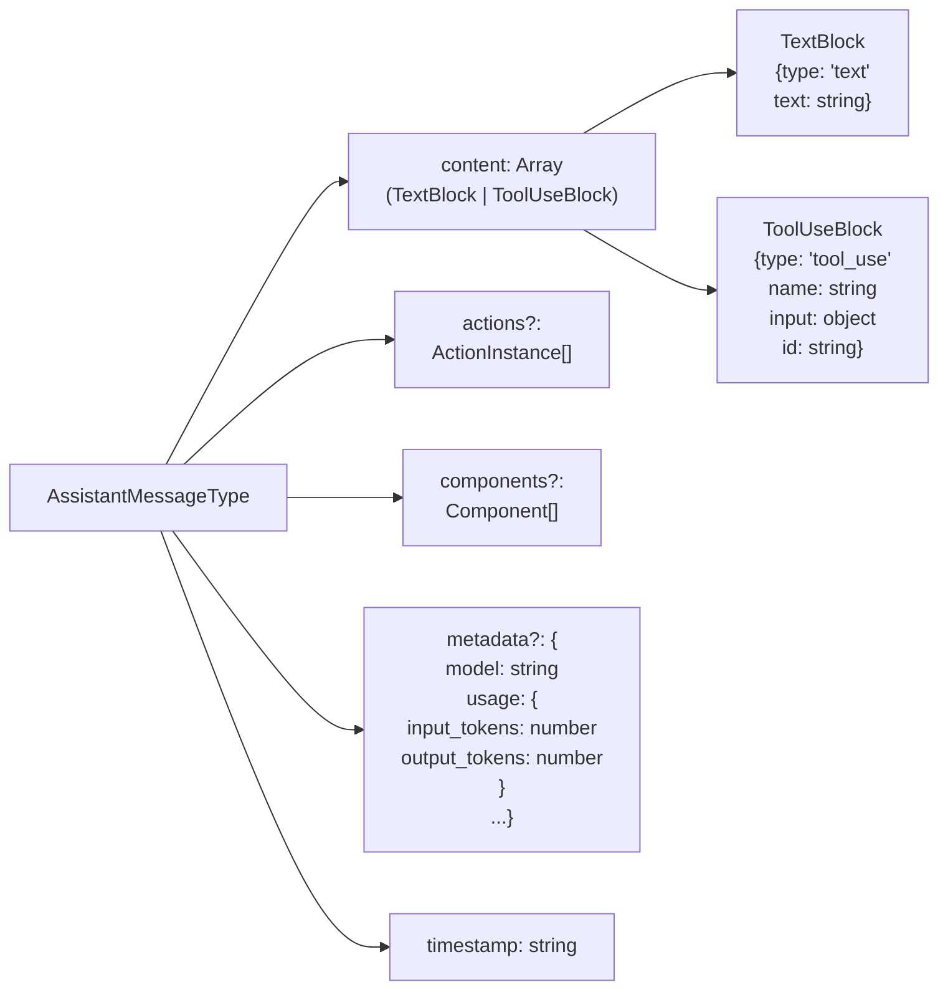

**Sources:** [email-agent/client/components/message/AssistantMessage.tsx:4]()

## Styling and Layout

The `AssistantMessage` component uses Tailwind CSS for styling with a consistent design system:

| Section | Classes | Purpose |
|---------|---------|---------|
| Container | `mb-3 p-3 bg-gray-50 border border-gray-200` | Light gray background, bordered |
| Header | `flex justify-between items-start mb-2` | Two-column layout |
| Label | `text-xs font-semibold text-gray-600 uppercase tracking-wider` | Small caps label |
| Model Badge | `ml-2 px-1 py-0.5 text-xs bg-gray-200 text-gray-600 font-mono` | Monospace gray badge |
| Timestamp | `text-xs text-gray-400` | Subtle timestamp |
| Tool Container | `mt-2 border border-gray-200 bg-gray-50` | Nested bordered section |
| Tool Header | `p-2 border-b border-gray-200 bg-white` | White header bar |
| Code Display | `font-mono` with various backgrounds | Monospace for technical content |
| Actions | `flex gap-2 mt-3 flex-wrap` | Horizontal action button row |
| Components | `mt-3 space-y-3` | Vertical component stack |

**Sources:** [email-agent/client/components/message/AssistantMessage.tsx:431-512]()

---

