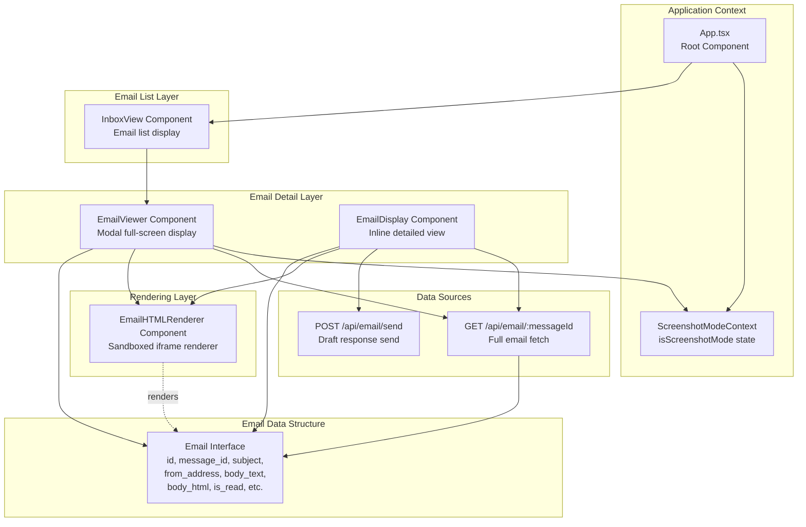
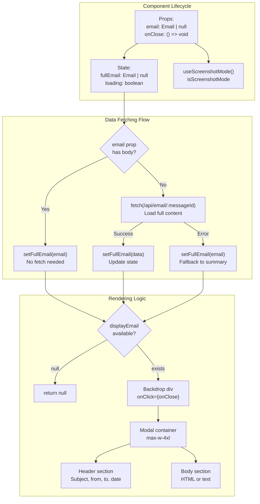
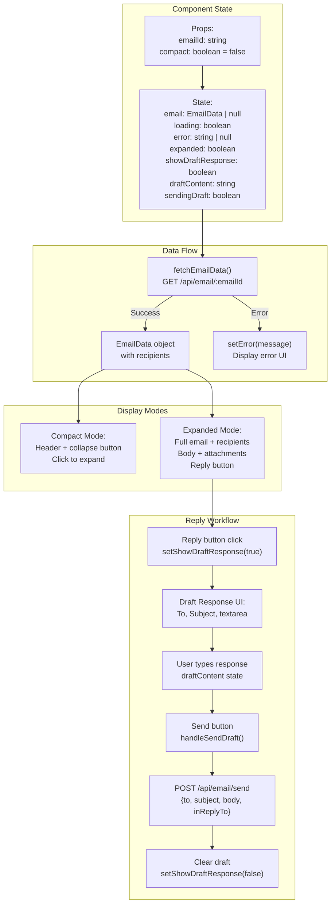
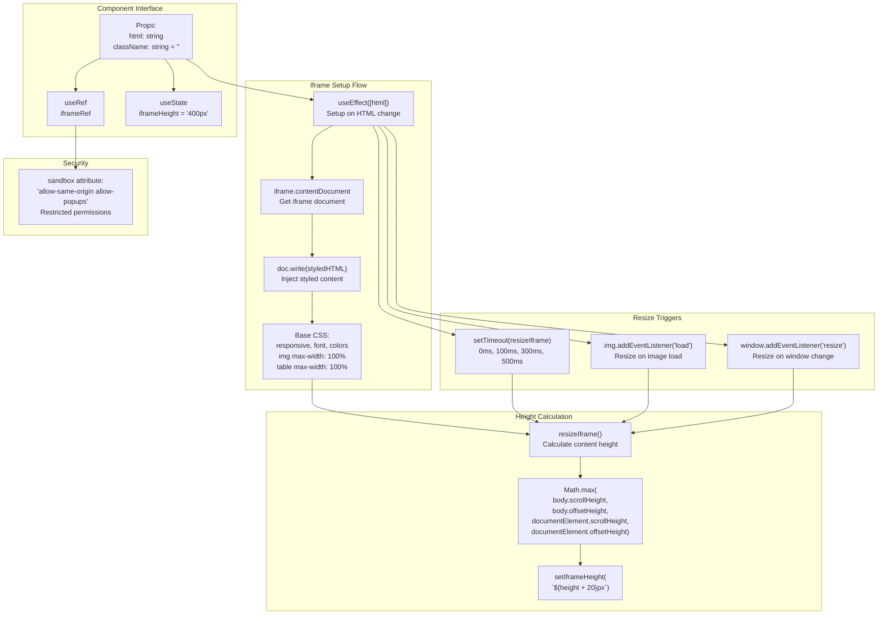

<!-- source: DeepWiki mcp.deepwiki.com · repo anthropics/claude-agent-sdk-demos · extra page Email Viewing Components · fetched 2026-10-26 -->

# Email Viewing Components

<details>
<summary>Relevant source files</summary>

The following files were used as context for generating this wiki page:

- [email-agent/client/components/EmailDisplay.tsx](email-agent/client/components/EmailDisplay.tsx)
- [email-agent/client/components/EmailHTMLRenderer.tsx](email-agent/client/components/EmailHTMLRenderer.tsx)
- [email-agent/client/components/EmailViewer.tsx](email-agent/client/components/EmailViewer.tsx)

</details>


## Purpose and Scope

This page documents the React components responsible for displaying email content in the Email Agent demo. These components handle rendering email messages, including HTML and plain text bodies, metadata display, and user interactions. For information about the inbox list view and email selection, see [4.4.3](#4.4.3). For details about the application structure and WebSocket integration, see [4.4.1](#4.4.1).

The email viewing system consists of three primary components:
- `EmailViewer`: Full-screen modal display for reading emails
- `EmailDisplay`: Inline email display with reply functionality
- `EmailHTMLRenderer`: Safe HTML rendering in isolated iframes

## Component Architecture

The email viewing components form a layered rendering system where each component serves a distinct display purpose.



**Sources:** [email-agent/client/components/EmailViewer.tsx:1-166](), [email-agent/client/components/EmailDisplay.tsx:1-303](), [email-agent/client/components/EmailHTMLRenderer.tsx:1-137]()

## Email Data Interface

Both `EmailViewer` and `EmailDisplay` consume email data through a structured interface. The components handle two levels of email detail: summary data (from inbox listings) and full email data (fetched on demand).

| Field | Type | Purpose |
|-------|------|---------|
| `id` | `number` | Database primary key |
| `message_id` | `string` | Unique email identifier |
| `subject` | `string` | Email subject line |
| `from_address` | `string` | Sender email address |
| `from_name` | `string` (optional) | Sender display name |
| `to_address` | `string` (optional) | Recipient address |
| `date_sent` | `string` | ISO timestamp |
| `body_text` | `string` (optional) | Plain text body |
| `body_html` | `string` (optional) | HTML body |
| `snippet` | `string` (optional) | Brief preview text |
| `is_read` | `boolean` | Read status flag |
| `is_starred` | `boolean` | Starred status flag |
| `has_attachments` | `boolean` | Attachment presence flag |
| `folder` | `string` (optional) | IMAP folder name |
| `recipients` | `object` (optional) | `to`, `cc`, `bcc` arrays |

**Sources:** [email-agent/client/components/EmailViewer.tsx:12-27](), [email-agent/client/components/EmailDisplay.tsx:5-24]()

## EmailViewer Component

### Modal Display Pattern

`EmailViewer` implements a full-screen modal overlay for focused email reading. The component renders over a backdrop that closes the viewer on click.



**Sources:** [email-agent/client/components/EmailViewer.tsx:34-166]()

### Lazy Email Loading

The component implements lazy loading to optimize performance. If the email prop contains `body_html` or `body_text`, it renders immediately. Otherwise, it fetches the full email content from the server.

[email-agent/client/components/EmailViewer.tsx:39-73]()

```typescript
useEffect(() => {
  if (!email) {
    setFullEmail(null);
    return;
  }

  // If email already has body_html or body_text, use it directly
  if (email.body_html || email.body_text) {
    setFullEmail(email);
    return;
  }

  // Otherwise fetch the full email
  const fetchFullEmail = async () => {
    setLoading(true);
    try {
      const response = await fetch(`/api/email/${encodeURIComponent(email.message_id)}`);
      if (response.ok) {
        const data = await response.json();
        setFullEmail(data);
      } else {
        // Fallback to the summary email if fetch fails
        setFullEmail(email);
      }
    } catch (error) {
      console.error('Error fetching full email:', error);
      setFullEmail(email);
    } finally {
      setLoading(false);
    }
  };

  fetchFullEmail();
}, [email]);
```

**Sources:** [email-agent/client/components/EmailViewer.tsx:40-73]()

### Screenshot Mode Integration

`EmailViewer` integrates with the `ScreenshotModeContext` to replace sensitive data with placeholders for demonstration screenshots. This affects subject lines, email addresses, names, dates, and body content.

[email-agent/client/components/EmailViewer.tsx:110-131]()

The component uses placeholder functions (`getPlaceholderSubject`, `getPlaceholderEmail`, `getPlaceholderName`, `getPlaceholderBodyText`) imported from `../utils/placeholders` when `isScreenshotMode` is true.

**Sources:** [email-agent/client/components/EmailViewer.tsx:3-10](), [email-agent/client/components/EmailViewer.tsx:35](), [email-agent/client/components/EmailViewer.tsx:110-160]()

### Modal Layout Structure

The modal uses a fixed overlay with centered content container:

| Section | CSS Classes | Purpose |
|---------|-------------|---------|
| Backdrop | `fixed inset-0 bg-black bg-opacity-30 z-40` | Dimmed overlay with click-to-close |
| Container | `fixed inset-0 flex items-center justify-center z-50 p-8` | Centering wrapper |
| Modal | `w-full max-w-4xl h-full bg-white rounded-lg shadow-2xl` | Email display surface |
| Header | `px-6 py-4 border-b border-gray-200` | Metadata section |
| Body | `flex-1 overflow-y-auto` | Scrollable content area |

**Sources:** [email-agent/client/components/EmailViewer.tsx:94-164]()

### Date Formatting

The `formatDate` function [email-agent/client/components/EmailViewer.tsx:82-92]() converts ISO date strings to a localized format:

```
weekday: 'short',
year: 'numeric',
month: 'short',
day: 'numeric',
hour: '2-digit',
minute: '2-digit'
```

Example output: `"Mon, Jan 1, 2024, 10:30 AM"`

**Sources:** [email-agent/client/components/EmailViewer.tsx:82-92]()

## EmailDisplay Component

### Inline Display with Reply Support

`EmailDisplay` provides an inline email viewer with advanced features including compact/expanded modes, draft responses, and email sending capabilities. Unlike `EmailViewer`, this component is designed for embedding within message threads or assistant responses.



**Sources:** [email-agent/client/components/EmailDisplay.tsx:26-303]()

### Compact vs Expanded Mode

The `compact` prop controls the initial display mode and enables click-to-toggle functionality:

- **Compact Mode** [email-agent/client/components/EmailDisplay.tsx:154-194](): Shows header only with `[+]` expand button
- **Expanded Mode** [email-agent/client/components/EmailDisplay.tsx:195-299](): Shows full email with recipients, body, attachments, and reply button

The `expanded` state is initialized based on the `compact` prop [email-agent/client/components/EmailDisplay.tsx:35]():
```typescript
const [expanded, setExpanded] = useState(!compact);
```

**Sources:** [email-agent/client/components/EmailDisplay.tsx:31-36](), [email-agent/client/components/EmailDisplay.tsx:152-300]()

### Relative Date Formatting

`EmailDisplay` implements a smart date formatter that displays relative times for recent emails and absolute dates for older ones [email-agent/client/components/EmailDisplay.tsx:64-87]():

| Age | Display Format | Example |
|-----|----------------|---------|
| < 24 hours | Time only | `"10:30 AM"` |
| 24-48 hours | Relative day | `"Yesterday"` |
| 2-7 days | Weekday name | `"Monday"` |
| > 7 days | Date | `"Jan 15"` or `"Jan 15, 2023"` |

**Sources:** [email-agent/client/components/EmailDisplay.tsx:64-87]()

### Draft Response System

The draft response workflow involves multiple UI states and API interactions:

1. **Reply Button** [email-agent/client/components/EmailDisplay.tsx:230-240](): Triggers `setShowDraftResponse(true)`
2. **Draft UI** [email-agent/client/components/EmailDisplay.tsx:243-297](): Shows recipient (`email.from_address`), subject (`Re: ${email.subject}`), and textarea
3. **Send Handler** [email-agent/client/components/EmailDisplay.tsx:89-124](): Posts to `/api/email/send` with `inReplyTo` field set to `emailId`

The `sendingDraft` state [email-agent/client/components/EmailDisplay.tsx:38]() disables the textarea and send button during transmission to prevent duplicate sends.

**Sources:** [email-agent/client/components/EmailDisplay.tsx:36-38](), [email-agent/client/components/EmailDisplay.tsx:89-124](), [email-agent/client/components/EmailDisplay.tsx:230-297]()

### Loading and Error States

The component handles three distinct states with appropriate UI feedback:

**Loading State** [email-agent/client/components/EmailDisplay.tsx:126-134]():
```typescript
return (
  <div className="border border-gray-200 p-3 bg-gray-50 animate-pulse">
    <div className="h-3 bg-gray-200 w-3/4 mb-2"></div>
    <div className="h-2 bg-gray-200 w-1/2 mb-2"></div>
    <div className="h-2 bg-gray-200 w-full"></div>
  </div>
);
```

**Error State** [email-agent/client/components/EmailDisplay.tsx:136-145]():
```typescript
return (
  <div className="border border-gray-300 p-3 bg-gray-50">
    <div className="flex items-center text-gray-600">
      <AlertCircle className="w-3 h-3 mr-2" />
      <span className="text-xs">{error}</span>
    </div>
  </div>
);
```

**Sources:** [email-agent/client/components/EmailDisplay.tsx:126-149]()

### Recipient Display

When expanded, the component displays recipient information from the `recipients` field [email-agent/client/components/EmailDisplay.tsx:197-208]():

- `to`: Primary recipients (always shown if present)
- `cc`: Carbon copy recipients (shown if non-empty array)
- `bcc`: Blind carbon copy (typically not included in received emails)

**Sources:** [email-agent/client/components/EmailDisplay.tsx:197-208]()

### Attachment Indicators

The component displays attachment information when `has_attachments` is true [email-agent/client/components/EmailDisplay.tsx:220-227]():

```typescript
{email.has_attachments && (
  <div className="mt-2 pt-2 border-t border-gray-200">
    <div className="flex items-center gap-2 text-xs text-gray-600">
      <Paperclip className="w-3 h-3" />
      <span className="uppercase">{email.attachment_count} attachment{email.attachment_count !== 1 ? 's' : ''}</span>
    </div>
  </div>
)}
```

**Sources:** [email-agent/client/components/EmailDisplay.tsx:220-227]()

## EmailHTMLRenderer Component

### Sandboxed Iframe Architecture

`EmailHTMLRenderer` isolates email HTML content within a sandboxed iframe to prevent security vulnerabilities and layout interference. The component implements automatic height adjustment and responsive styling.



**Sources:** [email-agent/client/components/EmailHTMLRenderer.tsx:1-137]()

### Styled HTML Injection

The component wraps the raw email HTML with a complete HTML document structure including responsive CSS [email-agent/client/components/EmailHTMLRenderer.tsx:29-67]():

```html
<!DOCTYPE html>
<html>
  <head>
    <meta charset="UTF-8">
    <meta name="viewport" content="width=device-width, initial-scale=1.0">
    <style>
      body {
        margin: 0;
        padding: 16px;
        font-family: -apple-system, BlinkMacSystemFont, 'Segoe UI', 'Roboto', 'Helvetica', 'Arial', sans-serif;
        font-size: 14px;
        line-height: 1.5;
        color: #374151;
        overflow-x: hidden;
        word-wrap: break-word;
      }
      img {
        max-width: 100% !important;
        height: auto !important;
      }
      table {
        max-width: 100% !important;
      }
      * {
        max-width: 100%;
        box-sizing: border-box;
      }
      a {
        color: #2563eb;
        text-decoration: underline;
      }
    </style>
  </head>
  <body>
    ${html}
  </body>
</html>
```

The `!important` declarations ensure that inline styles from the email cannot break the responsive layout.

**Sources:** [email-agent/client/components/EmailHTMLRenderer.tsx:29-70]()

### Dynamic Height Adjustment

The component implements a multi-stage height calculation strategy to handle various loading scenarios [email-agent/client/components/EmailHTMLRenderer.tsx:72-109]():

1. **Multiple timeout attempts** [email-agent/client/components/EmailHTMLRenderer.tsx:89-93](): Resize at 0ms, 100ms, 300ms, and 500ms to catch content rendering at different stages
2. **Image load listeners** [email-agent/client/components/EmailHTMLRenderer.tsx:95-100](): Resize when images complete loading
3. **Window resize listener** [email-agent/client/components/EmailHTMLRenderer.tsx:102-104](): Adjust height on window size changes

The height calculation uses the maximum of multiple DOM properties [email-agent/client/components/EmailHTMLRenderer.tsx:76-81]():
```typescript
const height = Math.max(
  doc.body.scrollHeight,
  doc.body.offsetHeight,
  doc.documentElement.scrollHeight,
  doc.documentElement.offsetHeight
);
```

**Sources:** [email-agent/client/components/EmailHTMLRenderer.tsx:72-109]()

### Security Sandbox Attributes

The iframe uses the `sandbox` attribute to restrict capabilities [email-agent/client/components/EmailHTMLRenderer.tsx:132]():

```typescript
sandbox="allow-same-origin allow-popups"
```

| Allowed | Purpose |
|---------|---------|
| `allow-same-origin` | Enables content document access for height calculation and styling |
| `allow-popups` | Allows links to open in new windows |

**Blocked by default:**
- `allow-scripts`: JavaScript execution disabled
- `allow-forms`: Form submission blocked
- `allow-top-navigation`: Cannot navigate parent window

This configuration prevents malicious email HTML from executing JavaScript or performing unauthorized actions while maintaining necessary functionality for display and link navigation.

**Sources:** [email-agent/client/components/EmailHTMLRenderer.tsx:128-134]()

### Fallback Rendering

When no HTML content is available, the component renders a fallback message [email-agent/client/components/EmailHTMLRenderer.tsx:119-125]():

```typescript
if (!html) {
  return (
    <div className={`p-4 text-gray-400 italic text-sm ${className}`}>
      No HTML content available
    </div>
  );
}
```

**Sources:** [email-agent/client/components/EmailHTMLRenderer.tsx:119-125]()

## Content Rendering Priority

Both `EmailViewer` and `EmailDisplay` follow the same content rendering priority:

1. **HTML Body** (if `body_html` exists): Render via `EmailHTMLRenderer`
2. **Plain Text Body** (if `body_text` exists): Render as preformatted text with `whitespace-pre-wrap`
3. **Snippet** (if available): Render snippet text
4. **Fallback**: Display "No content available"

**EmailViewer rendering logic** [email-agent/client/components/EmailViewer.tsx:146-161]():
```typescript
{isScreenshotMode ? (
  <pre className="whitespace-pre-wrap font-sans text-sm text-gray-900 p-6">
    {getPlaceholderBodyText()}
  </pre>
) : loading ? (
  <div className="flex items-center justify-center p-6">
    <div className="text-sm text-gray-500">Loading email content...</div>
  </div>
) : displayEmail.body_html ? (
  <EmailHTMLRenderer html={displayEmail.body_html} className="min-h-[600px]" />
) : (
  <pre className="whitespace-pre-wrap font-sans text-sm text-gray-900 p-6">
    {displayEmail.body_text || displayEmail.snippet || 'No content available'}
  </pre>
)}
```

**EmailDisplay rendering logic** [email-agent/client/components/EmailDisplay.tsx:210-218]():
```typescript
<div className="mt-2 bg-white border border-gray-200">
  {email.body_html ? (
    <EmailHTMLRenderer html={email.body_html} className="min-h-[400px]" />
  ) : email.body_text ? (
    <div className="p-2 whitespace-pre-wrap font-mono text-xs">{email.body_text}</div>
  ) : (
    <div className="p-2 text-gray-400 italic text-xs">No content available</div>
  )}
</div>
```

**Sources:** [email-agent/client/components/EmailViewer.tsx:145-161](), [email-agent/client/components/EmailDisplay.tsx:210-218]()

## Integration with Parent Components

### EmailViewer Integration

`EmailViewer` is typically invoked from `InboxView` or other list components when a user selects an email for full-screen viewing:

```typescript
const [selectedEmail, setSelectedEmail] = useState<Email | null>(null);

// In render:
<EmailViewer 
  email={selectedEmail} 
  onClose={() => setSelectedEmail(null)} 
/>
```

The `onClose` callback resets the selected email state, closing the modal.

**Sources:** [email-agent/client/components/EmailViewer.tsx:29-32]()

### EmailDisplay Integration

`EmailDisplay` is commonly embedded within `AssistantMessage` components to display emails referenced by the AI assistant. The component requires only an `emailId` string:

```typescript
<EmailDisplay emailId={messageId} compact={true} />
```

The `compact` prop is typically set to `true` for inline contexts to conserve vertical space.

**Sources:** [email-agent/client/components/EmailDisplay.tsx:26-29]()

### EmailHTMLRenderer Integration

Both `EmailViewer` and `EmailDisplay` instantiate `EmailHTMLRenderer` directly when `body_html` is present:

```typescript
<EmailHTMLRenderer 
  html={displayEmail.body_html} 
  className="min-h-[600px]" 
/>
```

The `className` prop allows the parent to set minimum height constraints for the iframe container.

**Sources:** [email-agent/client/components/EmailViewer.tsx:155](), [email-agent/client/components/EmailDisplay.tsx:212]()

## CSS Styling Patterns

All three components follow a consistent styling approach using Tailwind CSS utility classes:

| Pattern | Usage |
|---------|-------|
| Border utilities | `border border-gray-200`, `border-t border-gray-200` |
| Spacing | `p-3`, `px-6 py-4`, `gap-2`, `space-y-1` |
| Typography | `text-sm`, `text-xs`, `font-semibold`, `uppercase` |
| Colors | `text-gray-900`, `text-gray-600`, `bg-gray-50` |
| Layout | `flex`, `flex-1`, `items-center`, `justify-between` |
| Responsive | `max-w-4xl`, `w-full`, `min-h-[600px]` |
| Interactive | `hover:bg-gray-100`, `transition-colors`, `cursor-pointer` |

The components avoid custom CSS files, relying entirely on Tailwind's utility-first approach for maintainability and consistency.

**Sources:** [email-agent/client/components/EmailViewer.tsx:94-164](), [email-agent/client/components/EmailDisplay.tsx:152-301](), [email-agent/client/components/EmailHTMLRenderer.tsx:127-135]()

---

