<!-- source: DeepWiki mcp.deepwiki.com · repo anthropics/claude-agent-sdk-demos · extra page IMAP Integration and Email Sync · fetched 2026-10-26 -->

# IMAP Integration and Email Sync

<details>
<summary>Relevant source files</summary>

The following files were used as context for generating this wiki page:

- [email-agent/bun.lock](email-agent/bun.lock)
- [email-agent/client/globals.css](email-agent/client/globals.css)
- [email-agent/database/database-manager.ts](email-agent/database/database-manager.ts)
- [email-agent/package.json](email-agent/package.json)
- [email-agent/server/endpoints/emails.ts](email-agent/server/endpoints/emails.ts)
- [email-agent/server/server.ts](email-agent/server/server.ts)
- [email-agent/tailwind.config.js](email-agent/tailwind.config.js)

</details>


## Purpose and Scope

This document details the IMAP integration layer and email synchronization mechanisms in the Email Agent demo. It covers the `ImapManager` singleton for IMAP server communication, the `EmailSyncService` for orchestrating synchronization between IMAP and SQLite, and the real-time IDLE monitoring system for new email notifications.

For information about the SQLite database schema and search operations, see [Schema and Models](#3.3.1). For details on how custom MCP tools use this layer to serve AI queries, see [Custom MCP Tools](#3.5.1).

---

## Architecture Overview

The IMAP integration implements a dual-source data strategy combining live IMAP access with local SQLite caching. The `ImapManager` handles direct IMAP server operations, while the `EmailSyncService` orchestrates data flow between IMAP and the database.

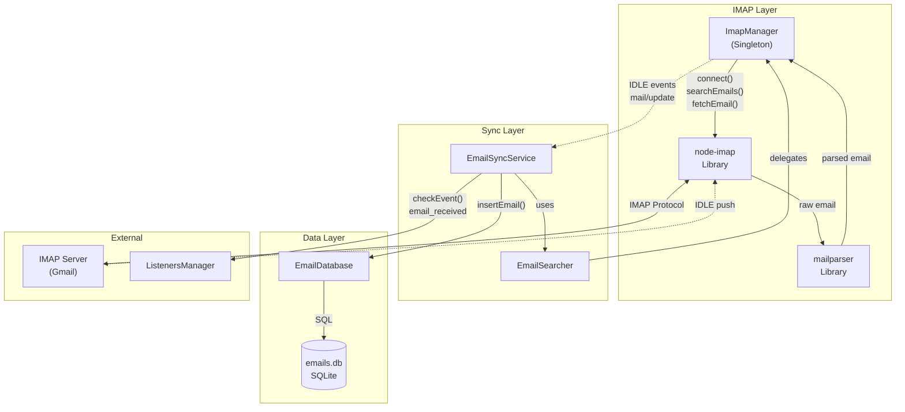

**Sources:** [email-agent/database/imap-manager.ts:1-61](), [email-agent/database/email-sync.ts:1-35]()

---

## ImapManager Class

### Singleton Pattern and Configuration

The `ImapManager` implements the singleton pattern to ensure a single IMAP connection per application instance. Configuration is sourced from environment variables or explicit constructor parameters.

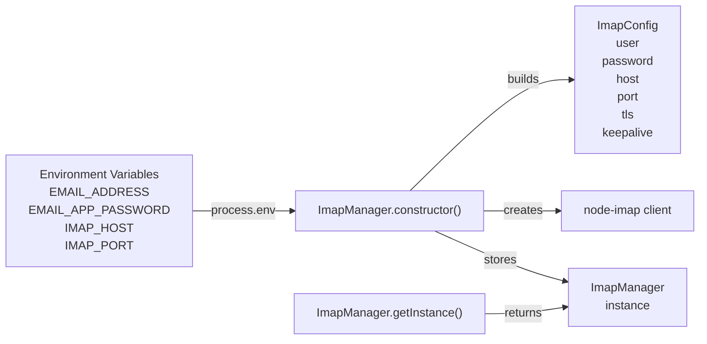

The configuration includes keepalive settings for maintaining long-lived connections:

| Parameter | Default Value | Purpose |
|-----------|--------------|---------|
| `connTimeout` | 30000ms | Maximum connection establishment time |
| `authTimeout` | 30000ms | Maximum authentication time |
| `keepalive.interval` | 10000ms | Frequency of keepalive NOOPs |
| `keepalive.idleInterval` | 300000ms | Duration to maintain IDLE state |
| `keepalive.forceNoop` | true | Force NOOP even when IDLE available |

**Sources:** [email-agent/database/imap-manager.ts:17-68]()

---

### Connection Management

The `ImapManager` implements connection pooling with promise-based concurrency control to prevent multiple simultaneous connection attempts.

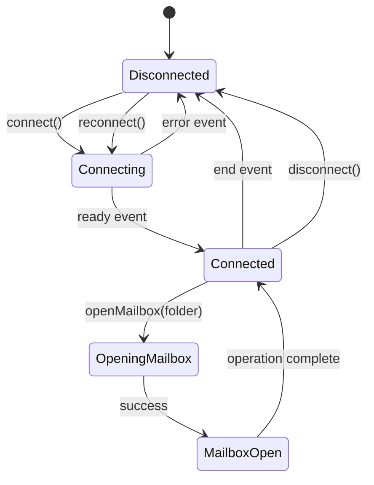

Connection lifecycle is managed through state tracking:

- `isConnected`: Boolean flag tracking connection state
- `connectionPromise`: Promise for deduplicating concurrent connection attempts
- `currentFolder`: Tracks currently opened mailbox for IDLE operations

**Sources:** [email-agent/database/imap-manager.ts:70-143]()

---

### Search Criteria and Gmail X-GM-RAW

The `buildImapSearchCriteria()` method converts `SearchCriteria` objects into IMAP search arrays. It prioritizes Gmail's native search syntax (`X-GM-RAW`) when available, enabling complex queries like `OR`, `has:attachment`, and date ranges.

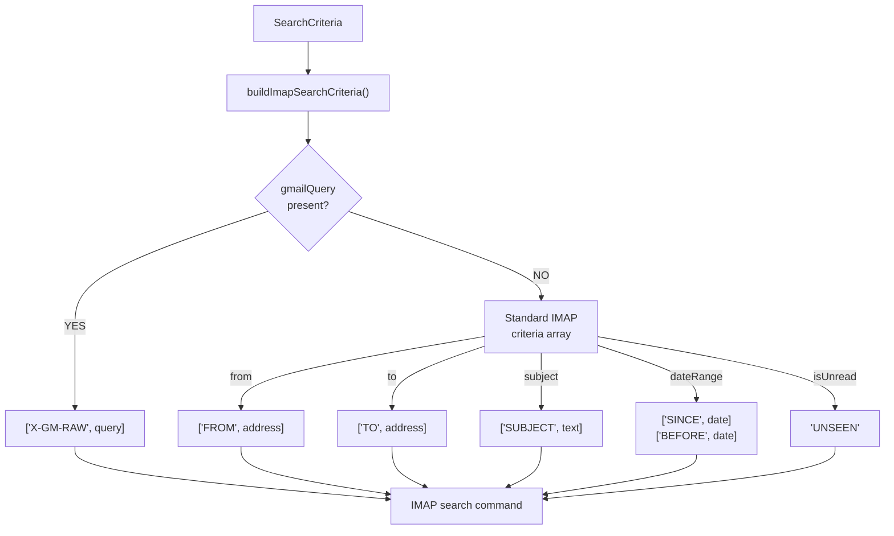

**Gmail X-GM-RAW Priority Example:**

When `criteria.gmailQuery` is provided, the method returns immediately with Gmail's native search syntax, bypassing standard IMAP criteria:

```
gmailQuery: "from:john@example.com OR from:jane@example.com has:attachment"
→ [['X-GM-RAW', 'from:john@example.com OR from:jane@example.com has:attachment']]
```

**Sources:** [email-agent/database/imap-manager.ts:145-221]()

---

### Parallel Email Fetching

The `fetchEmailsBatch()` method implements parallel fetching with configurable batch sizes to optimize throughput while managing memory constraints.

| Parameter | Default | Headers-Only Default | Purpose |
|-----------|---------|---------------------|---------|
| `batchSize` | 20 | 30 | Emails fetched per batch |
| Memory limit | 50MB | 50MB | Per-email size constraint |

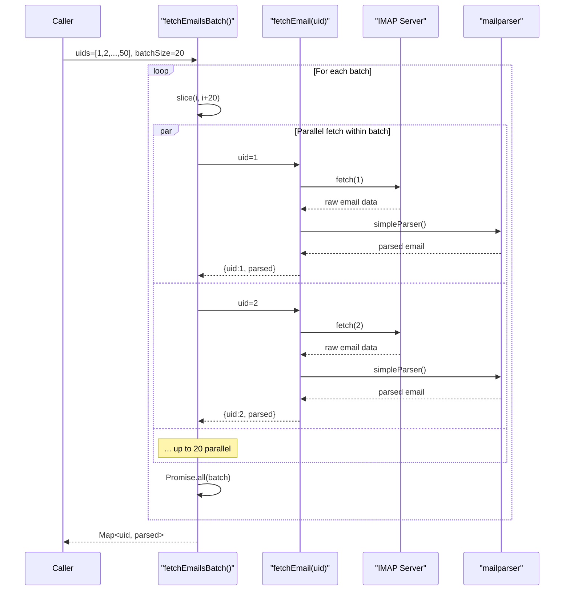

**Sources:** [email-agent/database/imap-manager.ts:232-332](), [email-agent/database/imap-manager.ts:387-460]()

---

### IMAP IDLE Monitoring

The `startIdleMonitoring()` method enables push-based notifications for new emails using the IMAP IDLE extension. The system automatically handles connection errors and reconnection.

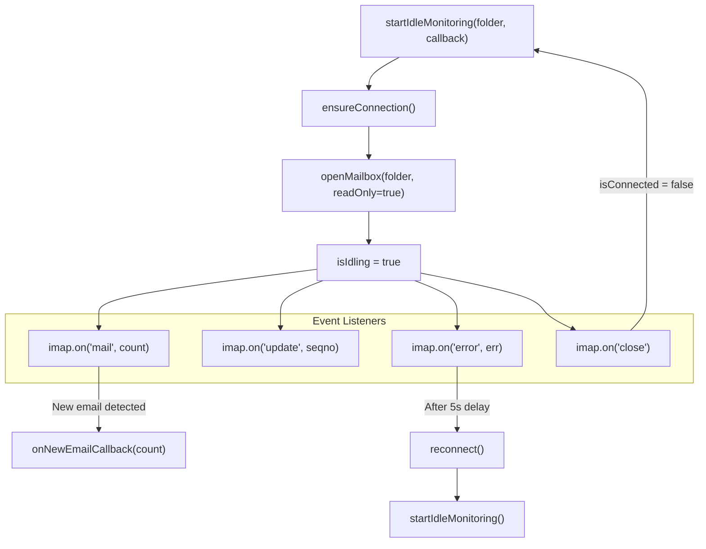

**IDLE Event Types:**

| Event | Trigger | Handler Action |
|-------|---------|----------------|
| `mail` | New message arrival | Invokes `onNewEmailCallback(count)` |
| `update` | Message flag change | Logs update with seqno |
| `error` | Connection/IDLE failure | Attempts reconnection after 5s |
| `close` | Connection closed | Resets connection state |

**Sources:** [email-agent/database/imap-manager.ts:504-577]()

---

### Email Actions

The `ImapManager` provides methods for email management operations that modify IMAP flags and mailbox locations:

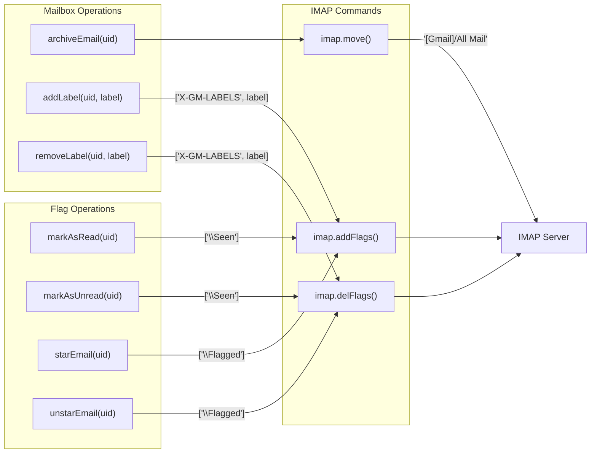

All operations require opening the mailbox in read-write mode (`readOnly=false`). The methods are async and return promises that resolve when the IMAP server confirms the operation.

**Sources:** [email-agent/database/imap-manager.ts:579-723]()

---

## EmailSyncService Class

### Synchronization Workflow

The `EmailSyncService` orchestrates data flow from IMAP to SQLite, handling email parsing, recipient extraction, attachment metadata, and listener notifications.

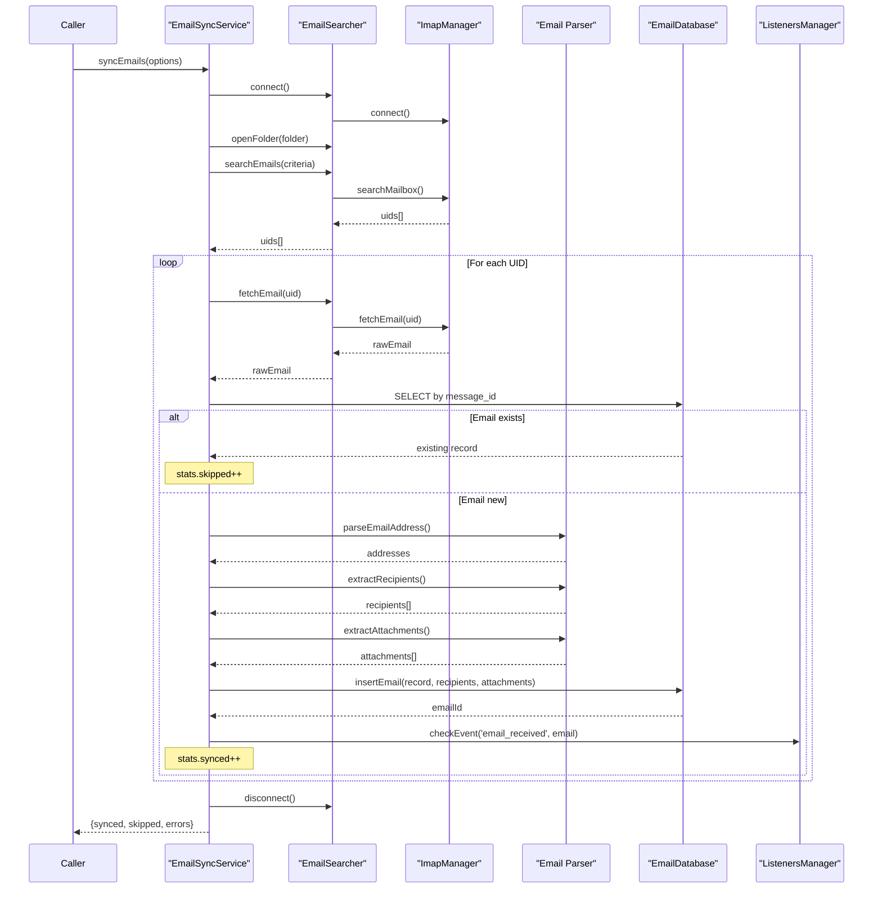

**Sources:** [email-agent/database/email-sync.ts:171-354]()

---

### Email Parsing and Extraction

The `EmailSyncService` implements three extraction methods that transform parsed email objects into normalized database records:

#### parseEmailAddress()

Parses RFC-compliant email address strings including display names:

```
Input: "John Doe <john@example.com>, jane@example.com"
Output: [
  {address: "john@example.com", name: "John Doe"},
  {address: "jane@example.com"}
]
```

#### extractRecipients()

Processes `to`, `cc`, and `bcc` fields from parsed emails, handling both structured (`value` arrays) and string formats:

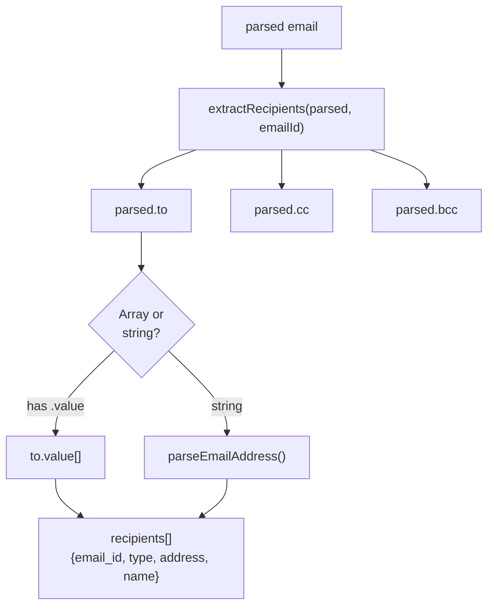

#### extractAttachments()

Extracts attachment metadata from `parsed.attachments`:

```typescript
{
  email_id: number,
  filename: string,
  content_type: string,
  size_bytes: number,
  content_id?: string,      // For inline images
  is_inline: boolean        // contentDisposition === "inline"
}
```

**Sources:** [email-agent/database/email-sync.ts:37-168]()

---

### IDLE Integration and Event Handling

The `handleIdleNewEmails()` method processes new email notifications from IMAP IDLE:

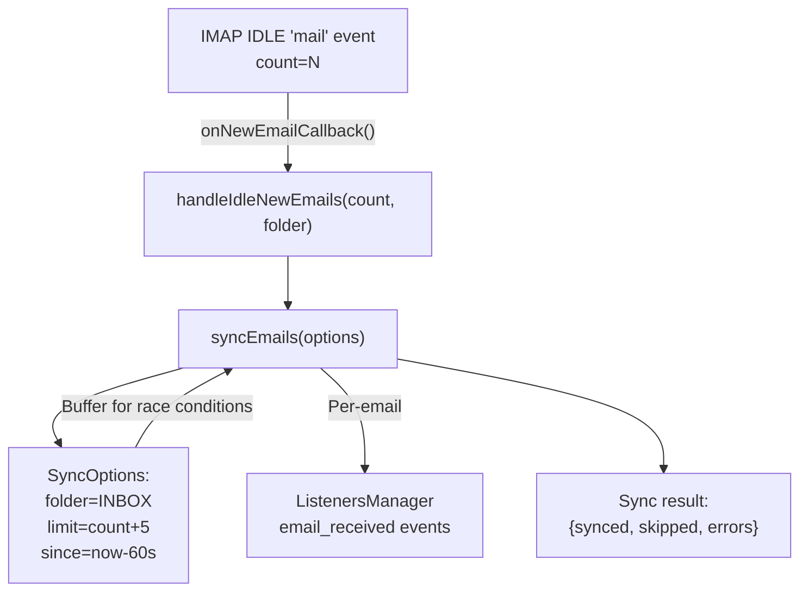

**Buffer Strategy:**

- `limit = count + 5`: Accounts for potential race conditions
- `since = now - 60s`: 1-minute lookback window to catch timing issues

The method is called by the `ImapManager`'s `onNewEmailCallback` during IDLE monitoring. Each synced email triggers a `checkEvent('email_received', email)` call to the `ListenersManager`.

**Sources:** [email-agent/database/email-sync.ts:368-384](), [email-agent/database/imap-manager.ts:519-524]()

---

## Data Flow: Complete Sync Cycle

The following diagram shows the complete data flow from IMAP server to SQLite database with all transformation steps:

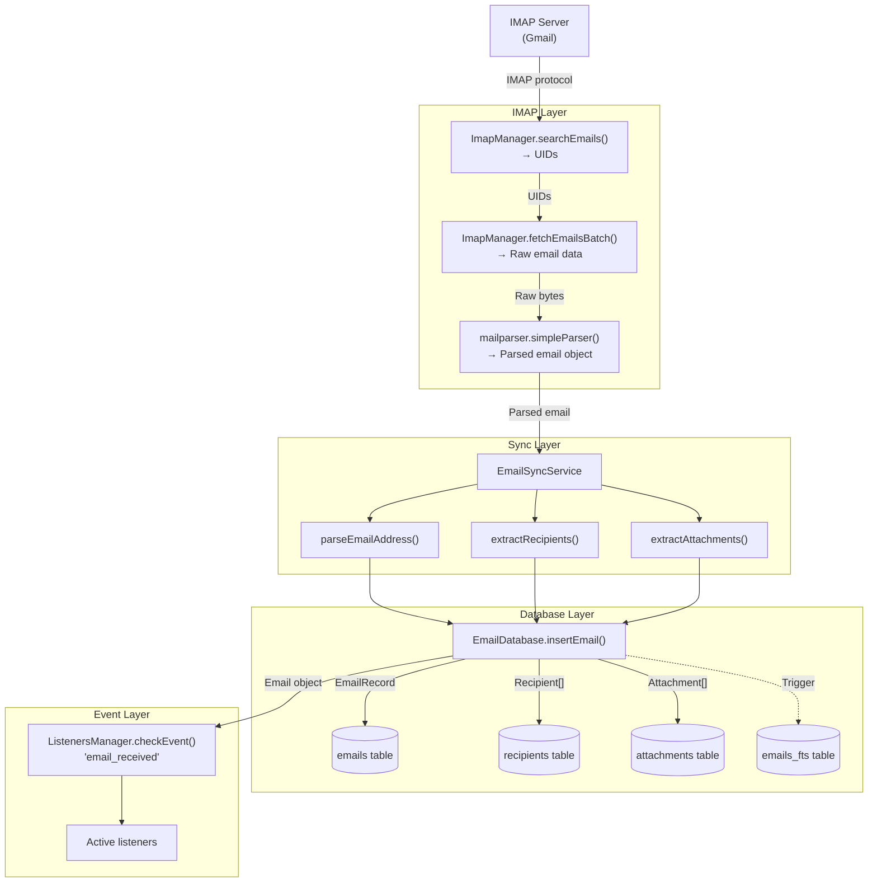

**Sources:** [email-agent/database/imap-manager.ts:387-460](), [email-agent/database/email-sync.ts:252-333](), [email-agent/database/email-db.ts:216-329]()

---

## Configuration and Environment Variables

The IMAP integration requires the following environment variables:

| Variable | Required | Default | Description |
|----------|----------|---------|-------------|
| `EMAIL_ADDRESS` or `EMAIL_USER` | Yes | - | IMAP account username |
| `EMAIL_APP_PASSWORD` or `EMAIL_PASS` | Yes | - | IMAP account password (app-specific for Gmail) |
| `IMAP_HOST` | No | `imap.gmail.com` | IMAP server hostname |
| `IMAP_PORT` | No | `993` | IMAP server port |

**Gmail App Password Setup:**

For Gmail accounts with 2FA enabled, generate an app-specific password at https://myaccount.google.com/apppasswords. The standard account password will not work with IMAP.

**Sources:** [email-agent/database/imap-manager.ts:28-58]()

---

