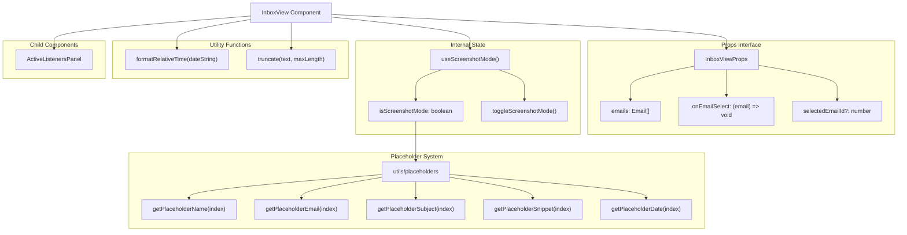
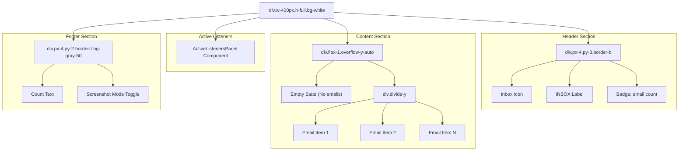
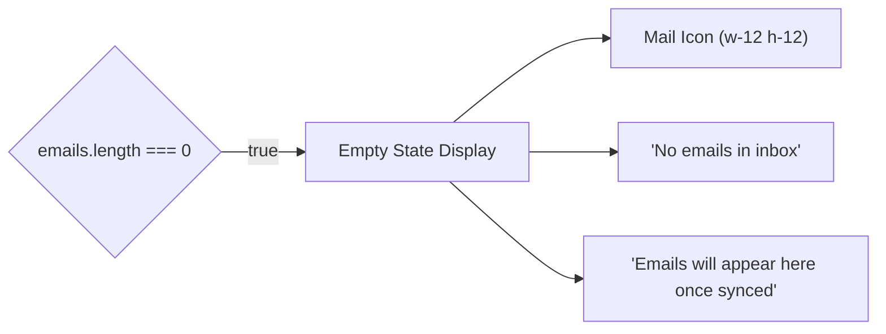
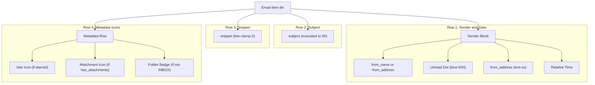
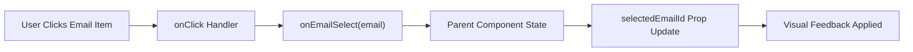
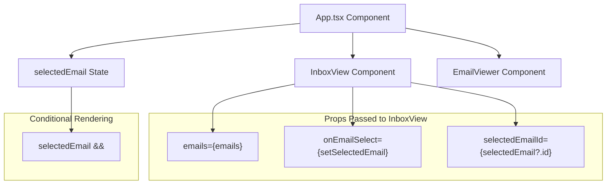
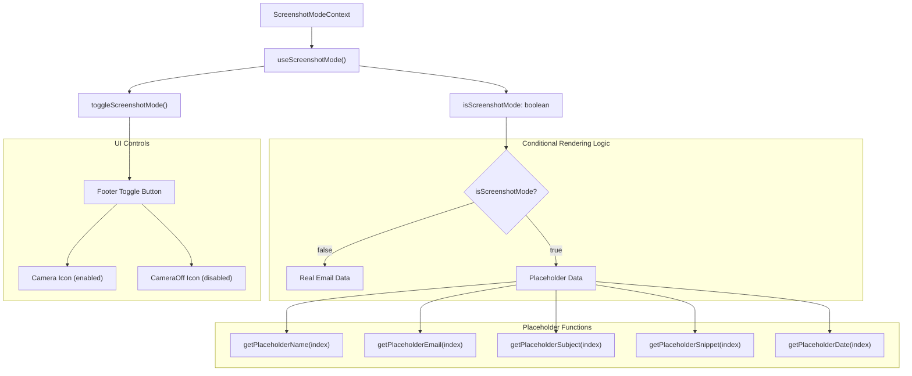
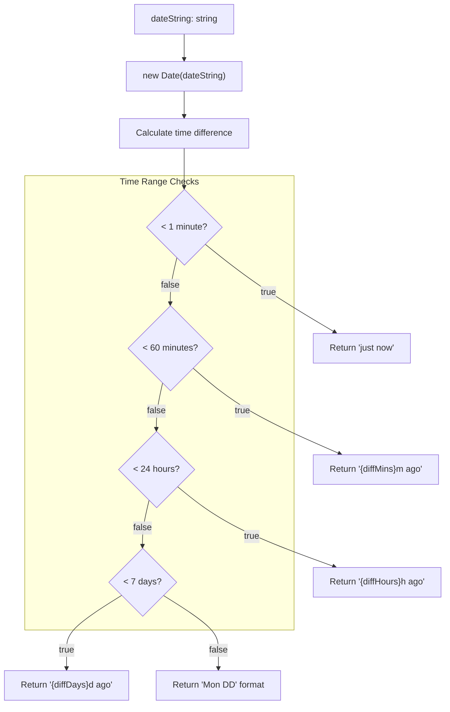
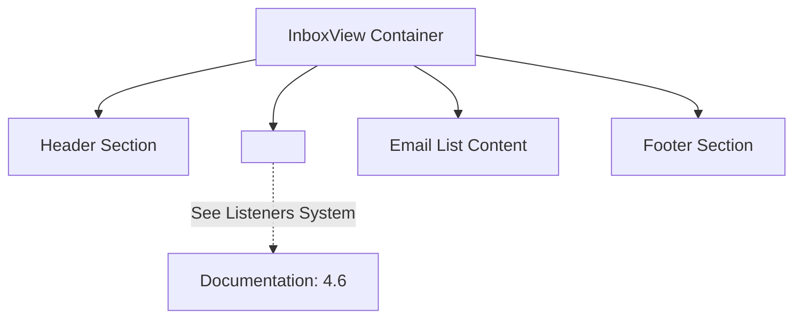
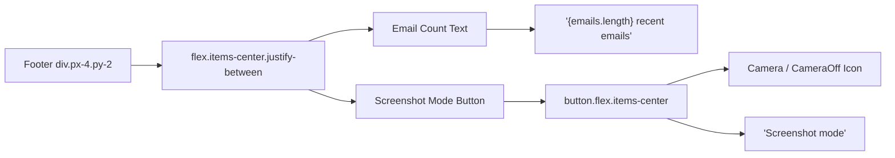

<!-- source: DeepWiki mcp.deepwiki.com · repo anthropics/claude-agent-sdk-demos · extra page Inbox Management · fetched 2026-10-26 -->

# Inbox Management

Relevant source files

The following files were used as context for generating this wiki page:

- [email-agent/client/App.tsx](email-agent/client/App.tsx)
- [email-agent/client/components/InboxView.tsx](email-agent/client/components/InboxView.tsx)

## Purpose and Scope

This page documents the `InboxView` component, which provides the email list interface for the Email Agent demo. The component handles email list rendering, selection state management, screenshot mode for privacy, and visual indicators for email metadata. For full email content display, see [Email Viewing Components](#4.4.2). For application-level state management and tab navigation, see [Application Structure](#4.4.1).

**Sources:** [email-agent/client/components/InboxView.tsx:1-180](), [email-agent/client/App.tsx:1-162]()

---

## Component Architecture

The `InboxView` component is a self-contained sidebar panel (400px wide) that displays the email list with integrated listeners panel and screenshot mode controls.

### InboxView Component Structure

**Sources:** [email-agent/client/components/InboxView.tsx:29-37](), [email-agent/client/components/InboxView.tsx:5-11]()

---

## Email Interface Definition

The `InboxView` component operates on an `Email` interface that defines the structure of email data received from the server.

### Email Type Definition

| Property | Type | Description |
|----------|------|-------------|
| `id` | `number` | Database primary key |
| `message_id` | `string` | IMAP message ID |
| `subject` | `string` | Email subject line |
| `from_address` | `string` | Sender email address |
| `from_name` | `string?` | Optional sender display name |
| `date_sent` | `string` | ISO timestamp of send date |
| `body_text` | `string?` | Plain text body |
| `body_html` | `string?` | HTML body |
| `snippet` | `string?` | Preview text (first ~150 chars) |
| `is_read` | `boolean` | Read/unread status |
| `is_starred` | `boolean` | Starred/flagged status |
| `has_attachments` | `boolean` | Attachment indicator |
| `folder` | `string?` | IMAP folder name |

**Sources:** [email-agent/client/components/InboxView.tsx:13-27]()

---

## Layout Structure

The `InboxView` component follows a three-section vertical layout: header, content area, and footer.

### Component Layout Diagram

**Sources:** [email-agent/client/components/InboxView.tsx:62-178]()

---

## Email List Rendering

### Empty State

When no emails are present, the component displays a centered empty state with an icon and explanatory text.

**Sources:** [email-agent/client/components/InboxView.tsx:83-88]()

### Email Item Structure

Each email item is rendered with a hierarchical layout displaying sender, subject, snippet, and metadata indicators.

**Sources:** [email-agent/client/components/InboxView.tsx:90-152]()

---

## Selection Handling

Email selection is managed through click handlers and visual feedback based on the `selectedEmailId` prop.

### Selection State Flow

### Visual Feedback Classes

| State | CSS Classes | Description |
|-------|-------------|-------------|
| Unselected, Read | `hover:bg-gray-50` | Light hover effect |
| Unselected, Unread | `bg-blue-50/30 hover:bg-gray-50` | Blue tint background |
| Selected | `bg-gray-100 border-l-2 border-gray-900` | Gray background with left border |
| Unread Text | `font-semibold` (subject) | Bold text for unread |

**Sources:** [email-agent/client/components/InboxView.tsx:91-98]()

### Integration with App Component

**Sources:** [email-agent/client/App.tsx:17](), [email-agent/client/App.tsx:98-102](), [email-agent/client/App.tsx:136-141]()

---

## Screenshot Mode

Screenshot mode replaces sensitive email data with placeholder values to enable safe screenshots and documentation.

### Screenshot Mode Architecture

### Screenshot Mode Data Replacement

| Email Field | Real Data | Placeholder Function | Index Parameter |
|-------------|-----------|---------------------|-----------------|
| Sender Name | `email.from_name \|\| email.from_address.split('@')[0]` | `getPlaceholderName(index)` | Email array index |
| Sender Email | `email.from_address` | `getPlaceholderEmail(index)` | Email array index |
| Subject | `email.subject` | `getPlaceholderSubject(index)` | Email array index |
| Snippet | `email.snippet` | `getPlaceholderSnippet(index)` | Email array index |
| Date | `formatRelativeTime(email.date_sent)` | `getPlaceholderDate(index * 3)` | `index * 3` for variety |

**Sources:** [email-agent/client/components/InboxView.tsx:36](), [email-agent/client/components/InboxView.tsx:104-122](), [email-agent/client/components/InboxView.tsx:164-176]()

---

## Utility Functions

### formatRelativeTime

Converts ISO date strings to human-readable relative time strings.

**Function Logic:**

**Sources:** [email-agent/client/components/InboxView.tsx:39-53]()

### truncate

Truncates text to a maximum length with ellipsis.

**Parameters:**
- `text: string | undefined` - Text to truncate
- `maxLength: number` - Maximum character length

**Returns:** Truncated string with `...` appended if length exceeded, empty string if text is undefined

**Sources:** [email-agent/client/components/InboxView.tsx:56-60]()

---

## Visual Indicators

The component uses various visual indicators to convey email status and metadata.

### Status Indicators

| Indicator | Condition | Visual Representation | Location |
|-----------|-----------|----------------------|----------|
| Unread Dot | `!email.is_read` | Blue circle (`w-2 h-2 bg-blue-500 rounded-full`) | Next to sender name |
| Unread Background | `!email.is_read` | Light blue tint (`bg-blue-50/30`) | Entire email item |
| Unread Text | `!email.is_read` | Bold font (`font-semibold` or `font-medium`) | Sender name and subject |
| Star Icon | `email.is_starred` | Yellow star (`★` with `text-yellow-500`) | Metadata row |
| Attachment Icon | `email.has_attachments` | Paperclip emoji (`📎`) | Metadata row |
| Folder Badge | `email.folder && email.folder !== 'INBOX'` | Gray badge with folder name | Metadata row |
| Selection Border | `selectedEmailId === email.id` | Left border (`border-l-2 border-gray-900`) | Entire email item |

**Sources:** [email-agent/client/components/InboxView.tsx:94-98](), [email-agent/client/components/InboxView.tsx:108-110](), [email-agent/client/components/InboxView.tsx:139-151]()

---

## Active Listeners Panel Integration

The `InboxView` component includes the `ActiveListenersPanel` component directly below the header, providing visibility into automated email monitoring rules.

The panel is positioned between the header and email list, allowing users to see active automated rules while browsing their inbox. For detailed information on how listeners work and how to create them, see [Listeners System](#4.6).

**Sources:** [email-agent/client/components/InboxView.tsx:77-78]()

---

## Footer Controls

The footer section displays email count statistics and screenshot mode toggle controls.

### Footer Layout

**Sources:** [email-agent/client/components/InboxView.tsx:158-177]()

---

