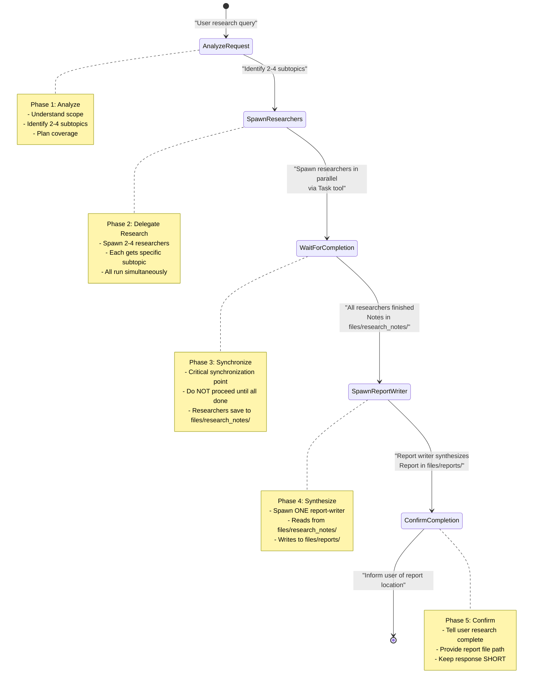
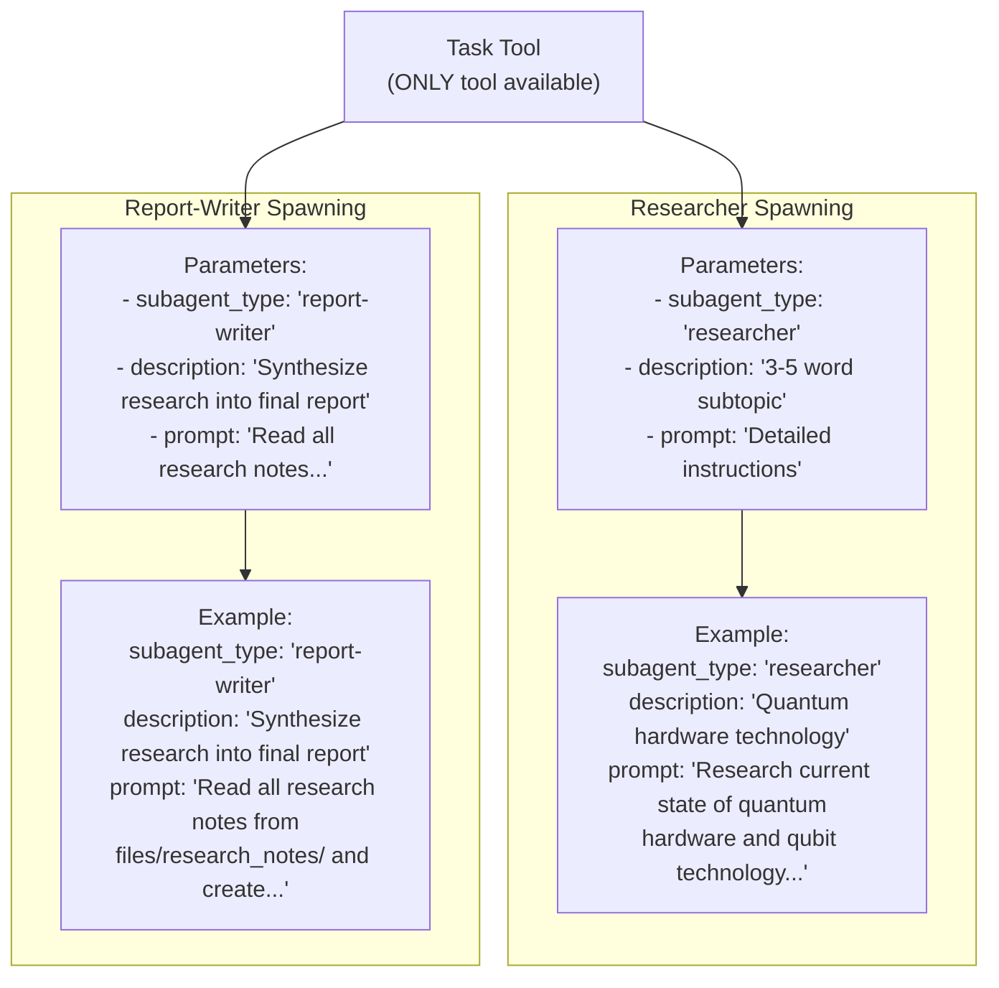
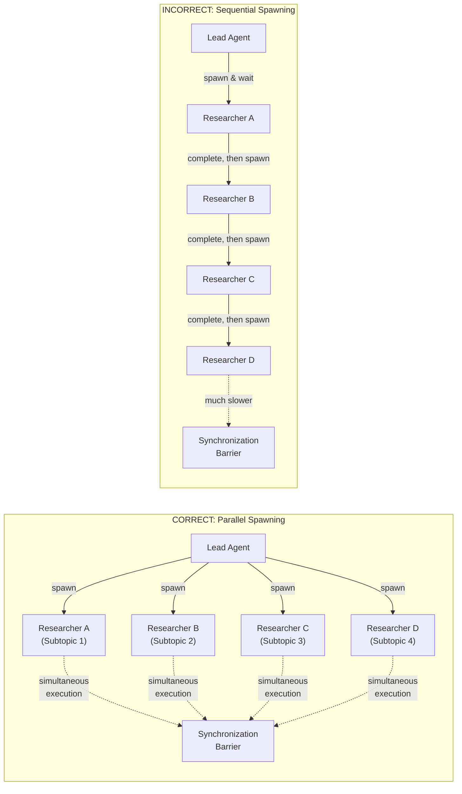
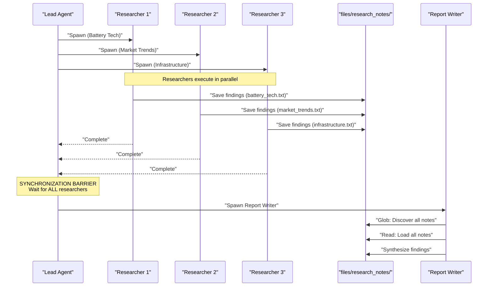

<!-- source: DeepWiki mcp.deepwiki.com · repo anthropics/claude-agent-sdk-demos · extra page Lead Agent Orchestration · fetched 2026-10-26 -->

# Lead Agent Orchestration

<details>
<summary>Relevant source files</summary>

The following files were used as context for generating this wiki page:

- [research-agent/research_agent/prompts/lead_agent.txt](research-agent/research_agent/prompts/lead_agent.txt)
- [research-agent/research_agent/prompts/report_writer.txt](research-agent/research_agent/prompts/report_writer.txt)

</details>


## Purpose and Scope

This document describes the Lead Agent's role in the Research Agent Demo as the central orchestrator of multi-agent research workflows. The Lead Agent is responsible for decomposing research topics, spawning specialized subagents in parallel, coordinating their execution, and ensuring report generation.

For implementation details of researcher subagents, see [Researcher Subagents](#5.2.2). For report generation mechanics, see [Report Writer](#5.2.3). For tracking and logging, see [Subagent Tracking System](#5.3).

**Sources:** [research-agent/research_agent/prompts/lead_agent.txt:1-8]()

---

## Core Responsibilities

The Lead Agent implements a strict **delegation-only** pattern where it orchestrates work but performs none itself. Its sole tool is the `Task` tool for spawning subagents.

| Responsibility | Description | Implementation |
|---------------|-------------|----------------|
| **Topic Analysis** | Break user requests into 2-4 distinct subtopics | Identifies complementary research angles that ensure comprehensive coverage |
| **Parallel Spawning** | Launch multiple researcher subagents simultaneously | Uses `Task` tool with `subagent_type: "researcher"` |
| **Coordination** | Ensure all researchers complete before proceeding | Implements synchronization point before report generation |
| **Report Generation** | Spawn report-writer after research completion | Uses `Task` tool with `subagent_type: "report-writer"` |
| **User Communication** | Confirm completion and report location | Provides path to generated report in `files/reports/` |

**Critical Constraint:** The Lead Agent NEVER conducts research, writes reports, or uses any tool other than `Task`. All execution is delegated to specialized subagents.

**Sources:** [research-agent/research_agent/prompts/lead_agent.txt:8-18](), [research-agent/research_agent/prompts/lead_agent.txt:54-65]()

---

## Workflow Phases

The Lead Agent executes a five-phase workflow for every research request:

### Workflow Diagram



**Sources:** [research-agent/research_agent/prompts/lead_agent.txt:20-52]()

### Phase Details

#### Phase 1: Analyze User Request

The Lead Agent analyzes the incoming research query to understand scope and identify distinct investigation angles.

**Example Topic Breakdown:**
```
User Query: "Research quantum computing"

Lead Agent Analysis:
- Subtopic 1: Current state of quantum hardware and qubit technology
- Subtopic 2: Quantum algorithms and real-world applications
- Subtopic 3: Major companies and investments in quantum computing
- Subtopic 4: Challenges and timeline to practical quantum advantage
```

The breakdown ensures comprehensive coverage by selecting complementary angles rather than overlapping topics.

**Sources:** [research-agent/research_agent/prompts/lead_agent.txt:21-37]()

#### Phase 2: Spawn Researcher Subagents (Parallel)

The Lead Agent spawns 2-4 researcher subagents **simultaneously** using the `Task` tool. Each researcher receives:
- A specific, focused subtopic
- Clear instructions on what to investigate
- Implicit access to `WebSearch` tool and file write capabilities

**Critical:** Researchers are spawned in **parallel**, not sequentially. This maximizes efficiency by enabling concurrent web searches and data collection.

**Sources:** [research-agent/research_agent/prompts/lead_agent.txt:26-30](), [research-agent/research_agent/prompts/lead_agent.txt:67-80]()

#### Phase 3: Wait for Research Completion

The Lead Agent implements a **synchronization barrier**, waiting for ALL researcher subagents to complete before proceeding. Researchers save their findings to `files/research_notes/` as they finish.

This synchronization point is mandatory to ensure the report-writer has access to complete research data.

**Sources:** [research-agent/research_agent/prompts/lead_agent.txt:39-41]()

#### Phase 4: Spawn Report-Writer Subagent

After all researchers finish, the Lead Agent spawns a single report-writer subagent with instructions to:
1. Use `Glob` tool to discover all files in `files/research_notes/`
2. Use `Read` tool to load each research note
3. Synthesize findings into a cohesive report
4. Use `Write` tool to save report to `files/reports/`

**Sources:** [research-agent/research_agent/prompts/lead_agent.txt:43-47](), [research-agent/research_agent/prompts/report_writer.txt:18-23]()

#### Phase 5: Confirm Completion

The Lead Agent informs the user that research is complete and provides the report file path. Responses are intentionally **concise** (2-3 sentences maximum):

```
"Research complete. Report saved to files/reports/quantum_computing_summary_20251110.txt"
```

**Sources:** [research-agent/research_agent/prompts/lead_agent.txt:49-51](), [research-agent/research_agent/prompts/lead_agent.txt:135-145]()

---

## Task Tool Usage

The Lead Agent uses the `Task` tool exclusively to spawn subagents. The tool accepts different parameters depending on subagent type.

### Task Tool Parameters



**Sources:** [research-agent/research_agent/prompts/lead_agent.txt:82-94]()

### Researcher Task Parameters

| Parameter | Value | Purpose |
|-----------|-------|---------|
| `subagent_type` | `"researcher"` | Identifies subagent as researcher |
| `description` | Brief 3-5 word summary | Human-readable subtopic label |
| `prompt` | Detailed investigation instructions | Specifies what angle/subtopic to research |

**Example:**
```
subagent_type: "researcher"
description: "Battery technology developments"
prompt: "Research the latest developments in electric vehicle battery technology, focusing on energy density improvements, charging speeds, and emerging chemistries like solid-state batteries."
```

**Sources:** [research-agent/research_agent/prompts/lead_agent.txt:85-88]()

### Report-Writer Task Parameters

| Parameter | Value | Purpose |
|-----------|-------|---------|
| `subagent_type` | `"report-writer"` | Identifies subagent as report writer |
| `description` | `"Synthesize research into final report"` | Standard description |
| `prompt` | `"Read all research notes from files/research_notes/ and create a comprehensive one-page summary report in files/reports/."` | Standard synthesis instructions |

**Sources:** [research-agent/research_agent/prompts/lead_agent.txt:90-93]()

---

## Parallel Spawning Strategy

The Lead Agent enforces **parallel spawning** of researchers to maximize efficiency. This is a critical architectural requirement.

### Parallel vs Sequential Spawning



### Parallel Spawning Rules

| Rule | Description | Rationale |
|------|-------------|-----------|
| **Spawn simultaneously** | Issue all researcher spawns without waiting for completion | Enables concurrent web searches and data collection |
| **2-4 researchers** | Always spawn between 2 and 4 researchers | Balances parallelism with topic decomposition granularity |
| **Distinct subtopics** | Each researcher gets a unique, non-overlapping subtopic | Prevents duplicate work and ensures comprehensive coverage |
| **Single synchronization point** | Wait for ALL researchers before spawning report-writer | Ensures report-writer has complete data set |

**Sources:** [research-agent/research_agent/prompts/lead_agent.txt:60](), [research-agent/research_agent/prompts/lead_agent.txt:67-80]()

---

## Synchronization and Coordination

The Lead Agent implements a critical **synchronization barrier** between research and report generation phases.

### Synchronization Pattern



### Coordination Rules

1. **Do NOT proceed until all researchers finish** - The Lead Agent must wait for completion signals from ALL spawned researchers before spawning the report-writer.

2. **Verify file presence** - Researchers save their findings to `files/research_notes/`. The synchronization point implicitly verifies these files exist before report generation begins.

3. **Single report-writer** - Only ONE report-writer is spawned per research workflow, ensuring a single cohesive synthesis rather than multiple competing reports.

4. **Sequential phases** - While researchers run in parallel within Phase 2, the phases themselves (analyze → research → report → confirm) execute sequentially.

**Sources:** [research-agent/research_agent/prompts/lead_agent.txt:39-47](), [research-agent/research_agent/prompts/lead_agent.txt:61]()

---

## Response Style and Constraints

The Lead Agent follows strict communication constraints to maintain efficiency and clarity.

### Communication Rules

| Rule | Requirement | Example |
|------|-------------|---------|
| **Conciseness** | Maximum 2-3 sentences per response | `"Researching 4 areas: hardware/qubits, algorithms/applications, industry players/investments, and challenges/timeline. Spawning researchers."` |
| **No greetings** | No friendly chatter or emojis | ❌ `"Hello! 👋 I'm your lead research coordinator..."` |
| **No explanations** | Don't explain workflow unless asked | ❌ `"Let me explain how I work..."` |
| **Action-oriented** | Get straight to work | ✅ `"Breaking this into 3 research areas: [list]. Spawning researchers now."` |
| **Completion brevity** | Simple confirmation with file path | ✅ `"Complete. Report: files/reports/quantum_computing_summary_20251110.txt"` |

**Sources:** [research-agent/research_agent/prompts/lead_agent.txt:135-145]()

### Delegation Constraints

The Lead Agent operates under **absolute delegation rules** that cannot be violated:

1. **Never research** - ALWAYS delegate to researcher subagents
2. **Never write reports** - ALWAYS delegate to report-writer subagent
3. **Only use Task tool** - No other tools available
4. **Always spawn 2-4 researchers** - Not 1, not 5+
5. **Always spawn in parallel** - Never sequential
6. **Distinct subtopics** - Each researcher gets unique focus
7. **Report-writer after research** - Only after ALL researchers complete
8. **Never provide findings directly** - Always generate a report first

**Sources:** [research-agent/research_agent/prompts/lead_agent.txt:54-65]()

---

## Example Workflows

### Example 1: Electric Vehicles Research

**User Query:** `"Research the latest developments in electric vehicles"`

**Lead Agent Response:**
```
"Breaking this into 4 research areas: battery technology, market trends, major manufacturers, and charging infrastructure. Spawning researchers now."
```

**Actions Taken:**
1. Spawns 4 researchers in parallel via `Task` tool
2. Each receives specific subtopic instructions
3. Waits for all 4 to complete and save to `files/research_notes/`
4. Spawns report-writer to synthesize findings
5. Reports completion: `"Research complete. Report saved to files/reports/electric_vehicles_summary_20251110.txt"`

**Sources:** [research-agent/research_agent/prompts/lead_agent.txt:99-108]()

### Example 2: Anti-Patterns

**What NOT to do:**

| Anti-Pattern | Why It's Wrong |
|-------------|----------------|
| `"Hello! 👋 I'm your lead research coordinator..."` | Too friendly, uses emojis |
| `"Let me explain how I work..."` | Unnecessary explanation unless asked |
| `"I'll search for information on quantum computing..."` | Lead Agent cannot search |
| `"Based on my knowledge, quantum computing..."` | Lead Agent doesn't provide findings directly |
| `"I'll spawn one researcher to handle everything..."` | Must spawn 2-4 with specific subtopics |
| `"Here are my findings: ..."` | Never provide findings directly; always generate a report |

**Sources:** [research-agent/research_agent/prompts/lead_agent.txt:112-119]()

---

## Summary

The Lead Agent implements a **coordinator-only** orchestration pattern with the following characteristics:

- **Single Tool:** Uses only the `Task` tool for spawning subagents
- **Topic Decomposition:** Breaks requests into 2-4 distinct subtopics
- **Parallel Execution:** Spawns researchers simultaneously for efficiency
- **Synchronization:** Waits for ALL researchers before report generation
- **Delegation Discipline:** Never conducts research or writes reports itself
- **Concise Communication:** 2-3 sentence maximum responses
- **File-Based Pipeline:** Coordinates through `files/research_notes/` and `files/reports/` directories

This orchestration pattern enables scalable, parallel research workflows while maintaining clear separation of concerns between coordination (Lead Agent), investigation (Researchers), and synthesis (Report Writer).

**Sources:** [research-agent/research_agent/prompts/lead_agent.txt:147-156]()

---

