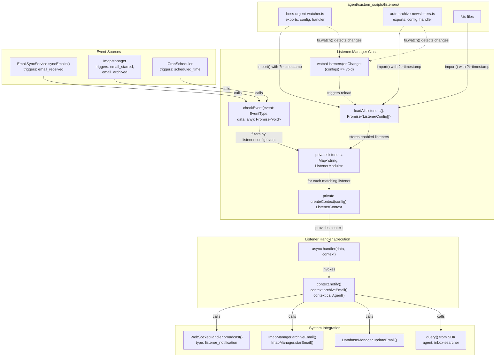
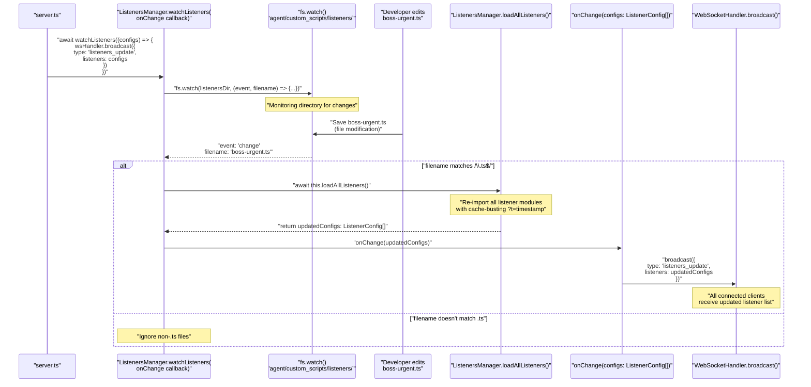
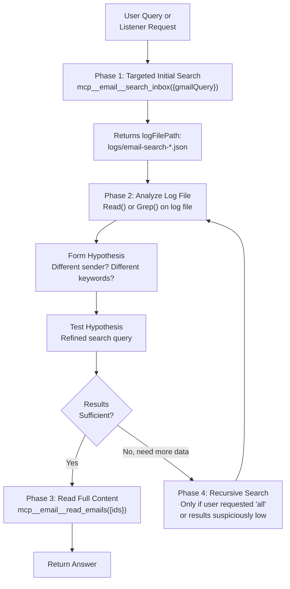

<!-- source: DeepWiki mcp.deepwiki.com · repo anthropics/claude-agent-sdk-demos · extra page Listener Concepts · fetched 2026-10-26 -->

# Listener Concepts

<details>
<summary>Relevant source files</summary>

The following files were used as context for generating this wiki page:

- [email-agent/.gitignore](email-agent/.gitignore)
- [email-agent/agent/.claude/agents/inbox-searcher.md](email-agent/agent/.claude/agents/inbox-searcher.md)
- [email-agent/agent/data/PROFILE.MD](email-agent/agent/data/PROFILE.MD)

</details>


This document defines the core concepts, types, and architecture of the Email Agent's listener system. Listeners enable **event-driven automation** by monitoring email events and executing custom logic when conditions are met. Unlike traditional polling or manual workflows, listeners react in real-time to email events, enabling proactive automation patterns such as priority filtering, auto-archiving, and AI-assisted inbox management.

For implementation guidance on creating listeners, see [Creating Listeners](#3.6.2). For the complete API reference of available listener operations, see [Listener Context API](#3.6.3).

**Sources:** [email-agent/LISTENERS_SPEC.md:1-15]()

## Event-Driven Automation Model

Listeners implement an **observer pattern** where handlers subscribe to specific event types and execute asynchronously when those events occur. This model provides several advantages:

| Benefit | Description |
|---------|-------------|
| **Real-time Response** | Listeners execute immediately when events fire (e.g., `EmailSyncService` detects new email) |
| **Decoupled Logic** | Each listener operates independently; failures don't cascade |
| **Hot-Reloadable** | Listener code can be modified and reloaded without server restart |
| **Composable** | Multiple listeners can respond to the same event with different logic |
| **AI-Augmented** | Listeners can invoke AI agents via `context.callAgent()` for intelligent decisions |

### Architecture Overview

Each listener is a TypeScript module in `agent/custom_scripts/listeners/` that exports:
- `config`: Metadata including `id`, `name`, `event` type, and `enabled` status
- `handler`: Async function receiving event data and `ListenerContext`

The `ListenersManager` class loads these modules, maintains a `Map<string, ListenerModule>` of active listeners, and dispatches events to matching handlers. When an event occurs (e.g., via `EmailSyncService.syncEmails()` detecting a new email), the manager iterates through registered listeners and invokes their handlers with a fresh `ListenerContext` instance.

**Sources:** [email-agent/LISTENERS_SPEC.md:5-27](), [email-agent/LISTENERS_SPEC.md:790-799]()
</thinking>

## System Architecture

The listener system implements an event-driven architecture where listener modules in `agent/custom_scripts/listeners/*.ts` register handlers for specific event types. The `ListenersManager` class maintains a registry of active listeners and dispatches events from various sources (email sync, IMAP operations, scheduled tasks).

**Title: Listener System Architecture - Component Interactions**



**Key architecture components:**

| Component | Type | Responsibility |
|-----------|------|----------------|
| `agent/custom_scripts/listeners/*.ts` | File System | Listener module definitions with `config` and `handler` exports |
| `ListenersManager` | Class | Central registry managing listener lifecycle, event dispatch, and hot-reload |
| `ListenersManager.listeners` | `Map<string, ListenerModule>` | In-memory registry keyed by `config.id` |
| `EmailSyncService.syncEmails()` | Event Source | Triggers `email_received` events after IMAP sync |
| `ImapManager` | Event Source | Triggers email state change events (`email_starred`, `email_archived`) |
| `ListenerContext` | Interface | Provides `notify()`, `archiveEmail()`, `callAgent()` methods to handlers |

**Sources:** [email-agent/LISTENERS_SPEC.md:16-27](), [email-agent/LISTENERS_SPEC.md:775-989](), [email-agent/LISTENERS_SPEC.md:790-799]()

## Core Type Definitions

### EventType

`EventType` is a discriminated union defining the types of events listeners can monitor. Each event type determines what data the handler receives.

| Event Type | Triggered When | Handler Data Type |
|------------|----------------|-------------------|
| `email_received` | New email arrives via IMAP sync | `Email` object |
| `email_sent` | User sends an email | `Email` object (sent email) |
| `email_starred` | Email is starred | `Email` object |
| `email_archived` | Email is archived | `Email` object |
| `email_labeled` | Label added to email | `{ email: Email, label: string }` |
| `scheduled_time` | Cron schedule fires | `{ timestamp: Date, cron?: string }` |

**Sources:** [email-agent/LISTENERS_SPEC.md:75-81](), [email-agent/LISTENERS_SPEC.md:143-289]()

### Email Interface

The `Email` interface represents email metadata passed to listener handlers. This structure contains the essential email properties needed for filtering and decision-making.

```typescript
interface Email {
  messageId: string;      // Unique message identifier
  from: string;           // Sender email address
  to: string;             // Recipient email address(es)
  subject: string;        // Email subject line
  body: string;           // Email body content
  date: string;           // ISO 8601 timestamp
  isRead: boolean;        // Read/unread status
  hasAttachments: boolean; // Attachment indicator
  labels?: string[];      // Gmail labels (optional)
}
```

**Sources:** [email-agent/LISTENERS_SPEC.md:60-73]()

### ListenerConfig Interface

`ListenerConfig` defines the metadata for a listener module. This configuration is exported as the `config` constant from each listener file.

```typescript
interface ListenerConfig {
  id: string;              // Unique identifier (must be unique across all listeners)
  name: string;            // Human-readable display name
  description?: string;    // Optional description of listener purpose
  enabled: boolean;        // Whether listener is active
  event: EventType;        // Event type to monitor
}
```

**Key fields:**
- **`id`**: Used as the map key in `ListenersManager`. Must be unique and stable across reloads.
- **`enabled`**: Checked during load time. Disabled listeners are not registered in the active listener map.
- **`event`**: Determines which events trigger this listener's handler.

**Sources:** [email-agent/LISTENERS_SPEC.md:83-98]()

### ListenerModule Interface

`ListenerModule` represents a loaded listener with both its configuration and handler function. The `ListenersManager` stores these in a `Map<string, ListenerModule>` keyed by `config.id`.

```typescript
interface ListenerModule {
  config: ListenerConfig;
  handler: (data: any, context: ListenerContext) => Promise<void>;
}
```

The handler function signature varies based on the `config.event` type:
- For `email_received`, `email_sent`, `email_starred`, `email_archived`: `(email: Email, context: ListenerContext) => Promise<void>`
- For `email_labeled`: `(data: { email: Email, label: string }, context: ListenerContext) => Promise<void>`
- For `scheduled_time`: `(data: { timestamp: Date, cron?: string }, context: ListenerContext) => Promise<void>`

**Sources:** [email-agent/LISTENERS_SPEC.md:137-141]()

## Listener Lifecycle

### Loading Phase

The `ListenersManager.loadAllListeners()` method discovers and imports listener modules from the file system, maintaining an in-memory registry of active listeners.

**Title: loadAllListeners() Module Discovery and Import Process**

```mermaid
sequenceDiagram
    participant Server as "server.ts initialization"
    participant LM as "ListenersManager instance"
    participant FS as "fs.readdir()<br/>agent/custom_scripts/listeners/"
    participant Import as "dynamic import()"
    participant Map as "this.listeners:<br/>Map&lt;string, ListenerModule&gt;"
    
    Server->>LM: "await loadAllListeners()"
    LM->>Map: "this.listeners.clear()"
    LM->>FS: "fs.readdir(listenersDir)"
    FS-->>LM: "['boss-urgent.ts',<br/>'_template.ts',<br/>'auto-archive.ts']"
    
    loop "For each file"
        alt "filename matches /^[^_].*\\.ts$/"
            LM->>LM: "const cacheBuster = Date.now()"
            LM->>Import: "import(filePath + '?t=' + cacheBuster)"
            Note over Import: "Cache-busting prevents<br/>module cache issues"
            Import-->>LM: "module = { config, handler }"
            
            alt "!module.config || !module.handler"
                Note over LM: "console.error('Invalid exports')<br/>skip this module"
            else "module.config.enabled === true"
                LM->>Map: "this.listeners.set(<br/>module.config.id,<br/>{ config, handler })"
                Note over LM: "Listener registered"
            else "module.config.enabled === false"
                Note over LM: "console.log('Skipping disabled')<br/>don't register"
            end
        else "filename starts with _ or not .ts"
            Note over LM: "Skip file (e.g., _template.ts)"
        end
    end
    
    LM-->>Server: "return ListenerConfig[]<br/>(metadata only)"
```

**Loading algorithm:**

1. **Clear registry**: `this.listeners.clear()` removes all previously loaded listeners
2. **Directory scan**: `fs.readdir('agent/custom_scripts/listeners/')` lists all files
3. **Filter files**: Include only files matching `/^[^_].*\.ts$/` (non-underscore-prefixed `.ts` files)
4. **Dynamic import**: `import(filePath + '?t=' + Date.now())` with cache-busting timestamp
5. **Validate exports**: Check for required `config` and `handler` exports
6. **Conditional registration**: Store in `Map<string, ListenerModule>` only if `config.enabled === true`
7. **Return metadata**: Return array of `ListenerConfig` objects for client synchronization

**File exclusion rules:**
- Files starting with `_` are skipped (e.g., `_template.ts`, `_helpers.ts`)
- Non-`.ts` files are ignored
- Files with invalid exports log error but don't crash the load process

**Sources:** [email-agent/LISTENERS_SPEC.md:804-844]()

### Execution Phase

The `ListenersManager.checkEvent()` method is called by event sources (e.g., `EmailSyncService.syncEmails()`, `ImapManager` operations) to trigger matching listener handlers.

**Title: checkEvent() Dispatch and Handler Invocation Flow**

```mermaid
sequenceDiagram
    participant Sync as "EmailSyncService.syncEmails()"
    participant CheckEvent as "ListenersManager.checkEvent(<br/>'email_received', emailObj)"
    participant Map as "this.listeners:<br/>Map&lt;string, ListenerModule&gt;"
    participant CreateCtx as "createContext(config)"
    participant Handler as "listener.handler(emailObj, ctx)"
    participant Context as "ListenerContext instance"
    participant Effects as "WebSocketHandler<br/>ImapManager<br/>DatabaseManager"
    
    Sync->>CheckEvent: "await checkEvent('email_received',<br/>{ messageId: '123', from: 'boss@co.com', ... })"
    
    CheckEvent->>Map: "for (const [id, listener] of this.listeners)"
    
    loop "Iterate registered listeners"
        Map-->>CheckEvent: "listener = { config, handler }"
        
        alt "listener.config.event === 'email_received'"
            CheckEvent->>CheckEvent: "try {"
            CheckEvent->>CreateCtx: "const ctx = this.createContext(config)"
            CreateCtx-->>CheckEvent: "ctx with injected deps:<br/>emailApi, notificationCallback"
            
            CheckEvent->>Handler: "await listener.handler(emailObj, ctx)"
            
            opt "Handler logic executes"
                Handler->>Handler: "// Filtering logic<br/>if (!email.from.includes('boss')) return;"
                Handler->>Context: "await context.notify('Urgent email!',<br/>{ priority: 'high' })"
                Context->>Effects: "notificationCallback({<br/>type: 'listener_notification',<br/>listenerId: 'boss-urgent',<br/>message: 'Urgent email!'<br/>})"
                Handler->>Context: "await context.starEmail(email.messageId)"
                Context->>Effects: "emailApi.starEmail(messageId)<br/>→ ImapManager.starEmail()<br/>→ DatabaseManager.updateEmail()"
            end
            
            Handler-->>CheckEvent: "Promise&lt;void&gt; resolves"
            CheckEvent->>CheckEvent: "} catch (error) {<br/>console.error('Listener failed:', error)<br/>// Continue to next listener<br/>}"
        else "listener.config.event !== 'email_received'"
            Note over CheckEvent: "Skip this listener<br/>(event type mismatch)"
        end
    end
    
    CheckEvent-->>Sync: "Promise&lt;void&gt; resolves"
    Note over CheckEvent: "All matching listeners executed<br/>(failures isolated via try-catch)"
```

**Execution characteristics:**

| Aspect | Behavior |
|--------|----------|
| **Iteration order** | Listeners execute in `Map` insertion order (chronological load order) |
| **Error isolation** | Each `handler()` invocation wrapped in try-catch; failures don't cascade |
| **Synchronous dispatch** | `checkEvent()` awaits each handler sequentially (not parallel) |
| **Context lifecycle** | Fresh `ListenerContext` instance created per handler via `createContext()` |
| **Filtering responsibility** | Handlers must implement own filtering logic (e.g., `if (!email.from.includes('urgent')) return;`) |
| **Event matching** | Only handlers where `listener.config.event === event` are invoked |

**Handler invocation contract:**
```typescript
// For event type 'email_received'
await listener.handler(
  emailObj: Email,  // Event data
  context: ListenerContext  // Methods: notify(), archiveEmail(), callAgent(), etc.
): Promise<void>
```

**Sources:** [email-agent/LISTENERS_SPEC.md:938-953]()

### Hot-Reload Phase

The `ListenersManager.watchListeners()` method monitors the `agent/custom_scripts/listeners/` directory using Node.js `fs.watch()` for automatic reload on file changes.

**Title: watchListeners() Hot-Reload Mechanism**



**Hot-reload workflow:**

1. **Watcher initialization**: `watchListeners(onChange)` starts `fs.watch()` on listener directory
2. **Change detection**: File system events trigger on `.ts` file modifications
3. **Reload trigger**: Calls `loadAllListeners()` which re-imports all modules with fresh cache-busting timestamps
4. **Client notification**: `onChange` callback receives updated configs and broadcasts via WebSocket
5. **UI synchronization**: Connected clients receive `listeners_update` message and refresh their listener UI

**File watch events handled:**
- `'change'`: File content modified (most common)
- `'rename'`: File created or deleted

**Development benefits:**
- Edit listener code in IDE → automatic reload → no server restart required
- Changes propagate to UI clients in real-time via WebSocket
- Cache-busting ensures latest code is always loaded (no Node.js module cache issues)

**Sources:** [email-agent/LISTENERS_SPEC.md:971-988]()

## Example: Using the inbox-searcher Agent

Listeners can leverage AI agents to perform intelligent operations. The `inbox-searcher` agent is a specialized email search agent that listeners can invoke via `context.callAgent()` to perform complex email queries with strategic hypothesis-driven searching.

### inbox-searcher Agent Overview

The `inbox-searcher` agent is defined in [email-agent/agent/.claude/agents/inbox-searcher.md:1-5]() with the following characteristics:

| Property | Value |
|----------|-------|
| **Name** | `inbox-searcher` |
| **Purpose** | Email inbox search specialist using iterative, hypothesis-driven search strategies |
| **Tools** | `Read`, `Bash`, `Glob`, `Grep`, `mcp__email__search_inbox`, `mcp__email__read_emails` |
| **Search Strategy** | Initial targeted search → Hypothesis formation → Testing → Recursive search only if justified |

### Search Workflow

**Title: inbox-searcher Agent Search Methodology**



**Sources:** [email-agent/agent/.claude/agents/inbox-searcher.md:1-80]()

### Calling inbox-searcher from Listeners

Listeners can invoke the `inbox-searcher` agent using `context.callAgent()`:

```typescript
// Example: Listener calling inbox-searcher agent
export async function handler(email: Email, context: ListenerContext): Promise<void> {
  // Use inbox-searcher to find related emails
  const result = await context.callAgent({
    agent: "inbox-searcher",
    message: `Find all emails from ${email.from} about project deadlines`,
    outputSchema: {
      type: "object",
      properties: {
        emails: { type: "array" },
        summary: { type: "string" }
      }
    }
  });
  
  // Process results
  await context.notify(`Found ${result.emails.length} related emails: ${result.summary}`);
}
```

The `inbox-searcher` agent uses Gmail query syntax and follows a strategic search process:

1. **Targeted Initial Search**: Starts with specific query based on request
2. **Log File Analysis**: Examines search results written to `logs/email-search-*.json` using `Read` or `Grep` tools
3. **Hypothesis Testing**: Forms hypotheses about where emails might be and tests with refined searches
4. **Full Content Reading**: Uses `mcp__email__read_emails` with IDs from log files when detailed content is needed
5. **Recursive Search**: Only performs exhaustive searches when user explicitly requests "all" or initial results are insufficient

**Sources:** [email-agent/agent/.claude/agents/inbox-searcher.md:13-80](), [email-agent/agent/.claude/agents/inbox-searcher.md:166-193]()

### Log File Persistence

The `inbox-searcher` agent persists search results to timestamped JSON log files, and listener execution logs are maintained separately.

**Directory structure:**
```
logs/
└── email-search-2025-09-16T10-30-45.json  # inbox-searcher search results

agent/custom_scripts/listeners/
└── .logs/
    ├── listener-executions.jsonl  # Listener execution logs
    └── *.jsonl                    # Per-listener log files
```

**Git exclusions** (from [email-agent/.gitignore:134-136]()):
```gitignore
agent/custom_scripts/listeners/.logs/
agent/custom_scripts/listeners/.logs/*.jsonl
```

**Benefits:**
- **Offline analysis**: `inbox-searcher` results available for `Read` and `Grep` tools without re-querying IMAP
- **Reduced API calls**: Cached search results avoid redundant email fetches
- **Privacy**: Listener logs with personal email data excluded from version control
- **Debugging**: Detailed execution traces for listener troubleshooting

**Sources:** [email-agent/agent/.claude/agents/inbox-searcher.md:32-66](), [email-agent/.gitignore:134-136]()

## ListenerContext Structure

The `ListenerContext` interface provides methods for listener handlers to interact with the Email Agent system. It is created per-handler invocation by `ListenersManager.createContext()` with injected dependencies.

### Context Method Categories

| Category | Methods | Purpose |
|----------|---------|---------|
| **Notifications** | `notify(message, options?)` | Display notifications to connected clients via WebSocket |
| **Email Operations** | `archiveEmail()`, `starEmail()`, `unstarEmail()`, `markAsRead()`, `markAsUnread()`, `addLabel()`, `removeLabel()` | Execute IMAP operations and update database |
| **AI Integration** | `callAgent<T>(options)` | Invoke Claude API with structured output schema (e.g., `inbox-searcher` agent) |

Full method signatures and usage patterns are documented in [Listener Context API](#3.6.3).

**Sources:** [email-agent/LISTENERS_SPEC.md:100-135](), [email-agent/LISTENERS_SPEC.md:849-934]()

## File Structure Requirements

Each listener file must conform to this structure:

```typescript
// agent/custom_scripts/listeners/example-listener.ts
import type { ListenerConfig, Email, ListenerContext } from "../types";

export const config: ListenerConfig = {
  id: "unique_listener_id",
  name: "Human Readable Name",
  description: "Optional description",
  enabled: true,
  event: "email_received"
};

export async function handler(email: Email, context: ListenerContext): Promise<void> {
  // Filtering logic
  if (!shouldProcess(email)) return;
  
  // Context method calls
  await context.notify("Message");
  await context.starEmail(email.messageId);
}
```

**Required exports:**
- `config`: Must be a `ListenerConfig` object with all required fields
- `handler`: Must be an async function with signature matching the event type

**File naming conventions:**
- Use kebab-case (e.g., `boss-urgent-watcher.ts`, `auto-archive-newsletters.ts`)
- Prefix with `_` to exclude from loading (e.g., `_template.ts`)
- Must have `.ts` extension

**Sources:** [email-agent/LISTENERS_SPEC.md:29-56]()

## Integration Points

### ListenersManager Class

The `ListenersManager` is instantiated in the Email Agent server with injected dependencies:

```typescript
class ListenersManager {
  constructor(
    emailApi: any,                              // Email operations (archive, star, etc.)
    notificationCallback?: (notification: any) => void  // WebSocket broadcast function
  )
  
  async loadAllListeners(): Promise<ListenerConfig[]>
  async checkEvent(event: EventType, data: any): Promise<void>
  async watchListeners(onChange: (configs: ListenerConfig[]) => void): Promise<void>
  getAllListeners(): ListenerConfig[]
  getListener(id: string): ListenerModule | undefined
}
```

**Initialization in server:**
```typescript
const listenersManager = new ListenersManager(
  emailApi,
  (notification) => wsHandler.broadcast(notification)
);
await listenersManager.loadAllListeners();
```

**Sources:** [email-agent/LISTENERS_SPEC.md:790-799]()

### EmailSyncService Integration

The `EmailSyncService` triggers listener events after persisting emails to the database:

```typescript
// In EmailSyncService.syncEmails()
for (const email of newEmails) {
  // 1. Store in database
  await dbManager.upsertEmail(email);
  
  // 2. Trigger listeners (they handle filtering and actions)
  await listenersManager.checkEvent("email_received", email);
}
```

This ensures listeners execute after database persistence, guaranteeing that operations like `context.archiveEmail()` can query the database for IMAP UIDs.

**Sources:** [email-agent/LISTENERS_SPEC.md:991-1036]()

### WebSocket Message Types

Listener execution produces several WebSocket message types broadcast to connected clients:

```typescript
// Notification from listener
{
  type: "listener_notification",
  listenerId: string,
  listenerName: string,
  priority: "low" | "normal" | "high",
  message: string,
  timestamp: string
}

// Listener list update (after hot-reload)
{
  type: "listeners_update",
  listeners: ListenerConfig[]
}

// Listener enable/disable (client → server)
{
  type: "listener_toggle",
  listenerId: string,
  enabled: boolean
}
```

**Sources:** [email-agent/LISTENERS_SPEC.md:1040-1078]()

## Error Handling Strategy

The listener system implements error isolation to ensure individual listener failures do not cascade:

**Handler-level isolation:**
```typescript
// In ListenersManager.checkEvent()
for (const [id, listener] of this.listeners) {
  try {
    await listener.handler(data, context);
  } catch (error) {
    console.error(`Listener ${id} failed:`, error);
    // Continue with other listeners
  }
}
```

**Load-time isolation:**
```typescript
// In ListenersManager.loadListener()
try {
  const module = await import(filePath);
  if (!module.config || !module.handler) {
    console.error(`Invalid listener ${filename}: missing exports`);
    return; // Skip this listener, continue loading others
  }
} catch (error) {
  console.error(`Failed to load ${filename}:`, error);
  // Continue loading other listeners
}
```

Handlers should implement their own try-catch blocks for context method calls when graceful degradation is desired.

**Sources:** [email-agent/LISTENERS_SPEC.md:1284-1332]()

---

