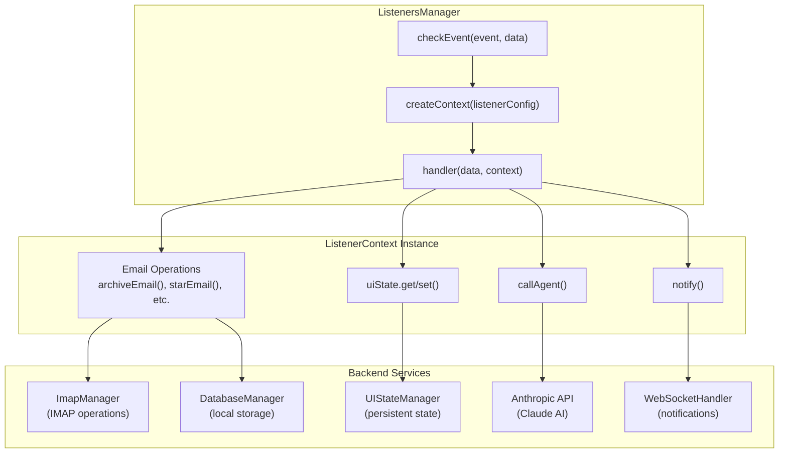
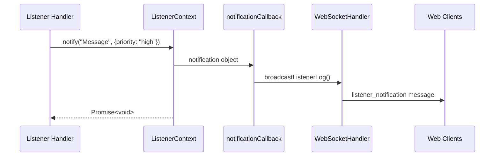
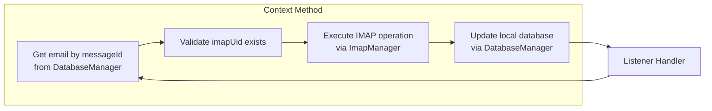
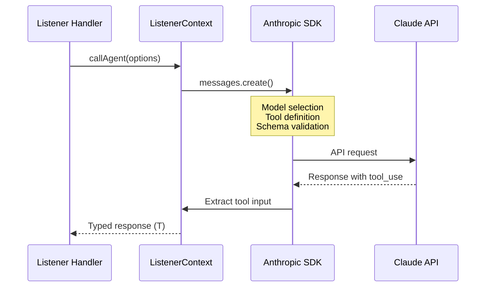
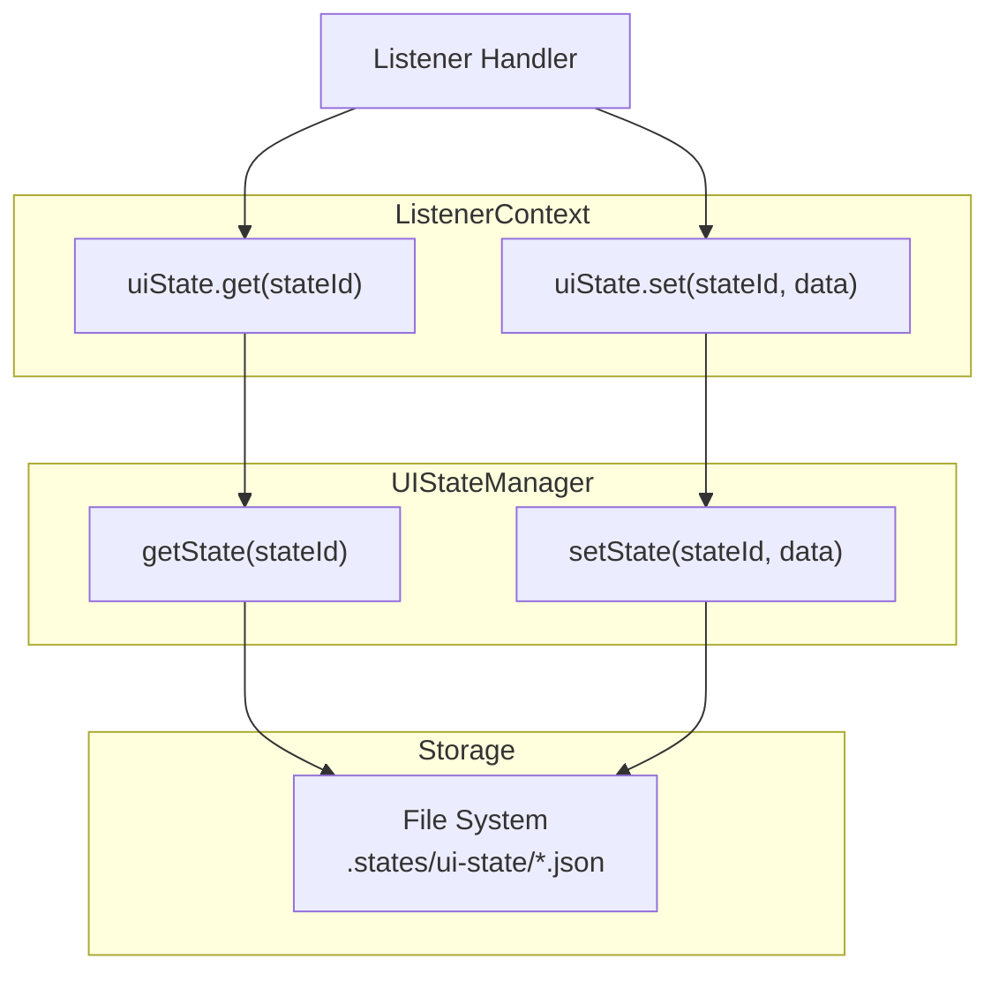
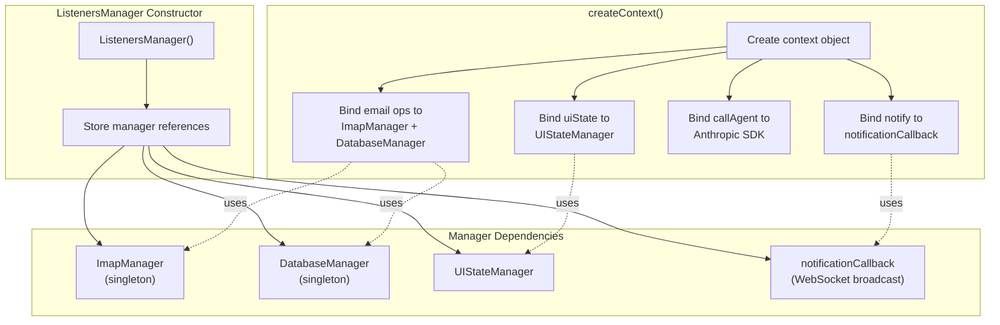
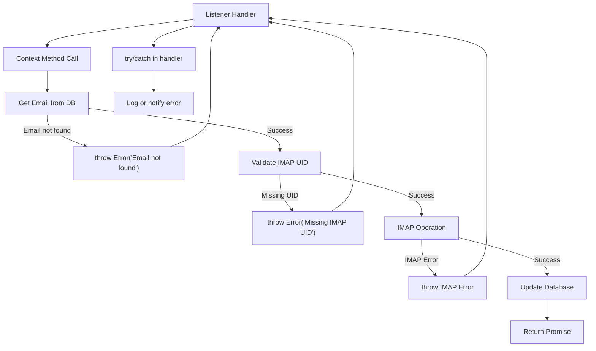

<!-- source: DeepWiki mcp.deepwiki.com · repo anthropics/claude-agent-sdk-demos · extra page Listener Context API · fetched 2026-10-26 -->

# Listener Context API

<details>
<summary>Relevant source files</summary>

The following files were used as context for generating this wiki page:

- [email-agent/.gitignore](email-agent/.gitignore)
- [email-agent/agent/.claude/agents/inbox-searcher.md](email-agent/agent/.claude/agents/inbox-searcher.md)
- [email-agent/agent/data/PROFILE.MD](email-agent/agent/data/PROFILE.MD)

</details>


This document provides a complete API reference for the `ListenerContext` object that is passed to listener handler functions. The context provides methods for notifying users, manipulating emails, calling AI subagents, and managing UI state.

For information about listener concepts and lifecycle, see page 4.6.1. For a guide to creating listeners, see page 4.6.2.

**Sources:** [email-agent/agent/custom_scripts/types.ts:76-101](), [email-agent/ccsdk/listeners-manager.ts:104-374]()

## Context Interface Overview

The `ListenerContext` interface is defined in the types file and provides four categories of operations:

| Category | Methods | Purpose |
|----------|---------|---------|
| **Notifications** | `notify()` | Display messages to users |
| **Email Operations** | `archiveEmail()`, `starEmail()`, `unstarEmail()`, `markAsRead()`, `markAsUnread()`, `addLabel()`, `removeLabel()` | Modify email metadata and state |
| **AI Integration** | `callAgent()` | Invoke Claude for structured analysis |
| **UI State** | `uiState.get()`, `uiState.set()` | Persist and retrieve custom state data |

**Context Creation Flow**



**Sources:** [email-agent/ccsdk/listeners-manager.ts:104-374](), [email-agent/agent/custom_scripts/types.ts:80-101]()

## Notification Methods

### notify()

Displays a notification message to all connected clients via WebSocket.

**Signature:**
```typescript
notify(message: string, options?: NotifyOptions): Promise<void>
```

**Parameters:**

| Parameter | Type | Required | Description |
|-----------|------|----------|-------------|
| `message` | `string` | Yes | The notification message text |
| `options` | `NotifyOptions` | No | Configuration options |
| `options.priority` | `"low" \| "normal" \| "high"` | No | Display priority (default: `"normal"`) |

**Behavior:**
- Broadcasts notification to all connected WebSocket clients
- Creates notification object with timestamp and listener metadata
- Does not block on delivery (fire-and-forget)

**Implementation Details:**



The notification object structure:
```typescript
{
  type: "listener_notification",
  listenerId: string,
  listenerName: string,
  priority: "low" | "normal" | "high",
  message: string,
  timestamp: string (ISO 8601)
}
```

**Example:**
```typescript
// Simple notification
await context.notify("New email from boss");

// High-priority notification
await context.notify("🚨 Urgent email requires attention", {
  priority: "high"
});

// Low-priority notification
await context.notify("Newsletter archived", {
  priority: "low"
});
```

**Sources:** [email-agent/ccsdk/listeners-manager.ts:106-122](), [email-agent/agent/custom_scripts/types.ts:52-56](), [email-agent/agent/custom_scripts/types.ts:82]()

## Email Operation Methods

All email operation methods follow a two-phase pattern: (1) perform IMAP server operation, (2) update local database. This ensures consistency between the remote server and local cache.

**Email Operation Flow**



**Sources:** [email-agent/ccsdk/listeners-manager.ts:124-305]()

### archiveEmail()

Moves an email to the archive folder (Gmail: `[Gmail]/All Mail`).

**Signature:**
```typescript
archiveEmail(emailId: string): Promise<void>
```

**Parameters:**

| Parameter | Type | Description |
|-----------|------|-------------|
| `emailId` | `string` | The email's `messageId` field |

**Implementation:**
1. Queries `DatabaseManager.getEmailByMessageId()` to retrieve email and IMAP UID
2. Calls `ImapManager.archiveEmail(uid, folder)` to perform server operation
3. Updates database with `DatabaseManager.updateEmailFlags()` to set `folder: '[Gmail]/All Mail'`

**Throws:**
- `Error` if email not found
- `Error` if email missing IMAP UID
- IMAP errors if server operation fails

**Example:**
```typescript
export async function handler(email: Email, context: ListenerContext) {
  if (email.from.includes("newsletter")) {
    await context.archiveEmail(email.messageId);
    await context.notify("Newsletter archived");
  }
}
```

**Sources:** [email-agent/ccsdk/listeners-manager.ts:124-149]()

### starEmail()

Adds a star flag to an email.

**Signature:**
```typescript
starEmail(emailId: string): Promise<void>
```

**Parameters:**

| Parameter | Type | Description |
|-----------|------|-------------|
| `emailId` | `string` | The email's `messageId` field |

**Implementation:**
1. Retrieves email and validates IMAP UID exists
2. Calls `ImapManager.starEmail(uid, folder)` 
3. Updates database with `DatabaseManager.updateEmailFlags()` to set `isStarred: true`

**Example:**
```typescript
// Star urgent emails from VIPs
if (email.from.includes("ceo@") && email.subject.includes("urgent")) {
  await context.starEmail(email.messageId);
}
```

**Sources:** [email-agent/ccsdk/listeners-manager.ts:151-174]()

### unstarEmail()

Removes the star flag from an email.

**Signature:**
```typescript
unstarEmail(emailId: string): Promise<void>
```

**Parameters:**

| Parameter | Type | Description |
|-----------|------|-------------|
| `emailId` | `string` | The email's `messageId` field |

**Implementation:**
Identical to `starEmail()` but calls `ImapManager.unstarEmail()` and sets `isStarred: false`.

**Sources:** [email-agent/ccsdk/listeners-manager.ts:176-199]()

### markAsRead()

Marks an email as read (adds `\Seen` IMAP flag).

**Signature:**
```typescript
markAsRead(emailId: string): Promise<void>
```

**Parameters:**

| Parameter | Type | Description |
|-----------|------|-------------|
| `emailId` | `string` | The email's `messageId` field |

**Implementation:**
1. Retrieves email and validates IMAP UID
2. Calls `ImapManager.markAsRead(uid, folder)`
3. Updates database with `isRead: true`

**Example:**
```typescript
// Auto-mark newsletters as read after archiving
await context.archiveEmail(email.messageId);
await context.markAsRead(email.messageId);
```

**Sources:** [email-agent/ccsdk/listeners-manager.ts:201-224]()

### markAsUnread()

Marks an email as unread (removes `\Seen` IMAP flag).

**Signature:**
```typescript
markAsUnread(emailId: string): Promise<void>
```

**Parameters:**

| Parameter | Type | Description |
|-----------|------|-------------|
| `emailId` | `string` | The email's `messageId` field |

**Implementation:**
Identical to `markAsRead()` but calls `ImapManager.markAsUnread()` and sets `isRead: false`.

**Sources:** [email-agent/ccsdk/listeners-manager.ts:226-249]()

### addLabel()

Adds a Gmail label (IMAP folder) to an email.

**Signature:**
```typescript
addLabel(emailId: string, label: string): Promise<void>
```

**Parameters:**

| Parameter | Type | Description |
|-----------|------|-------------|
| `emailId` | `string` | The email's `messageId` field |
| `label` | `string` | Label name (e.g., `"Work"`, `"Important"`) |

**Implementation:**
1. Retrieves email and validates IMAP UID
2. Calls `ImapManager.addLabel(uid, label, folder)`
3. Appends label to email's `labels` array in database (if not already present)

**Example:**
```typescript
// Categorize financial emails
if (email.from.includes("bank.com") || email.subject.includes("invoice")) {
  await context.addLabel(email.messageId, "Finance");
}
```

**Sources:** [email-agent/ccsdk/listeners-manager.ts:251-278]()

### removeLabel()

Removes a Gmail label from an email.

**Signature:**
```typescript
removeLabel(emailId: string, label: string): Promise<void>
```

**Parameters:**

| Parameter | Type | Description |
|-----------|------|-------------|
| `emailId` | `string` | The email's `messageId` field |
| `label` | `string` | Label name to remove |

**Implementation:**
1. Retrieves email and validates IMAP UID
2. Calls `ImapManager.removeLabel(uid, label, folder)`
3. Filters label from email's `labels` array in database

**Sources:** [email-agent/ccsdk/listeners-manager.ts:280-305]()

## AI Integration Methods

### callAgent()

Invokes Claude AI with a prompt and receives a structured response based on a JSON schema. This enables listeners to perform complex analysis, classification, or extraction tasks.

**Signature:**
```typescript
callAgent<T = any>(options: SubagentOptions<T>): Promise<T>
```

**Type Parameters:**

| Parameter | Description |
|-----------|-------------|
| `T` | The TypeScript type of the expected response (inferred from schema) |

**Parameters:**

| Parameter | Type | Required | Description |
|-----------|------|----------|-------------|
| `options.prompt` | `string` | Yes | The prompt to send to Claude |
| `options.schema` | `object` | Yes | JSON Schema defining the response structure |
| `options.schema.type` | `"object"` | Yes | Must be `"object"` |
| `options.schema.properties` | `Record<string, any>` | Yes | Property definitions |
| `options.schema.required` | `string[]` | No | Required property names |
| `options.model` | `"opus" \| "sonnet" \| "haiku"` | No | Model to use (default: `"haiku"`) |

**Model Mapping:**

| Option | Model ID | Use Case |
|--------|----------|----------|
| `"opus"` | `claude-opus-4-20250514` | Complex reasoning, multi-step tasks |
| `"sonnet"` | `claude-sonnet-4-20250514` | Balanced performance and quality |
| `"haiku"` | `claude-3-5-haiku-20241022` | Fast classification, simple extraction |

**Implementation Details:**



The method uses Anthropic's tool forcing pattern:
1. Defines a `respond` tool with `input_schema` matching the provided schema
2. Sets `tool_choice: { type: "tool", name: "respond" }` to force structured output
3. Extracts `input` from the `tool_use` content block

**Example: Email Classification**

```typescript
interface ClassificationResult {
  category: "urgent" | "newsletter" | "personal" | "work";
  priority: "high" | "normal" | "low";
  reasoning: string;
}

export async function handler(email: Email, context: ListenerContext) {
  const result = await context.callAgent<ClassificationResult>({
    prompt: `Classify this email:
    
From: ${email.from}
Subject: ${email.subject}
Body: ${email.body.substring(0, 500)}

Determine the category, priority level, and explain your reasoning.`,

    schema: {
      type: "object",
      properties: {
        category: {
          type: "string",
          enum: ["urgent", "newsletter", "personal", "work"]
        },
        priority: {
          type: "string",
          enum: ["high", "normal", "low"]
        },
        reasoning: { type: "string" }
      },
      required: ["category", "priority", "reasoning"]
    },
    
    model: "haiku" // Fast classification
  });
  
  if (result.priority === "high") {
    await context.notify(`High priority ${result.category}: ${email.subject}`);
    await context.starEmail(email.messageId);
  }
}
```

**Example: Meeting Extraction**

```typescript
interface MeetingDetails {
  isMeeting: boolean;
  title?: string;
  date?: string;
  time?: string;
  location?: string;
}

const details = await context.callAgent<MeetingDetails>({
  prompt: `Extract meeting details from this email:
  
Subject: ${email.subject}
Body: ${email.body}

Identify if this is a meeting request and extract the title, date, time, and location.`,

  schema: {
    type: "object",
    properties: {
      isMeeting: { type: "boolean" },
      title: { type: "string" },
      date: { type: "string" },
      time: { type: "string" },
      location: { type: "string" }
    },
    required: ["isMeeting"]
  },
  
  model: "sonnet" // Better extraction
});

if (details.isMeeting) {
  await context.addLabel(email.messageId, "meetings");
  await context.notify(`📅 Meeting: ${details.title} on ${details.date}`);
}
```

**Error Handling:**
- Throws if API call fails
- Throws if Claude does not return a `tool_use` block
- Throws if response does not match schema

**Performance Considerations:**
- Haiku: ~1-2 seconds, suitable for real-time classification
- Sonnet: ~2-5 seconds, good for detailed extraction
- Opus: ~5-15 seconds, use sparingly for complex analysis
- Consider caching results for similar emails

**Sources:** [email-agent/ccsdk/listeners-manager.ts:307-353](), [email-agent/agent/custom_scripts/types.ts:61-74](), [email-agent/agent/custom_scripts/types.ts:94]()

## UI State Methods

The `uiState` object provides methods to persist and retrieve custom state data that survives across listener executions and server restarts.

**UI State Integration**



**Sources:** [email-agent/ccsdk/listeners-manager.ts:355-373](), [email-agent/agent/custom_scripts/types.ts:97-100]()

### uiState.get()

Retrieves stored state data by ID.

**Signature:**
```typescript
uiState.get<T>(stateId: string): Promise<T | null>
```

**Type Parameters:**

| Parameter | Description |
|-----------|-------------|
| `T` | The TypeScript type of the stored data |

**Parameters:**

| Parameter | Type | Description |
|-----------|------|-------------|
| `stateId` | `string` | Unique identifier for the state |

**Returns:**
- `Promise<T>` if state exists
- `Promise<null>` if state does not exist or `UIStateManager` is unavailable

**Example:**
```typescript
interface EmailStats {
  totalProcessed: number;
  urgentCount: number;
  lastProcessed: string;
}

// Retrieve existing stats
const stats = await context.uiState.get<EmailStats>("email-stats");

if (stats) {
  console.log(`Previously processed: ${stats.totalProcessed} emails`);
} else {
  console.log("No stats found, initializing...");
}
```

**Sources:** [email-agent/ccsdk/listeners-manager.ts:357-363]()

### uiState.set()

Stores state data by ID.

**Signature:**
```typescript
uiState.set<T>(stateId: string, data: T): Promise<void>
```

**Type Parameters:**

| Parameter | Description |
|-----------|-------------|
| `T` | The TypeScript type of the data to store |

**Parameters:**

| Parameter | Type | Description |
|-----------|------|-------------|
| `stateId` | `string` | Unique identifier for the state |
| `data` | `T` | The data to store (must be JSON-serializable) |

**Returns:**
`Promise<void>` - Resolves when state is persisted

**Example:**
```typescript
interface EmailStats {
  totalProcessed: number;
  urgentCount: number;
  lastProcessed: string;
}

// Get current stats
let stats = await context.uiState.get<EmailStats>("email-stats") || {
  totalProcessed: 0,
  urgentCount: 0,
  lastProcessed: ""
};

// Update stats
stats.totalProcessed++;
if (email.subject.includes("urgent")) {
  stats.urgentCount++;
}
stats.lastProcessed = new Date().toISOString();

// Save updated stats
await context.uiState.set("email-stats", stats);
```

**Complete Example: Daily Summary with Persistent State**

```typescript
interface SummaryState {
  lastSummaryDate: string;
  emailsSinceSummary: number;
  urgentEmailsToday: number;
}

export async function handler(email: Email, context: ListenerContext) {
  // Get state
  let state = await context.uiState.get<SummaryState>("daily-summary") || {
    lastSummaryDate: new Date().toDateString(),
    emailsSinceSummary: 0,
    urgentEmailsToday: 0
  };
  
  // Check if new day
  const today = new Date().toDateString();
  if (state.lastSummaryDate !== today) {
    // Send summary for previous day
    await context.notify(
      `📊 Yesterday: ${state.emailsSinceSummary} emails, ${state.urgentEmailsToday} urgent`,
      { priority: "normal" }
    );
    
    // Reset for new day
    state = {
      lastSummaryDate: today,
      emailsSinceSummary: 0,
      urgentEmailsToday: 0
    };
  }
  
  // Update counters
  state.emailsSinceSummary++;
  if (email.subject.includes("urgent")) {
    state.urgentEmailsToday++;
  }
  
  // Save state
  await context.uiState.set("daily-summary", state);
}
```

**Sources:** [email-agent/ccsdk/listeners-manager.ts:365-372](), [email-agent/agent/custom_scripts/types.ts:97-100]()

## Implementation Architecture

**Context Creation and Dependency Injection**



The `ListenersManager` constructor receives references to all required managers and callbacks, then the `createContext()` method binds these to the context object methods. This provides dependency injection without listeners needing to import manager classes directly.

**Sources:** [email-agent/ccsdk/listeners-manager.ts:33-46](), [email-agent/ccsdk/listeners-manager.ts:104-374]()

## Error Handling

**Error Propagation Pattern**



**Error Types and Handling:**

| Error Source | Error Type | Typical Cause | Handler Action |
|--------------|------------|---------------|----------------|
| `getEmailByMessageId()` | `Error("Email not found")` | Invalid `messageId` | Log error, skip operation |
| Email validation | `Error("Missing IMAP UID")` | Email synced before UID migration | Log warning, skip IMAP op |
| `ImapManager` | IMAP protocol error | Server unreachable, auth failed | Retry or notify user |
| `callAgent()` | API error | Rate limit, invalid request | Log error, fallback behavior |
| `uiState` | Not available | `UIStateManager` not initialized | Return `null` gracefully |

**Recommended Error Handling in Handlers:**

```typescript
export async function handler(email: Email, context: ListenerContext) {
  // Filter before expensive operations
  if (!email.from.includes("important.com")) return;
  
  try {
    // Email operations can fail
    await context.starEmail(email.messageId);
    await context.addLabel(email.messageId, "important");
    
    // Always succeeds (fire-and-forget)
    await context.notify("Email starred and labeled");
  } catch (error) {
    console.error("Failed to process email:", error);
    
    // Notify user of failure
    await context.notify(
      `⚠️ Failed to process email: ${error.message}`,
      { priority: "low" }
    );
  }
}
```

**Context Method Error Handling:**

Context methods log errors internally but propagate them to handlers:

```typescript
// From listeners-manager.ts implementation
archiveEmail: async (emailId: string) => {
  try {
    const email = await this.databaseManager.getEmailByMessageId(emailId);
    if (!email) {
      throw new Error(`Email not found: ${emailId}`);
    }
    // ... perform operation
    console.log(`✓ Archived email ${emailId}`);
  } catch (error) {
    console.error(`Failed to archive email ${emailId}:`, error);
    throw error; // Propagate to handler
  }
}
```

**Sources:** [email-agent/ccsdk/listeners-manager.ts:124-305](), [email-agent/LISTENERS_SPEC.md:1284-1332]()

## Complete Example: Multi-Feature Listener

This example demonstrates using multiple context methods together:

```typescript
// agent/custom_scripts/listeners/vip-email-processor.ts
import type { ListenerConfig, Email, ListenerContext } from "../types";

export const config: ListenerConfig = {
  id: "vip_email_processor",
  name: "VIP Email Processor",
  description: "Processes emails from VIP contacts with AI classification",
  enabled: true,
  event: "email_received"
};

interface Classification {
  isUrgent: boolean;
  requiresAction: boolean;
  category: "meeting" | "decision" | "fyi" | "other";
  suggestedLabels: string[];
  summary: string;
}

interface VIPStats {
  totalEmails: number;
  urgentEmails: number;
  lastProcessed: string;
}

const VIP_DOMAINS = ["ceo@company.com", "board@company.com"];

export async function handler(email: Email, context: ListenerContext) {
  // 1. Filter for VIP senders
  const isVIP = VIP_DOMAINS.some(domain => email.from.includes(domain));
  if (!isVIP) return;
  
  try {
    // 2. Use AI to classify email
    const classification = await context.callAgent<Classification>({
      prompt: `Classify this VIP email:
      
From: ${email.from}
Subject: ${email.subject}
Body: ${email.body.substring(0, 1000)}

Determine:
- Is it urgent?
- Does it require action?
- Category (meeting/decision/fyi/other)
- Suggested Gmail labels
- Brief summary`,

      schema: {
        type: "object",
        properties: {
          isUrgent: { type: "boolean" },
          requiresAction: { type: "boolean" },
          category: {
            type: "string",
            enum: ["meeting", "decision", "fyi", "other"]
          },
          suggestedLabels: {
            type: "array",
            items: { type: "string" }
          },
          summary: { type: "string" }
        },
        required: ["isUrgent", "requiresAction", "category", "summary"]
      },
      model: "sonnet" // Better classification
    });
    
    // 3. Apply labels
    await context.addLabel(email.messageId, "VIP");
    for (const label of classification.suggestedLabels || []) {
      await context.addLabel(email.messageId, label);
    }
    
    // 4. Star if urgent or requires action
    if (classification.isUrgent || classification.requiresAction) {
      await context.starEmail(email.messageId);
    }
    
    // 5. Update statistics in persistent state
    let stats = await context.uiState.get<VIPStats>("vip-stats") || {
      totalEmails: 0,
      urgentEmails: 0,
      lastProcessed: ""
    };
    
    stats.totalEmails++;
    if (classification.isUrgent) {
      stats.urgentEmails++;
    }
    stats.lastProcessed = new Date().toISOString();
    
    await context.uiState.set("vip-stats", stats);
    
    // 6. Notify user
    const emoji = classification.isUrgent ? "🚨" : "📧";
    const priority = classification.isUrgent ? "high" : "normal";
    
    await context.notify(
      `${emoji} VIP ${classification.category}: ${email.subject}\n${classification.summary}`,
      { priority }
    );
    
  } catch (error) {
    console.error("VIP email processing failed:", error);
    
    // Fallback: still star and notify even if AI fails
    await context.starEmail(email.messageId);
    await context.notify(
      `⚠️ VIP email received but processing failed: ${email.subject}`,
      { priority: "high" }
    );
  }
}
```

This example demonstrates:
1. Filtering based on sender
2. AI-powered classification with `callAgent()`
3. Multiple label operations with `addLabel()`
4. Conditional starring with `starEmail()`
5. Persistent statistics with `uiState.get()` and `uiState.set()`
6. Priority-based notifications with `notify()`
7. Comprehensive error handling with fallback behavior

**Sources:** [email-agent/LISTENERS_SPEC.md:507-597](), [email-agent/agent/custom_scripts/types.ts:80-101]()

## Performance Considerations

| Operation | Typical Duration | Notes |
|-----------|-----------------|-------|
| `notify()` | < 1ms | Fire-and-forget WebSocket broadcast |
| Email operations | 100-500ms | IMAP round-trip + DB update |
| `callAgent("haiku")` | 1-2 seconds | Fast classification tasks |
| `callAgent("sonnet")` | 2-5 seconds | Detailed extraction/analysis |
| `callAgent("opus")` | 5-15 seconds | Complex reasoning (use sparingly) |
| `uiState.get()` | < 10ms | File system read |
| `uiState.set()` | < 10ms | File system write |

**Best Practices:**
1. **Filter early** - Check conditions before expensive operations
2. **Batch operations** - Apply multiple labels in sequence before notifying
3. **Choose appropriate model** - Use Haiku for real-time, Sonnet for quality
4. **Error handling** - Always wrap context calls in try-catch
5. **State management** - Use `uiState` for cross-execution data, not for large datasets
6. **Logging** - Log context method calls for debugging and audit trails

**Sources:** [email-agent/LISTENERS_SPEC.md:1335-1348](), [email-agent/ccsdk/listeners-manager.ts:307-353]()

---

