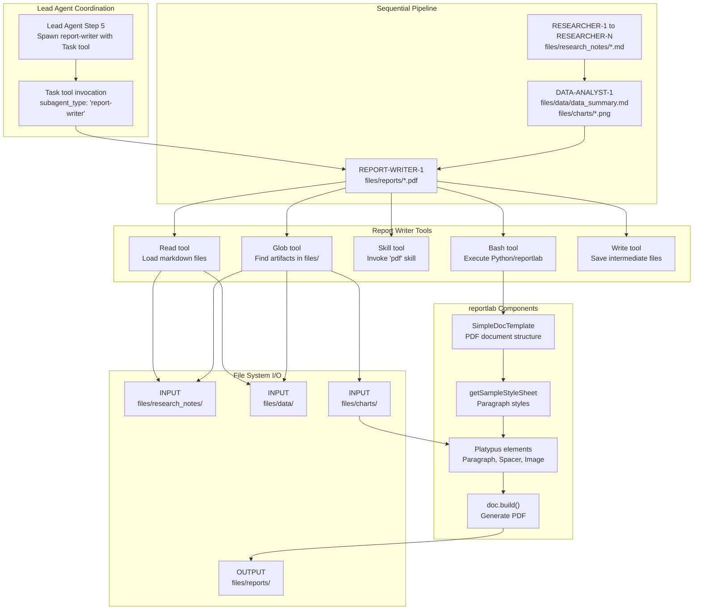
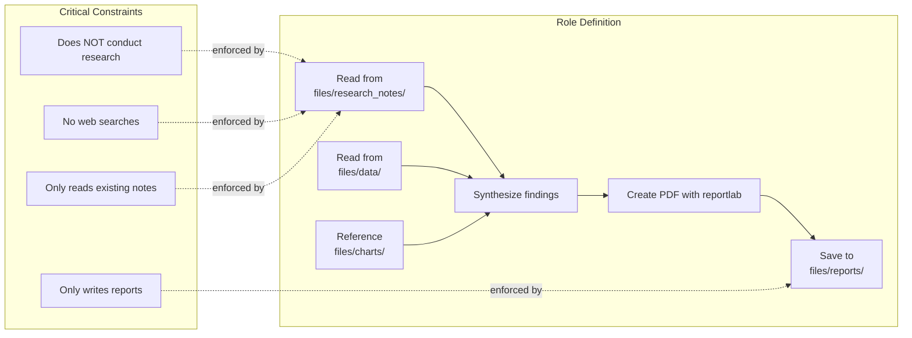
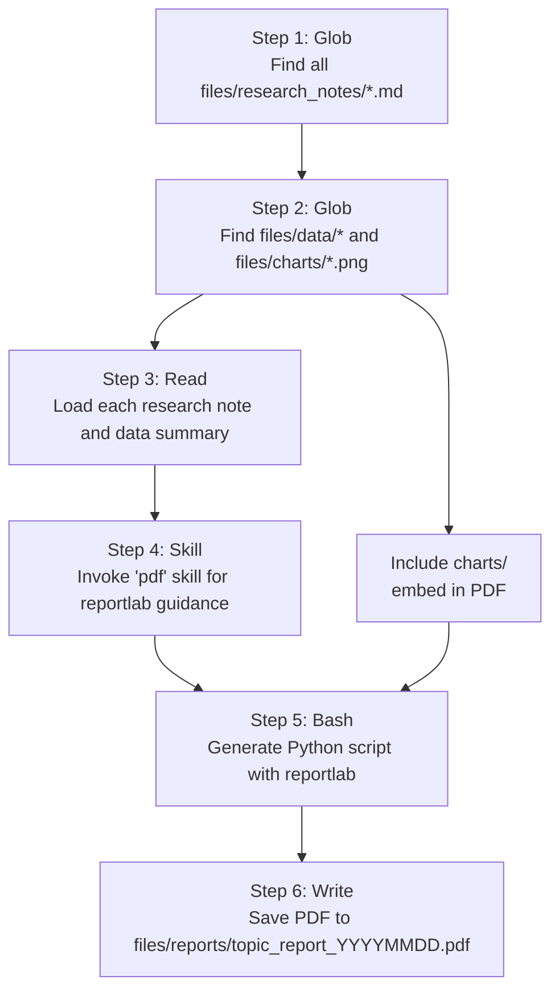
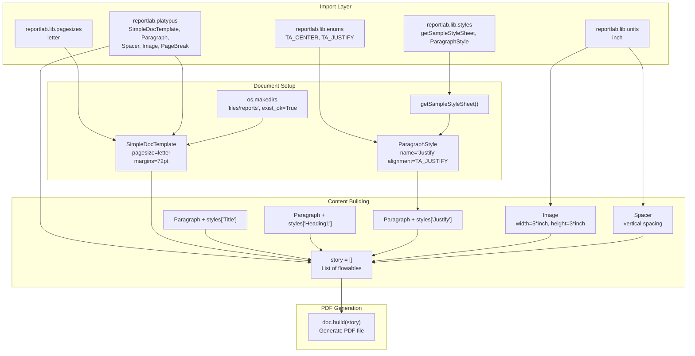
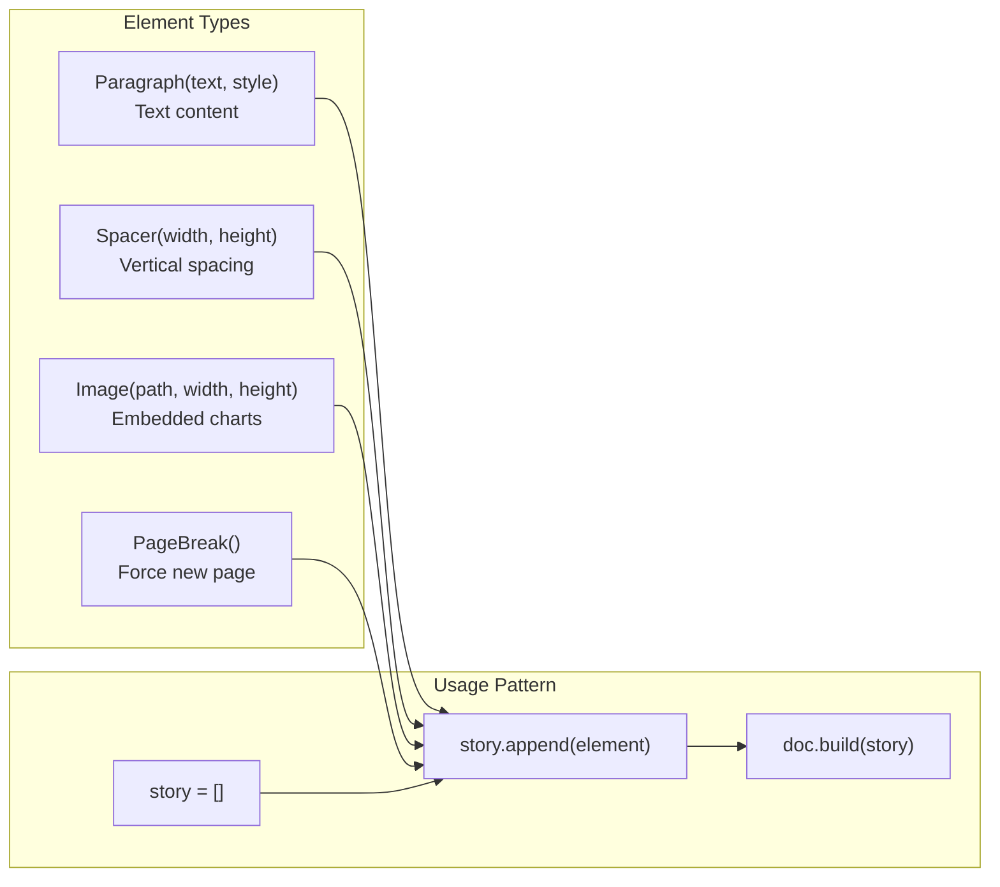
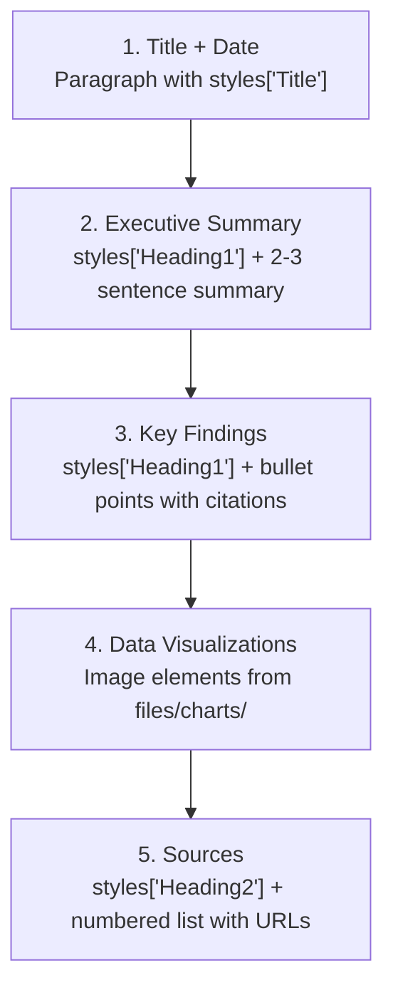
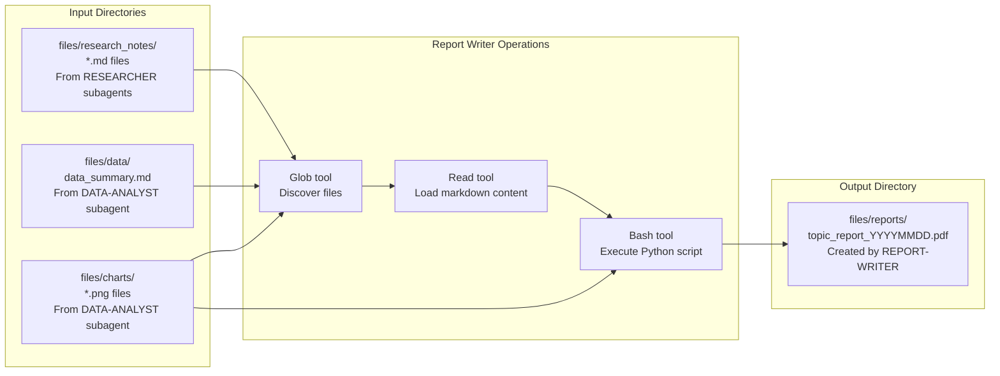
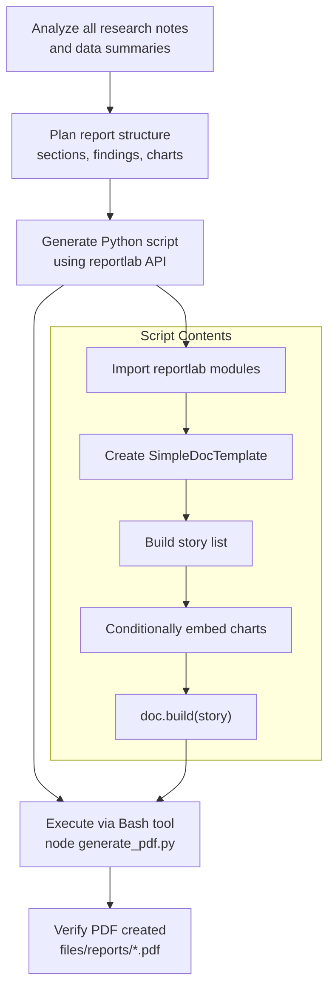

<!-- source: DeepWiki mcp.deepwiki.com · repo anthropics/claude-agent-sdk-demos · extra page Report Writer Subagent · fetched 2026-10-26 -->

# Report Writer Subagent

<details>
<summary>Relevant source files</summary>

The following files were used as context for generating this wiki page:

- [research-agent/research_agent/prompts/lead_agent.txt](research-agent/research_agent/prompts/lead_agent.txt)
- [research-agent/research_agent/prompts/report_writer.txt](research-agent/research_agent/prompts/report_writer.txt)

</details>


## Purpose and Scope

The Report Writer Subagent is the final stage in the Research Agent's sequential pipeline, responsible for synthesizing research findings, data analysis, and visualizations into a professional PDF report using the reportlab library. This subagent reads artifacts created by researcher subagents ([5.2.2](#5.2.2)) and the data analyst subagent ([5.2.3](#5.2.3)), then generates a comprehensive 1-2 page PDF document with proper formatting, embedded charts, citations, and sources.

For information about how the Lead Agent coordinates this subagent in the overall workflow, see [Lead Agent Orchestration](#5.2.1). For details on the subagent tracking system that monitors report writer execution, see [Subagent Tracking System](#5.3).

## Role in the Multi-Agent Pipeline

The Report Writer operates as the synthesis phase after all research and analysis is complete:



**Sources:** [research-agent/research_agent/prompts/report_writer.txt:1-113](), [research-agent/research_agent/prompts/lead_agent.txt:51-56]()

## Subagent Configuration

The Report Writer is spawned by the Lead Agent using the Task tool with specific parameters:

| Parameter | Value | Purpose |
|-----------|-------|---------|
| `subagent_type` | `"report-writer"` | Identifies agent type for tracking |
| `description` | `"Synthesize research into PDF report"` | Brief summary for logs |
| `prompt` | Full report writer instructions | Loaded from `report_writer.txt` |

The prompt instructs the subagent to read all research notes, incorporate charts and data analysis, and create a professional PDF report using reportlab.

**Sources:** [research-agent/research_agent/prompts/lead_agent.txt:105-109]()

## Prompt Definition and Role

The Report Writer's behavior is defined by [research-agent/research_agent/prompts/report_writer.txt:1-113](). Key role characteristics:



The prompt explicitly states at [research-agent/research_agent/prompts/report_writer.txt:3](): `**CRITICAL: You MUST read research notes from files/research_notes/ folder and generate PDF reports.**`

**Sources:** [research-agent/research_agent/prompts/report_writer.txt:5-12]()

## Execution Workflow

The Report Writer follows a six-step workflow defined in [research-agent/research_agent/prompts/report_writer.txt:22-30]():



**Workflow Details:**

1. **Discovery Phase**: Uses `Glob` tool to locate all research artifacts
2. **Loading Phase**: Uses `Read` tool to load markdown content
3. **Guidance Phase**: Optionally invokes the `pdf` skill for reportlab usage patterns
4. **Generation Phase**: Creates Python script using reportlab API via `Bash` tool
5. **Output Phase**: Saves final PDF to `files/reports/` with standardized naming

**Sources:** [research-agent/research_agent/prompts/report_writer.txt:22-30]()

## reportlab PDF Generation

The Report Writer generates PDFs using the reportlab library. The complete pattern is provided in [research-agent/research_agent/prompts/report_writer.txt:32-96]():

### Core reportlab Structure



**Sources:** [research-agent/research_agent/prompts/report_writer.txt:35-96]()

### Document Configuration

The `SimpleDocTemplate` is configured with standard parameters at [research-agent/research_agent/prompts/report_writer.txt:48-53]():

| Parameter | Value | Purpose |
|-----------|-------|---------|
| `pagesize` | `letter` | US Letter (8.5" × 11") |
| `rightMargin` | `72` | 1 inch (72 points) |
| `leftMargin` | `72` | 1 inch (72 points) |
| `topMargin` | `72` | 1 inch (72 points) |
| `bottomMargin` | `72` | 1 inch (72 points) |

**Sources:** [research-agent/research_agent/prompts/report_writer.txt:48-53]()

### Style System

The Report Writer uses reportlab's style system with custom additions:

```python
# Get base styles
styles = getSampleStyleSheet()

# Add custom Justify style
styles.add(ParagraphStyle(
    name='Justify',
    alignment=TA_JUSTIFY,
    fontSize=11,
    leading=14
))
```

Available style names used in reports:
- `styles['Title']` - Document title
- `styles['Heading1']` - Section headings
- `styles['Heading2']` - Subsection headings
- `styles['Justify']` - Custom justified body text
- `styles['Normal']` - Default body text

**Sources:** [research-agent/research_agent/prompts/report_writer.txt:56-62]()

### Content Elements (Platypus Flowables)

Reports are built using Platypus flowable elements added to a `story` list:



**Typical element sequence:**
1. `Paragraph` with `Title` style
2. `Spacer(1, 0.25*inch)` - Title spacing
3. `Paragraph` with `Heading1` style
4. `Paragraph` with `Justify` style - Content
5. `Spacer(1, 0.2*inch)` - Section spacing
6. `Image` - Embedded chart from `files/charts/`
7. Repeat for additional sections

**Sources:** [research-agent/research_agent/prompts/report_writer.txt:64-86]()

## Report Structure Requirements

The Report Writer must adhere to strict structural requirements defined in [research-agent/research_agent/prompts/report_writer.txt:98-112]():

### Mandatory Components

| Component | Requirement | Location |
|-----------|-------------|----------|
| **Output Format** | PDF with `.pdf` extension | N/A |
| **Save Location** | `files/reports/` directory | Must exist, created with `os.makedirs` |
| **File Naming** | `{topic}_report_YYYYMMDD.pdf` | Standardized format |
| **Length** | 1-2 pages (500-1000 words) | Content constraint |
| **Title and Date** | Required header elements | Top of first page |
| **Executive Summary** | 2-3 sentences | After title |
| **Key Findings** | With citations | Main body section |
| **Data Visualizations** | Embed charts from `files/charts/` | If available |
| **Sources Section** | URLs and references | End of report |

**Sources:** [research-agent/research_agent/prompts/report_writer.txt:98-112]()

### Section Breakdown



**Critical requirement from [research-agent/research_agent/prompts/report_writer.txt:110]():** "Every claim must have a citation (source/URL when available)"

**Sources:** [research-agent/research_agent/prompts/report_writer.txt:103-111]()

## Chart Embedding Pattern

The Report Writer embeds charts generated by the Data Analyst subagent. The pattern at [research-agent/research_agent/prompts/report_writer.txt:75-80]() demonstrates conditional chart inclusion:

```python
# Check if chart exists
chart_path = "files/charts/chart_name.png"
if os.path.exists(chart_path):
    # Create Image flowable with fixed dimensions
    img = Image(chart_path, width=5*inch, height=3*inch)
    story.append(img)
    story.append(Spacer(1, 0.2*inch))
```

**Chart integration steps:**
1. Use `Glob` tool to discover chart files in `files/charts/`
2. Check existence with `os.path.exists()` before embedding
3. Create `Image` flowable with dimensions (typically 5" × 3")
4. Append to story list
5. Add spacing after chart for visual separation

**Sources:** [research-agent/research_agent/prompts/report_writer.txt:75-80]()

## File System Integration

The Report Writer reads from and writes to specific directories in the `files/` structure:



**File paths accessed:**
- **Read**: `files/research_notes/*.md` - All research findings
- **Read**: `files/data/data_summary.md` - Quantitative analysis
- **Read**: `files/charts/*.png` - Generated visualizations
- **Write**: `files/reports/{topic}_report_YYYYMMDD.pdf` - Final output

**Sources:** [research-agent/research_agent/prompts/report_writer.txt:6-10](), [research-agent/research_agent/prompts/report_writer.txt:23-29]()

## Python Script Generation Pattern

The Report Writer generates a Python script that uses reportlab to create the PDF. The execution flow:



The script follows the template pattern provided in [research-agent/research_agent/prompts/report_writer.txt:35-95](), which includes:
- Import statements for all necessary reportlab modules
- Directory creation with `os.makedirs`
- `SimpleDocTemplate` initialization with margins
- Style system setup with custom styles
- Story list construction with all content elements
- Conditional chart embedding
- Final PDF generation with `doc.build()`

**Sources:** [research-agent/research_agent/prompts/report_writer.txt:32-96]()

## Example Report Structure

A typical report generated by the Report Writer has this structure:

| Section | Content | Style | Spacing |
|---------|---------|-------|---------|
| **Title** | Research topic name | `styles['Title']` | `0.25*inch` after |
| **Executive Summary** | 2-3 sentence overview of key findings | `styles['Heading1']` + `styles['Justify']` | `0.2*inch` after |
| **Key Finding 1** | First major finding with citation | `styles['Justify']` | `0.1*inch` after |
| **Key Finding 2** | Second major finding with citation | `styles['Justify']` | `0.1*inch` after |
| **Chart 1** | Embedded visualization from `files/charts/` | `Image` flowable | `0.2*inch` after |
| **Key Finding 3** | Third major finding with data | `styles['Justify']` | `0.1*inch` after |
| **Chart 2** | Second embedded visualization | `Image` flowable | `0.2*inch` after |
| **Sources** | Numbered list of URLs and references | `styles['Heading2']` + `styles['Normal']` | End of document |

**Typical page count:** 1-2 pages depending on number of findings and charts

**Sources:** [research-agent/research_agent/prompts/report_writer.txt:67-91](), [research-agent/research_agent/prompts/report_writer.txt:101-102]()

## Tools Available to Report Writer

The Report Writer has access to five tools defined in [research-agent/research_agent/prompts/report_writer.txt:14-20]():

| Tool | Purpose | Usage Pattern |
|------|---------|---------------|
| **Glob** | Find files matching patterns | Discover `files/research_notes/*.md`, `files/data/*`, `files/charts/*.png` |
| **Read** | Read file contents | Load markdown files and data summaries |
| **Skill** | Access domain knowledge | Invoke `pdf` skill for reportlab guidance |
| **Bash** | Execute commands | Run Python scripts to generate PDFs |
| **Write** | Create files | Save intermediate files if needed |

**Tool restrictions:** The Report Writer does NOT have access to:
- `WebSearch` - Cannot conduct new research
- `WebFetch` - Cannot retrieve external content
- `Task` - Cannot spawn additional subagents

**Sources:** [research-agent/research_agent/prompts/report_writer.txt:14-20]()

---

