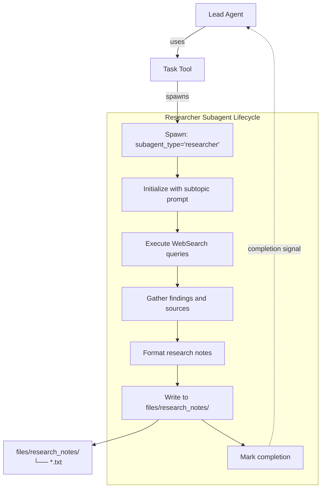
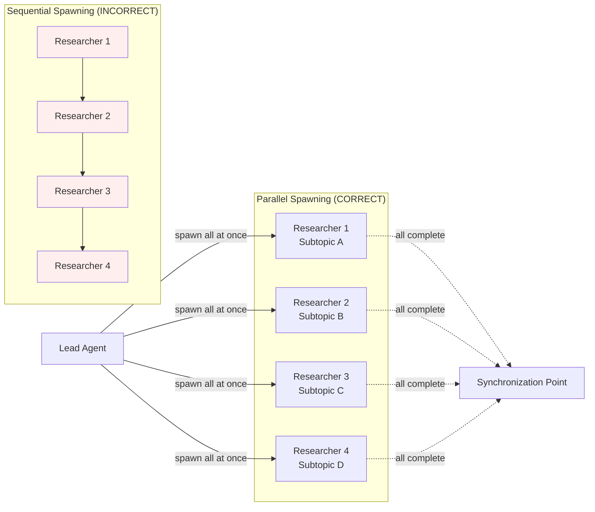
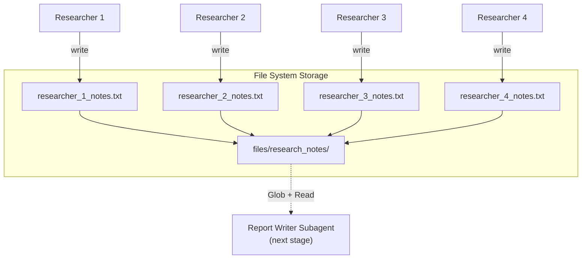
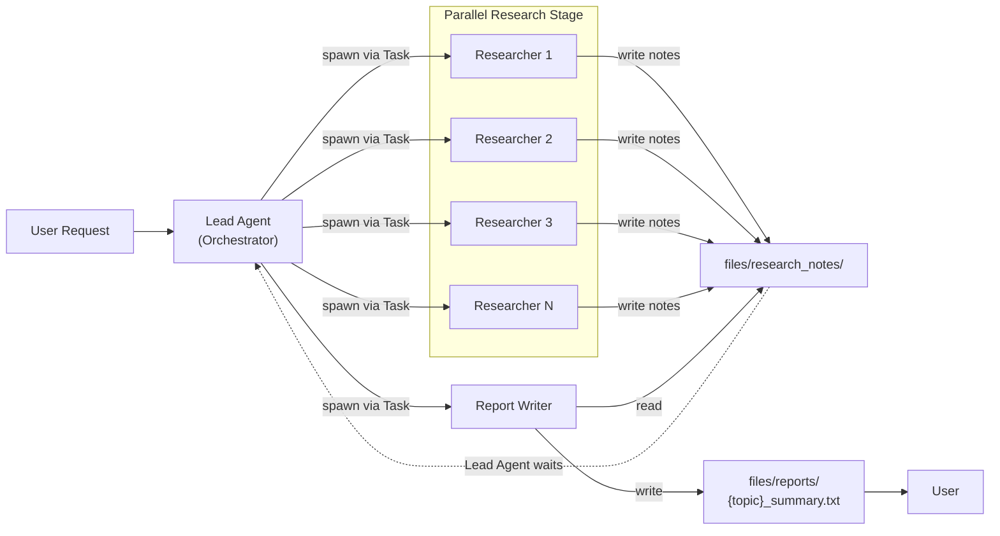

<!-- source: DeepWiki mcp.deepwiki.com · repo anthropics/claude-agent-sdk-demos · extra page Researcher Subagents · fetched 2026-10-26 -->

# Researcher Subagents

<details>
<summary>Relevant source files</summary>

The following files were used as context for generating this wiki page:

- [research-agent/research_agent/prompts/lead_agent.txt](research-agent/research_agent/prompts/lead_agent.txt)
- [research-agent/research_agent/prompts/report_writer.txt](research-agent/research_agent/prompts/report_writer.txt)

</details>


## Purpose and Scope

This document describes the researcher subagents in the Research Agent Demo. Researcher subagents are specialized worker agents spawned by the Lead Agent to investigate specific subtopics in parallel. Each researcher conducts web searches, gathers information, and saves findings to text files for later synthesis. For information about how researchers are spawned and coordinated, see [Lead Agent Orchestration](#5.2.1). For information about how their output is consumed, see [Report Writer](#5.2.3).

**Sources:** [research-agent/research_agent/prompts/lead_agent.txt:26-30]()

## Role and Responsibilities

Researcher subagents are focused execution agents with a narrow, well-defined scope:

| Responsibility | Description |
|---------------|-------------|
| **Subtopic Investigation** | Research a single, specific subtopic assigned by the Lead Agent |
| **Web Search** | Use the `WebSearch` tool to gather information from the internet |
| **Note Taking** | Save findings to text files in `files/research_notes/` directory |
| **Parallel Execution** | Operate independently and simultaneously with other researchers |
| **No Synthesis** | Do NOT create reports or summaries (delegated to report-writer) |

Researchers are specialized for information gathering only. They do not coordinate with each other, synthesize findings, or communicate results directly to users.

**Sources:** [research-agent/research_agent/prompts/lead_agent.txt:9-11](), [research-agent/research_agent/prompts/lead_agent.txt:30]()

## Spawning Process

### Task Tool Invocation

The Lead Agent spawns researcher subagents using the `Task` tool with specific parameters:

```
Task Tool Parameters:
├── subagent_type: "researcher"
├── description: Brief 3-5 word description of subtopic
└── prompt: Detailed instructions on specific research angle
```

### Subtopic Assignment Pattern

The Lead Agent breaks down the user's research request into 2-4 distinct subtopics and assigns one to each researcher. This ensures comprehensive coverage without overlap.

**Example Breakdown:**

User Request: "Research quantum computing"

| Researcher | Assigned Subtopic |
|-----------|-------------------|
| Researcher 1 | Current state of quantum hardware and qubit technology |
| Researcher 2 | Quantum algorithms and real-world applications |
| Researcher 3 | Major companies and investments in quantum computing |
| Researcher 4 | Challenges and timeline to practical quantum advantage |

Each subtopic is specific, focused, and non-overlapping to maximize research efficiency.

**Sources:** [research-agent/research_agent/prompts/lead_agent.txt:32-37](), [research-agent/research_agent/prompts/lead_agent.txt:85-89]()

## Execution Workflow

### Researcher Lifecycle Diagram



**Workflow Steps:**

1. **Initialization**: Researcher receives specific subtopic prompt from Lead Agent
2. **Web Search**: Executes multiple `WebSearch` tool calls to gather information
3. **Information Gathering**: Collects relevant data, statistics, sources, and URLs
4. **Note Formatting**: Structures findings into readable text format
5. **File Writing**: Saves notes to `files/research_notes/` directory as `.txt` files
6. **Completion**: Signals completion back to Lead Agent

**Sources:** [research-agent/research_agent/prompts/lead_agent.txt:26-30]()

### Tool Usage

Researchers have access to the `WebSearch` tool for information gathering:

| Tool | Purpose | Usage Pattern |
|------|---------|---------------|
| **WebSearch** | Search internet for information | Execute multiple queries per subtopic to gather comprehensive data |

Researchers save findings using standard file I/O operations to the `files/research_notes/` directory.

**Sources:** [research-agent/research_agent/prompts/lead_agent.txt:30]()

## Parallel Execution Pattern

### Concurrency Model

The Lead Agent spawns all researcher subagents **in parallel**, not sequentially. This is a critical design decision for performance:



**Parallel Execution Rules:**

- **GOOD**: Spawn all 2-4 researchers simultaneously using multiple `Task` tool calls
- **BAD**: Spawn researcher 1, wait for completion, spawn researcher 2, wait, etc.
- **Synchronization**: Lead Agent waits for ALL researchers to complete before proceeding

This parallel pattern maximizes throughput and minimizes total research time.

**Sources:** [research-agent/research_agent/prompts/lead_agent.txt:60](), [research-agent/research_agent/prompts/lead_agent.txt:67-80]()

### Independence Guarantee

Researchers operate independently with no inter-agent communication:

- No shared state between researchers
- No coordination or message passing
- Each researcher focuses solely on its assigned subtopic
- File system acts as the only communication mechanism (via written notes)

**Sources:** [research-agent/research_agent/prompts/lead_agent.txt:62]()

## Output Format and Storage

### File System Integration



### Note Structure

Research notes are saved as plain text files in `files/research_notes/` with the following characteristics:

| Attribute | Specification |
|-----------|---------------|
| **Format** | Plain text (`.txt` extension) |
| **Location** | `files/research_notes/` directory |
| **Naming** | Descriptive names indicating subtopic |
| **Content** | Research findings, data, statistics, sources |
| **Citations** | URLs and source references included |
| **Structure** | Unstructured text optimized for human and AI readability |

### Content Requirements

Each research note should contain:

- **Findings**: Key information discovered during web searches
- **Data**: Specific statistics, numbers, dates, and facts
- **Sources**: URLs and references for verification
- **Context**: Relevant background and explanations
- **Subtopic Focus**: Information strictly related to assigned subtopic

**Sources:** [research-agent/research_agent/prompts/lead_agent.txt:30](), [research-agent/research_agent/prompts/report_writer.txt:3-10]()

## Integration with Research Pipeline

### Pipeline Position

Researcher subagents occupy the middle stage of the research pipeline:



### Synchronization Point

The Lead Agent implements a critical synchronization barrier:

1. Spawn all researchers in parallel
2. **Wait for ALL researchers to complete** before proceeding
3. Only after completion, spawn the report-writer subagent
4. Report-writer reads all research notes and synthesizes final report

This ensures the report-writer has access to complete research findings from all subtopics.

**Sources:** [research-agent/research_agent/prompts/lead_agent.txt:39-41](), [research-agent/research_agent/prompts/lead_agent.txt:61]()

## Configuration and Customization

### Subtopic Count

The Lead Agent spawns between 2-4 researcher subagents based on topic complexity:

| Topic Complexity | Researcher Count | Rationale |
|-----------------|------------------|-----------|
| Simple | 2 researchers | Two main angles sufficient |
| Moderate | 3 researchers | Three distinct aspects |
| Complex | 4 researchers | Four complementary subtopics for comprehensive coverage |

### Subtopic Specificity

Each researcher's prompt must be **specific and focused**:

- **GOOD**: "Research current state of quantum hardware and qubit technology"
- **BAD**: "Research quantum computing" (too broad, causes overlap)
- **GOOD**: "Research major companies and investments in quantum computing"
- **BAD**: "Research everything about quantum computing" (not specific)

Specificity ensures non-overlapping coverage and efficient parallel execution.

**Sources:** [research-agent/research_agent/prompts/lead_agent.txt:62]()

## Lifecycle Management

### Completion Detection

The Lead Agent detects researcher completion through the Claude Agent SDK's subagent lifecycle tracking. Once all researchers have written their notes and completed execution, the Lead Agent proceeds to the next stage.

### Error Handling

If a researcher fails or produces incomplete results:

- The Lead Agent may need to re-spawn the researcher with clarified instructions
- Failed researchers do not block other parallel researchers
- The file-based communication pattern allows inspection of partial results

**Sources:** [research-agent/research_agent/prompts/lead_agent.txt:39-41]()

## Summary

Researcher subagents implement a focused, parallel execution model:

- **Spawned by Lead Agent** via `Task` tool with specific subtopic assignments
- **Execute independently** using `WebSearch` tool for information gathering
- **Run in parallel** (2-4 simultaneously) for maximum efficiency
- **Save findings** to `files/research_notes/` as plain text files
- **No synthesis** - only gather and document raw research findings
- **Completion signals** allow Lead Agent to proceed to report synthesis stage

This design maximizes research throughput while maintaining clear separation of concerns between information gathering (researchers) and synthesis (report-writer).

**Sources:** [research-agent/research_agent/prompts/lead_agent.txt:1-157](), [research-agent/research_agent/prompts/report_writer.txt:1-34]()

---

