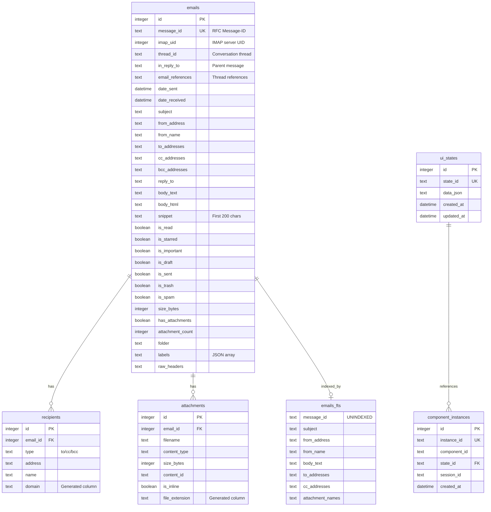
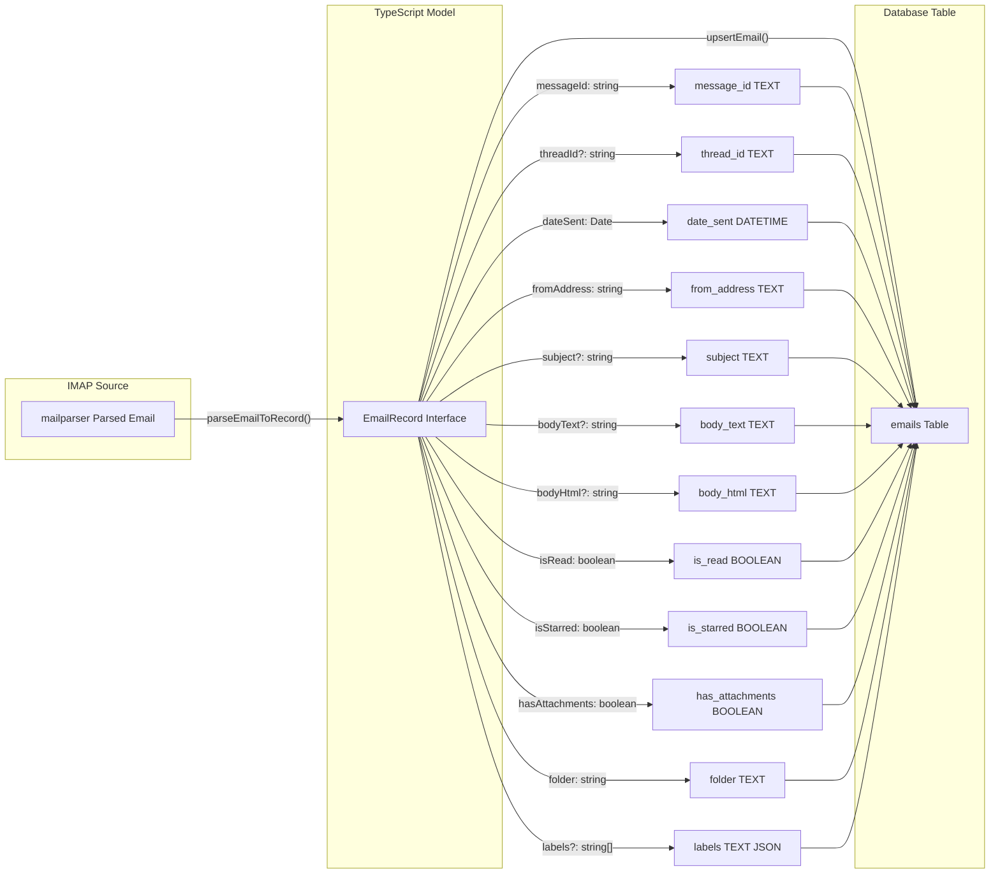
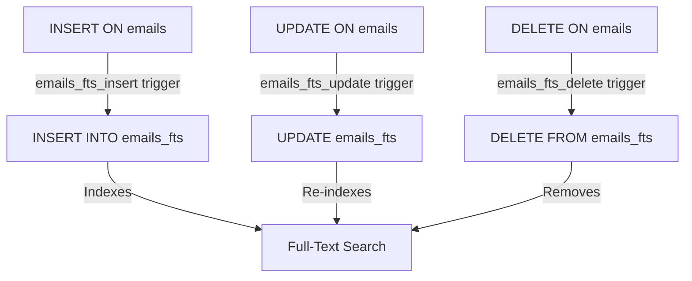
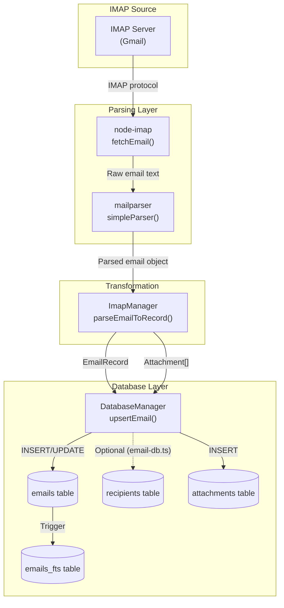
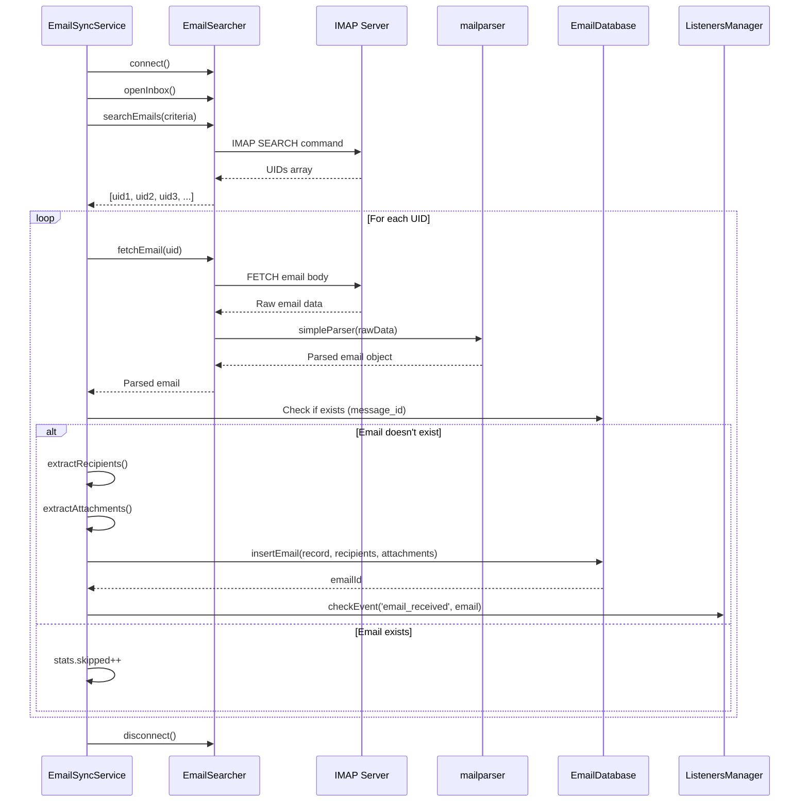

<!-- source: DeepWiki mcp.deepwiki.com · repo anthropics/claude-agent-sdk-demos · extra page Schema and Models · fetched 2026-10-26 -->

# Schema and Models

<details>
<summary>Relevant source files</summary>

The following files were used as context for generating this wiki page:

- [email-agent/bun.lock](email-agent/bun.lock)
- [email-agent/client/globals.css](email-agent/client/globals.css)
- [email-agent/database/database-manager.ts](email-agent/database/database-manager.ts)
- [email-agent/package.json](email-agent/package.json)
- [email-agent/server/endpoints/emails.ts](email-agent/server/endpoints/emails.ts)
- [email-agent/server/server.ts](email-agent/server/server.ts)
- [email-agent/tailwind.config.js](email-agent/tailwind.config.js)

</details>


This page documents the database schema and TypeScript models used in the Email Agent Demo's local SQLite storage layer. It covers the table structures, relationships, data types, and how IMAP email data is transformed into structured database records for efficient querying and search operations.

For information about IMAP integration and synchronization logic, see [IMAP Integration and Email Sync](#3.3.2). For database operations and query methods, see [Database Layer](#3.3).

---

## Database Schema Overview

The Email Agent uses SQLite with Write-Ahead Logging (WAL mode) as its local cache and persistence layer. The schema is designed to support fast email searches, thread management, and full-text search capabilities.

**Primary Tables:**
- `emails` - Core email metadata and content
- `recipients` - Normalized recipient addresses (to/cc/bcc)
- `attachments` - Attachment metadata
- `emails_fts` - FTS5 virtual table for full-text search
- `ui_states` - Persistent UI state storage
- `component_instances` - Dynamic component tracking



**Sources:** 
- [email-agent/database/database-manager.ts:89-257]()
- [email-agent/database/schema.sql:8-112]()
- [email-agent/database/email-db.ts:84-213]()

---

## Core Email Tables

### emails Table

The `emails` table stores the primary email data. Each row represents a unique email identified by its RFC `message_id`. The table is initialized in both `DatabaseManager` and `EmailDatabase` classes with identical schemas.

**Key Fields:**
| Field | Type | Purpose | Indexed |
|-------|------|---------|---------|
| `id` | INTEGER | Auto-increment primary key | Yes (implicit) |
| `message_id` | TEXT | RFC Message-ID header (unique) | Yes |
| `imap_uid` | INTEGER | Server-side UID for IMAP operations | No |
| `thread_id` | TEXT | Groups conversation threads | Yes |
| `date_sent` | DATETIME | Original send timestamp | Yes (DESC) |
| `from_address` | TEXT | Sender email address | Yes |
| `subject` | TEXT | Email subject line | No (in FTS) |
| `body_text` | TEXT | Plain text content | No (in FTS) |
| `body_html` | TEXT | HTML content | No |
| `is_read` | BOOLEAN | Read/unread status | Yes |
| `is_starred` | BOOLEAN | Starred/flagged status | Yes |
| `folder` | TEXT | IMAP folder (INBOX, Sent, etc.) | Yes |
| `has_attachments` | BOOLEAN | Attachment presence flag | Yes |
| `labels` | TEXT | JSON array of Gmail labels | No |

**Boolean Fields Storage:** All boolean fields are stored as INTEGER (0/1) due to SQLite's type system.

**Sources:**
- [email-agent/database/database-manager.ts:90-125]()
- [email-agent/database/schema.sql:8-54]()

### recipients Table

The `recipients` table normalizes email addresses for efficient domain-based searches. Multiple recipients per email are stored as separate rows.

**Structure:**
```sql
CREATE TABLE recipients (
    id INTEGER PRIMARY KEY,
    email_id INTEGER NOT NULL,
    type TEXT CHECK(type IN ('to', 'cc', 'bcc')),
    address TEXT NOT NULL,
    name TEXT,
    domain TEXT GENERATED ALWAYS AS (
        LOWER(SUBSTR(address, INSTR(address, '@') + 1))
    ) STORED,
    FOREIGN KEY (email_id) REFERENCES emails(id) ON DELETE CASCADE
)
```

The `domain` column is a generated stored column that automatically extracts and lowercases the domain from the `address` field, enabling fast domain-based queries without additional parsing.

**Indexes:** `email_id`, `address`, `domain`, `type`

**Sources:**
- [email-agent/database/schema.sql:57-68]()
- [email-agent/database/email-db.ts:119-130]()

### attachments Table

The `attachments` table stores metadata about email attachments. Actual attachment content is not stored locally.

**Structure:**
```sql
CREATE TABLE attachments (
    id INTEGER PRIMARY KEY,
    email_id INTEGER NOT NULL,
    filename TEXT NOT NULL,
    content_type TEXT,
    size_bytes INTEGER,
    content_id TEXT,  -- For inline images
    is_inline BOOLEAN DEFAULT 0,
    file_extension TEXT GENERATED ALWAYS AS (
        LOWER(SUBSTR(filename, INSTR(filename, '.') + 1))
    ) STORED,
    FOREIGN KEY (email_id) REFERENCES emails(id) ON DELETE CASCADE
)
```

The `file_extension` generated column enables queries like "find all PDFs" without string parsing.

**Sources:**
- [email-agent/database/schema.sql:71-84]()
- [email-agent/database/database-manager.ts:128-139]()

---

## TypeScript Models and Interfaces

The database schema is represented in TypeScript through several interfaces that enforce type safety when working with email data.

### EmailRecord Interface

The `EmailRecord` interface is defined in both `database-manager.ts` and `email-db.ts` with nearly identical structures:



**Key Fields Mapping:**

| TypeScript Property | Database Column | Type Conversion |
|---------------------|-----------------|-----------------|
| `messageId: string` | `message_id TEXT` | Direct mapping |
| `dateSent: Date \| string` | `date_sent DATETIME` | `.toISOString()` |
| `isRead: boolean` | `is_read BOOLEAN` | `? 1 : 0` |
| `labels?: string[]` | `labels TEXT` | `JSON.stringify()` |
| `toAddresses?: string` | `to_addresses TEXT` | Comma-separated |

**Sources:**
- [email-agent/database/database-manager.ts:5-37]()
- [email-agent/database/email-db.ts:6-35]()

### Attachment and Recipient Interfaces

```typescript
// Attachment interface
interface Attachment {
  emailId?: number;
  filename: string;
  contentType?: string;
  sizeBytes?: number;
  contentId?: string;
  isInline?: boolean;
}

// Recipient interface (email-db.ts only)
interface Recipient {
  email_id: number;
  type: 'to' | 'cc' | 'bcc';
  address: string;
  name?: string;
}
```

**Note:** `DatabaseManager` does not define a separate `Recipient` interface. Instead, recipients are denormalized into the `toAddresses`, `ccAddresses`, and `bccAddresses` fields of `EmailRecord` as comma-separated strings. The `EmailDatabase` class uses the normalized `Recipient` interface with a separate `recipients` table.

**Sources:**
- [email-agent/database/database-manager.ts:39-46]()
- [email-agent/database/email-db.ts:37-51]()

### SearchCriteria vs SearchOptions

Two search interfaces exist with overlapping functionality:

**`SearchCriteria` (database-manager.ts):**
```typescript
interface SearchCriteria {
  query?: string;           // Full-text search
  from?: string | string[] | 'me';
  to?: string | string[];
  subject?: string;
  dateRange?: { start: Date; end: Date };
  hasAttachments?: boolean;
  isUnread?: boolean;
  isStarred?: boolean;
  folder?: string;
  folders?: string[];       // Multiple folder search
  labels?: string[];
  threadId?: string;
  limit?: number;
  offset?: number;
  minSize?: number;
  maxSize?: number;
  gmailQuery?: string;      // Gmail X-GM-RAW syntax
}
```

**`SearchOptions` (email-db.ts):**
```typescript
interface SearchOptions {
  query?: string;
  from?: string;
  to?: string;
  domain?: string;          // Domain-specific search
  subject?: string;
  dateFrom?: Date;
  dateTo?: Date;
  hasAttachments?: boolean;
  isUnread?: boolean;
  isStarred?: boolean;
  folder?: string;
  threadId?: string;
  limit?: number;
  offset?: number;
}
```

**Key Difference:** `SearchCriteria` supports Gmail-specific `gmailQuery` for native Gmail search syntax via IMAP's X-GM-RAW extension, while `SearchOptions` includes a `domain` field for recipient domain filtering.

**Sources:**
- [email-agent/database/database-manager.ts:48-66]()
- [email-agent/database/email-db.ts:53-68]()

---

## Full-Text Search (FTS5)

The `emails_fts` virtual table enables fast full-text searches across email content using SQLite's FTS5 extension.

### FTS5 Table Structure

```sql
CREATE VIRTUAL TABLE emails_fts USING fts5(
    messageId UNINDEXED,       -- Foreign key, not searchable
    subject,                   -- Searchable
    fromAddress,               -- Searchable
    fromName,                  -- Searchable
    bodyText,                  -- Searchable
    toAddresses,               -- Searchable (denormalized)
    ccAddresses,               -- Searchable (denormalized)
    attachment_names,          -- Searchable (denormalized)
    tokenize = 'porter unicode61'
);
```

**Tokenizer:** `porter unicode61` provides:
- Porter stemming algorithm (e.g., "running" matches "run")
- Unicode support for international characters
- Case-insensitive matching

**Sources:**
- [email-agent/database/database-manager.ts:142-154]()
- [email-agent/database/schema.sql:115-124]()

### FTS Synchronization Triggers

Three triggers keep `emails_fts` synchronized with the `emails` table:



**Trigger Definitions:**

1. **emails_fts_insert** - Adds new emails to FTS index:
   ```sql
   CREATE TRIGGER emails_fts_insert 
   AFTER INSERT ON emails
   BEGIN
       INSERT INTO emails_fts(messageId, subject, fromAddress, fromName, bodyText, ...)
       VALUES (NEW.messageId, NEW.subject, NEW.fromAddress, ...);
   END
   ```

2. **emails_fts_update** - Updates FTS index when email changes:
   ```sql
   CREATE TRIGGER emails_fts_update 
   AFTER UPDATE ON emails
   BEGIN
       UPDATE emails_fts 
       SET subject = NEW.subject, fromAddress = NEW.fromAddress, ...
       WHERE messageId = NEW.messageId;
   END
   ```

3. **emails_fts_delete** - Removes emails from FTS index:
   ```sql
   CREATE TRIGGER emails_fts_delete 
   AFTER DELETE ON emails
   BEGIN
       DELETE FROM emails_fts WHERE messageId = OLD.messageId;
   END
   ```

**Sources:**
- [email-agent/database/database-manager.ts:174-210]()
- [email-agent/database/schema.sql:169-191]()

### FTS Query Usage

Full-text searches use the `MATCH` operator:

```typescript
// Example from searchEmails method
WHERE emails_fts MATCH $query
```

The query syntax supports:
- AND/OR operators: `"important meeting"`
- NOT operator: `"project NOT cancelled"`
- Phrase search: `"'exact phrase'"`
- Column search: `subject: meeting`

**Sources:**
- [email-agent/database/database-manager.ts:401-410]()

---

## UI State Tables

Two tables support persistent UI state management and dynamic component rendering.

### ui_states Table

Stores arbitrary JSON state data keyed by `state_id`:

```sql
CREATE TABLE ui_states (
    id INTEGER PRIMARY KEY,
    state_id TEXT UNIQUE NOT NULL,
    data_json TEXT NOT NULL,          -- JSON serialized state
    created_at DATETIME DEFAULT CURRENT_TIMESTAMP,
    updated_at DATETIME DEFAULT CURRENT_TIMESTAMP
)
```

**Auto-Update Trigger:**
```sql
CREATE TRIGGER update_ui_states_timestamp
AFTER UPDATE ON ui_states
BEGIN
    UPDATE ui_states SET updated_at = CURRENT_TIMESTAMP 
    WHERE id = NEW.id;
END
```

**Operations:**
- `getUIState(stateId)` - Returns parsed JSON or null
- `setUIState(stateId, data)` - Upserts with ON CONFLICT
- `listUIStates()` - Returns all state IDs with timestamps
- `deleteUIState(stateId)` - Removes state

**Sources:**
- [email-agent/database/database-manager.ts:213-221]()
- [email-agent/database/database-manager.ts:721-782]()

### component_instances Table

Tracks dynamically created component instances and their associated states:

```sql
CREATE TABLE component_instances (
    id INTEGER PRIMARY KEY,
    instance_id TEXT UNIQUE NOT NULL,
    component_id TEXT NOT NULL,      -- Component template ID
    state_id TEXT NOT NULL,          -- Links to ui_states
    session_id TEXT,                 -- WebSocket session
    created_at DATETIME DEFAULT CURRENT_TIMESTAMP
)
```

**Purpose:** Enables the AI agent to create persistent UI components (e.g., charts, forms) that survive page reloads and can be rehydrated from stored state.

**Operations:**
- `registerComponentInstance()` - Creates instance record
- `getComponentInstancesBySession()` - Retrieves all instances for a WebSocket session
- `pruneOldComponentInstances(days)` - Cleanup old instances

**Sources:**
- [email-agent/database/database-manager.ts:224-232]()
- [email-agent/database/database-manager.ts:787-839]()

---

## Indexes and Performance Optimization

### Strategic Indexes

The schema creates 14 indexes for common query patterns:

**Email Table Indexes:**
| Index | Purpose |
|-------|---------|
| `idx_emails_date_sent` | DESC ordering for recent emails |
| `idx_emails_from_address` | Sender-based queries |
| `idx_emails_thread_id` | Conversation threading |
| `idx_emails_message_id` | Unique identifier lookups |
| `idx_emails_is_read` | Unread email filtering |
| `idx_emails_is_starred` | Starred email filtering |
| `idx_emails_folder` | Folder-based queries |
| `idx_emails_has_attachments` | Attachment filtering |

**Recipient Table Indexes:**
| Index | Purpose |
|-------|---------|
| `idx_recipients_email_id` | Foreign key joins |
| `idx_recipients_address` | Email address lookups |
| `idx_recipients_domain` | Domain-based searches |
| `idx_recipients_type` | Filter by to/cc/bcc |

**Attachment Table Indexes:**
| Index | Purpose |
|-------|---------|
| `idx_attachments_email_id` | Foreign key joins |
| `idx_attachments_extension` | File type filtering |

**Sources:**
- [email-agent/database/database-manager.ts:157-171]()
- [email-agent/database/schema.sql:137-159]()

### WAL Mode and Foreign Keys

Both database implementations enable performance and data integrity features:

```typescript
this.db.exec("PRAGMA journal_mode = WAL");
this.db.exec("PRAGMA foreign_keys = ON");
```

**WAL (Write-Ahead Logging):**
- Improves write performance by writing changes to a separate WAL file
- Allows concurrent reads during writes
- Reduces database locking contention

**Foreign Keys:**
- Enforces referential integrity
- Enables CASCADE DELETE (removing an email deletes its recipients/attachments)

**Sources:**
- [email-agent/database/database-manager.ts:76-77]()
- [email-agent/database/email-db.ts:77-78]()

---

## Data Transformation Pipeline

### IMAP to EmailRecord Conversion

The `ImapManager.parseEmailToRecord()` method transforms `mailparser` output into `EmailRecord` format:



**Key Transformations:**

1. **Address Extraction:**
   ```typescript
   // From: parsed.from.value[0].address
   fromAddress: parsed.from?.value?.[0]?.address || ""
   fromName: parsed.from?.value?.[0]?.name || ""
   
   // To: comma-separated
   toAddresses: parsed.to?.value?.map(addr => addr.address).join(", ")
   ```

2. **Date Handling:**
   ```typescript
   dateSent: parsed.date || new Date()
   ```

3. **Thread ID Inference:**
   ```typescript
   threadId: parsed.threadId || parsed.inReplyTo
   ```

4. **Folder-Based Flags:**
   ```typescript
   isSent: folder === "Sent" || folder === "[Gmail]/Sent Mail"
   isTrash: folder === "Trash" || folder === "[Gmail]/Trash"
   isSpam: folder === "Spam" || folder === "[Gmail]/Spam"
   ```

5. **Attachment Processing:**
   ```typescript
   for (const att of parsed.attachments) {
     attachments.push({
       filename: att.filename || "unnamed",
       contentType: att.contentType,
       sizeBytes: att.size,
       contentId: att.contentId,
       isInline: att.contentDisposition === "inline"
     });
   }
   ```

**Sources:**
- [email-agent/database/imap-manager.ts:335-385]()

### Sync Service Data Flow

The `EmailSyncService` orchestrates the complete pipeline from IMAP to database:



**Key Methods:**

1. **extractRecipients()** - Parses to/cc/bcc into `Recipient[]`:
   ```typescript
   // Handles both parsed.to.value array and "Name <email>" strings
   const parsed = this.parseEmailAddress(to);
   recipients.push({ email_id: emailId, type: "to", ...parsed });
   ```

2. **extractAttachments()** - Converts `parsed.attachments` to `Attachment[]`:
   ```typescript
   attachments.push({
     email_id: emailId,
     filename: att.filename || "unnamed",
     content_type: att.contentType,
     size_bytes: att.size || 0,
     content_id: att.contentId,
     is_inline: att.contentDisposition === "inline"
   });
   ```

3. **insertEmail()** - Atomic transaction with FTS update:
   ```typescript
   const insertTransaction = this.db.transaction(() => {
     const result = insertEmail.run(params);
     const emailId = result.lastInsertRowid;
     
     // Insert recipients
     for (const recipient of recipients) { ... }
     
     // Insert attachments
     for (const attachment of attachments) { ... }
     
     // Update FTS with denormalized data
     this.db.prepare(`UPDATE emails_fts SET ...`).run(...);
     
     return emailId;
   });
   ```

**Sources:**
- [email-agent/database/email-sync.ts:171-354]()
- [email-agent/database/email-sync.ts:57-168]()
- [email-agent/database/email-db.ts:216-329]()

---

## Database Initialization

Both `DatabaseManager` and `EmailDatabase` use singleton pattern and initialize schema in constructor:

```typescript
export class DatabaseManager {
  private static instance: DatabaseManager;
  
  public static getInstance(dbPath?: string): DatabaseManager {
    if (!DatabaseManager.instance) {
      DatabaseManager.instance = new DatabaseManager(dbPath);
    }
    return DatabaseManager.instance;
  }
  
  private constructor(dbPath: string = DATABASE_PATH) {
    this.db = new Database(dbPath);
    this.db.exec("PRAGMA journal_mode = WAL");
    this.db.exec("PRAGMA foreign_keys = ON");
    this.initializeDatabase();  // Creates tables, indexes, triggers
  }
}
```

**Initialization Order:**
1. Create main tables (`emails`, `recipients`, `attachments`)
2. Create FTS5 virtual table (`emails_fts`)
3. Create indexes for performance
4. Create triggers for FTS synchronization
5. Create UI state tables (`ui_states`, `component_instances`)

**Sources:**
- [email-agent/database/database-manager.ts:68-257]()
- [email-agent/database/email-db.ts:70-214]()
- [email-agent/server/server.ts:30]()

---

