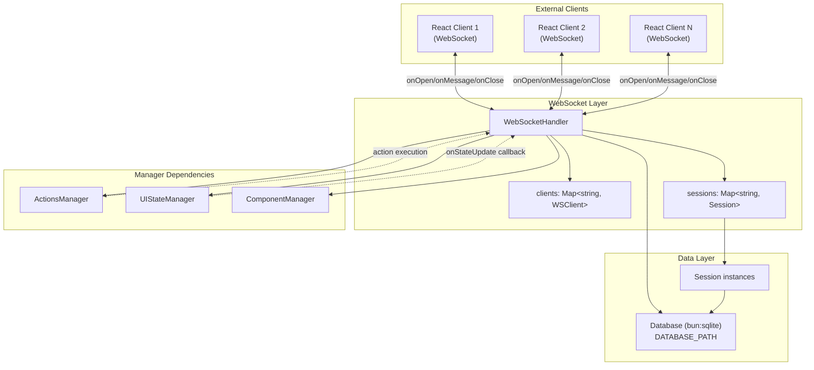
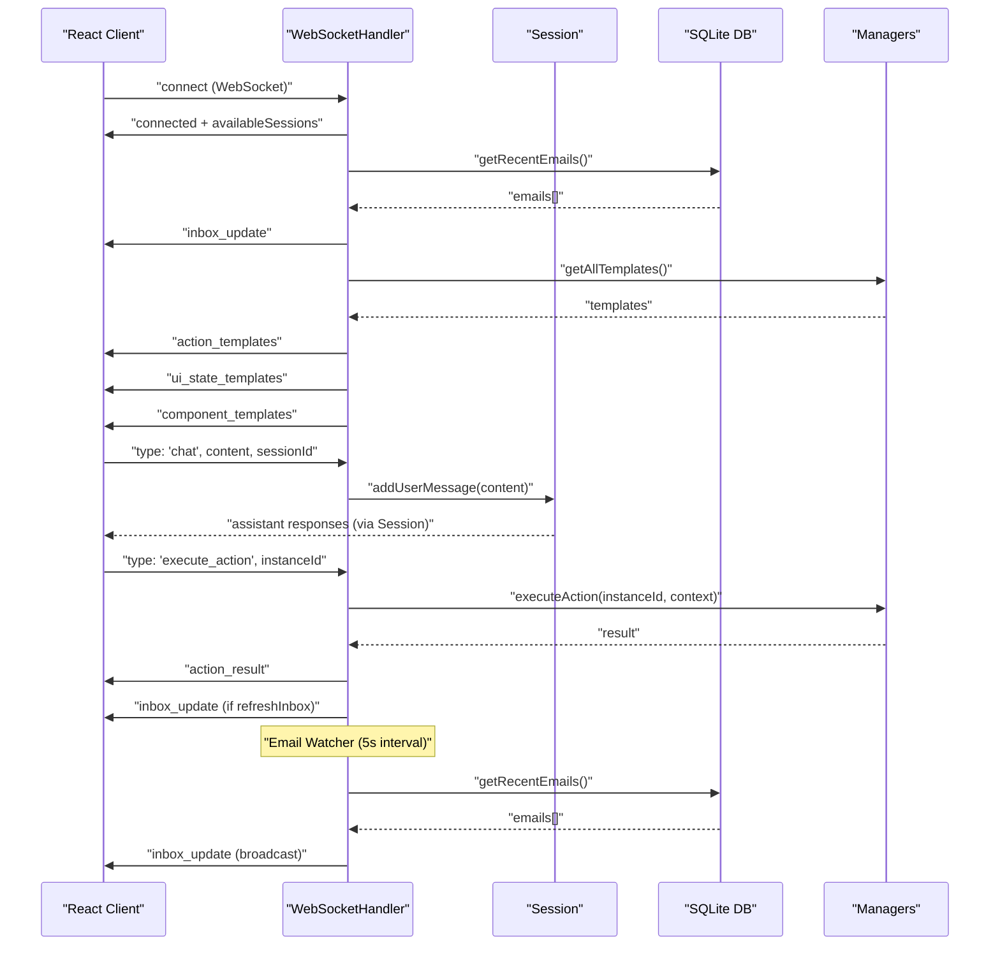
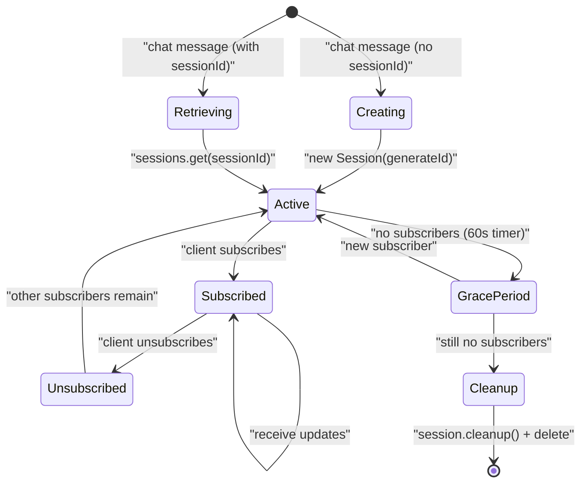
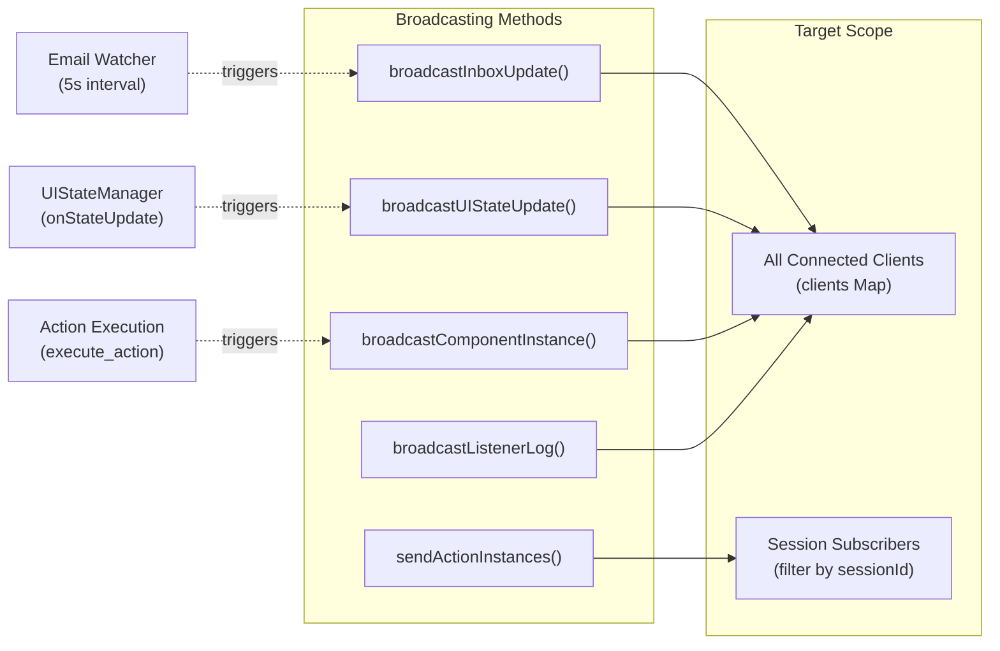

<!-- source: DeepWiki mcp.deepwiki.com · repo anthropics/claude-agent-sdk-demos · extra page WebSocket Handler · fetched 2026-10-26 -->

# WebSocket Handler

<details>
<summary>Relevant source files</summary>

The following files were used as context for generating this wiki page:

- [email-agent/ccsdk/websocket-handler.ts](email-agent/ccsdk/websocket-handler.ts)
- [email-agent/server/endpoints/index.ts](email-agent/server/endpoints/index.ts)

</details>


The WebSocket Handler is responsible for managing real-time bidirectional communication between the Email Agent server and connected React clients. It handles client connections, session management, message routing, and broadcasting of updates such as inbox changes, UI state updates, and listener activities. The handler integrates with the ActionsManager, UIStateManager, and ComponentManager to enable clients to trigger actions and receive real-time feedback.

For information about the manager dependencies (ActionsManager, UIStateManager, ComponentManager), see [Actions and UI State Management](#3.2.4). For information about how clients establish WebSocket connections, see [Client Layer](#3.4).

## Architecture and Dependencies

The `WebSocketHandler` class serves as the central hub for WebSocket communication in the Email Agent server. It maintains connections to multiple clients, manages conversation sessions, and coordinates with other server components to provide real-time updates.

**WebSocketHandler System Architecture**



**Sources:** [email-agent/ccsdk/websocket-handler.ts:10-31]()

## Class Structure

The `WebSocketHandler` class is defined at [email-agent/ccsdk/websocket-handler.ts:11-666]() and maintains the following key data structures:

| Property | Type | Purpose |
|----------|------|---------|
| `db` | `Database` | Direct SQLite connection for querying emails |
| `sessions` | `Map<string, Session>` | Active conversation sessions indexed by session ID |
| `clients` | `Map<string, WSClient>` | Connected WebSocket clients indexed by client ID |
| `actionsManager` | `ActionsManager?` | Optional manager for executing user actions |
| `uiStateManager` | `UIStateManager?` | Optional manager for persistent UI state |
| `componentManager` | `ComponentManager?` | Optional manager for dynamic component instances |

The constructor accepts these managers as optional dependencies and initializes two watchers:
- **Email Watcher** ([email-agent/ccsdk/websocket-handler.ts:33-41]()): Polls the database every 5 seconds and broadcasts inbox updates to all connected clients
- **UI State Watcher** ([email-agent/ccsdk/websocket-handler.ts:87-94]()): Subscribes to UI state changes from the `UIStateManager` and broadcasts updates

**Sources:** [email-agent/ccsdk/websocket-handler.ts:11-31](), [email-agent/ccsdk/websocket-handler.ts:33-94]()

## Message Protocol

The WebSocket Handler implements a structured JSON-based message protocol with distinct incoming and outgoing message types.

**WebSocket Message Flow**



### Incoming Message Types

The handler processes the following incoming message types ([email-agent/ccsdk/websocket-handler.ts:195-332]()):

| Message Type | Required Fields | Purpose |
|--------------|----------------|---------|
| `chat` | `content`, `sessionId?`, `newConversation?` | Send a user message to the AI assistant |
| `subscribe` | `sessionId` | Subscribe to updates from a specific session |
| `unsubscribe` | `sessionId` | Unsubscribe from a session |
| `request_inbox` | - | Request current inbox state |
| `execute_action` | `instanceId`, `sessionId` | Execute an action instance created by the AI |

### Outgoing Message Types

The handler sends the following outgoing message types:

| Message Type | Fields | Purpose | Broadcast or Targeted |
|--------------|--------|---------|----------------------|
| `connected` | `message`, `availableSessions` | Confirm connection established | Targeted (on connect) |
| `inbox_update` | `emails` | Send current inbox emails | Broadcast (all clients) |
| `ui_state_update` | `stateId`, `data` | Notify of UI state change | Broadcast (all clients) |
| `component_instance` | `instance`, `sessionId` | Send new component instance | Broadcast (all clients) |
| `listener_log` | `log` | Send listener activity log | Broadcast (all clients) |
| `action_templates` | `templates` | Send available action templates | Targeted (on connect) |
| `ui_state_templates` | `templates` | Send UI state templates | Targeted (on connect) |
| `component_templates` | `templates` | Send component templates | Targeted (on connect) |
| `action_instances` | `actions`, `sessionId` | Send action instances for session | Targeted (session subscribers) |
| `action_result` | `instanceId`, `result`, `sessionId` | Send action execution result | Targeted (requester) |
| `error` | `error` | Report error condition | Targeted (requester) |

**Sources:** [email-agent/ccsdk/websocket-handler.ts:191-340]()

## Connection Lifecycle

The WebSocket Handler implements three lifecycle methods that manage client connections:

### onOpen - Client Connection

When a client connects ([email-agent/ccsdk/websocket-handler.ts:145-189]()), the handler:

1. Generates a unique `clientId` and stores the WebSocket in `clients` Map
2. Sends a `connected` message with available sessions
3. Queries and sends the initial inbox (`inbox_update`)
4. Sends all available templates from managers:
   - `action_templates` from `ActionsManager`
   - `ui_state_templates` from `UIStateManager`
   - `component_templates` from `ComponentManager`

```typescript
// Conceptual flow at connection:
clientId = generateId();
clients.set(clientId, ws);
ws.send({ type: 'connected', availableSessions: [...] });
ws.send({ type: 'inbox_update', emails: [...] });
ws.send({ type: 'action_templates', templates: [...] });
ws.send({ type: 'ui_state_templates', templates: [...] });
ws.send({ type: 'component_templates', templates: [...] });
```

### onMessage - Message Processing

The `onMessage` method ([email-agent/ccsdk/websocket-handler.ts:191-340]()) parses incoming JSON messages and routes them to appropriate handlers based on the `type` field. Key behaviors:

- **`chat` messages**: Creates or retrieves a session, auto-subscribes the sender, optionally ends the conversation if `newConversation` flag is set, and adds the user message to the session
- **`subscribe` messages**: Subscribes the client to a session, automatically unsubscribing from any previous session
- **`execute_action` messages**: Retrieves the session, creates an `ActionContext` with all capabilities, executes the action, and broadcasts component instances if returned

### onClose - Client Disconnection

When a client disconnects ([email-agent/ccsdk/websocket-handler.ts:342-376]()), the handler:

1. Unsubscribes the client from any session
2. Removes the client from the `clients` Map
3. Triggers cleanup of empty sessions with a 60-second grace period

**Sources:** [email-agent/ccsdk/websocket-handler.ts:145-189](), [email-agent/ccsdk/websocket-handler.ts:191-340](), [email-agent/ccsdk/websocket-handler.ts:342-376]()

## Session Management

The WebSocket Handler manages conversation sessions through the `Session` class, which handles the actual AI conversation loop. Sessions are created on-demand and support multiple subscribers.

**Session Lifecycle**



### Session Creation and Retrieval

The `getOrCreateSession` method ([email-agent/ccsdk/websocket-handler.ts:134-143]()) implements session lookup and creation:

1. If a `sessionId` is provided and exists in the `sessions` Map, return the existing session
2. Otherwise, generate a new session ID using `generateSessionId()` (format: `session-{timestamp}-{random}`)
3. Create a new `Session` instance with the ID and database connection
4. Store in `sessions` Map and return

### Subscription Management

Clients can subscribe to sessions to receive real-time updates. The handler supports:

- **Auto-subscription**: When a client sends a `chat` message, it automatically subscribes to that session ([email-agent/ccsdk/websocket-handler.ts:200-203]())
- **Explicit subscription**: Clients can subscribe via `subscribe` message type ([email-agent/ccsdk/websocket-handler.ts:215-237]())
- **Unsubscription**: Clients can unsubscribe via `unsubscribe` message or are automatically unsubscribed on disconnect

The WebSocket client stores its current subscription in `ws.data.sessionId`.

### Session Cleanup

The `cleanupEmptySessions` method ([email-agent/ccsdk/websocket-handler.ts:363-376]()) runs after client disconnections. For sessions with no subscribers:

1. Start a 60-second grace period timer
2. If still no subscribers after 60 seconds, call `session.cleanup()` and remove from `sessions` Map
3. If a new subscriber joins during grace period, cancel cleanup

**Sources:** [email-agent/ccsdk/websocket-handler.ts:130-143](), [email-agent/ccsdk/websocket-handler.ts:196-251](), [email-agent/ccsdk/websocket-handler.ts:363-376]()

## Broadcasting Mechanisms

The WebSocket Handler implements several broadcasting patterns to push updates to clients in real-time.

**Broadcasting Patterns**



### Global Broadcasts

These methods broadcast to all connected clients:

1. **`broadcastInboxUpdate()`** ([email-agent/ccsdk/websocket-handler.ts:70-85]()): Queries recent emails via `getRecentEmails()` and sends `inbox_update` message to all clients. Triggered by the email watcher every 5 seconds and after action execution if `result.refreshInbox` is true.

2. **`broadcastUIStateUpdate(stateId, data)`** ([email-agent/ccsdk/websocket-handler.ts:96-111]()): Sends `ui_state_update` message when UI state changes. Triggered by `UIStateManager` callbacks registered in `initUIStateWatcher()`.

3. **`broadcastComponentInstance(instance, sessionId)`** ([email-agent/ccsdk/websocket-handler.ts:113-128]()): Sends `component_instance` message when actions create new component instances.

4. **`broadcastListenerLog(log)`** ([email-agent/ccsdk/websocket-handler.ts:389-402]()): Sends `listener_log` message for listener activity tracking.

### Session-Targeted Broadcasts

The `sendActionInstances(sessionId, actions)` method ([email-agent/ccsdk/websocket-handler.ts:407-427]()) sends `action_instances` messages only to clients subscribed to the specified session. It filters clients by checking `client.data.sessionId === sessionId`.

**Sources:** [email-agent/ccsdk/websocket-handler.ts:70-111](), [email-agent/ccsdk/websocket-handler.ts:113-128](), [email-agent/ccsdk/websocket-handler.ts:389-427]()

## Action Execution Context

When a client triggers action execution via an `execute_action` message, the handler creates a rich `ActionContext` object that provides the action with access to email operations, AI capabilities, and UI management.

**ActionContext Capabilities**

```mermaid
graph TB
    ActionContext["ActionContext object"]
    
    subgraph "Email Operations"
        EmailAPI["emailAPI.getInbox()"]
        EmailAPI2["emailAPI.searchEmails()"]
        EmailAPI3["emailAPI.getEmailById()"]
        EmailAPI4["emailAPI.getEmailsByIds()"]
        DirectOps["archiveEmail()"]
        DirectOps2["starEmail()"]
        DirectOps3["markAsRead()"]
        SendOp["sendEmail()"]
    end
    
    subgraph "AI Capabilities"
        CallAgent["callAgent()"]
        AnthropicAPI["Anthropic API"]
    end
    
    subgraph "UI Operations"
        UIStateGet["uiState.get()"]
        UIStateSet["uiState.set()"]
        Notify["notify()"]
    end
    
    subgraph "Session Operations"
        AddUserMsg["addUserMessage()"]
        AddAsstMsg["addAssistantMessage()"]
        AddSysMsg["addSystemMessage()"]
    end
    
    subgraph "Utilities"
        Fetch["fetch()"]
        Log["log()"]
    end
    
    ActionContext --> EmailAPI
    ActionContext --> EmailAPI2
    ActionContext --> EmailAPI3
    ActionContext --> EmailAPI4
    ActionContext --> DirectOps
    ActionContext --> DirectOps2
    ActionContext --> DirectOps3
    ActionContext --> SendOp
    ActionContext --> CallAgent
    ActionContext --> UIStateGet
    ActionContext --> UIStateSet
    ActionContext --> Notify
    ActionContext --> AddUserMsg
    ActionContext --> AddAsstMsg
    ActionContext --> AddSysMsg
    ActionContext --> Fetch
    ActionContext --> Log
    
    CallAgent --> AnthropicAPI
```



### Email API Operations

The `ActionContext.emailAPI` object ([email-agent/ccsdk/websocket-handler.ts:444-512]()) provides structured email queries:

- **`getInbox(options?)`**: Retrieves recent emails with optional filtering by read status and limit
- **`searchEmails(criteria)`**: Placeholder for criteria-based search
- **`searchWithGmailQuery(query)`**: Placeholder for Gmail query syntax search
- **`getEmailsByIds(ids)`**: Retrieves multiple emails by message IDs using parameterized queries
- **`getEmailById(id)`**: Retrieves a single email by message ID

All queries return email objects with fields: `messageId`, `subject`, `from`, `to`, `body`, `date`, `isRead`, `hasAttachments`, `labels`.

### Direct Email Operations

The context provides direct email manipulation methods ([email-agent/ccsdk/websocket-handler.ts:514-543]()):

- `archiveEmail(emailId)`, `starEmail(emailId)`, `unstarEmail(emailId)`
- `markAsRead(emailId)`, `markAsUnread(emailId)`
- `addLabel(emailId, label)`, `removeLabel(emailId, label)` (placeholder)
- `sendEmail(options)` (placeholder)

### AI Agent Invocation

The `callAgent(options)` method ([email-agent/ccsdk/websocket-handler.ts:553-599]()) enables actions to call Claude models directly:

1. Accepts `options.model` (opus/sonnet/haiku), `options.prompt`, and `options.schema`
2. Maps model names to full model identifiers (e.g., `haiku` → `claude-3-5-haiku-20241022`)
3. Uses Anthropic SDK with structured output via tool use pattern
4. Defines a `respond` tool with the provided schema
5. Forces tool usage via `tool_choice: { type: "tool", name: "respond" }`
6. Extracts and returns the structured response from tool use block

### UI State Management

The `uiState` object ([email-agent/ccsdk/websocket-handler.ts:640-656]()) provides typed state operations:

- `uiState.get<T>(stateId)`: Retrieves typed state via `UIStateManager`
- `uiState.set<T>(stateId, data)`: Persists typed state and triggers broadcasts

**Sources:** [email-agent/ccsdk/websocket-handler.ts:439-658]()

## Database Queries

The WebSocket Handler queries the SQLite database directly for inbox updates, bypassing the `DatabaseManager` for performance.

The `getRecentEmails(limit = 30)` method ([email-agent/ccsdk/websocket-handler.ts:43-68]()) executes a prepared statement:

```sql
SELECT
  message_id as id,
  message_id,
  subject,
  from_address,
  from_name,
  date_sent,
  snippet,
  is_read,
  is_starred,
  has_attachments,
  folder
FROM emails
ORDER BY date_sent DESC
LIMIT ?
```

This query returns the most recent emails ordered by send date, providing the data for inbox broadcasts. Similar queries are used in the `ActionContext.emailAPI` methods with different field mappings.

**Sources:** [email-agent/ccsdk/websocket-handler.ts:43-68](), [email-agent/ccsdk/websocket-handler.ts:447-463](), [email-agent/ccsdk/websocket-handler.ts:476-511]()

## Public Interface

The `WebSocketHandler` class exposes several public methods for integration with the server:

| Method | Purpose | Returns |
|--------|---------|---------|
| `onOpen(ws)` | Handle new client connection | `Promise<void>` |
| `onMessage(ws, message)` | Process incoming message | `Promise<void>` |
| `onClose(ws)` | Handle client disconnection | `void` |
| `getActiveSessionsCount()` | Get count of active sessions | `number` |
| `getActiveSessions()` | Get array of session IDs | `string[]` |
| `broadcastListenerLog(log)` | Broadcast listener activity | `void` |
| `sendActionInstances(sessionId, actions)` | Send actions to session subscribers | `void` |
| `getActionsManager()` | Access the ActionsManager | `ActionsManager \| undefined` |
| `cleanup()` | Clean up all sessions and resources | `void` |

These methods are called by the Bun server at [email-agent/server/server.ts]() during WebSocket lifecycle events.

**Sources:** [email-agent/ccsdk/websocket-handler.ts:145-189](), [email-agent/ccsdk/websocket-handler.ts:191-340](), [email-agent/ccsdk/websocket-handler.ts:342-376](), [email-agent/ccsdk/websocket-handler.ts:378-434](), [email-agent/ccsdk/websocket-handler.ts:660-665]()

---

