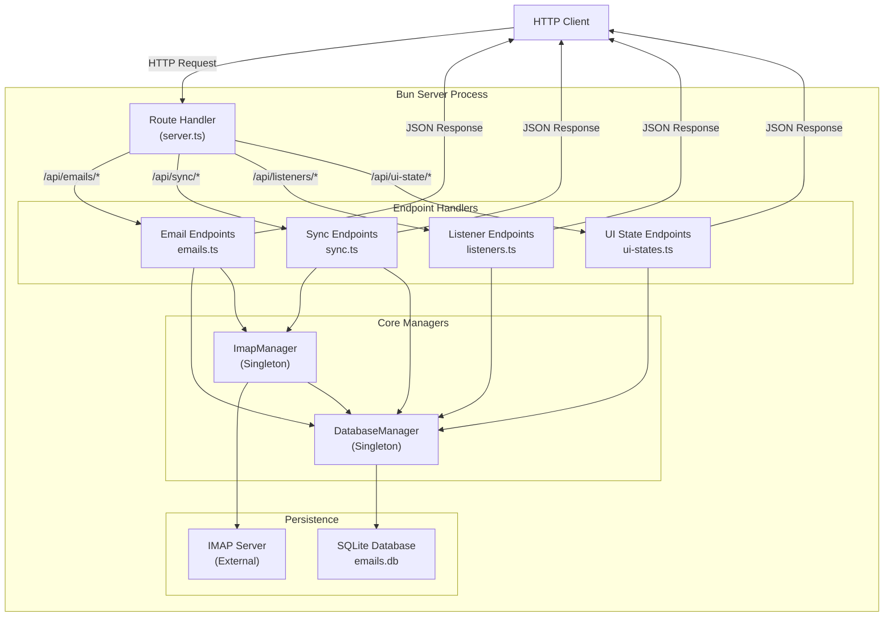
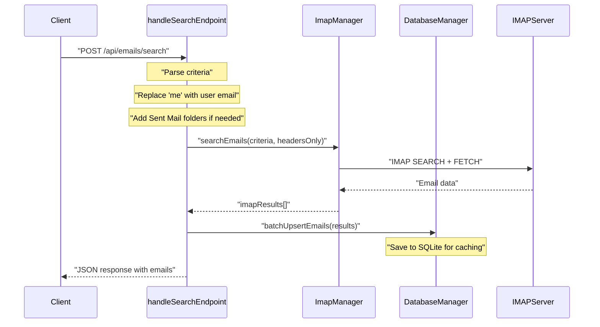
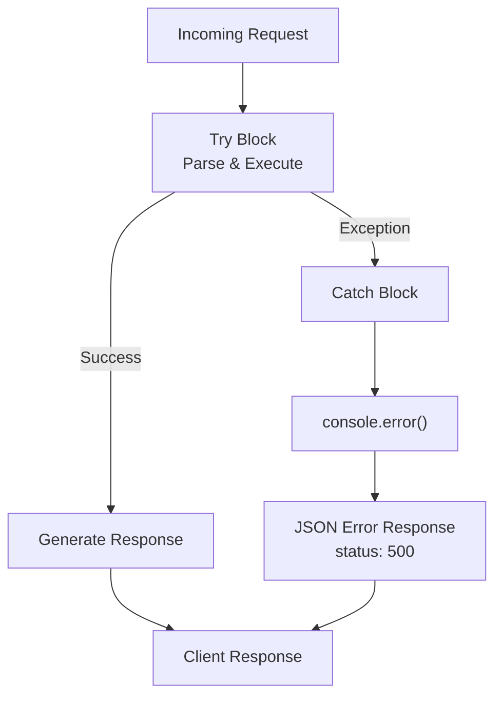

<!-- source: DeepWiki mcp.deepwiki.com · repo anthropics/claude-agent-sdk-demos · extra page API Endpoints · fetched 2026-10-26 -->

# API Endpoints

<details>
<summary>Relevant source files</summary>

The following files were used as context for generating this wiki page:

- [email-agent/bun.lock](email-agent/bun.lock)
- [email-agent/client/globals.css](email-agent/client/globals.css)
- [email-agent/database/database-manager.ts](email-agent/database/database-manager.ts)
- [email-agent/package.json](email-agent/package.json)
- [email-agent/server/endpoints/emails.ts](email-agent/server/endpoints/emails.ts)
- [email-agent/server/server.ts](email-agent/server/server.ts)
- [email-agent/tailwind.config.js](email-agent/tailwind.config.js)

</details>


This document describes the HTTP REST endpoints exposed by the Email Agent server. These endpoints provide synchronous, request-response access to email operations, synchronization, and UI state management.

For real-time bidirectional communication using WebSockets, see [WebSocket Handler](#3.2.1). For the event-driven listener system, see [Listeners Manager](#3.2.3).

## Overview

The Email Agent server exposes HTTP REST endpoints organized into four categories:

| Category | Purpose | Handler Functions |
|----------|---------|------------------|
| **Email Operations** | Query, search, and retrieve emails | `handleInboxEndpoint`, `handleSearchEndpoint`, `handleEmailDetailsEndpoint`, `handleBatchEmailsEndpoint` |
| **Synchronization** | Trigger and monitor IMAP sync operations | `handleSyncEndpoint`, `handleSyncStatusEndpoint` |
| **Listener Management** | Query listener configurations and logs | `handleListenerDetailsEndpoint` |
| **UI State Management** | Manage persistent UI state across sessions | `handleGetUIState`, `handleSetUIState`, `handleListUIStates`, etc. |

All endpoints return JSON responses and include CORS headers for cross-origin access. The server runs on Bun and uses singleton manager classes (`DatabaseManager`, `ImapManager`) to coordinate data access.

**Sources:** [email-agent/server/endpoints/index.ts:1-11](), [email-agent/server/endpoints/emails.ts:1-301]()

## Endpoint Architecture



**Sources:** [email-agent/server/endpoints/index.ts:1-11](), [email-agent/server/endpoints/emails.ts:12-14]()

## Email Endpoints

### GET /api/emails/inbox

Retrieves recent emails from the local database.

**Handler:** `handleInboxEndpoint` [email-agent/server/endpoints/emails.ts:16-60]()

**Query Parameters:**
| Parameter | Type | Default | Description |
|-----------|------|---------|-------------|
| `limit` | integer | 50 | Maximum number of emails to return |
| `includeRead` | boolean | true | Whether to include read emails |

**Response Schema:**
```typescript
Array<{
  id: string;
  messageId: string;
  from: string;
  to: string;
  subject: string;
  date: Date;
  body: string;
  body_text: string;
  body_html: string;
  hasAttachments: boolean;
  isRead: boolean;
  folder: string;
  labels: string;
}>
```

**Implementation Details:**
- Calls `dbManager.getRecentEmails(limit, includeRead)` to fetch from SQLite
- Orders by `date_sent DESC`
- Maps database columns to API response format

**Sources:** [email-agent/server/endpoints/emails.ts:16-60]()

### POST /api/emails/search

Performs advanced email search using IMAP server queries.

**Handler:** `handleSearchEndpoint` [email-agent/server/endpoints/emails.ts:62-144]()

**Request Body:**
```typescript
{
  headersOnly?: boolean;  // Fetch only headers, not full bodies
  from?: string | string[];  // Special value 'me' auto-replaced
  to?: string | string[];
  subject?: string;
  body?: string;
  since?: Date;
  before?: Date;
  folders?: string[];  // Defaults to INBOX
  gmailQuery?: string;  // Gmail-style query syntax
  // ... additional search criteria
}
```

**Special Handling:**
- `from: 'me'` automatically replaces with `process.env.EMAIL_ADDRESS` and adds Sent Mail folders
- Gmail query syntax supported via `gmailQuery` parameter
- Auto-includes `[Gmail]/Sent Mail` for `from:me` queries

**Implementation Flow:**


**Performance Logging:**
- Logs search start time and duration
- Logs number of results found
- Logs database save operations

**Sources:** [email-agent/server/endpoints/emails.ts:62-144]()

### GET /api/emails/:id

Retrieves full details for a single email by message ID.

**Handler:** `handleEmailDetailsEndpoint` [email-agent/server/endpoints/emails.ts:146-241]()

**Path Parameters:**
| Parameter | Type | Description |
|-----------|------|-------------|
| `emailId` | string | Message ID of the email to retrieve |

**Response Schema:**
```typescript
{
  id: number;
  message_id: string;
  subject: string;
  from_address: string;
  from_name: string;
  date_sent: string;
  body_text: string;
  body_html: string;
  snippet: string;
  is_read: boolean;
  is_starred: boolean;
  has_attachments: boolean;
  attachment_count: number;
  folder: string;
  recipients: {
    to: string[];
    cc: string[];
    bcc: string[];
  };
}
```

**Implementation Details:**
- Queries `emails` table by `message_id`
- Joins with `recipients` table to build recipient lists
- Groups recipients by type (to, cc, bcc)
- Returns 404 if email not found

**Sources:** [email-agent/server/endpoints/emails.ts:146-241]()

### POST /api/emails/batch

Retrieves multiple emails by message IDs in a single request.

**Handler:** `handleBatchEmailsEndpoint` [email-agent/server/endpoints/emails.ts:243-301]()

**Request Body:**
```typescript
{
  ids: string[];  // Array of message IDs
}
```

**Response Schema:**
```typescript
{
  emails: Array<{
    id: string;
    messageId: string;
    from: string;
    to: string;
    subject: string;
    date: Date;
    body: string;
    body_text: string;
    body_html: string;
    hasAttachments: boolean;
    isRead: boolean;
    folder: string;
    labels: string[];
  }>;
}
```

**Implementation Details:**
- Validates `ids` is a non-empty array
- Calls `dbManager.getEmailsByMessageIds(ids)`
- Returns empty array if no IDs provided
- Preserves order from database query

**Sources:** [email-agent/server/endpoints/emails.ts:243-301]()

## Synchronization Endpoints

The sync endpoints trigger and monitor email synchronization operations between the IMAP server and local database.

**Handlers:** `handleSyncEndpoint`, `handleSyncStatusEndpoint` [email-agent/server/endpoints/index.ts:1]()

| Endpoint | Method | Purpose |
|----------|--------|---------|
| `/api/sync` | POST | Trigger manual email synchronization |
| `/api/sync/status` | GET | Query current sync status and progress |

These endpoints interact with `ImapManager` to initiate IDLE monitoring and batch email fetching operations.

**Sources:** [email-agent/server/endpoints/index.ts:1]()

## Listener Endpoints

The listener endpoints provide access to listener configurations and execution logs.

**Handler:** `handleListenerDetailsEndpoint` [email-agent/server/endpoints/index.ts:3]()

| Endpoint | Method | Purpose |
|----------|--------|---------|
| `/api/listeners/:listenerId` | GET | Retrieve listener configuration and recent logs |

Listeners are event-driven automation scripts managed by the `ListenersManager`. See [Listeners Manager](#3.2.3) for details on the listener system architecture.

**Sources:** [email-agent/server/endpoints/index.ts:3]()

## UI State Endpoints

UI state endpoints provide persistent key-value storage for client-side state that survives page refreshes and session changes.

**Handlers:** [email-agent/server/endpoints/index.ts:4-11]()

| Endpoint | Method | Purpose |
|----------|--------|---------|
| `/api/ui-state/:stateId` | GET | Retrieve UI state by ID |
| `/api/ui-state/:stateId` | POST | Create or update UI state |
| `/api/ui-state/:stateId` | DELETE | Remove UI state |
| `/api/ui-state` | GET | List all UI states |
| `/api/ui-state/templates` | GET | List available UI state templates |
| `/api/ui-state/components/templates` | GET | List available component templates |

**Integration with WebSocket:**
When UI state is updated via POST endpoint, the `UIStateManager` broadcasts changes to all connected WebSocket clients via the `ui_state_update` message type. This ensures all clients see consistent state in real-time.

**Sources:** [email-agent/server/endpoints/index.ts:4-11]()

## CORS Configuration

All endpoints include CORS headers to support cross-origin requests:

```typescript
const corsHeaders = {
  'Access-Control-Allow-Origin': '*',
  'Access-Control-Allow-Methods': 'GET, POST, OPTIONS',
  'Access-Control-Allow-Headers': 'Content-Type',
};
```

These headers are included in both successful responses and error responses to ensure proper client-side error handling.

**Sources:** [email-agent/server/endpoints/emails.ts:6-10]()

## Error Handling Pattern

All endpoint handlers follow a consistent error handling pattern:



**Error Response Schema:**
```typescript
{
  error: string;  // Human-readable error message
  details?: string;  // Exception message if available
}
```

**Status Codes:**
| Code | Usage |
|------|-------|
| 200 | Successful operation |
| 400 | Invalid request (missing parameters, malformed data) |
| 404 | Resource not found (email, listener, etc.) |
| 500 | Server error (database failure, IMAP error, etc.) |

**Sources:** [email-agent/server/endpoints/emails.ts:47-59](), [email-agent/server/endpoints/emails.ts:131-143]()

## Database and IMAP Manager Integration

Endpoints access data through singleton manager instances:

```typescript
const db = new Database(DATABASE_PATH);
const dbManager = DatabaseManager.getInstance();
const imapManager = ImapManager.getInstance();
```

**Manager Responsibilities:**

| Manager | Responsibility | Used By |
|---------|---------------|---------|
| `Database` (raw) | Direct SQL queries for specific endpoints | Email detail queries |
| `DatabaseManager` | High-level data operations, batch operations | Inbox, batch fetch, search caching |
| `ImapManager` | IMAP protocol operations, email fetching | Search endpoint, sync operations |

**Data Flow Pattern:**
1. IMAP search via `ImapManager.searchEmails()` fetches from server
2. Results cached to database via `DatabaseManager.batchUpsertEmails()`
3. Subsequent queries served from local SQLite for performance
4. WebSocket clients notified of changes via broadcast

**Sources:** [email-agent/server/endpoints/emails.ts:12-14](), [email-agent/server/endpoints/emails.ts:93-103]()

---

