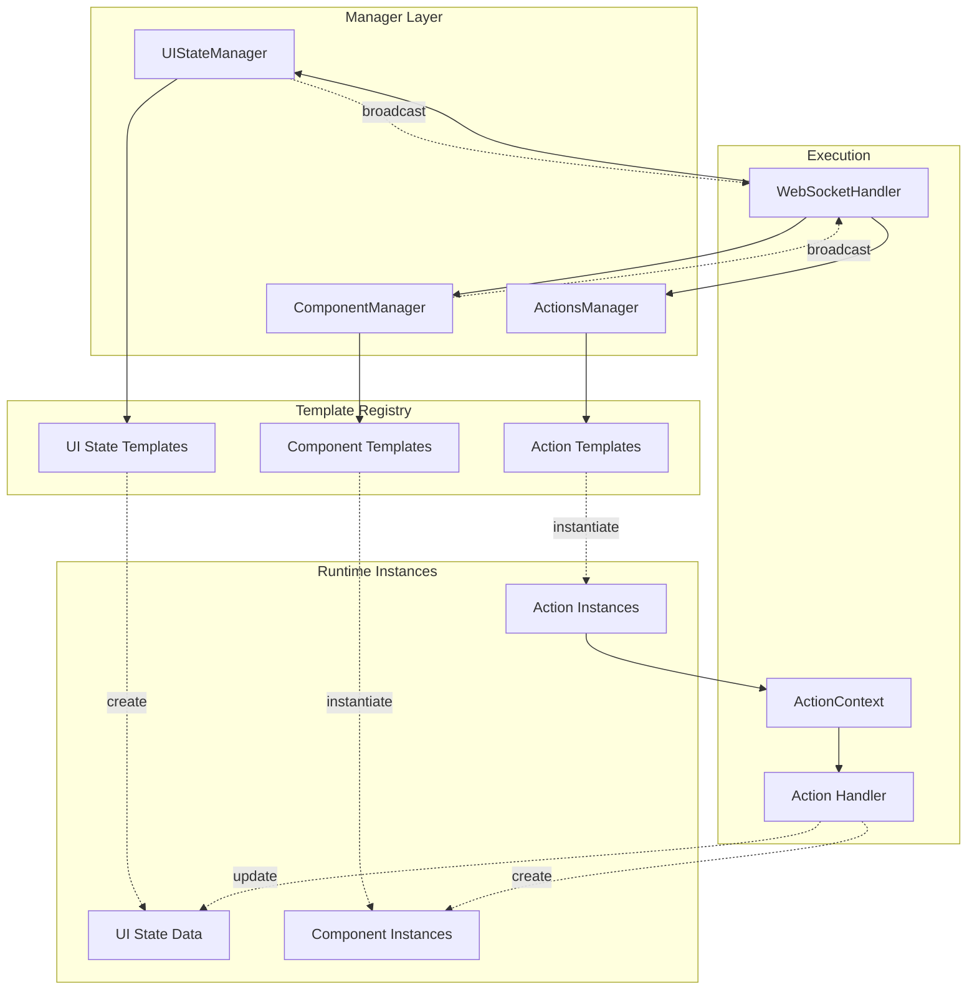
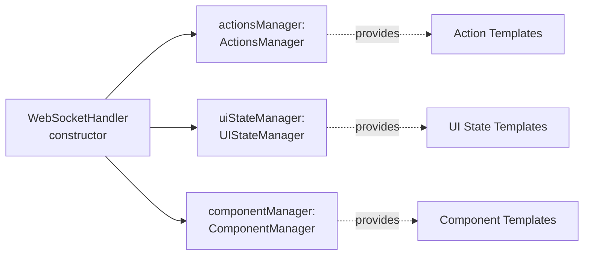
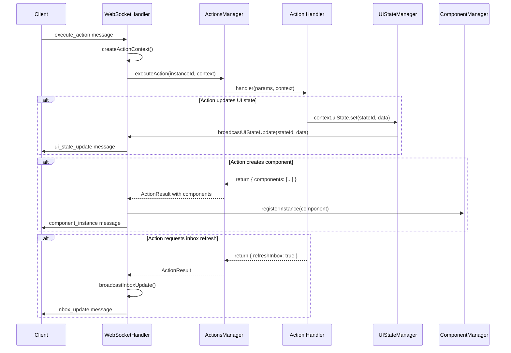
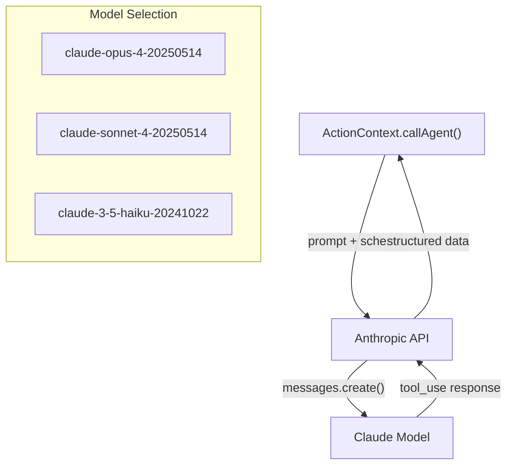
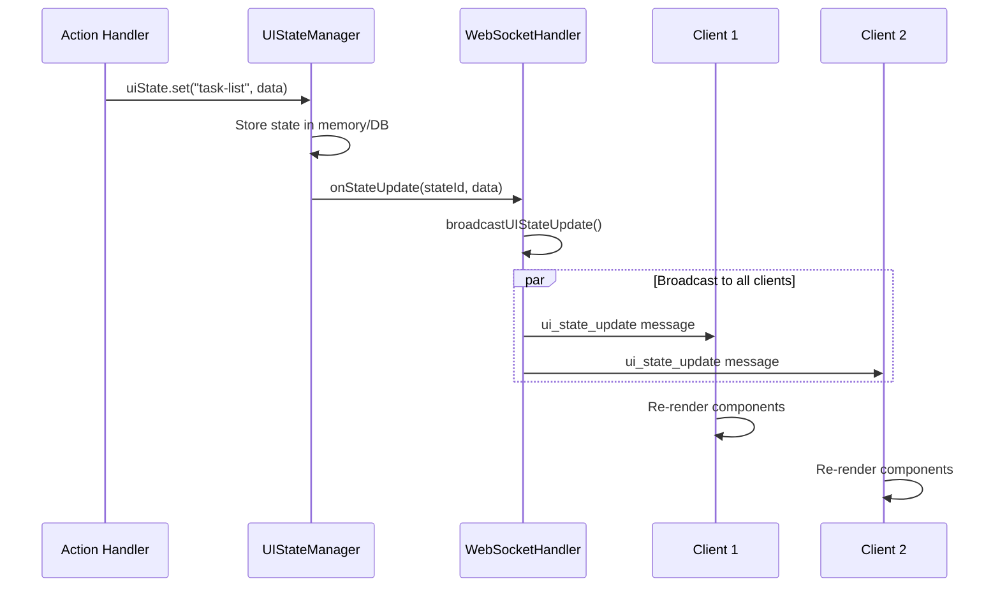
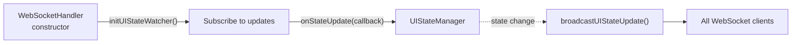
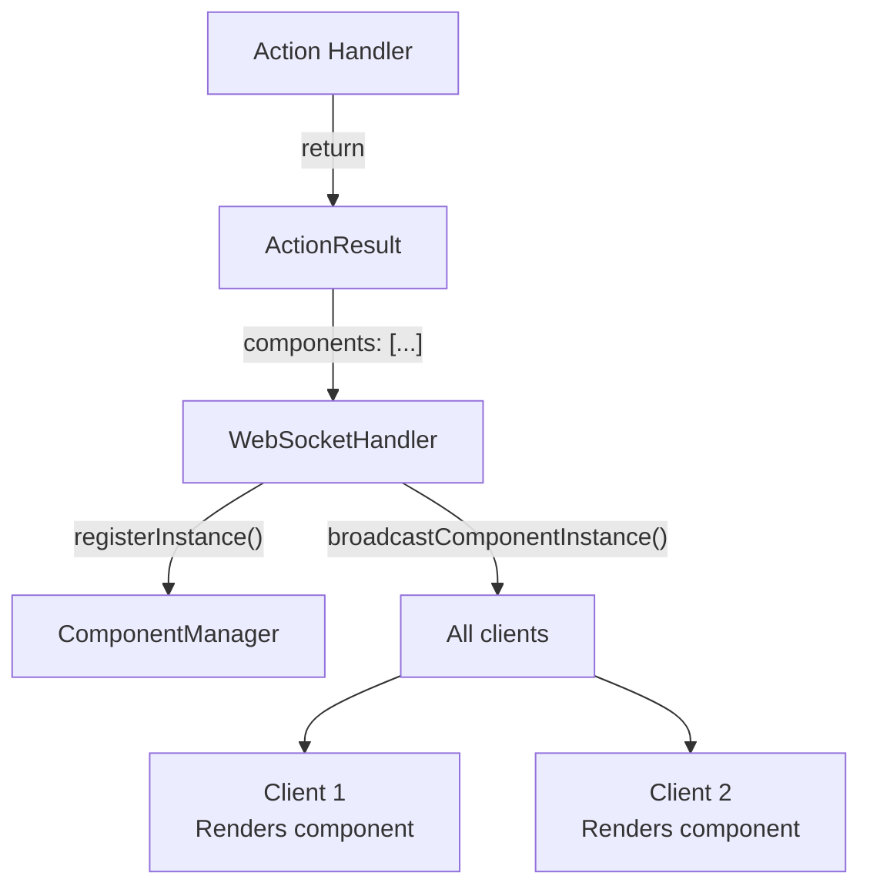
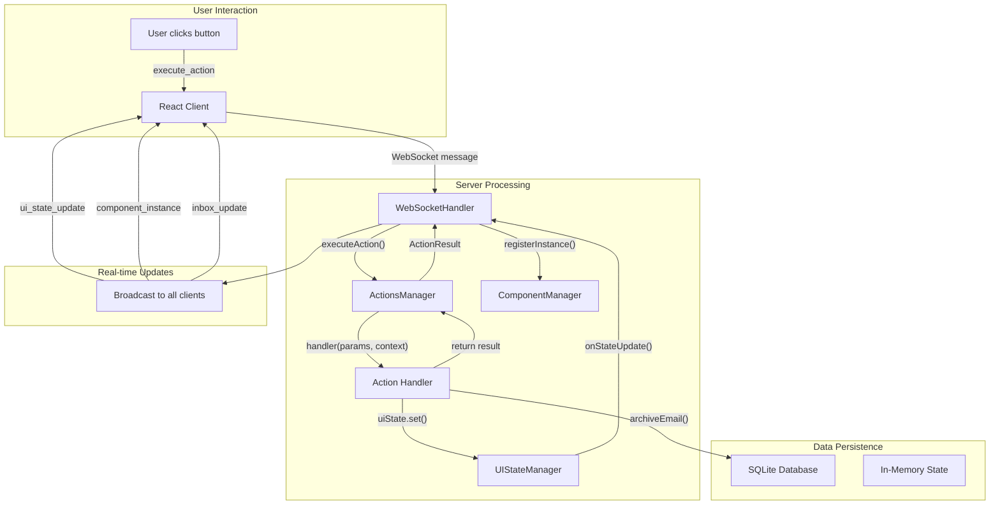
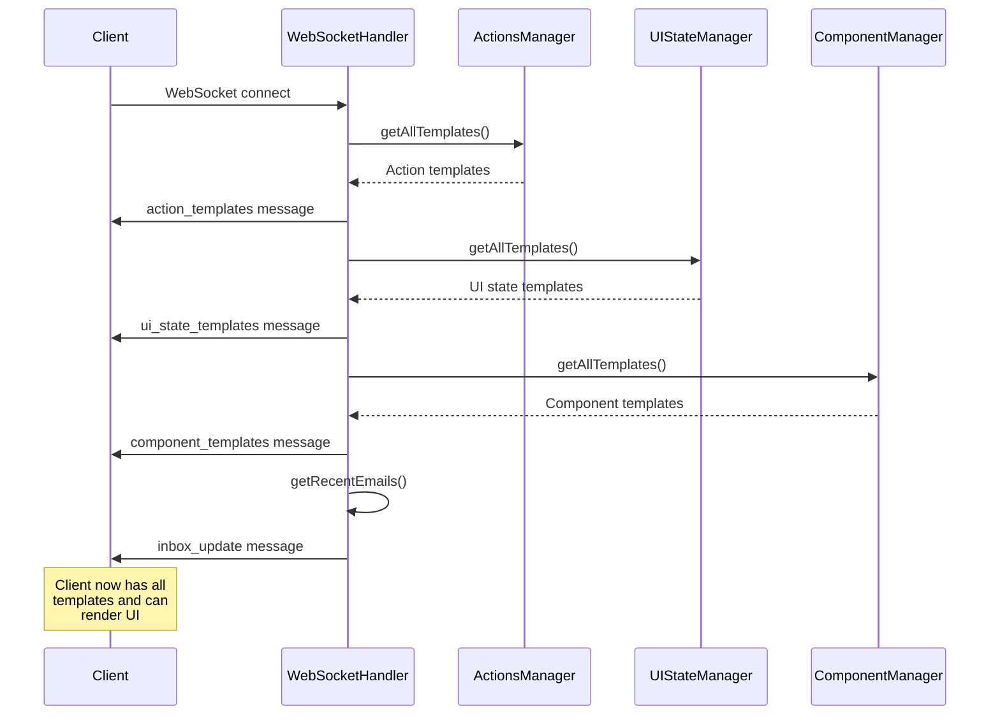

<!-- source: DeepWiki mcp.deepwiki.com · repo anthropics/claude-agent-sdk-demos · extra page Actions and UI State Management · fetched 2026-10-26 -->

# Actions and UI State Management

<details>
<summary>Relevant source files</summary>

The following files were used as context for generating this wiki page:

- [email-agent/ccsdk/websocket-handler.ts](email-agent/ccsdk/websocket-handler.ts)
- [email-agent/server/endpoints/index.ts](email-agent/server/endpoints/index.ts)

</details>


## Purpose and Scope

This document describes the Actions, UI State, and Components systems in the Email Agent, which enable dynamic UI generation and action execution. These three interconnected systems allow agents and listeners to create interactive UI elements, manage persistent state, and execute operations through user interactions.

For information about the event-driven automation system, see [Listeners System](#3.6). For WebSocket communication patterns, see [Real-time Communication](#3.8).

---

## System Overview

The Email Agent implements three manager classes that work together to provide dynamic UI capabilities:



**Sources:** [email-agent/ccsdk/websocket-handler.ts:1-666](), [email-agent/agent/custom_scripts/types.ts:1-422]()

---

## Architecture and Relationships

### Manager Initialization

The three managers are initialized together and injected into the `WebSocketHandler`:



**Component Coordination Table:**

| Manager | Purpose | Registry | Runtime |
|---------|---------|----------|---------|
| `ActionsManager` | Manages executable actions | Action Templates | Action Instances |
| `UIStateManager` | Manages persistent state | UI State Templates | State Data |
| `ComponentManager` | Manages UI components | Component Templates | Component Instances |

**Sources:** [email-agent/ccsdk/websocket-handler.ts:15-31]()

---

## Actions System

### Action Templates

Action templates define reusable action patterns with parameter schemas. They specify what parameters an action requires and provide metadata for UI rendering.

**Action Template Structure:**

```typescript
interface ActionTemplate {
  id: string;                    // Unique identifier
  name: string;                  // Human-readable name
  description: string;           // What the action does
  icon?: string;                 // Optional emoji/icon
  parameterSchema: {
    type: "object";
    properties: Record<string, {
      type: string;
      description: string;
      enum?: string[];
      default?: any;
    }>;
    required?: string[];
  };
}
```

**Sources:** [email-agent/agent/custom_scripts/types.ts:135-159]()

### Action Instances

Action instances are created when an agent or listener wants to execute an action. The instance provides specific parameter values and button presentation metadata.

**Action Instance Structure:**

```typescript
interface ActionInstance {
  instanceId: string;            // Unique ID for this instance
  templateId: string;            // Reference to template
  label: string;                 // Button label (agent-generated)
  description?: string;          // Additional context
  params: Record<string, any>;   // Parameter values
  style?: "primary" | "secondary" | "danger";
  sessionId: string;             // Associated session
  createdAt: string;             // Creation timestamp
}
```

**Sources:** [email-agent/agent/custom_scripts/types.ts:161-189]()

### Action Execution Flow



**Sources:** [email-agent/ccsdk/websocket-handler.ts:263-325]()

### ActionContext API

The `ActionContext` provides comprehensive capabilities to action handlers. It is created by `WebSocketHandler.createActionContext()`.

**ActionContext Structure:**

| Category | Methods | Description |
|----------|---------|-------------|
| **Session** | `sessionId` | Current session identifier |
| **Email API** | `emailAPI.getInbox()` | Retrieve inbox with options |
| | `emailAPI.searchEmails()` | Search by criteria |
| | `emailAPI.searchWithGmailQuery()` | Search with Gmail syntax |
| | `emailAPI.getEmailsByIds()` | Batch fetch by IDs |
| | `emailAPI.getEmailById()` | Single email fetch |
| **Email Operations** | `archiveEmail()` | Archive an email |
| | `starEmail()`, `unstarEmail()` | Star management |
| | `markAsRead()`, `markAsUnread()` | Read status |
| | `addLabel()`, `removeLabel()` | Label management |
| | `sendEmail()` | Send new email |
| **AI Capabilities** | `callAgent()` | Invoke Claude with prompt and schema |
| **Session Messaging** | `addUserMessage()` | Inject user message |
| | `addAssistantMessage()` | Inject assistant message |
| | `addSystemMessage()` | Inject system message |
| **Notifications** | `notify()` | Show notification to user |
| **External APIs** | `fetch()` | Make HTTP requests |
| **Logging** | `log()` | Log messages with levels |
| **UI State** | `uiState.get()` | Retrieve state by ID |
| | `uiState.set()` | Update state and broadcast |

**callAgent Implementation:**

The `callAgent` method enables actions to invoke Claude for analysis or decision-making:



**Sources:** [email-agent/ccsdk/websocket-handler.ts:439-658](), [email-agent/agent/custom_scripts/types.ts:209-271]()

### Action Results

Action handlers return an `ActionResult` to indicate execution outcome:

```typescript
interface ActionResult {
  success: boolean;                          // Execution succeeded
  message: string;                           // Human-readable result
  data?: Record<string, any>;               // Structured return data
  suggestedActions?: ActionInstance[];       // Follow-up actions
  refreshInbox?: boolean;                    // Request inbox refresh
  components?: ComponentInstance[];          // Components to render
}
```

**Sources:** [email-agent/agent/custom_scripts/types.ts:277-295]()

---

## UI State System

### UI State Templates

UI state templates define the structure and initial values for persistent state objects:

```typescript
interface UIStateTemplate<T = any> {
  id: string;                    // Unique state type identifier
  name: string;                  // Human-readable name
  description?: string;          // Purpose of this state
  initialState: T;               // Default structure
}
```

**Sources:** [email-agent/agent/custom_scripts/types.ts:321-333]()

### State Management

The `UIStateManager` provides CRUD operations for state data:

**State Operations:**

| Method | Purpose | Broadcast |
|--------|---------|-----------|
| `getState<T>(stateId)` | Retrieve state by ID | No |
| `setState<T>(stateId, data)` | Update state | Yes |
| `getAllTemplates()` | List registered templates | No |

**State Update Propagation:**



**Sources:** [email-agent/ccsdk/websocket-handler.ts:87-111](), [email-agent/agent/custom_scripts/types.ts:640-656]()

### State Initialization

The `UIStateManager` subscribes to state updates and broadcasts changes:



**Sources:** [email-agent/ccsdk/websocket-handler.ts:87-94]()

---

## Components System

### Component Templates

Component templates define UI components that render specific UI state types:

```typescript
interface ComponentTemplate {
  id: string;                    // Component identifier
  name: string;                  // Human-readable name
  description?: string;          // Component purpose
  stateId: string;               // Associated UI state type
}
```

**Sources:** [email-agent/agent/custom_scripts/types.ts:339-351]()

### Component Instances

Component instances represent actual rendered components bound to specific state:

```typescript
interface ComponentInstance {
  instanceId: string;            // Unique instance ID
  componentId: string;           // Template reference
  stateId: string;               // Bound state ID
  sessionId?: string;            // Associated session
  createdAt?: string;            // Creation timestamp
}
```

**Component Instance Creation Flow:**



**Sources:** [email-agent/agent/custom_scripts/types.ts:357-372](), [email-agent/ccsdk/websocket-handler.ts:300-312]()

### Component Props

React components receive state data and action triggers:

```typescript
interface ComponentProps<T = any> {
  state: T;                                          // Current state data
  onAction: (actionId: string, params: any) => void; // Trigger actions
}
```

**Sources:** [email-agent/agent/custom_scripts/types.ts:377-383]()

---

## Integration and Data Flow

### Complete Interaction Flow

The following diagram shows how actions, UI state, and components work together:



**Sources:** [email-agent/ccsdk/websocket-handler.ts:263-325]()

### WebSocket Message Types

**Outbound Messages (Server → Client):**

| Message Type | Data | Purpose |
|-------------|------|---------|
| `action_templates` | `{ templates: [] }` | Available action templates |
| `action_instances` | `{ actions: [], sessionId }` | Created action instances |
| `action_result` | `{ instanceId, result, sessionId }` | Execution result |
| `ui_state_templates` | `{ templates: [] }` | Available state templates |
| `ui_state_update` | `{ stateId, data }` | State changed |
| `component_templates` | `{ templates: [] }` | Available components |
| `component_instance` | `{ instance, sessionId }` | New component created |

**Inbound Messages (Client → Server):**

| Message Type | Data | Purpose |
|-------------|------|---------|
| `execute_action` | `{ instanceId, sessionId }` | Execute an action |

**Sources:** [email-agent/ccsdk/websocket-handler.ts:164-188](), [email-agent/ccsdk/websocket-handler.ts:263-325]()

---

## Client Connection Initialization

When a client connects, the server sends all available templates:



**Sources:** [email-agent/ccsdk/websocket-handler.ts:145-188]()

---

## Usage Patterns

### Pattern 1: Action with State Update

An action that updates shared state which components observe:

```typescript
// Action handler
async function handler(params: any, context: ActionContext): Promise<ActionResult> {
  // Perform operation
  const emails = await context.emailAPI.getInbox({ limit: 10 });
  
  // Update UI state
  await context.uiState.set("email-summary", {
    total: emails.length,
    unread: emails.filter(e => !e.isRead).length,
    lastUpdate: new Date().toISOString()
  });
  
  return {
    success: true,
    message: "Summary updated",
    refreshInbox: true
  };
}
```

### Pattern 2: Action with Component Creation

An action that creates a new UI component instance:

```typescript
// Action handler
async function handler(params: any, context: ActionContext): Promise<ActionResult> {
  // Perform analysis
  const result = await context.callAgent({
    prompt: "Analyze these emails...",
    schema: { type: "object", properties: { insights: { type: "array" } } }
  });
  
  // Store results in UI state
  const stateId = `analysis-${Date.now()}`;
  await context.uiState.set(stateId, result);
  
  // Return component to render
  return {
    success: true,
    message: "Analysis complete",
    components: [{
      instanceId: `instance-${Date.now()}`,
      componentId: "analysis-viewer",
      stateId: stateId
    }]
  };
}
```

### Pattern 3: Listener with UI State

Listeners can also interact with UI state:

```typescript
// Listener handler
async function handler(email: Email, context: ListenerContext): Promise<ListenerResult> {
  // Get current task list state
  const taskList = await context.uiState.get<{ tasks: any[] }>("task-list");
  
  // Add new task from email
  const updatedTasks = [
    ...(taskList?.tasks || []),
    { emailId: email.messageId, subject: email.subject }
  ];
  
  // Update state (broadcasts to all clients)
  await context.uiState.set("task-list", { tasks: updatedTasks });
  
  return {
    executed: true,
    reason: "Added email to task list"
  };
}
```

**Sources:** [email-agent/agent/custom_scripts/types.ts:209-271](), [email-agent/ccsdk/listeners-manager.ts:356-372]()

---

## HTTP Endpoints

The server provides REST endpoints for UI state management:

| Endpoint | Method | Purpose |
|----------|--------|---------|
| `/api/ui-state/:stateId` | GET | Retrieve state by ID |
| `/api/ui-state/:stateId` | POST | Update state by ID |
| `/api/ui-state/:stateId` | DELETE | Delete state by ID |
| `/api/ui-state` | GET | List all states |
| `/api/ui-state/templates` | GET | List state templates |
| `/api/ui-state/component-templates` | GET | List component templates |

**Sources:** [email-agent/server/endpoints/index.ts:4-11]()

---

## Summary

The Actions, UI State, and Components systems provide a comprehensive framework for dynamic UI generation:

- **Actions** define executable operations with parameters
- **UI State** maintains persistent data that components render
- **Components** provide React-based visualization of state
- **WebSocketHandler** orchestrates all three systems
- **Real-time synchronization** ensures all clients see updates
- **ActionContext** provides unified API for email, AI, and state operations

These systems enable agents and listeners to create rich, interactive experiences while maintaining clean separation of concerns between data, presentation, and behavior.

**Sources:** [email-agent/ccsdk/websocket-handler.ts:1-666](), [email-agent/agent/custom_scripts/types.ts:1-422](), [email-agent/ccsdk/listeners-manager.ts:1-519]()

---

