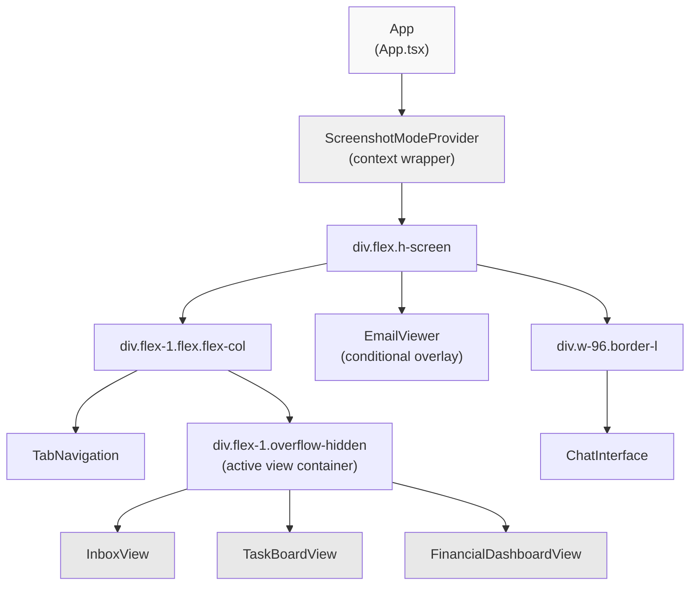
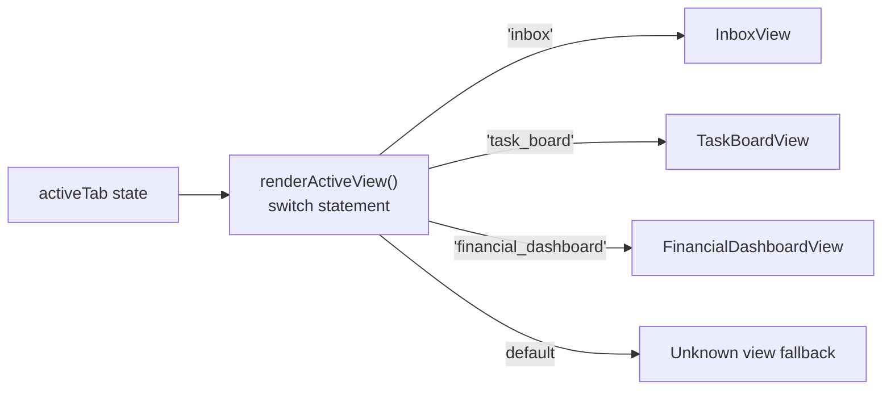
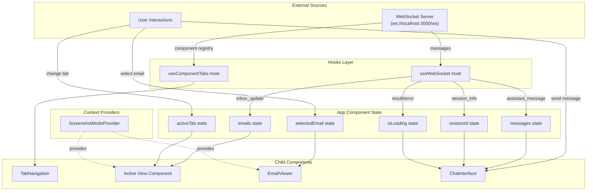

<!-- source: DeepWiki mcp.deepwiki.com · repo anthropics/claude-agent-sdk-demos · extra page Application Structure · fetched 2026-10-26 -->

# Application Structure

<details>
<summary>Relevant source files</summary>

The following files were used as context for generating this wiki page:

- [email-agent/client/App.tsx](email-agent/client/App.tsx)
- [email-agent/client/components/InboxView.tsx](email-agent/client/components/InboxView.tsx)

</details>


## Purpose and Scope

This document describes the top-level structure of the Email Agent client application, including the main `App` component, the dynamic tab navigation system, and global state management patterns. It covers how the application orchestrates different views, manages WebSocket connectivity, and implements screenshot mode for privacy-conscious demonstrations.

For detailed information about individual view components (InboxView, EmailViewer, etc.), see [Email Viewing Components](#3.3.2) and [Inbox Management](#3.3.3). For information about the chat interface and real-time communication patterns, see [Real-time Communication](#3.8).

**Sources:** [email-agent/client/App.tsx:1-162]()

---

## Main App Component

The `App` component serves as the root component for the Email Agent client application. It is implemented in [email-agent/client/App.tsx:12-161]() and manages the following responsibilities:

### Core Application State

The component maintains several pieces of state that coordinate the application:

| State Variable | Type | Purpose |
|---------------|------|---------|
| `emails` | `Array` | List of emails displayed in InboxView |
| `messages` | `Array` | Chat conversation history |
| `sessionId` | `string \| null` | Active WebSocket session identifier |
| `isLoading` | `boolean` | Loading state for chat operations |
| `selectedEmail` | `any \| null` | Currently selected email for detail view |
| `activeTab` | `string` | Currently active tab identifier |

These state variables are declared at [email-agent/client/App.tsx:13-18]().

### WebSocket Integration

The application establishes a single WebSocket connection shared across all components via the `useWebSocket` hook [email-agent/client/App.tsx:32-91](). The hook handles:

- Connection management to `ws://localhost:3000/ws`
- Message routing based on message type
- State updates for different message types (`inbox_update`, `session`, `assistant_message`, `tool_use`, `result`, `error`)

The WebSocket message handler updates local state based on server events, enabling real-time synchronization between the server and all connected clients.

**Sources:** [email-agent/client/App.tsx:12-91]()

---

## Component Hierarchy

The following diagram shows the component structure with actual component names as they appear in the codebase:

### Diagram: Component Tree Structure



The layout structure at [email-agent/client/App.tsx:117-161]() implements a three-column design:
1. **Main content area** (left, flex-1): Contains tab navigation and the active view
2. **Email viewer** (center, overlay): Conditionally rendered when `selectedEmail` is set
3. **Chat interface** (right, fixed width 384px): Always visible

**Sources:** [email-agent/client/App.tsx:117-161]()

---

## Tab Navigation System

### Dynamic Tab Discovery

The application implements a hybrid tab system that combines hardcoded and dynamically discovered tabs. The `useComponentTabs` hook [email-agent/client/App.tsx:21]() discovers available component tabs from the UI component registry.

The complete tabs list is constructed at [email-agent/client/App.tsx:24-29]():

```typescript
const tabs = useMemo(() => {
  return [
    { id: 'inbox', name: 'Inbox' },
    ...componentTabs
  ];
}, [componentTabs]);
```

This pattern allows the server to dynamically register new UI components without requiring client code changes. For more information about the component registration system, see [Actions and UI State Management](#3.2.4).

### Tab Structure

Each tab object contains:
- `id`: Unique identifier used for routing
- `name`: Display name shown in the UI

### View Routing

The `renderActiveView` function at [email-agent/client/App.tsx:94-115]() maps tab IDs to their corresponding view components:



The `TabNavigation` component receives the tabs array, active tab state, and `onTabChange` callback at [email-agent/client/App.tsx:123-127]().

**Sources:** [email-agent/client/App.tsx:20-29](), [email-agent/client/App.tsx:94-115](), [email-agent/client/App.tsx:123-127]()

---

## View Rendering Pattern

### Inbox View

When `activeTab === 'inbox'`, the application renders `InboxView` [email-agent/client/App.tsx:96-103]() with the following props:

| Prop | Source | Purpose |
|------|--------|---------|
| `emails` | `emails` state | List of emails to display |
| `onEmailSelect` | `setSelectedEmail` | Callback for email selection |
| `selectedEmailId` | `selectedEmail?.id` | Currently selected email ID |

### Dynamic Component Views

Additional views like `TaskBoardView` and `FinancialDashboardView` [email-agent/client/App.tsx:104-107]() receive the WebSocket instance as a prop, enabling them to:
- Subscribe to specific message types
- Send messages to the server
- Update their local state based on server events

### Unknown View Fallback

If no matching view is found, the application displays a fallback message [email-agent/client/App.tsx:109-113](), preventing rendering errors and providing debugging information.

**Sources:** [email-agent/client/App.tsx:94-115]()

---

## State Management Patterns

### Diagram: State Flow and Data Sources



### Local State with useState

The App component uses React's `useState` hook for managing local state [email-agent/client/App.tsx:13-18](). This pattern provides:
- Simple state updates via setter functions
- Re-rendering when state changes
- Clear ownership of data

### WebSocket-Driven State Updates

The WebSocket message handler [email-agent/client/App.tsx:34-91]() implements a type-based routing pattern:

```typescript
switch (message.type) {
  case 'inbox_update':
    setEmails(message.emails || []);
    break;
  case 'assistant_message':
    // Build message object and append to messages
    setMessages(prev => [...prev, assistantMsg]);
    break;
  // ... other cases
}
```

This pattern ensures that server events automatically update the UI without manual polling.

**Sources:** [email-agent/client/App.tsx:13-91]()

---

## Screenshot Mode

### Purpose and Use Case

Screenshot mode enables privacy-conscious demonstrations by replacing sensitive information with placeholder data. This is particularly useful for:
- Creating documentation screenshots
- Recording demo videos
- Sharing the application interface without exposing real email data

### Implementation via Context

The application wraps all components in `ScreenshotModeProvider` [email-agent/client/App.tsx:118](), which provides:
- `isScreenshotMode`: Boolean state indicating whether screenshot mode is active
- `toggleScreenshotMode`: Function to toggle the mode

Any component in the tree can access this context via the `useScreenshotMode` hook [email-agent/client/components/InboxView.tsx:36]().

### UI Toggle Control

The InboxView component includes a screenshot mode toggle button in its footer [email-agent/client/components/InboxView.tsx:164-176]():

```typescript
<button
  onClick={toggleScreenshotMode}
  className="flex items-center gap-1.5 px-2 py-1 rounded text-xs text-gray-500 hover:bg-gray-100 transition-all"
  title={isScreenshotMode ? 'Disable Screenshot Mode' : 'Enable Screenshot Mode'}
>
  {isScreenshotMode ? (
    <Camera className="w-3 h-3" />
  ) : (
    <CameraOff className="w-3 h-3" />
  )}
  <span>Screenshot mode</span>
</button>
```

### Data Placeholder Pattern

When screenshot mode is enabled, components replace real data with generated placeholders using helper functions from `../utils/placeholders` [email-agent/client/components/InboxView.tsx:5-11]():

| Helper Function | Replaces | Usage |
|----------------|----------|-------|
| `getPlaceholderEmail()` | Email addresses | [InboxView.tsx:114]() |
| `getPlaceholderName()` | Sender names | [InboxView.tsx:105]() |
| `getPlaceholderSubject()` | Email subjects | [InboxView.tsx:127]() |
| `getPlaceholderSnippet()` | Email snippets | [InboxView.tsx:134]() |
| `getPlaceholderDate()` | Timestamps | [InboxView.tsx:120]() |

Components use ternary operators to conditionally render placeholder or real data:

```typescript
{isScreenshotMode
  ? getPlaceholderName(index)
  : (email.from_name || email.from_address.split('@')[0])}
```

This pattern appears at multiple locations in InboxView [email-agent/client/components/InboxView.tsx:104-135]().

**Sources:** [email-agent/client/App.tsx:118](), [email-agent/client/components/InboxView.tsx:3](), [email-agent/client/components/InboxView.tsx:36](), [email-agent/client/components/InboxView.tsx:104-176]()

---

## Email Viewer Overlay Pattern

The `EmailViewer` component is rendered conditionally based on the `selectedEmail` state [email-agent/client/App.tsx:136-141]():

```typescript
{selectedEmail && (
  <EmailViewer
    email={selectedEmail}
    onClose={() => setSelectedEmail(null)}
  />
)}
```

This pattern creates an overlay that:
- Appears when an email is selected from the inbox
- Receives the full email object as a prop
- Provides a close callback that clears the selection
- Disappears automatically when `selectedEmail` is set to `null`

The overlay does not interrupt the WebSocket connection or unmount other components, allowing real-time updates to continue in the background.

**Sources:** [email-agent/client/App.tsx:136-141]()

---

## Chat Interface Integration

The `ChatInterface` component is always mounted and visible [email-agent/client/App.tsx:144-155](). It receives comprehensive state and control props:

| Prop | Type | Purpose |
|------|------|---------|
| `isConnected` | `boolean` | WebSocket connection status |
| `sendMessage` | `function` | Function to send messages via WebSocket |
| `messages` | `Array` | Chat conversation history |
| `setMessages` | `function` | State setter for messages |
| `sessionId` | `string \| null` | Current session identifier |
| `isLoading` | `boolean` | Loading state for operations |
| `setIsLoading` | `function` | State setter for loading |
| `ws` | `WebSocket` | Raw WebSocket instance for subscriptions |

The raw WebSocket instance (`ws`) enables the chat interface to subscribe to specific message types beyond those handled by the App component's message handler.

**Sources:** [email-agent/client/App.tsx:144-155]()

---

