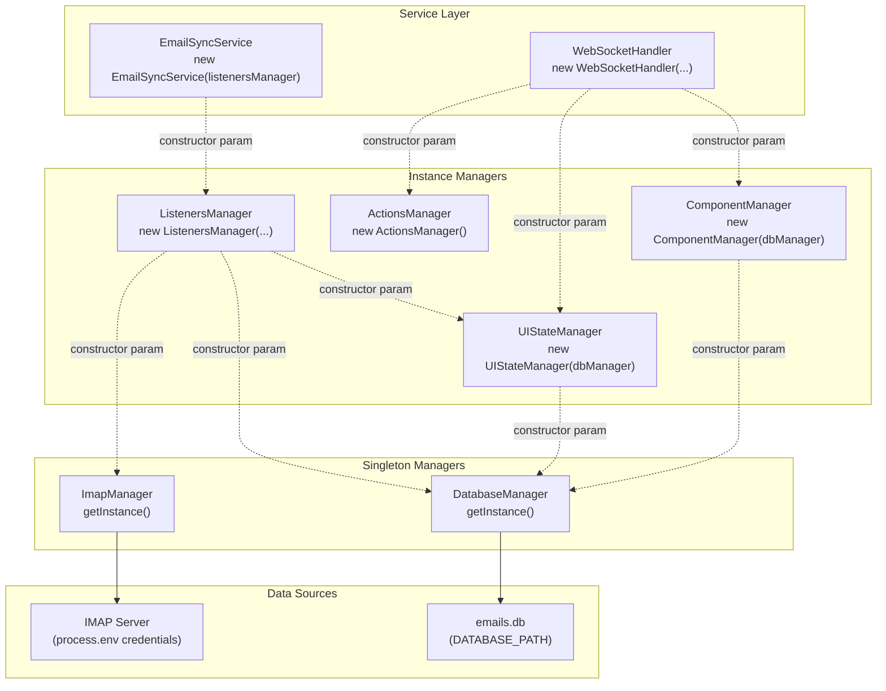
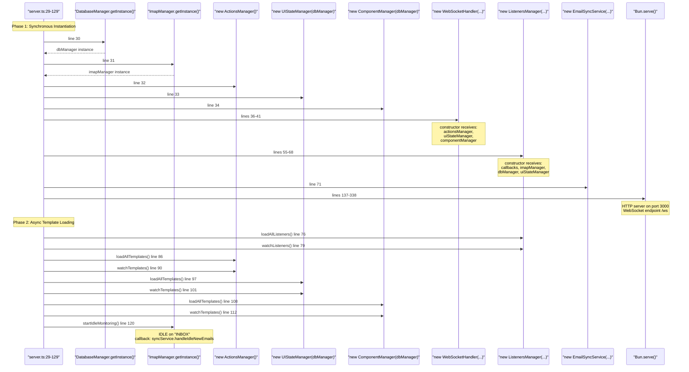
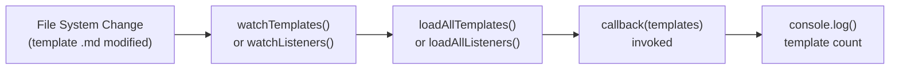
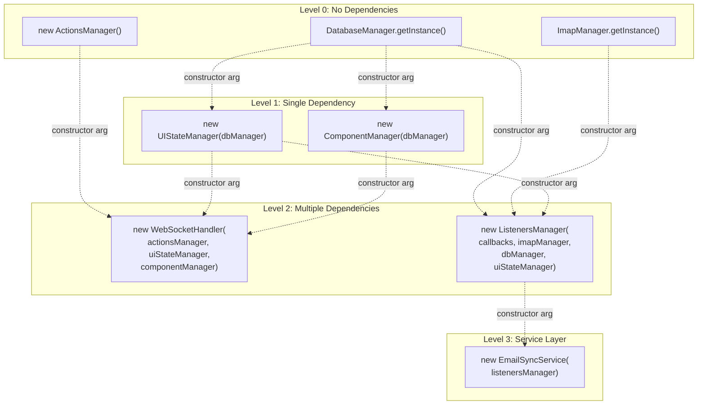

<!-- source: DeepWiki mcp.deepwiki.com · repo anthropics/claude-agent-sdk-demos · extra page Core Server and Managers · fetched 2026-10-26 -->

# Core Server and Managers

<details>
<summary>Relevant source files</summary>

The following files were used as context for generating this wiki page:

- [email-agent/database/database-manager.ts](email-agent/database/database-manager.ts)
- [email-agent/server/server.ts](email-agent/server/server.ts)

</details>


## Purpose and Scope

This page documents the Email Agent server initialization process, the singleton manager pattern, and the dependencies between core server components. The main server file at [email-agent/server/server.ts]() orchestrates the instantiation and configuration of all managers, establishes template file watchers, and starts IDLE monitoring for real-time email notifications.

For WebSocket-specific communication patterns, see page 4.2.2. For REST API endpoint implementations, see page 4.2.3. For detailed actions and UI state management logic, see page 4.2.4. For database schema and operations, see page 4.3.

**Sources:** [email-agent/server/server.ts:1-342]()

---

## Manager Architecture Overview

The Email Agent server employs a **manager pattern** where specialized singleton and non-singleton classes handle distinct responsibilities. The architecture separates concerns into data management, IMAP operations, listener orchestration, action execution, UI state persistence, and component lifecycle management.

**Manager Dependency Architecture**



**Key Manager Responsibilities:**

| Manager | Type | Primary Responsibility | Dependencies |
|---------|------|------------------------|--------------|
| `DatabaseManager` | Singleton | SQLite operations, schema management, email CRUD | `bun:sqlite`, `DATABASE_PATH` |
| `ImapManager` | Singleton | IMAP connection, email fetching, IDLE monitoring | IMAP credentials |
| `ActionsManager` | Instance | Load/watch action templates, execute actions | `DatabaseManager` |
| `UIStateManager` | Instance | Persist/retrieve UI state, manage templates | `DatabaseManager` |
| `ComponentManager` | Instance | Track component instances, manage templates | `DatabaseManager` |
| `ListenersManager` | Instance | Load/execute listeners, file watching | `ImapManager`, `DatabaseManager`, `UIStateManager` |
| `EmailSyncService` | Instance | Orchestrate IMAP-to-database sync | `ListenersManager`, `DatabaseManager`, `ImapManager` |
| `WebSocketHandler` | Instance | WebSocket session management, message routing | `ActionsManager`, `UIStateManager`, `ComponentManager` |

**Sources:** [email-agent/server/server.ts:29-68]()

---

## Server Initialization Sequence

The server initialization follows a **two-phase pattern**: synchronous manager instantiation followed by asynchronous template loading and monitoring setup.

**Server Initialization Sequence**



**Phase 1 - Synchronous Instantiation (Lines 29-71):**

1. **Singleton Managers:** `DatabaseManager.getInstance()` and `ImapManager.getInstance()` return singleton instances, ensuring only one connection per resource throughout the application lifecycle.

2. **Non-Singleton Managers:** `ActionsManager`, `UIStateManager`, and `ComponentManager` are instantiated as regular objects. The latter two receive `dbManager` as a constructor parameter for database operations.

3. **WebSocketHandler:** Instantiated with references to `actionsManager`, `uiStateManager`, and `componentManager` to handle WebSocket-triggered actions and UI state updates.

4. **ListenersManager:** Instantiated with callbacks for notifications and log broadcasting, plus dependencies on `imapManager`, `dbManager`, and `uiStateManager`.

5. **EmailSyncService:** Instantiated with `listenersManager` to trigger listeners after email synchronization.

6. **Bun Server:** The HTTP/WebSocket server starts immediately, accepting connections even before async initialization completes.

**Phase 2 - Asynchronous Initialization (Lines 74-129):**

An immediately-invoked async function loads templates and starts file watchers:

```typescript
(async () => {
  await listenersManager.loadAllListeners();
  listenersManager.watchListeners(...);
  
  const templates = await actionsManager.loadAllTemplates();
  actionsManager.watchTemplates(...);
  
  const uiStateTemplates = await uiStateManager.loadAllTemplates();
  uiStateManager.watchTemplates(...);
  
  const componentTemplates = await componentManager.loadAllTemplates();
  componentManager.watchTemplates(...);
  
  await imapManager.startIdleMonitoring("INBOX", async (count) => {
    await syncService.handleIdleNewEmails(count, "INBOX");
  });
})();
```

Each manager's `watchTemplates()` or `watchListeners()` method monitors the file system for changes and reloads templates/listeners automatically, enabling hot-reload during development.

**Sources:** [email-agent/server/server.ts:29-129]()

---

## DatabaseManager - Singleton Data Layer

### Singleton Pattern Implementation

The `DatabaseManager` implements the singleton pattern to ensure a single database connection throughout the application. The constructor is private, and access is controlled through `getInstance()`.

**DatabaseManager Class Structure**

```mermaid
classDiagram
    class DatabaseManager {
        -static instance: DatabaseManager
        -db: Database
        -dbPath: string
        
        +static getInstance(dbPath?: string) DatabaseManager$
        -constructor(dbPath: string)
        -initializeDatabase() void
        
        +upsertEmail(email, attachments) number
        +searchEmails(criteria) EmailRecord[]
        +getRecentEmails(limit, includeRead) EmailRecord[]
        +getEmailByMessageId(messageId) EmailRecord | null
        +getEmailsByIds(ids) EmailRecord[]
        +getEmailsByMessageIds(messageIds) EmailRecord[]
        +updateEmailFlags(messageId, updates) void
        +getAttachments(emailId) Attachment[]
        +batchUpsertEmails(emails) void
        +getStatistics() object
        
        +getUIState(stateId) any | null
        +setUIState(stateId, data) void
        +listUIStates() Array
        +deleteUIState(stateId) void
        
        +registerComponentInstance(instance) void
        +getComponentInstancesBySession(sessionId) Array
        +pruneOldComponentInstances(daysOld) void
        
        +close() void
        -mapRowToEmailRecord(row) EmailRecord
    }
    
    class EmailRecord {
        +id?: number
        +messageId: string
        +imapUid?: number
        +threadId?: string
        +subject?: string
        +fromAddress: string
        +bodyText?: string
        +bodyHtml?: string
        +isRead: boolean
        +isStarred: boolean
        +folder: string
    }
    
    class SearchCriteria {
        +query?: string
        +from?: string | string[]
        +to?: string | string[]
        +subject?: string
        +dateRange?: object
        +hasAttachments?: boolean
        +isUnread?: boolean
        +folder?: string
        +gmailQuery?: string
    }
    
    DatabaseManager ..> EmailRecord: "returns"
    DatabaseManager ..> SearchCriteria: "accepts"
    DatabaseManager ..> Database: "uses bun:sqlite"
```

**Instantiation:**

```typescript
// Server initialization
const dbManager = DatabaseManager.getInstance();
```

The `getInstance()` method at [email-agent/database/database-manager.ts:81-86]() checks if an instance exists, creates one if not, and returns the singleton. This ensures that all parts of the application share the same database connection and transaction context.

**Database Initialization:**

The `initializeDatabase()` method at [email-agent/database/database-manager.ts:88-257]() creates:
- **emails table** (lines 90-125): Core email metadata with flags and folder information
- **attachments table** (lines 128-139): Email attachments with foreign key to emails
- **emails_fts table** (lines 142-154): FTS5 full-text search virtual table
- **ui_states table** (lines 213-221): Persistent UI state storage
- **component_instances table** (lines 223-232): Component lifecycle tracking

Indexes are created for frequently queried columns (lines 157-171), and triggers maintain FTS synchronization (lines 173-210).

**Sources:** [email-agent/database/database-manager.ts:68-257](), [email-agent/server/server.ts:30]()

---

## ImapManager - Singleton IMAP Connection

The `ImapManager` singleton manages the IMAP connection to the email server. While the implementation is not shown in the provided files, the server initialization reveals its usage pattern:

```typescript
const imapManager = ImapManager.getInstance();

// Start IDLE monitoring for live email notifications
await imapManager.startIdleMonitoring("INBOX", async (count: number) => {
  console.log(`[Server] IDLE: ${count} new email(s) detected`);
  await syncService.handleIdleNewEmails(count, "INBOX");
});
```

The `startIdleMonitoring()` method establishes an IMAP IDLE connection on the specified folder (typically "INBOX") and invokes a callback when new emails arrive. The callback receives the count of new messages and triggers `EmailSyncService.handleIdleNewEmails()` to fetch and process them.

**IDLE Monitoring Error Handling:**

The server includes graceful degradation for IDLE monitoring failures at [email-agent/server/server.ts:119-128]():

```typescript
try {
  await imapManager.startIdleMonitoring("INBOX", async (count: number) => {
    // ...callback
  });
  console.log("✅ IDLE monitoring started successfully");
} catch (error) {
  console.error('❌ Failed to start IDLE monitoring:', error);
  console.log('ℹ️  Server will continue without IDLE monitoring. You can still sync manually.');
}
```

This ensures the server remains operational even if IMAP IDLE fails (e.g., due to network issues or server configuration).

**Sources:** [email-agent/server/server.ts:8](), [email-agent/server/server.ts:31](), [email-agent/server/server.ts:119-128]()

---

## ActionsManager - Action Template Orchestration

The `ActionsManager` handles loading, watching, and executing action templates that define AI agent workflows triggered by user interactions or listener conditions.

### Initialization and Template Loading

```typescript
const actionsManager = new ActionsManager();

// Load all action templates at startup
const templates = await actionsManager.loadAllTemplates();
console.log(`✅ Loaded ${templates.length} action template(s)`);

// Start watching for action template file changes
actionsManager.watchTemplates((templates) => {
  console.log(`[Server] Action templates reloaded: ${templates.length} template(s)`);
}).catch((error) => {
  console.error('[Server] Failed to start action templates watcher:', error);
});
```

The `loadAllTemplates()` method reads action definition files from disk, typically stored in a directory structure. The `watchTemplates()` method establishes a file system watcher that reloads templates when files change, enabling developers to modify actions without restarting the server.

**Integration with WebSocketHandler:**

The `actionsManager` is passed to `WebSocketHandler` at [email-agent/server/server.ts:36-41](), allowing WebSocket messages to trigger action executions. See page 4.2.4 for detailed action execution patterns.

**Sources:** [email-agent/server/server.ts:10](), [email-agent/server/server.ts:32](), [email-agent/server/server.ts:86-94]()

---

## UIStateManager - Persistent UI State

The `UIStateManager` provides persistent storage for UI component state, enabling the Email Agent to maintain user interface configurations across sessions and WebSocket reconnections.

### Initialization and Template Loading

```typescript
const uiStateManager = new UIStateManager(dbManager);

// Load all UI state templates at startup
const uiStateTemplates = await uiStateManager.loadAllTemplates();
console.log(`✅ Loaded ${uiStateTemplates.length} UI state template(s)`);

// Start watching for UI state template file changes
uiStateManager.watchTemplates((templates) => {
  console.log(`[Server] UI state templates reloaded: ${templates.length} template(s)`);
}).catch((error) => {
  console.error('[Server] Failed to start UI state templates watcher:', error);
});
```

### Database Integration

The `UIStateManager` constructor receives `dbManager` at [email-agent/server/server.ts:33](), enabling it to use the database operations defined in [email-agent/database/database-manager.ts:718-782](). The database provides four core operations:

| Operation | Method | Description |
|-----------|--------|-------------|
| Read | `getUIState(stateId)` | Retrieve state JSON by ID |
| Write | `setUIState(stateId, data)` | Create or update state (upsert) |
| List | `listUIStates()` | Get all state IDs with timestamps |
| Delete | `deleteUIState(stateId)` | Remove state by ID |

State is stored in the `ui_states` table with schema:

```sql
CREATE TABLE IF NOT EXISTS ui_states (
  id INTEGER PRIMARY KEY AUTOINCREMENT,
  state_id TEXT UNIQUE NOT NULL,
  data_json TEXT NOT NULL,
  created_at DATETIME DEFAULT CURRENT_TIMESTAMP,
  updated_at DATETIME DEFAULT CURRENT_TIMESTAMP
)
```

A trigger automatically updates the `updated_at` timestamp on modifications (lines 249-256).

**Sources:** [email-agent/server/server.ts:33](), [email-agent/server/server.ts:97-105](), [email-agent/database/database-manager.ts:213-257](), [email-agent/database/database-manager.ts:718-782]()

---

## ComponentManager - Component Instance Tracking

The `ComponentManager` tracks dynamic component instances created during AI agent execution, associating them with UI state and WebSocket sessions.

### Initialization and Template Loading

```typescript
const componentManager = new ComponentManager(dbManager);

// Load all component templates at startup
const componentTemplates = await componentManager.loadAllTemplates();
console.log(`✅ Loaded ${componentTemplates.length} component template(s)`);

// Start watching for component template file changes
componentManager.watchTemplates((templates) => {
  console.log(`[Server] Component templates reloaded: ${templates.length} template(s)`);
}).catch((error) => {
  console.error('[Server] Failed to start component templates watcher:', error);
});
```

### Component Instance Lifecycle

The `componentManager` uses the `component_instances` table defined at [email-agent/database/database-manager.ts:223-232]():

```sql
CREATE TABLE IF NOT EXISTS component_instances (
  id INTEGER PRIMARY KEY AUTOINCREMENT,
  instance_id TEXT UNIQUE NOT NULL,
  component_id TEXT NOT NULL,
  state_id TEXT NOT NULL,
  session_id TEXT,
  created_at DATETIME DEFAULT CURRENT_TIMESTAMP
)
```

**Database Operations:**

| Operation | Method | Purpose |
|-----------|--------|---------|
| Register | `registerComponentInstance(instance)` | Create new instance record |
| Retrieve | `getComponentInstancesBySession(sessionId)` | Get all instances for a session |
| Prune | `pruneOldComponentInstances(daysOld)` | Delete old instances (default 7 days) |

Components are associated with:
- **instance_id**: Unique component instance identifier
- **component_id**: Component template identifier
- **state_id**: Reference to UI state in `ui_states` table
- **session_id**: Optional WebSocket session association

**Sources:** [email-agent/server/server.ts:34](), [email-agent/server/server.ts:108-116](), [email-agent/database/database-manager.ts:223-232](), [email-agent/database/database-manager.ts:787-839]()

---

## ListenersManager - Event-Driven Automation

The `ListenersManager` orchestrates the Email Agent's automated email monitoring and response system. It loads listener definitions, watches for file changes, and executes listeners when conditions are met.

### Complex Dependency Injection

The `ListenersManager` initialization at [email-agent/server/server.ts:55-68]() demonstrates the most complex dependency injection in the system:

```typescript
const listenersManager = new ListenersManager(
  (notification) => {
    // Notification callback - will be used when listeners execute
    console.log('[Server] Listener notification:', notification);
    // TODO: Broadcast to WebSocket clients when listeners execute
  },
  imapManager,
  dbManager,
  (log) => {
    // Log broadcast callback - broadcasts listener logs via WebSocket
    wsHandler.broadcastListenerLog(log);
  },
  uiStateManager
);
```

**Constructor Parameters:**

| Parameter | Type | Purpose |
|-----------|------|---------|
| 1. Notification callback | `(notification) => void` | Called when listener executes (future use) |
| 2. imapManager | `ImapManager` | IMAP operations for email fetching |
| 3. dbManager | `DatabaseManager` | Database access for searches |
| 4. Log broadcast callback | `(log) => void` | Broadcasts logs via WebSocket |
| 5. uiStateManager | `UIStateManager` | UI state operations for listeners |

The log broadcast callback references `wsHandler.broadcastListenerLog(log)`, creating a circular dependency where `ListenersManager` needs `WebSocketHandler` functionality without direct coupling. This is resolved through callback injection.

### Template Loading and File Watching

```typescript
// Load all listeners at startup
await listenersManager.loadAllListeners();

// Start watching for listener file changes
listenersManager.watchListeners((listeners) => {
  console.log(`[Server] Listeners reloaded: ${listeners.length} active listener(s)`);
}).catch((error) => {
  console.error('[Server] Failed to start listener file watcher:', error);
});
```

The `watchListeners()` method monitors the listeners directory for changes and automatically reloads listener definitions, enabling hot-reload of listener logic during development.

**Sources:** [email-agent/server/server.ts:9](), [email-agent/server/server.ts:55-68](), [email-agent/server/server.ts:76-83]()

---

## Template and File Watching System

All template-based managers (`ActionsManager`, `UIStateManager`, `ComponentManager`, `ListenersManager`) implement a consistent file watching pattern:

**Template Hot-Reload Flow**



### File Watching Implementation Pattern

Each manager's `watchTemplates()` or `watchListeners()` method:

1. **Establishes file system watcher** on template directory
2. **Debounces changes** to avoid multiple reloads
3. **Reloads templates** using the manager's load method
4. **Invokes callback** with the new template set
5. **Handles errors** and logs to console

**Console Output During Startup:**

```
✅ Loaded 3 action template(s)
✅ Loaded 2 UI state template(s)
✅ Loaded 4 component template(s)
✅ IDLE monitoring started successfully
```

**Console Output on Template Changes:**

```
[Server] Action templates reloaded: 3 template(s)
[Server] UI state templates reloaded: 2 template(s)
[Server] Component templates reloaded: 4 template(s)
[Server] Listeners reloaded: 5 active listener(s)
```

This hot-reload capability significantly improves development velocity by eliminating server restarts when modifying templates.

**Sources:** [email-agent/server/server.ts:79-116]()

---

## Sync Metadata Table

The server creates a `sync_metadata` table at [email-agent/server/server.ts:44-52]() to track email synchronization operations:

```sql
CREATE TABLE IF NOT EXISTS sync_metadata (
  id INTEGER PRIMARY KEY AUTOINCREMENT,
  sync_time TEXT NOT NULL,
  emails_synced INTEGER DEFAULT 0,
  emails_skipped INTEGER DEFAULT 0,
  sync_type TEXT DEFAULT 'manual'
)
```

This table is used by `EmailSyncService` to record:
- **sync_time**: Timestamp of synchronization
- **emails_synced**: Count of new emails added
- **emails_skipped**: Count of emails already in database
- **sync_type**: Either 'manual' (user-triggered) or 'idle' (IMAP IDLE triggered)

The metadata enables tracking synchronization history and diagnosing sync issues.

**Sources:** [email-agent/server/server.ts:42-52]()

---

## Manager Initialization Dependencies

**Manager Initialization Dependency Levels**



This dependency graph illustrates why initialization must follow a specific order:

1. **Level 0 (No Dependencies):** `DatabaseManager`, `ImapManager`, `ActionsManager` can be instantiated immediately
2. **Level 1 (DB Dependent):** `UIStateManager`, `ComponentManager` require `dbManager`
3. **Level 2 (Multi-Dependent):** `WebSocketHandler` and `ListenersManager` require multiple Level 0/1 managers
4. **Level 3 (Service Layer):** `EmailSyncService` requires `ListenersManager`

**Sources:** [email-agent/server/server.ts:29-71]()

---

## Error Handling and Graceful Degradation

The server implements graceful degradation for non-critical initialization failures:

### IMAP IDLE Monitoring

```typescript
try {
  await imapManager.startIdleMonitoring("INBOX", async (count: number) => {
    console.log(`[Server] IDLE: ${count} new email(s) detected`);
    await syncService.handleIdleNewEmails(count, "INBOX");
  });
  console.log("✅ IDLE monitoring started successfully");
} catch (error) {
  console.error('❌ Failed to start IDLE monitoring:', error);
  console.log('ℹ️  Server will continue without IDLE monitoring. You can still sync manually.');
}
```

If IMAP IDLE fails to start, the server continues running with manual sync capability. The error is logged but does not prevent server startup.

### File Watcher Failures

```typescript
listenersManager.watchListeners((listeners) => {
  console.log(`[Server] Listeners reloaded: ${listeners.length} active listener(s)`);
}).catch((error) => {
  console.error('[Server] Failed to start listener file watcher:', error);
});
```

File watcher failures are caught and logged but do not terminate the server. Templates remain loaded from the initial `loadAllTemplates()` call; only hot-reload is disabled.

**Rationale:**

The server prioritizes availability over full functionality. Core operations (WebSocket connections, REST endpoints, email search) remain available even if optional features (IMAP IDLE, hot-reload) fail. This design ensures the Email Agent can operate in constrained environments or during transient failures.

**Sources:** [email-agent/server/server.ts:119-128](), [email-agent/server/server.ts:79-116]()

---

