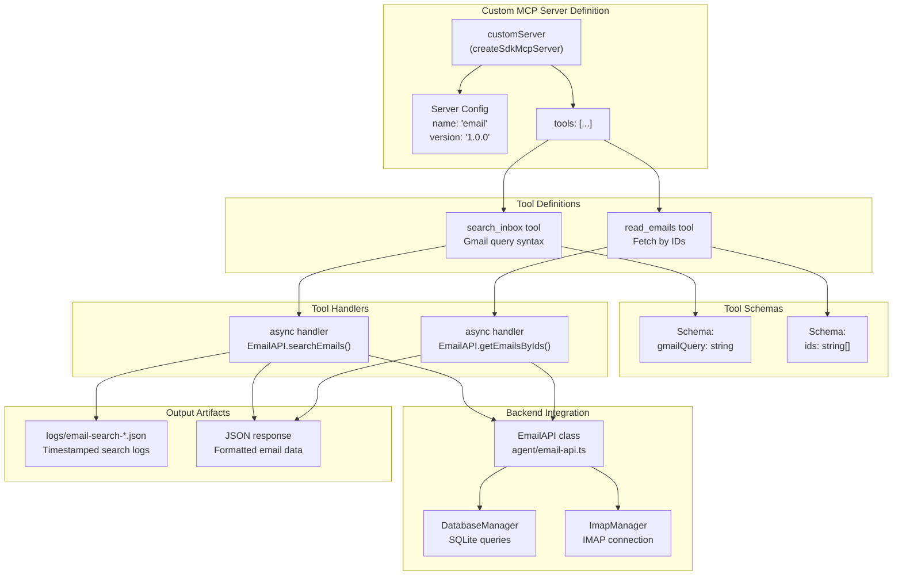
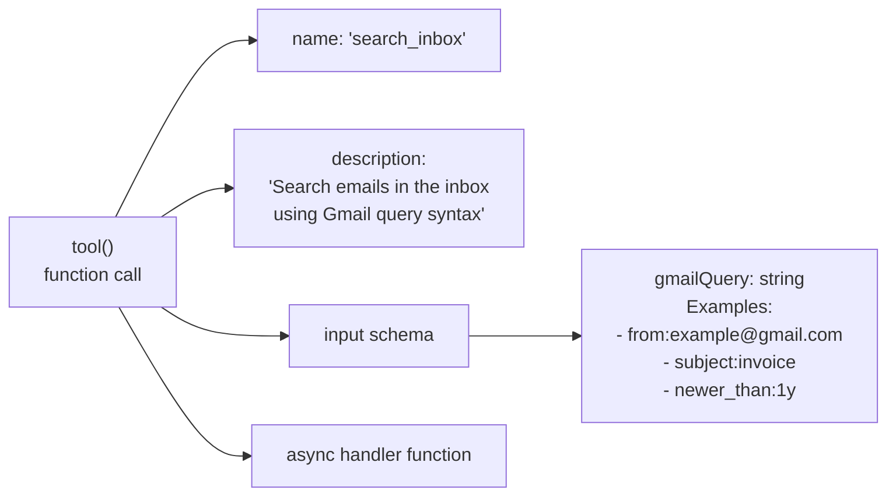
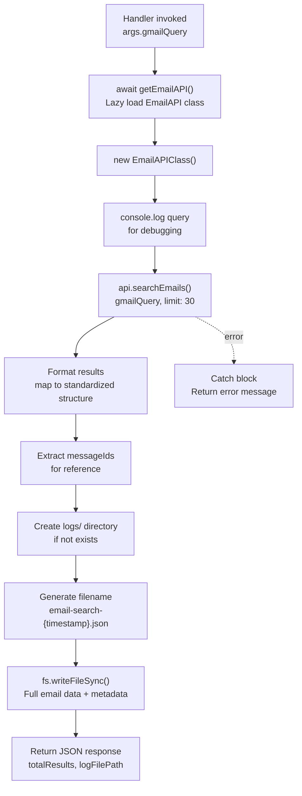
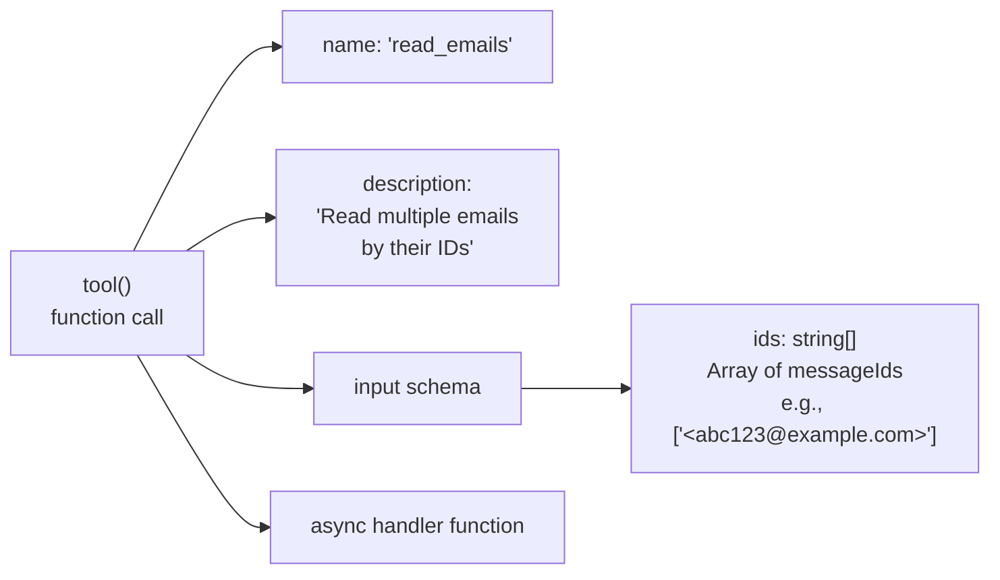
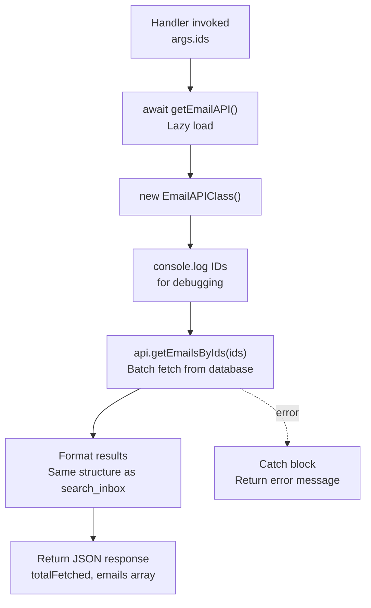
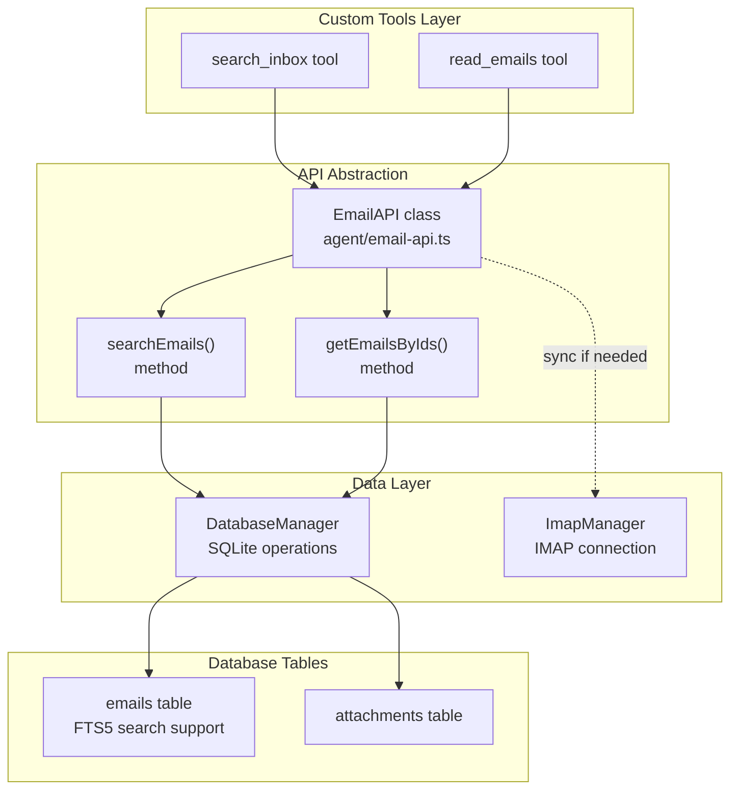
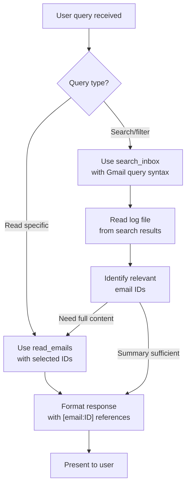
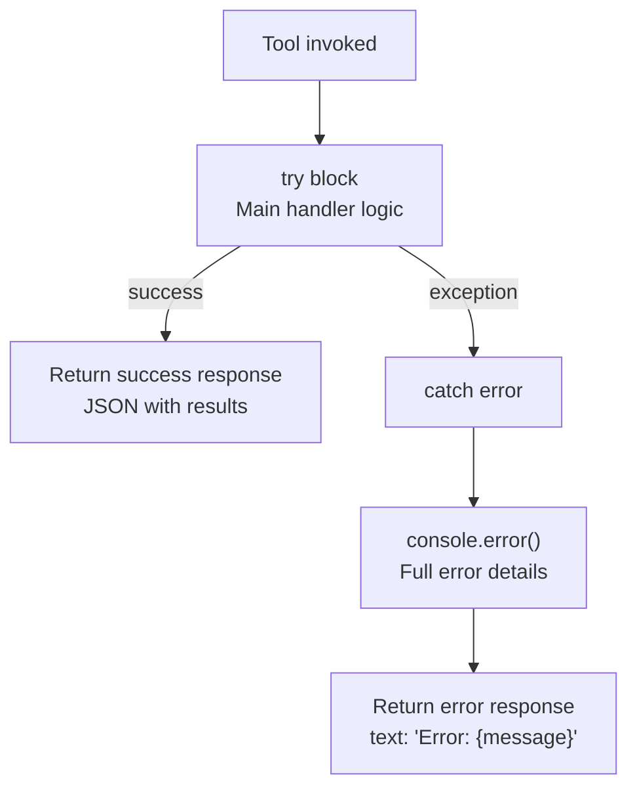

<!-- source: DeepWiki mcp.deepwiki.com · repo anthropics/claude-agent-sdk-demos · extra page Custom MCP Tools · fetched 2026-10-26 -->

# Custom MCP Tools

<details>
<summary>Relevant source files</summary>

The following files were used as context for generating this wiki page:

- [email-agent/README.md](email-agent/README.md)
- [email-agent/ccsdk/custom-tools.ts](email-agent/ccsdk/custom-tools.ts)
- [email-agent/ccsdk/email-agent-prompt.ts](email-agent/ccsdk/email-agent-prompt.ts)
- [email-agent/ccsdk/types.ts](email-agent/ccsdk/types.ts)
- [email-agent/client/components/message/AssistantMessage.tsx](email-agent/client/components/message/AssistantMessage.tsx)

</details>


## Purpose and Scope

This document covers the two custom MCP (Model Context Protocol) tools provided to the email agent for email operations: `search_inbox` and `read_emails`. These tools extend the Claude Agent SDK's built-in capabilities to enable domain-specific email querying and retrieval from the SQLite database via the IMAP integration layer.

For the agent's behavioral configuration and how these tools are described to the agent, see [Email Agent Prompt and Capabilities](#4.5.2). For the database and IMAP integration that these tools access, see [IMAP Integration and Email Sync](#4.3.2).

## Custom MCP Server Architecture

The email agent implements a custom MCP server using the SDK's `createSdkMcpServer` function to expose two domain-specific tools. The server is initialized at startup and provides tools that bridge the agent's natural language understanding with the underlying email database operations.



**Sources:** [email-agent/ccsdk/custom-tools.ts:1-170]()

## Tool Definition: search_inbox

The `search_inbox` tool enables the agent to search emails using Gmail query syntax. It accepts a `gmailQuery` string parameter and returns matching emails up to a limit of 30 results.

### Schema Definition



The tool schema is defined using Zod validation at [email-agent/ccsdk/custom-tools.ts:28-36]():

- **Tool name:** `search_inbox`
- **Description:** Informs the agent this tool searches emails using Gmail query syntax
- **Input parameter:** `gmailQuery` (string) with examples showing the query format
- **Output:** JSON structure with `totalResults`, `logFilePath`, and a message

**Sources:** [email-agent/ccsdk/custom-tools.ts:28-36]()

### Handler Implementation

The handler executes a multi-step process:



Key implementation details at [email-agent/ccsdk/custom-tools.ts:37-112]():

1. **Lazy API loading:** Uses `getEmailAPI()` to load the EmailAPI class only when needed, ensuring environment variables are loaded first [email-agent/ccsdk/custom-tools.ts:16-22]()

2. **Search execution:** Calls `api.searchEmails()` with the query and a hard-coded limit of 30 results [email-agent/ccsdk/custom-tools.ts:45-48]()

3. **Result formatting:** Maps raw email objects to a standardized structure including:
   - `index`, `id`, `messageId`
   - `date`, `from`, `to`, `subject`
   - `body` (full email content)
   - `hasAttachments`, `isRead`, `folder`, `labels`

4. **Log file generation:** Creates timestamped JSON files in `logs/` directory with full search results and metadata [email-agent/ccsdk/custom-tools.ts:69-89]()

5. **Response structure:** Returns only the log file path and count, not the full email data, keeping the tool response concise

**Sources:** [email-agent/ccsdk/custom-tools.ts:37-112]()

### Search Result Logging

Each search generates a timestamped log file with this structure:

| Field | Description |
|-------|-------------|
| `query` | Original Gmail query string |
| `timestamp` | ISO 8601 timestamp of search |
| `totalResults` | Number of emails found |
| `ids` | Array of messageId strings |
| `emails` | Full array of formatted email objects |

The log file naming convention is `email-search-{ISO-timestamp}.json` where colons and periods in the timestamp are replaced with hyphens [email-agent/ccsdk/custom-tools.ts:76-78]().

**Sources:** [email-agent/ccsdk/custom-tools.ts:81-89]()

## Tool Definition: read_emails

The `read_emails` tool retrieves full email details for specific message IDs. This is typically used after `search_inbox` to fetch complete content for selected emails.

### Schema Definition



The tool schema at [email-agent/ccsdk/custom-tools.ts:115-120]():

- **Tool name:** `read_emails`
- **Description:** Explains this tool reads multiple emails by their IDs for full content
- **Input parameter:** `ids` (array of strings) - email message IDs in angle bracket format
- **Output:** JSON with `totalFetched` count and array of email objects

**Sources:** [email-agent/ccsdk/custom-tools.ts:115-120]()

### Handler Implementation

The read_emails handler follows a simpler pattern than search_inbox:



Implementation details at [email-agent/ccsdk/custom-tools.ts:121-168]():

1. **API initialization:** Same lazy loading pattern as search_inbox

2. **Batch fetch:** Calls `api.getEmailsByIds()` with the array of IDs [email-agent/ccsdk/custom-tools.ts:129]()

3. **Result formatting:** Uses identical formatting structure as search_inbox for consistency [email-agent/ccsdk/custom-tools.ts:132-145]()

4. **Direct response:** Unlike search_inbox, returns email data directly in the tool response rather than via a log file

5. **No logging:** Does not create timestamped log files since the operation is deterministic

**Sources:** [email-agent/ccsdk/custom-tools.ts:121-168]()

## Tool Integration with EmailAPI

Both tools delegate to the `EmailAPI` class which provides an abstraction over the database layer:



The EmailAPI class is lazy-loaded through the `getEmailAPI()` helper function to ensure environment variables are properly loaded before instantiation [email-agent/ccsdk/custom-tools.ts:16-22](). This pattern prevents initialization errors when the custom-tools module is imported.

**Sources:** [email-agent/ccsdk/custom-tools.ts:14-22](), [email-agent/ccsdk/custom-tools.ts:39-41](), [email-agent/ccsdk/custom-tools.ts:123-125]()

## Tool Usage in Agent Workflow

The agent prompt explicitly instructs the AI on when and how to use these tools:



The agent prompt at [email-agent/ccsdk/email-agent-prompt.ts:1-36]() describes capabilities like:
- Searching by sender, subject, date, or content
- Finding emails with attachments
- Filtering by read/unread status
- Searching for specific email types (invoices, receipts, etc.)

When presenting results, the agent uses the `[email:MESSAGE_ID]` format which the client renders as clickable components [email-agent/ccsdk/email-agent-prompt.ts:31-33]().

**Sources:** [email-agent/ccsdk/email-agent-prompt.ts:1-36](), [email-agent/client/components/message/AssistantMessage.tsx:336-343]()

## Environment Configuration

The custom tools module loads environment variables explicitly to ensure database credentials are available:

| Configuration | Purpose |
|---------------|---------|
| `ANTHROPIC_API_KEY` | Required for Claude API access |
| `EMAIL_USER` | IMAP username |
| `EMAIL_PASSWORD` | IMAP password or app password |
| `IMAP_HOST` | IMAP server hostname |
| `IMAP_PORT` | IMAP server port |

The environment loading occurs at [email-agent/ccsdk/custom-tools.ts:7-9](), locating the `.env` file in the parent directory of the ccsdk module.

**Sources:** [email-agent/ccsdk/custom-tools.ts:7-9]()

## Tool Call Logging and Debugging

Both tools implement comprehensive console logging for debugging:

### search_inbox Logging

```
=== SEARCH INBOX TOOL CALLED ===
Query: from:boss@company.com newer_than:1d
================================
Wrote 5 emails to logs/email-search-2024-01-15T10-30-00-000Z.json
```

The logging pattern at [email-agent/ccsdk/custom-tools.ts:41-43]() and [email-agent/ccsdk/custom-tools.ts:91]() provides visibility into:
- Exact query string received
- Number of results found
- Output file path

### read_emails Logging

```
=== READ EMAILS TOOL CALLED ===
IDs: ['<abc123@example.com>', '<def456@example.com>']
================================
Fetched 2 emails
```

The logging at [email-agent/ccsdk/custom-tools.ts:125-127]() and [email-agent/ccsdk/custom-tools.ts:147]() tracks:
- List of IDs being fetched
- Count of successfully retrieved emails

These logs appear in the server console where the Bun runtime is executing and are essential for debugging agent tool usage patterns.

**Sources:** [email-agent/ccsdk/custom-tools.ts:41-43](), [email-agent/ccsdk/custom-tools.ts:91](), [email-agent/ccsdk/custom-tools.ts:125-127](), [email-agent/ccsdk/custom-tools.ts:147]()

## Error Handling

Both tools implement try-catch blocks that return formatted error responses to the agent:



Error responses follow the MCP protocol structure with a `content` array containing a text block with the error message [email-agent/ccsdk/custom-tools.ts:103-111](), [email-agent/ccsdk/custom-tools.ts:159-167](). This allows the agent to understand when operations fail and potentially retry or inform the user.

**Sources:** [email-agent/ccsdk/custom-tools.ts:103-111](), [email-agent/ccsdk/custom-tools.ts:159-167]()

---

