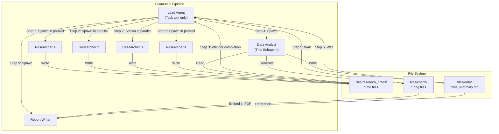
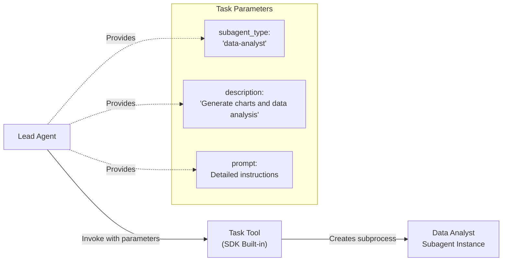
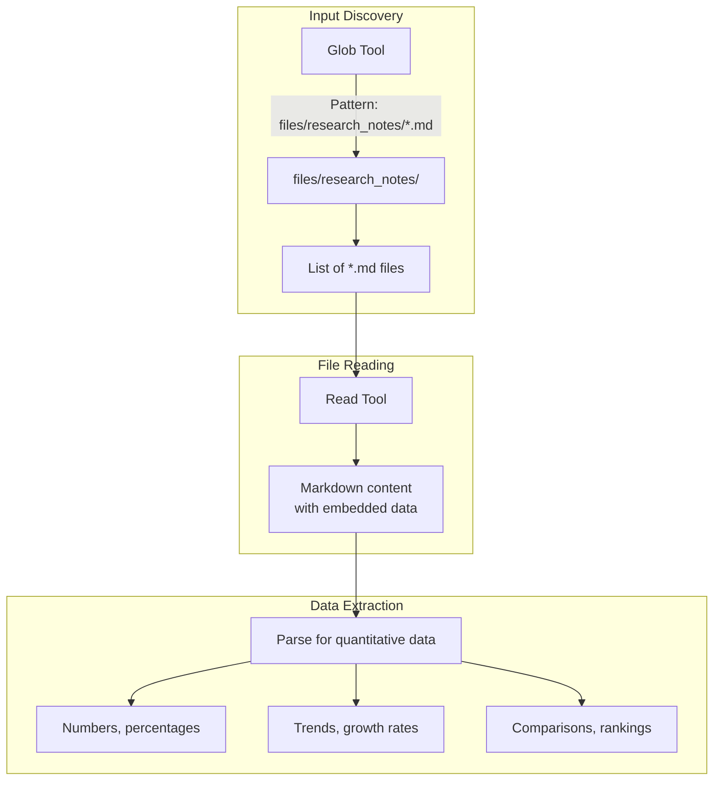
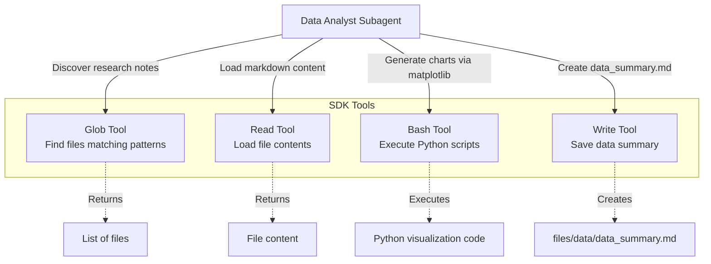
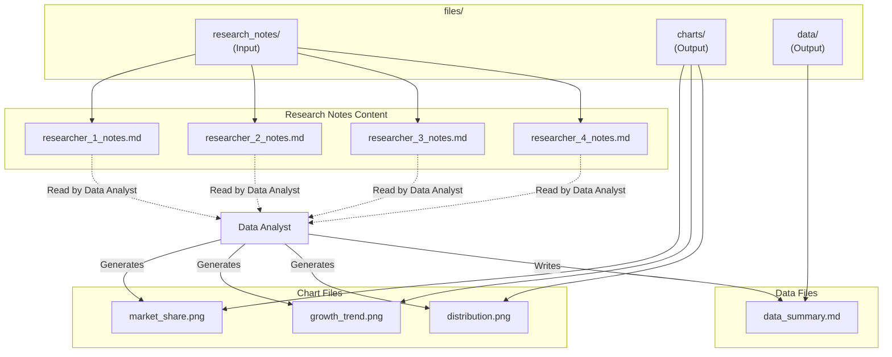
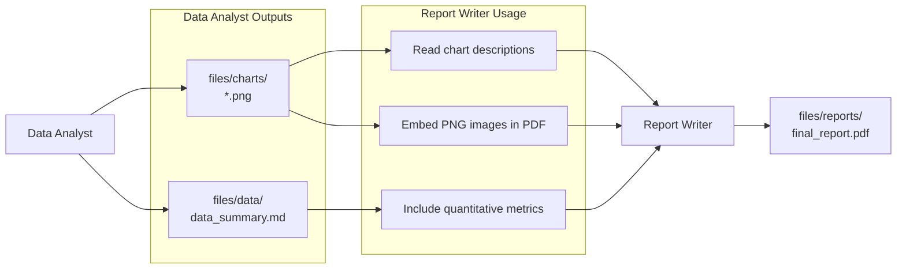

<!-- source: DeepWiki mcp.deepwiki.com · repo anthropics/claude-agent-sdk-demos · extra page Data Analyst Subagent · fetched 2026-10-26 -->

# Data Analyst Subagent

<details>
<summary>Relevant source files</summary>

The following files were used as context for generating this wiki page:

- [research-agent/research_agent/prompts/lead_agent.txt](research-agent/research_agent/prompts/lead_agent.txt)
- [research-agent/research_agent/prompts/report_writer.txt](research-agent/research_agent/prompts/report_writer.txt)

</details>


## Purpose and Scope

This document covers the Data Analyst subagent within the Research Agent demo, which is responsible for extracting quantitative data from research notes and generating visualizations. The Data Analyst operates as part of a sequential pipeline after all Researcher subagents complete their work and before the Report Writer synthesizes the final report.

For information about the overall multi-agent coordination system, see [Multi-Agent Coordination](#5.2). For details about the preceding research phase, see [Researcher Subagents](#5.2.2). For information about the subsequent report generation, see [Report Writer Subagent](#5.2.4).

---

## Role in the Research Pipeline

The Data Analyst subagent occupies a critical position in the research workflow, serving as the bridge between qualitative research findings and quantitative synthesis. It is spawned by the Lead Agent only after all Researcher subagents have completed their work and saved their findings to the file system.



**Diagram: Data Analyst Position in Sequential Pipeline**

Sources: [research-agent/research_agent/prompts/lead_agent.txt:44-49]()

### Key Responsibilities

The Data Analyst subagent has three primary responsibilities:

| Responsibility | Description | Output Location |
|---------------|-------------|-----------------|
| **Data Extraction** | Parse research notes to identify quantitative information (numbers, percentages, trends, comparisons) | In-memory processing |
| **Visualization** | Generate 2-4 charts using Python and matplotlib to illustrate key data points | `files/charts/*.png` |
| **Summary Creation** | Write structured data summary documenting extracted metrics and chart descriptions | `files/data/data_summary.md` |

Sources: [research-agent/research_agent/prompts/lead_agent.txt:44-49](), [research-agent/research_agent/prompts/lead_agent.txt:100-103]()

---

## Spawning and Configuration

### Lead Agent Delegation

The Data Analyst is spawned by the Lead Agent using the `Task` tool with specific parameters defined in the lead agent's workflow. The spawning occurs at Step 4 of the six-step orchestration process.



**Diagram: Data Analyst Spawning via Task Tool**

Sources: [research-agent/research_agent/prompts/lead_agent.txt:44-49](), [research-agent/research_agent/prompts/lead_agent.txt:100-103]()

### Standard Prompt Template

The Lead Agent provides the following standard prompt when spawning the Data Analyst:

> "Read all research notes from files/research_notes/, extract quantitative data (numbers, percentages, trends, comparisons), and generate 2-4 charts using Python/matplotlib. Save charts to files/charts/ and write a data summary to files/data/data_summary.md."

This prompt is defined in the lead agent's Task tool usage section at [research-agent/research_agent/prompts/lead_agent.txt:103]().

### Timing Constraints

| Constraint | Rule | Reason |
|-----------|------|--------|
| **Spawn After Research** | Data Analyst MUST NOT be spawned until all Researcher subagents complete | Requires complete research notes to extract data from |
| **Sequential Dependency** | Lead Agent waits for Data Analyst completion before spawning Report Writer | Report Writer needs charts and data summary for PDF generation |
| **Single Instance** | Only ONE Data Analyst is spawned per research session | Centralizes data extraction and avoids duplicate visualizations |

Sources: [research-agent/research_agent/prompts/lead_agent.txt:70-72]()

---

## Workflow and Operations

### Input Sources

The Data Analyst reads from the `files/research_notes/` directory, which contains markdown files produced by all Researcher subagents. Each research note typically contains:

- Web search findings with URLs
- Extracted facts and statistics
- Numerical data points
- Trend observations
- Comparative information



**Diagram: Data Analyst Input Processing Workflow**

Sources: [research-agent/research_agent/prompts/lead_agent.txt:46-47](), [research-agent/research_agent/prompts/lead_agent.txt:103]()

### Data Extraction Process

The Data Analyst identifies and extracts four categories of quantitative information:

1. **Numbers**: Raw numerical values (e.g., "5000 users", "$2.5 billion")
2. **Percentages**: Proportional data (e.g., "30% increase", "45% market share")
3. **Trends**: Directional changes over time (e.g., "declining since 2020", "exponential growth")
4. **Comparisons**: Relative measurements (e.g., "3x faster than competitors", "ranked #2 globally")

These categories are explicitly specified in the standard prompt at [research-agent/research_agent/prompts/lead_agent.txt:103]().

### Chart Generation

The Data Analyst generates 2-4 charts using Python and matplotlib. Charts are saved as PNG files to the `files/charts/` directory.

#### Technical Implementation

The subagent uses the `Bash` tool to execute Python scripts that:
1. Import matplotlib and necessary libraries
2. Process extracted data into visualization-ready formats
3. Create charts (bar charts, line graphs, pie charts, etc.)
4. Save as PNG files with descriptive filenames
5. Output confirmation messages with file paths

#### Chart Types and Use Cases

| Chart Type | Use Case | Example Scenario |
|-----------|----------|------------------|
| **Bar Chart** | Comparing discrete categories | Market share across companies |
| **Line Graph** | Showing trends over time | Revenue growth 2020-2024 |
| **Pie Chart** | Displaying proportional distribution | Budget allocation by category |
| **Scatter Plot** | Illustrating correlations | Price vs. performance metrics |

### Output Artifacts

The Data Analyst produces two types of output:

#### 1. Charts (`files/charts/*.png`)

PNG image files containing visualizations. Filenames typically follow patterns like:
- `market_share_comparison.png`
- `growth_trend_2020_2024.png`
- `budget_distribution.png`

#### 2. Data Summary (`files/data/data_summary.md`)

A markdown file documenting:
- Extracted quantitative metrics with citations
- Descriptions of generated charts
- Key statistical insights
- References to source research notes

Sources: [research-agent/research_agent/prompts/lead_agent.txt:46-49](), [research-agent/research_agent/prompts/lead_agent.txt:103]()

---

## Tools and Capabilities

### Available Tools

The Data Analyst subagent has access to the following SDK tools:



**Diagram: Data Analyst Tool Usage Pattern**

### Tool Usage Sequence

1. **Glob**: Discover all research note files
   - Pattern: `files/research_notes/*.md`
   - Returns array of file paths

2. **Read**: Load each research note
   - Input: Individual file path
   - Returns: Markdown content as string

3. **Bash**: Execute Python for visualization
   - Creates Python script with matplotlib code
   - Executes via `python script.py` or `python3 script.py`
   - Generates PNG files in `files/charts/`

4. **Write**: Save data summary
   - Path: `files/data/data_summary.md`
   - Content: Structured markdown with metrics and chart descriptions

Sources: [research-agent/research_agent/prompts/lead_agent.txt:46-49]()

### Python/Matplotlib Integration

The Data Analyst leverages Python's matplotlib library for all visualizations. A typical chart generation script follows this pattern:

```python
import matplotlib.pyplot as plt
import os

# Ensure output directory exists
os.makedirs('files/charts', exist_ok=True)

# Sample data
categories = ['Category A', 'Category B', 'Category C']
values = [45, 30, 25]

# Create chart
plt.figure(figsize=(10, 6))
plt.bar(categories, values)
plt.title('Distribution Analysis')
plt.xlabel('Categories')
plt.ylabel('Values')

# Save to files/charts/
plt.savefig('files/charts/distribution_chart.png', dpi=300, bbox_inches='tight')
plt.close()

print("Chart saved: files/charts/distribution_chart.png")
```

The subagent generates and executes similar scripts dynamically based on extracted data.

Sources: [research-agent/research_agent/prompts/lead_agent.txt:47-48]()

---

## File System Integration

### Directory Structure

The Data Analyst interacts with three primary directories in the research agent file system:



**Diagram: Data Analyst File System Interactions**

### Input/Output Mapping

| Directory | Access Mode | Purpose | File Format |
|-----------|-------------|---------|-------------|
| `files/research_notes/` | Read-only | Source of research findings and quantitative data | `*.md` (Markdown) |
| `files/charts/` | Write | Storage for generated visualizations | `*.png` (PNG images) |
| `files/data/` | Write | Storage for data summary documentation | `data_summary.md` (Markdown) |

### File Naming Conventions

**Charts**: Descriptive names reflecting the visualization content
- Examples: `revenue_growth.png`, `market_comparison.png`, `technology_adoption.png`

**Data Summary**: Fixed filename
- Always: `data_summary.md`

Sources: [research-agent/research_agent/prompts/lead_agent.txt:48-49](), [research-agent/research_agent/prompts/lead_agent.txt:103]()

---

## Integration with Other Subagents

### Upstream: Researcher Subagents

The Data Analyst depends on completed research from all Researcher subagents. The Lead Agent enforces this dependency through explicit waiting:

**Lead Agent Coordination Logic**:
- Step 2: Spawn 2-4 Researchers in parallel
- Step 3: **Wait for ALL researchers to complete**
- Step 4: Spawn Data Analyst (only after Step 3 completes)

This ensures the Data Analyst has access to the complete set of research notes before attempting data extraction.

Sources: [research-agent/research_agent/prompts/lead_agent.txt:40-49]()

### Downstream: Report Writer Subagent

The Data Analyst's outputs are consumed by the Report Writer subagent:



**Diagram: Data Analyst to Report Writer Data Flow**

The Report Writer specifically:
1. Reads data summaries from `files/data/` to understand quantitative findings
2. Embeds chart images from `files/charts/` directly into the PDF
3. References specific metrics documented by the Data Analyst

Sources: [research-agent/research_agent/prompts/report_writer.txt:6-8](), [research-agent/research_agent/prompts/report_writer.txt:24](), [research-agent/research_agent/prompts/report_writer.txt:28]()

### Coordination Timing

The Lead Agent ensures proper sequencing through its delegation rules:

| Rule | Enforcement | Citation |
|------|-------------|----------|
| **No parallel with researchers** | Data Analyst spawned AFTER all researchers complete | [lead_agent.txt:71]() |
| **Before report writer** | Report Writer spawned AFTER Data Analyst completes | [lead_agent.txt:72]() |
| **Single instance** | Only ONE Data Analyst per research session | [lead_agent.txt:100-103]() |

Sources: [research-agent/research_agent/prompts/lead_agent.txt:70-72]()

---

## Tracking and Observability

### SubagentTracker Integration

The Data Analyst, like all subagents, is monitored by the `SubagentTracker` system through pre-tool and post-tool hooks. Each tool invocation is logged with:

- **Agent Identifier**: `DATA-ANALYST-1` (typically)
- **Tool Name**: `Glob`, `Read`, `Bash`, `Write`
- **Timestamp**: ISO format
- **Input Parameters**: Tool-specific arguments
- **Output Results**: Tool execution results

### Log Files

**Structured Logs**: `logs/session_*/tool_calls.jsonl`
- JSONL format with one tool call per line
- Includes agent ID, tool name, timestamp, inputs, and outputs

**Human-Readable Transcript**: `logs/session_*/transcript.txt`
- Plain text format showing the data analyst's workflow
- Includes tool invocations and results in readable format

For complete details on the tracking system, see [Subagent Tracking System](#5.3).

Sources: System diagrams (Diagram 5 in high-level architecture)

---

