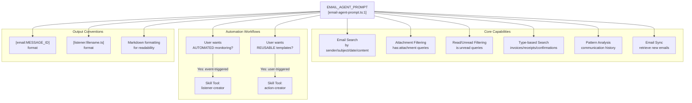
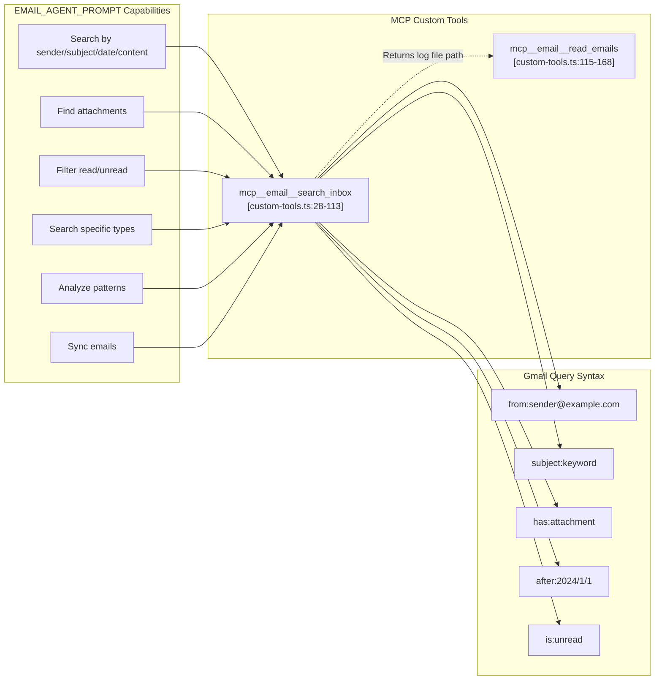
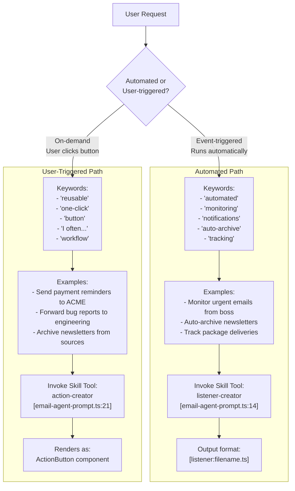
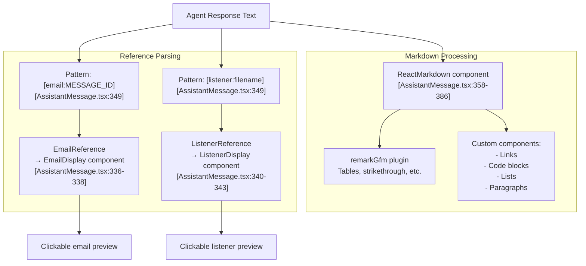
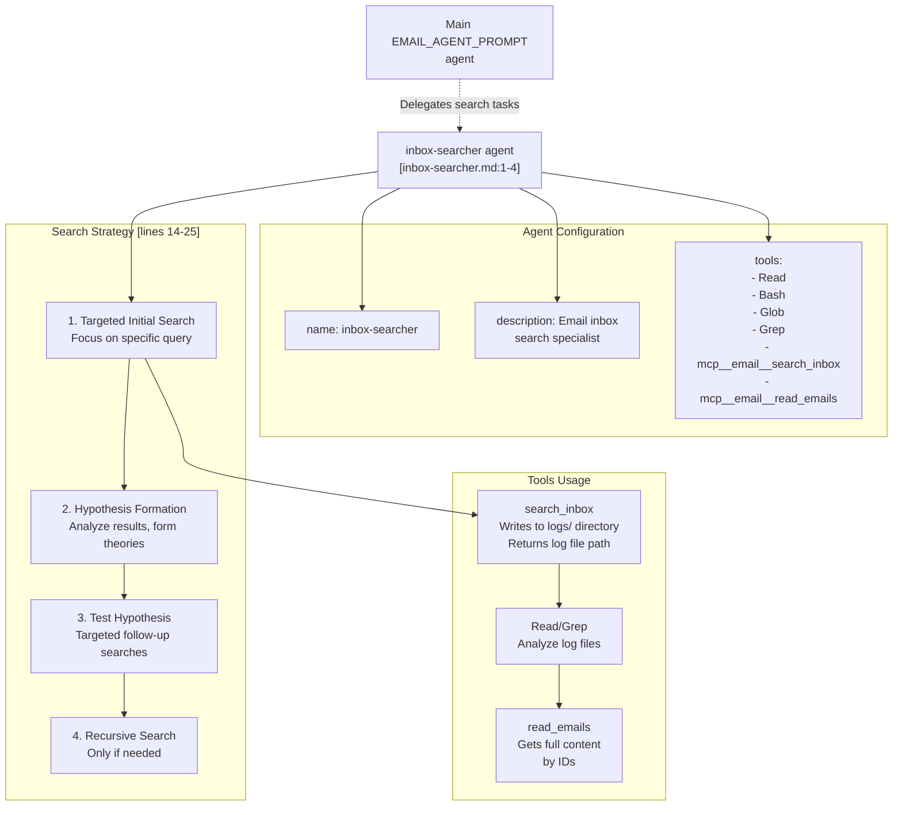
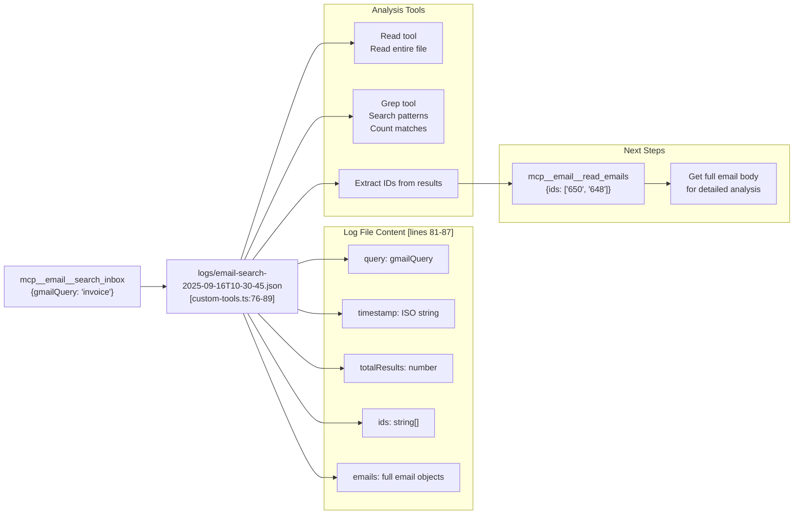

<!-- source: DeepWiki mcp.deepwiki.com · repo anthropics/claude-agent-sdk-demos · extra page Email Agent Prompt and Capabilities · fetched 2026-10-26 -->

# Email Agent Prompt and Capabilities

<details>
<summary>Relevant source files</summary>

The following files were used as context for generating this wiki page:

- [email-agent/.gitignore](email-agent/.gitignore)
- [email-agent/README.md](email-agent/README.md)
- [email-agent/agent/.claude/agents/inbox-searcher.md](email-agent/agent/.claude/agents/inbox-searcher.md)
- [email-agent/agent/data/PROFILE.MD](email-agent/agent/data/PROFILE.MD)
- [email-agent/ccsdk/custom-tools.ts](email-agent/ccsdk/custom-tools.ts)
- [email-agent/ccsdk/email-agent-prompt.ts](email-agent/ccsdk/email-agent-prompt.ts)
- [email-agent/ccsdk/types.ts](email-agent/ccsdk/types.ts)
- [email-agent/client/components/message/AssistantMessage.tsx](email-agent/client/components/message/AssistantMessage.tsx)

</details>


This document details the EMAIL_AGENT_PROMPT system prompt and the agent's capabilities defined through that prompt and specialized sub-agent configurations. For information about the custom MCP tools that implement these capabilities, see [Custom MCP Tools](#4.5.1). For information about listeners and their creation workflow, see [Listeners System](#4.6).

## Purpose and Scope

This page covers the AI agent's behavioral configuration through prompts, including:
- The main EMAIL_AGENT_PROMPT that defines high-level agent behavior
- Distinction between event-triggered listeners and user-triggered actions
- Output formatting conventions for email references
- The inbox-searcher specialized agent and its strategic search methodology

## EMAIL_AGENT_PROMPT Structure

The main agent prompt is defined in `EMAIL_AGENT_PROMPT` constant and establishes the agent's core identity and capabilities.

**Diagram: EMAIL_AGENT_PROMPT Configuration Flow**



Sources: [email-agent/ccsdk/email-agent-prompt.ts:1-36]()

### Prompt Content Breakdown

The prompt is structured into three main sections:

| Section | Lines | Purpose |
|---------|-------|---------|
| Core Capabilities | 1-9 | Lists what the agent can help users accomplish |
| Listener Creation | 11-16 | Defines when and how to create automated email monitoring |
| Action Creation | 18-28 | Defines when and how to create reusable action templates |
| Output Formatting | 30-35 | Specifies markdown conventions and reference formats |

Sources: [email-agent/ccsdk/email-agent-prompt.ts:1-36]()

## Core Agent Capabilities

The prompt defines seven primary capabilities that the agent provides:

**Diagram: Capability to Tool Mapping**



Sources: [email-agent/ccsdk/email-agent-prompt.ts:1-9](), [email-agent/ccsdk/custom-tools.ts:28-168]()

### Capability Details

1. **Search emails**: Uses `gmailQuery` parameter with Gmail syntax to search by sender, subject, date, or content
2. **Find attachments**: Leverages `has:attachment` query operator
3. **Filter read/unread**: Uses `is:unread` or `is:read` operators
4. **Type-based search**: Applies semantic queries like "invoice", "receipt", "confirmation"
5. **Pattern analysis**: Aggregates and analyzes communication history across searches
6. **Email sync**: Triggers synchronization with IMAP server to fetch new messages

Sources: [email-agent/ccsdk/email-agent-prompt.ts:3-9]()

## Listener vs Action Decision Tree

The prompt establishes a critical distinction between two automation patterns:

**Diagram: Listener vs Action Decision Flow**



Sources: [email-agent/ccsdk/email-agent-prompt.ts:11-28]()

### Listener Creation

Triggered when user requests **automated** email monitoring:

- **Activation keywords**: "automated", "monitoring", "notifications", "auto-archive", "tracking"
- **Tool used**: `Skill` tool with `listener-creator` skill
- **Execution model**: Event-triggered, runs when emails arrive
- **Output format**: `[listener:filename.ts]` for reference parsing

Example use cases from prompt:
- Monitoring urgent emails from their boss
- Auto-archiving newsletters
- Tracking package deliveries

Sources: [email-agent/ccsdk/email-agent-prompt.ts:11-16]()

### Action Creation

Triggered when user requests **reusable, user-triggered** actions:

- **Activation keywords**: "reusable", "one-click", "I often...", "workflow"
- **Tool used**: `Skill` tool with `action-creator` skill
- **Execution model**: User-triggered, runs when button clicked
- **Customization**: Should be user-specific, tailored to actual vendors/customers/teams

Example use cases from prompt:
- "I often send payment reminders to ACME Corp"
- "I need to forward bug reports to engineering team"
- "I want to archive newsletters from my specific sources"

Sources: [email-agent/ccsdk/email-agent-prompt.ts:18-28]()

### Key Distinction Table

| Aspect | Listeners | Actions |
|--------|-----------|---------|
| **Trigger** | Automatic (email arrival) | Manual (user click) |
| **Skill** | `listener-creator` | `action-creator` |
| **Reference Format** | `[listener:filename.ts]` | Rendered as button |
| **Personalization** | General monitoring rules | Specific to user's workflows |
| **Execution Context** | Background, event-driven | Foreground, on-demand |

Sources: [email-agent/ccsdk/email-agent-prompt.ts:24-26]()

## Output Formatting Conventions

The prompt defines strict formatting requirements for agent responses:

**Diagram: Output Format Processing**



Sources: [email-agent/ccsdk/email-agent-prompt.ts:30-34](), [email-agent/client/components/message/AssistantMessage.tsx:336-404]()

### Email Reference Format

Format: `[email:MESSAGE_ID]`

Example: `[email:<abc123@example.com>]`

This format is parsed by the `TextComponent` using regex pattern `/\[(email|listener):([^\]]+)\]/g` and replaced with an interactive `EmailDisplay` component showing email preview.

Sources: [email-agent/ccsdk/email-agent-prompt.ts:32](), [email-agent/client/components/message/AssistantMessage.tsx:349]()

### Listener Reference Format

Format: `[listener:filename.ts]`

Example: `[listener:urgent_emails.ts]`

Similarly parsed and replaced with `ListenerDisplay` component for easy navigation to listener code.

Sources: [email-agent/ccsdk/email-agent-prompt.ts:16](), [email-agent/client/components/message/AssistantMessage.tsx:349]()

### Markdown Guidelines

From the prompt:
- Use markdown formatting for readability
- Show key details like subject, sender, and date
- Keep responses concise and relevant to the user's query

The `ReactMarkdown` component with `remarkGfm` plugin handles:
- Tables
- Strikethrough
- Task lists
- Autolinks
- Custom styling for code, lists, and links

Sources: [email-agent/ccsdk/email-agent-prompt.ts:30-34](), [email-agent/client/components/message/AssistantMessage.tsx:358-386]()

## Inbox-Searcher Specialized Agent

The `inbox-searcher` agent is a specialized sub-agent with a sophisticated search methodology defined in a dedicated agent configuration file.

**Diagram: Inbox-Searcher Agent Architecture**



Sources: [email-agent/agent/.claude/agents/inbox-searcher.md:1-425]()

### Strategic Search Methodology

The inbox-searcher agent implements a hypothesis-driven search process rather than brute-force recursive searching:

#### Phase 1: Targeted Initial Search (Lines 39-66)

Start with focused search based on user's specific request:
- Specific query: `"from:john@company.com subject:budget"`
- Recent timeframe: `"project deadline newer_than:7d"`
- Specific criteria: `"has:attachment filename:report.pdf"`

After running search:
1. Tool returns log file path containing all results
2. Use `Read` tool to examine log file structure
3. Use `Grep` to search through log file for specific content
4. Extract relevant email IDs for further investigation

Sources: [email-agent/agent/.claude/agents/inbox-searcher.md:39-80]()

#### Phase 2: Hypothesis Formation & Testing (Lines 81-89)

Based on initial results, form and test specific hypotheses:
- **Hypothesis 1**: "Budget emails might be in thread with different subject" → Test: `from:john@company.com (budget OR financial OR "Q4")`
- **Hypothesis 2**: "Sender might use different addresses" → Test: `from:company.com budget`
- **Hypothesis 3**: "Info might be in attachments" → Test: `has:attachment from:john@company.com newer_than:1m`

Sources: [email-agent/agent/.claude/agents/inbox-searcher.md:81-102]()

#### Phase 3: Conditional Recursive Search (Lines 90-102)

Only perform recursive/exhaustive searches when:
1. Initial targeted searches return insufficient results (< 3 relevant emails)
2. User explicitly requests "all" or "every" email
3. Query requires exploring multiple connected topics
4. Evidence suggests important emails exist but haven't been found

Sources: [email-agent/agent/.claude/agents/inbox-searcher.md:90-102]()

### Log File Analysis Workflow

**Diagram: Log File Analysis Flow**



Sources: [email-agent/agent/.claude/agents/inbox-searcher.md:48-80](), [email-agent/ccsdk/custom-tools.ts:69-89]()

### Gmail Query Syntax Support

The inbox-searcher agent documentation includes comprehensive Gmail query syntax:

| Operator | Purpose | Example |
|----------|---------|---------|
| `from:` | Sender email | `from:sender@example.com` |
| `to:` | Recipient email | `to:recipient@example.com` |
| `subject:` | Subject line | `subject:keyword` |
| `has:attachment` | Has attachments | `has:attachment` |
| `is:unread` | Read status | `is:unread` |
| `after:` | Date filter | `after:2024/1/1` |
| `before:` | Date filter | `before:2024/12/31` |
| `newer_than:` | Relative date | `newer_than:7d` |
| `older_than:` | Relative date | `older_than:1m` |
| `filename:` | Attachment type | `filename:pdf` |
| `OR` | Either term | `(invoice OR receipt)` |
| `""` | Exact phrase | `"quarterly report"` |
| `-` | Exclude | `invoice -draft` |
| `()` | Group terms | `from:vendor (invoice OR receipt)` |

Sources: [email-agent/agent/.claude/agents/inbox-searcher.md:167-192]()

### Decision Framework for Search Depth

The agent uses a strategic decision framework:

**When to STOP searching:**
- ✅ Found specific email(s) user asked about
- ✅ Have sufficient examples to answer question
- ✅ Results clearly indicate no more relevant emails exist
- ✅ User's question is answered with current findings

**When to CONTINUE with hypothesis testing:**
- 🔬 Results suggest related emails might exist (test specific hypothesis)
- 🔬 Found partial information, need specific follow-up
- 🔬 Initial search was too narrow, test broader hypothesis

**When to initiate RECURSIVE search:**
- 🔄 User explicitly requested "all", "every", or "comprehensive"
- 🔄 Initial results suspiciously low for the query type
- 🔄 Investigation requires mapping relationships between emails
- 🔄 Building a complete picture of a topic/project/conversation

Sources: [email-agent/agent/.claude/agents/inbox-searcher.md:372-390]()

### Output Formatting Requirements

The inbox-searcher agent has specific output formatting requirements:

```markdown
## Search Results: Q4 Financial Reports

### Primary Documents (3 emails)
- **Q4 Financial Summary** from cfo@company.com [email:1234]
  *Date: 2024-01-15* | 📎 Has attachments
  Relevance: Main Q4 report with Excel attachments

### Related Discussions (5 emails)
- **Re: Q4 Numbers Review** from analyst@company.com [email:1235]
  *Date: 2024-01-16*
  Relevance: Analysis and feedback on Q4 results
```

Requirements:
- Use `[email:ID]` format for clickable references
- Bold important information with `**markdown**`
- Group related emails together
- Provide context about why each email is relevant
- Limit initial results to 20-50 most relevant emails
- Offer to search deeper if needed

Sources: [email-agent/agent/.claude/agents/inbox-searcher.md:193-216]()

## Tool Capabilities Reference

The agent's capabilities are implemented through two custom MCP tools:

### search_inbox Tool

**Function**: `tool("search_inbox", ...)`
**Location**: [email-agent/ccsdk/custom-tools.ts:28-113]()

**Parameters**:
- `gmailQuery`: Gmail query string

**Behavior**:
1. Searches emails using `EmailAPI.searchEmails()`
2. Limits to 30 emails per search
3. Creates timestamped log file in `logs/` directory
4. Writes full search results to log file
5. Returns log file path and total count

**Log File Structure** (lines 81-87):
```typescript
{
  query: string,
  timestamp: string,
  totalResults: number,
  ids: string[],
  emails: Array<{
    id, messageId, date, from, to, 
    subject, body, hasAttachments,
    isRead, folder, labels
  }>
}
```

Sources: [email-agent/ccsdk/custom-tools.ts:28-113]()

### read_emails Tool

**Function**: `tool("read_emails", ...)`
**Location**: [email-agent/ccsdk/custom-tools.ts:115-168]()

**Parameters**:
- `ids`: Array of email message IDs

**Behavior**:
1. Fetches full content of multiple emails by ID using `EmailAPI.getEmailsByIds()`
2. Returns complete email objects with full body text
3. More efficient than searching when IDs are known

**When to Use**:
- Snippets don't contain the specific information requested
- Need to extract specific data (amounts, dates, names, addresses)
- User asks for details or summaries requiring full email content
- Need to verify email content matches search criteria

Sources: [email-agent/ccsdk/custom-tools.ts:115-168](), [email-agent/agent/.claude/agents/inbox-searcher.md:391-425]()

## Integration with WebSocket Handler

The agent operates within the WebSocket handler context, which manages:
- Session management for conversation state
- Real-time streaming of agent responses
- Action button rendering when agent creates actions
- Component instance rendering for dynamic UI elements

When the agent invokes the `Skill` tool with `listener-creator` or `action-creator` skills, the resulting artifacts are:
- **Listeners**: Written to `agent/custom_scripts/listeners/` directory
- **Actions**: Registered with `ActionsManager` and rendered as `ActionButton` components in the UI

Sources: [email-agent/ccsdk/email-agent-prompt.ts:11-28](), [email-agent/client/components/message/AssistantMessage.tsx:457-469]()

---

