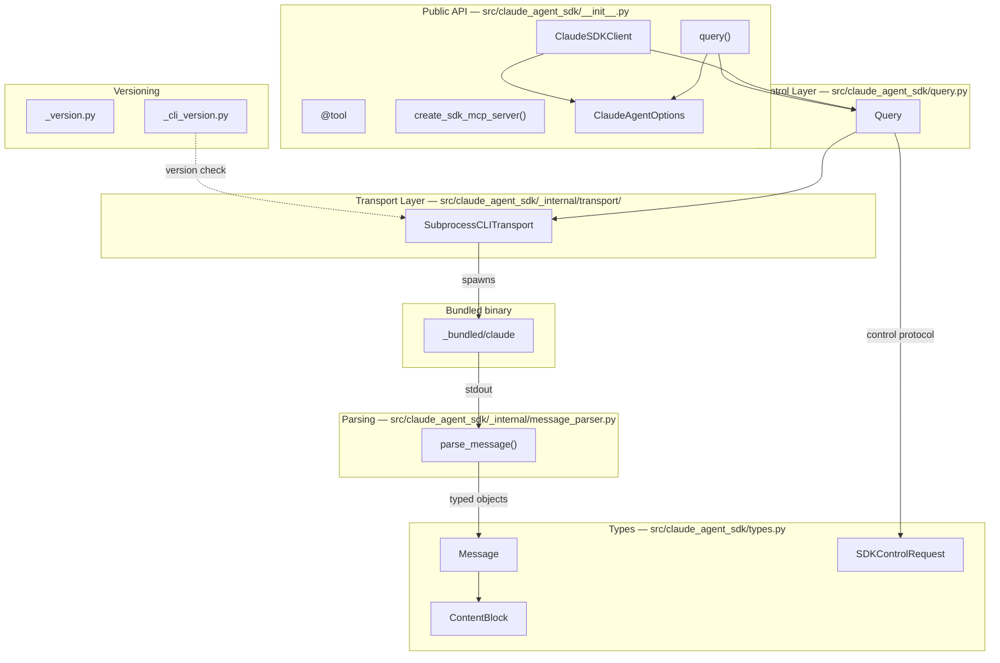
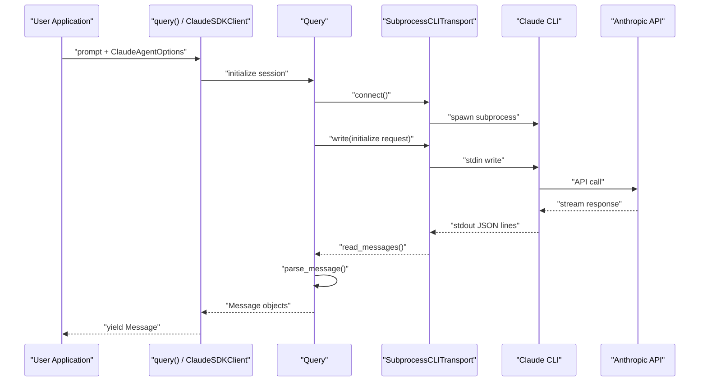

<!-- source: DeepWiki mcp.deepwiki.com · repo anthropics/claude-agent-sdk-python · page 1 Overview · fetched 2026-10-26 -->

# Overview

Relevant source files

The following files were used as context for generating this wiki page:

- [.github/workflows/generate-changelog.yml](.github/workflows/generate-changelog.yml)
- [CLAUDE.md](CLAUDE.md)
- [README.md](README.md)
- [src/claude_agent_sdk/__init__.py](src/claude_agent_sdk/__init__.py)
- [tests/test_mcp_large_output.py](tests/test_mcp_large_output.py)
- [tests/test_query.py](tests/test_query.py)
- [tests/test_sdk_mcp_integration.py](tests/test_sdk_mcp_integration.py)

This page describes the purpose, structure, and major subsystems of the `claude-agent-sdk` Python package. It is intended as an entry point for developers reading the codebase for the first time. 

For quick setup and usage, see [Quick Start](#1.1). For detailed installation requirements and options, see [Installation and Setup](#1.2). For version tracking, release information, and changelogs, see [Version Information and Changelog](#1.3).

---

## What the SDK Is

`claude-agent-sdk` is a Python library that lets application code drive a Claude agent session programmatically. It is published as `claude-agent-sdk` on PyPI [pyproject.toml:6-7]() and currently targets Python 3.10 and later [pyproject.toml:10](), [README.md:13]().

The SDK does **not** communicate with the Anthropic API directly. Instead, it manages a subprocess running the bundled Claude CLI binary [README.md:15](). All API calls flow through that CLI process. The SDK's job is to:

- Spawn and manage the CLI subprocess via `SubprocessCLITransport` [src/claude_agent_sdk/_internal/transport/subprocess_cli.py:38-50]().
- Serialize configuration and user prompts into the CLI's control protocol [src/claude_agent_sdk/query.py:40-60]().
- Parse the CLI's JSON-lines output into typed Python objects via `parse_message` [src/claude_agent_sdk/_internal/message_parser.py:20-45]().
- Expose Python-level hooks, custom tools (`@tool`), and permission callbacks (`can_use_tool`) that the CLI calls back into [src/claude_agent_sdk/client.py:22-50]().

This design means the SDK version and the bundled CLI version are tracked separately. For details, see [Bundled CLI Version Management](#2.4).

Sources: [pyproject.toml:6-10](), [README.md:13-18](), [src/claude_agent_sdk/_internal/transport/subprocess_cli.py:38-50]()

---

## Runtime Dependencies

The package relies on a small set of core runtime dependencies defined in `pyproject.toml`:

| Package | Minimum Version | Role |
|---|---|---|
| `anyio` | 4.0.0 | Async I/O and memory streams; supports both asyncio and Trio [pyproject.toml:28]() |
| `mcp` | 1.23.0 | In-process MCP server for custom tools [pyproject.toml:31]() |
| `sniffio` | 1.0.0 | Runtime async backend detection (asyncio vs Trio) [pyproject.toml:29]() |
| `typing_extensions` | 4.0.0 | Backports for Python < 3.11 [pyproject.toml:30]() |

Sources: [pyproject.toml:27-32]()

---

## Major Subsystems

The architecture connects user-facing Python constructs down through control layers and transport mechanisms to the CLI binary.

**System-to-Code mapping diagram:**

Sources: [src/claude_agent_sdk/client.py:22-40](), [src/claude_agent_sdk/query.py:23-35](), [CLAUDE.md:21-28]()

---

The table below maps each subsystem to its primary source file(s) and its role.

| Subsystem | Primary File(s) | Role |
|---|---|---|
| Public API | `src/claude_agent_sdk/__init__.py` | Exports `query()`, `ClaudeSDKClient`, `@tool`, `create_sdk_mcp_server`, all types and errors [src/claude_agent_sdk/__init__.py:68-194](). |
| Configuration | `src/claude_agent_sdk/types.py` | `ClaudeAgentOptions` and associated typed settings [src/claude_agent_sdk/types.py:79-141](). |
| Control protocol | `src/claude_agent_sdk/query.py` | `query()` function and internal logic for the bidirectional control protocol [src/claude_agent_sdk/query.py:30-90](). |
| Transport | `src/claude_agent_sdk/_internal/transport/` | `Transport` and `SubprocessCLITransport`: spawns CLI and handles I/O [src/claude_agent_sdk/_internal/transport/subprocess_cli.py:38-70](). |
| Message parsing | `src/claude_agent_sdk/_internal/message_parser.py` | `parse_message()`: deserializes CLI JSON lines to typed `Message` objects [src/claude_agent_sdk/_internal/message_parser.py:20-50](). |
| Error types | `src/claude_agent_sdk/_errors.py` | `CLINotFoundError`, `CLIConnectionError`, `ProcessError`, `ClaudeSDKError` [src/claude_agent_sdk/_errors.py:1-45](). |
| Session Store | `src/claude_agent_sdk/_internal/session_store.py` | `SessionStore` protocol and `InMemorySessionStore` implementation [src/claude_agent_sdk/_internal/session_store.py:20-80](). |

Sources: [src/claude_agent_sdk/__init__.py:68-194](), [src/claude_agent_sdk/_errors.py:1-45](), [src/claude_agent_sdk/_internal/session_store.py:20-80]()

---

## Two Entry Points

The SDK exposes two public ways to interact with Claude:

### `query()` — One-shot async generator

`query()` is an async generator that accepts a prompt (string or `AsyncIterable`) and an optional `ClaudeAgentOptions` instance, then yields `Message` objects until the session ends [README.md:33-55](). It internally creates and manages a `ClaudeSDKClient` for each call. Use this for simple, stateless queries.

For details, see [query() Function](#3.1).

### `ClaudeSDKClient` — Stateful streaming session

`ClaudeSDKClient` maintains an open session across multiple queries [README.md:97-146](). It supports context-manager usage, interruption, model switching, permission mode changes, MCP status inspection, and custom tools via in-process SDK MCP servers [README.md:100-146]().

For details, see [ClaudeSDKClient](#3.2).

Sources: [README.md:33-55](), [README.md:97-146]()

---

## Data Flow

The message flow bridges user code invocation down to the CLI subprocess and Anthropic API.

**End-to-end message flow diagram:**

Sources: [README.md:34-55](), [README.md:85-134](), [src/claude_agent_sdk/query.py:30-100]()

---

## Extension Points

The SDK supports three primary extension mechanisms:

| Mechanism | Key Types | Purpose |
|---|---|---|
| Custom tools | `@tool`, `SdkMcpTool`, `create_sdk_mcp_server()` | Define Python functions as in-process MCP tools Claude can call [README.md:100-134]() |
| Permission callbacks | `can_use_tool`, `ToolPermissionContext`, `PermissionResultAllow` | Approve, deny, or modify tool inputs at runtime [README.md:59]() |
| Lifecycle hooks | `hooks`, `HookMatcher`, `HookEventMessage` | React to agent loop events like `PreToolUse`, `PostToolUse`, or `Stop` [src/claude_agent_sdk/types.py:92-133]() |

For details, see [Custom Tools (SDK MCP Servers)](#5.1), [Permission System and Callbacks](#5.2), and [Lifecycle Hooks](#5.3).

Sources: [README.md:59-134](), [src/claude_agent_sdk/types.py:92-133]()

---

## Version Information

- **SDK Package Version**: Managed in `src/claude_agent_sdk/_version.py` [src/claude_agent_sdk/_version.py:1-3]().
- **Bundled CLI Version**: Managed in `src/claude_agent_sdk/_cli_version.py` [src/claude_agent_sdk/_cli_version.py:1-3]().

For instructions on consulting version numbers programmatically or reading the changelog, see [Version Information and Changelog](#1.3).

Sources: [src/claude_agent_sdk/_version.py:1-3](), [src/claude_agent_sdk/_cli_version.py:1-3]()

---

