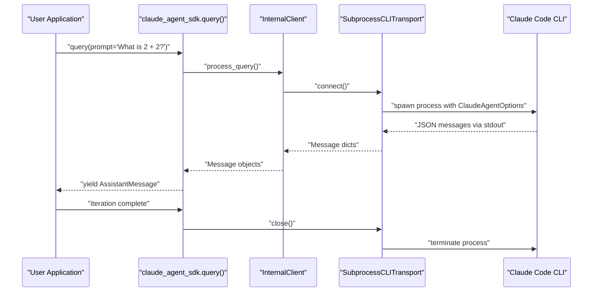
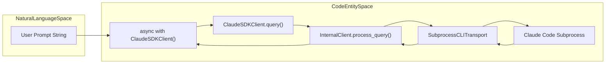
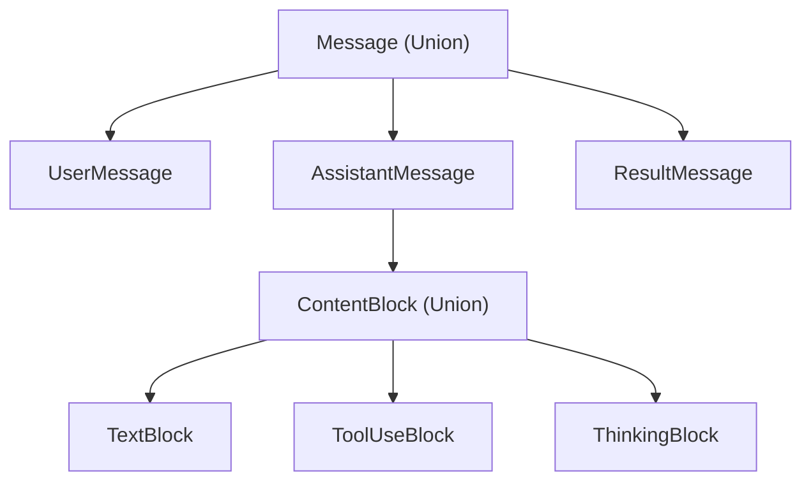

<!-- source: DeepWiki mcp.deepwiki.com · repo anthropics/claude-agent-sdk-python · page 1.1 Quick Start · fetched 2026-10-26 -->

# Quick Start

<details>
<summary>Relevant source files</summary>

The following files were used as context for generating this wiki page:

- [examples/quick_start.py](examples/quick_start.py)
- [src/claude_agent_sdk/_internal/transport/__init__.py](src/claude_agent_sdk/_internal/transport/__init__.py)
- [src/claude_agent_sdk/query.py](src/claude_agent_sdk/query.py)
- [tests/test_close_cancellation.py](tests/test_close_cancellation.py)

</details>


This page provides minimal working examples to get started with the Claude Agent SDK. It demonstrates the two primary interaction modes (`query()` and `ClaudeSDKClient`), custom tool creation, and basic hook usage, detailing their underlying implementation and data flow.

## Prerequisites and Installation

The Claude Agent SDK requires Python 3.10 or later. The Claude Code CLI is automatically bundled with the package and requires no separate installation. The SDK communicates with Claude through the bundled CLI subprocess by default or via the abstract `Transport` interface [src/claude_agent_sdk/_internal/transport/__init__.py:8-19]().

```bash
pip install claude-agent-sdk
```

Sources: [src/claude_agent_sdk/_internal/transport/__init__.py:8-19]()

## Two Interaction Modes

The SDK provides two primary modes of interaction with Claude, each suited to different architectural needs [src/claude_agent_sdk/query.py:18-43]():

| Mode | Function / Class | Use Case | Features |
|------|----------|----------|----------|
| One-shot | `query()` | Simple queries, batch jobs, CI/CD | Async iterator, automatic cleanup via `InternalClient`, stateless execution [src/claude_agent_sdk/query.py:20-35]() |
| Interactive | `ClaudeSDKClient` | Multi-turn conversations, REPLs, custom tools | Bidirectional control, stateful session management, interrupt handling [src/claude_agent_sdk/query.py:37-43]() |

Sources: [src/claude_agent_sdk/query.py:11-43]()

## Basic Interaction Flow

The following diagram illustrates the data flow from a high-level `query()` call down to the `InternalClient`, `SubprocessCLITransport`, and the bundled CLI subprocess.

Title: SDK Interaction Sequence


Sources: [src/claude_agent_sdk/query.py:11-132](), [src/claude_agent_sdk/_internal/transport/__init__.py:21-70]()

## One-Shot Queries with query()

The `query()` function provides a simple async iterator interface for single-turn interactions [src/claude_agent_sdk/query.py:11-16](). It wraps `InternalClient` to instantiate options, manage transport connection, and yield parsed `Message` instances [src/claude_agent_sdk/query.py:124-132]().

### Minimal Example

The simplest usage pattern demonstrates basic message iteration [examples/quick_start.py:15-24]():

```python
import anyio
from claude_agent_sdk import query

async def main():
    async for message in query(prompt="What is 2 + 2?"):
        print(message)

anyio.run(main)
```

### Processing Response Content

To extract specific content types, inspect message content blocks [examples/quick_start.py:19-24]():

```python
from claude_agent_sdk import query, AssistantMessage, TextBlock

async for message in query(prompt="Hello Claude"):
    if isinstance(message, AssistantMessage):
        for block in message.content:
            if isinstance(block, TextBlock):
                print(block.text)
```

### Configuration with ClaudeAgentOptions

The `query()` function accepts a `ClaudeAgentOptions` parameter for configuration [src/claude_agent_sdk/query.py:11-15](), such as setting a system prompt or tool restrictions [examples/quick_start.py:30-54]():

```python
from claude_agent_sdk import query, ClaudeAgentOptions

options = ClaudeAgentOptions(
    system_prompt="You are a helpful assistant",
    allowed_tools=["Read", "Write", "Bash"],
    permission_mode='acceptEdits',
    max_turns=1
)

async for message in query(prompt="Create a hello.py file", options=options):
    print(message)
```

Sources: [src/claude_agent_sdk/query.py:11-132](), [examples/quick_start.py:15-65]()

## Interactive Sessions with ClaudeSDKClient

`ClaudeSDKClient` provides a context manager for multi-turn conversations with bidirectional control, supporting custom tools and session state.

### Basic Session Pattern

```python
from claude_agent_sdk import ClaudeSDKClient, ClaudeAgentOptions

options = ClaudeAgentOptions(
    allowed_tools=["Bash"],
    permission_mode='acceptEdits'
)

async with ClaudeSDKClient(options=options) as client:
    await client.query("Echo 'Hello World'")
    async for msg in client.receive_response():
        print(msg)
```

Sources: [tests/test_close_cancellation.py:129-138]()

## Client Lifecycle and Message Flow

This diagram bridges the natural language prompt entry point to the concrete classes and methods handling communication in the codebase.

Title: Client Architecture and Entity Mapping


Sources: [src/claude_agent_sdk/query.py:127-132](), [tests/test_close_cancellation.py:129-138]()

## Custom Tools with SDK MCP Servers

SDK MCP servers run in-process, eliminating IPC overhead. They are defined using the `@tool` decorator and registered via `create_sdk_mcp_server()`.

### Complete Example: Calculator Server

```python
from claude_agent_sdk import tool, create_sdk_mcp_server, ClaudeAgentOptions, ClaudeSDKClient

@tool("add", "Add two numbers", {"a": float, "b": float})
async def add_numbers(args):
    result = args["a"] + args["b"]
    return {"content": [{"type": "text", "text": f"Result: {result}"}]}

calculator = create_sdk_mcp_server(
    name="calculator",
    version="1.0.0",
    tools=[add_numbers]
)

options = ClaudeAgentOptions(
    mcp_servers={"calc": calculator},
    allowed_tools=["mcp__calc__add"]
)

async with ClaudeSDKClient(options=options) as client:
    await client.query("Calculate 15 + 27")
    async for msg in client.receive_response():
        print(msg)
```

Sources: [src/claude_agent_sdk/query.py:11-132](), [examples/quick_start.py:15-65]()

## Lifecycle Hooks

Hooks enable deterministic control at specific points in the execution loop (e.g., `PreToolUse`), registered via `ClaudeAgentOptions.hooks`.

### Hook Registration Pattern

```python
from claude_agent_sdk import ClaudeAgentOptions, ClaudeSDKClient, HookMatcher

async def check_bash_command(input_data, tool_use_id, context):
    command = input_data["tool_input"].get("command", "")
    if "rm -rf" in command:
        return {
            "hookSpecificOutput": {
                "hookEventName": "PreToolUse",
                "permissionDecision": "deny",
                "permissionDecisionReason": "Dangerous command blocked"
            }
        }
    return {}

options = ClaudeAgentOptions(
    hooks={"PreToolUse": [HookMatcher(matcher="Bash", hooks=[check_bash_command])]}
)
```

Sources: [src/claude_agent_sdk/query.py:11-132]()

## Message Type Overview

All interactions produce typed message objects parsed from the underlying transport stream.

Title: Message and Content Block Hierarchy


Sources: [src/claude_agent_sdk/query.py:8-16](), [examples/quick_start.py:6-12]()

---

