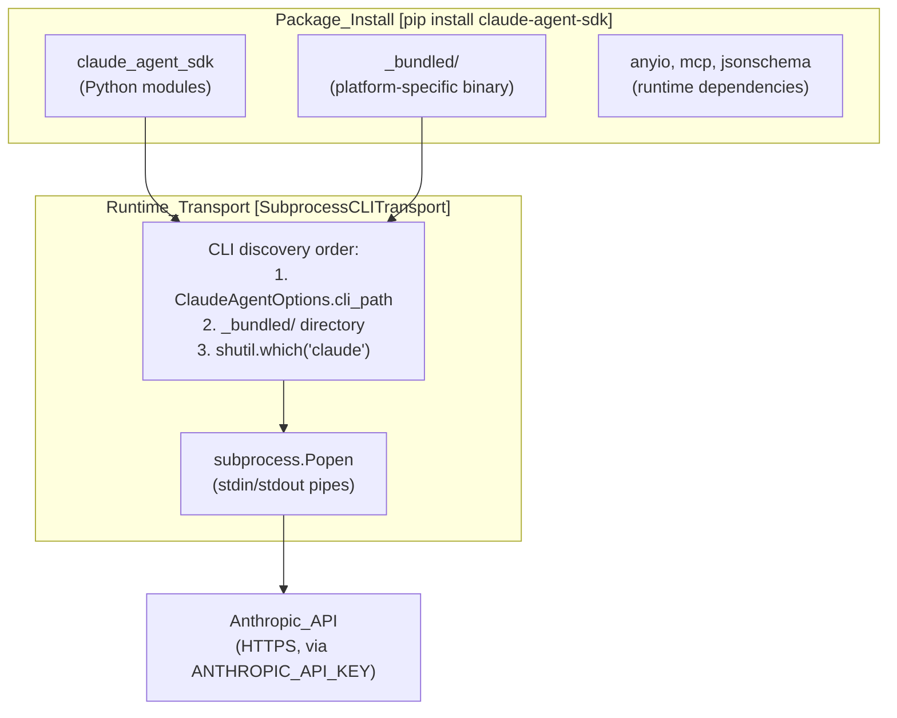
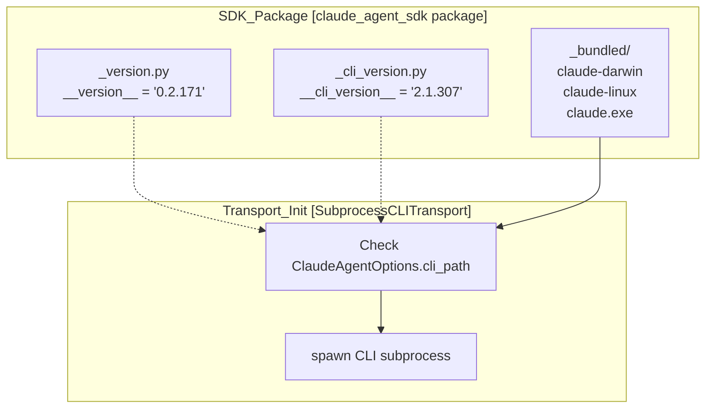

<!-- source: DeepWiki mcp.deepwiki.com · repo anthropics/claude-agent-sdk-python · page 1.2 Installation and Setup · fetched 2026-10-26 -->

# Installation and Setup

<details>
<summary>Relevant source files</summary>

The following files were used as context for generating this wiki page:

- [CHANGELOG.md](CHANGELOG.md)
- [pyproject.toml](pyproject.toml)
- [scripts/initial-setup.sh](scripts/initial-setup.sh)
- [scripts/pre-push](scripts/pre-push)
- [src/claude_agent_sdk/_cli_version.py](src/claude_agent_sdk/_cli_version.py)
- [src/claude_agent_sdk/_version.py](src/claude_agent_sdk/_version.py)
- [tests/test_changelog.py](tests/test_changelog.py)

</details>


This page explains package installation via `pip`, runtime dependencies (`anyio`, `sniffio`, `typing_extensions`, `mcp`, `jsonschema`), optional async backends, and the `ANTHROPIC_API_KEY` requirement. For information about configuring the SDK after installation, see [ClaudeAgentOptions Configuration Reference](). For details on versioning and release history, see [Version Information and Changelog]().

## Basic Installation

The SDK is distributed via PyPI and bundles the Claude Code CLI binary directly within the package structure:

```bash
pip install claude-agent-sdk
```

This command installs:
- The `claude-agent-sdk` Python package [pyproject.toml:6-7]()
- All core runtime dependencies [pyproject.toml:27-33]()
- The platform-specific bundled Claude Code CLI binary [pyproject.toml:62-64]()

No separate CLI installation is required. The SDK automatically resolves and executes the bundled CLI binary by default.

Sources: [pyproject.toml:5-33](), [pyproject.toml:62-64]()

## ANTHROPIC_API_KEY Requirement

The SDK communicates with the Anthropic API by spawning the bundled Claude CLI as a managed subprocess. The CLI process expects the `ANTHROPIC_API_KEY` environment variable to be present in its inherited environment before initialization:

```bash
export ANTHROPIC_API_KEY="sk-ant-..."
```

The SDK itself does not parse or validate the API key directly; the spawned subprocess reads it from the environment upon startup. If the key is omitted or malformed, the CLI process terminates or emits error messages that surface through the transport layer as execution exceptions.

Sources: [pyproject.toml:5-33]()

## Installation Architecture

**Diagram: Package Structure and CLI Discovery**



The transport layer resolves the executable using a tiered discovery strategy, checking `ClaudeAgentOptions.cli_path`, falling back to the bundled binary inside the package layout, and finally attempting system path resolution.

Sources: [pyproject.toml:62-64]()

## Python Version Requirements

The SDK officially supports Python 3.10 through 3.13 [pyproject.toml:10-23]():

| Python Version | Support Status | Notes |
|----------------|----------------|-------|
| 3.13 | ✅ Supported | Fully tested [pyproject.toml:23]() |
| 3.12 | ✅ Supported | Fully tested [pyproject.toml:22]() |
| 3.11 | ✅ Supported | Native typing features [pyproject.toml:21]() |
| 3.10 | ✅ Supported | Minimum required version [pyproject.toml:20]() |
| 3.9 and earlier | ❌ Not Supported | Incompatible |

The minimum version constraint is declared in `pyproject.toml` [pyproject.toml:10]():

```toml
requires-python = ">=3.10"
```

Sources: [pyproject.toml:10-25]()

## Understanding the Bundled CLI

**Diagram: Version Tracking and CLI Binary Layout**



The package version is defined in `_version.py` [src/claude_agent_sdk/_version.py:3](), while the exact bundled CLI version is pinned in `_cli_version.py` [src/claude_agent_sdk/_cli_version.py:3](). Upgrades to the bundled CLI accompany SDK releases [CHANGELOG.md:3-8]().

Sources: [src/claude_agent_sdk/_version.py:3](), [src/claude_agent_sdk/_cli_version.py:3](), [CHANGELOG.md:3-8]()

## Core Dependencies

The SDK depends on several core packages declared in `pyproject.toml` [pyproject.toml:27-33]():

| Dependency | Version Requirement | Purpose |
|------------|---------------------|---------|
| `anyio` | `>=4.0.0` | Async I/O abstraction supporting asyncio and trio [pyproject.toml:28]() |
| `sniffio` | `>=1.0.0` | Async backend detection [pyproject.toml:29]() |
| `typing_extensions` | `>=4.0.0` (Python <3.11) | Backport of typing constructs [pyproject.toml:30]() |
| `mcp` | `>=1.23.0,<3.0.0` | Model Context Protocol core types and server utilities [pyproject.toml:31]() |
| `jsonschema` | `>=4.20.0` | JSON schema validation for tool definitions [pyproject.toml:32]() |

**Conditional Backporting:**

`typing_extensions` is conditionally required for Python versions preceding 3.11 [pyproject.toml:30]():

```toml
"typing_extensions>=4.0.0; python_version<'3.11'"
```

**Async Backend Execution:**

Using `anyio` allows the SDK to run seamlessly under both `asyncio` and `trio` event loops [pyproject.toml:38](). 

Sources: [pyproject.toml:27-33](), [pyproject.toml:38]()

## Optional Dependencies

Optional dependency groups extend functionality for development, tracing, and storage examples [pyproject.toml:35-55]():

### Development Extra
```bash
pip install claude-agent-sdk[dev]
```
Includes testing and validation tools: `pytest` (`>=7.0.0`), `anyio[trio]` (`>=4.0.0`), `pytest-cov` (`>=4.0.0`), `mypy` (`>=1.0.0`), and `ruff` (`>=0.1.0`) [pyproject.toml:36-42]().

### OpenTelemetry Extra
```bash
pip install claude-agent-sdk[otel]
```
Enables distributed tracing instrumentation via `opentelemetry-api` (`>=1.20.0`) [pyproject.toml:43-45]().

### Examples Extra
```bash
pip install claude-agent-sdk[examples]
```
Installs drivers required for reference `SessionStore` adapters (`boto3`, `moto`, `redis`, `fakeredis`, `asyncpg`) [pyproject.toml:46-55]().

Sources: [pyproject.toml:35-55]()

## Verifying Installation

Verify the installed SDK version programmatically:

```python
import claude_agent_sdk
print(claude_agent_sdk.__version__)  # "0.2.171"
```

Run a simple query via `anyio` to verify correct environment setup and subprocess communication:

```python
import anyio
from claude_agent_sdk import query

async def main():
    async for message in query(prompt="What is 2 + 2?"):
        print(message)

anyio.run(main)
```

Sources: [src/claude_agent_sdk/_version.py:3]()

## Package Build Configuration

The package utilizes Hatchling as its build backend [pyproject.toml:1-3]():

```toml
[build-system]
requires = ["hatchling"]
build-backend = "hatchling.build"
```

Wheel targets package modules under `src/claude_agent_sdk`, whereas source distributions include tests, scripts, and examples [pyproject.toml:62-77]().

Sources: [pyproject.toml:1-77]()

---

