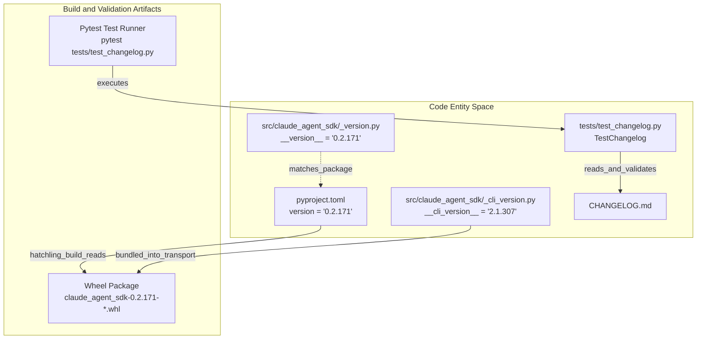
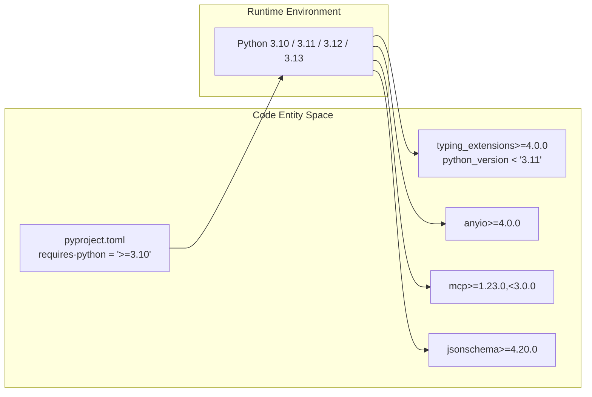

<!-- source: DeepWiki mcp.deepwiki.com · repo anthropics/claude-agent-sdk-python · page 1.3 Version Information and Changelog · fetched 2026-10-26 -->

# Version Information and Changelog

<details>
<summary>Relevant source files</summary>

The following files were used as context for generating this wiki page:

- [CHANGELOG.md](CHANGELOG.md)
- [pyproject.toml](pyproject.toml)
- [src/claude_agent_sdk/_cli_version.py](src/claude_agent_sdk/_cli_version.py)
- [src/claude_agent_sdk/_version.py](src/claude_agent_sdk/_version.py)
- [tests/test_changelog.py](tests/test_changelog.py)

</details>


This document provides technical details on version management for the `claude-agent-sdk` package, covering where SDK and bundled CLI versions are defined, how they are accessed programmatically, dependency constraints, and how the `CHANGELOG.md` is structured and validated.

For installation instructions, see [1.2 Installation and Setup](). For architectural details on how the transport layer utilizes the bundled CLI version, see [2.1 Architecture Overview]() and [2.4 Bundled CLI Version Management]().

---

## Current Versions

The SDK tracks two primary release versions independently, along with package metadata configured in build scripts.

| Component | Current Value | Source File |
|-----------|--------------|-------------|
| SDK Version (`__version__`) | `0.2.171` | [src/claude_agent_sdk/_version.py:3]() |
| Bundled CLI Version (`__cli_version__`) | `2.1.307` | [src/claude_agent_sdk/_cli_version.py:3]() |
| Package Build Version | `0.2.171` | [pyproject.toml:7]() |

The SDK version and the bundled Claude Code CLI version advance on separate cycles. Updates to the bundled CLI typically trigger patch releases of the SDK to incorporate the latest binary transport compatibility.

Sources: [src/claude_agent_sdk/_version.py:1-3](), [src/claude_agent_sdk/_cli_version.py:1-3](), [pyproject.toml:5-8](), [CHANGELOG.md:3-8]()

---

## Programmatic Version Access

Both version identifiers are exposed as module-level constants and can be imported directly at runtime for diagnostics, telemetry payloads, or capability negotiation:

```python
from claude_agent_sdk._version import __version__          # SDK version string (e.g. "0.2.171")
from claude_agent_sdk._cli_version import __cli_version__  # Bundled CLI version string (e.g. "2.1.307")
```

The runtime loader relies on `src/claude_agent_sdk/_version.py` as the authoritative source for package version introspection, while `src/claude_agent_sdk/_cli_version.py` dictates the expected version of the Claude Code CLI binary invoked by `SubprocessCLITransport`.

Sources: [src/claude_agent_sdk/_version.py:1-3](), [src/claude_agent_sdk/_cli_version.py:1-3]()

---

## Version Tracking Architecture

The following diagram maps the logical entities and files responsible for version definition, wheel packaging, and automated validation:



Sources: [src/claude_agent_sdk/_version.py:1-3](), [src/claude_agent_sdk/_cli_version.py:1-3](), [pyproject.toml:1-8](), [tests/test_changelog.py:5-85]()

---

## Version Compatibility Matrix

### Python Version Support

The SDK requires Python 3.10 or higher and declares explicit support up to Python 3.13 via PyPI classifiers in [pyproject.toml:15-25]().



### Dependency Specifications

The required runtime dependencies and their constraints are defined in [pyproject.toml:27-33]():

| Dependency | Version Constraint | Role in SDK |
|------------|-------------------|-------------|
| `anyio` | `>=4.0.0` | Asynchronous I/O abstraction layer supporting asyncio and Trio backends |
| `sniffio` | `>=1.0.0` | Automatic async library detection at runtime |
| `typing_extensions` | `>=4.0.0` (`python_version<'3.11'`) | Backports modern type hint primitives (e.g., `NotRequired`) |
| `mcp` | `>=1.23.0,<3.0.0` | Model Context Protocol core library |
| `jsonschema` | `>=4.20.0` | JSON Schema validation for tool inputs and options |

Optional dependency extras include `dev` (linting/testing tools), `otel` (`opentelemetry-api>=1.20.0`), and `examples` (database/storage drivers for session store reference adapters) [pyproject.toml:35-55]().

Sources: [pyproject.toml:10-55]()

---

## Changelog Structure and Validation

Changes to the SDK are recorded in `CHANGELOG.md`. The repository enforces formatting rules via automated tests implemented in `tests/test_changelog.py`.

### Automated Validation Rules

The `TestChangelog` test suite verifies the following invariants:
1. **Existence**: `CHANGELOG.md` must exist in the root directory [tests/test_changelog.py:9-10]().
2. **Header Prefix**: The file must start with `# Changelog` [tests/test_changelog.py:12-16]().
3. **Version Format**: Version headers must match the pattern `## \d+\.\d+\.\d+(?:\s+\(\d{4}-\d{2}-\d{2}\))?` [tests/test_changelog.py:22-31]().
4. **Descending Order**: Version numbers must appear in strict descending semantic order [tests/test_changelog.py:63-78]().
5. **Bullet Points**: Every version section must contain at least one non-empty bullet point (`- `) [tests/test_changelog.py:34-85]().

Sources: [tests/test_changelog.py:1-85](), [CHANGELOG.md:1-10]()

---

## Recent Release History

The following summary highlights key updates from recent entries in `CHANGELOG.md`:

- **Version 0.2.171**: Updated bundled Claude CLI to version `2.1.307` [CHANGELOG.md:3-8]().
- **Version 0.2.170**: Fixed parallel tool calls missing from session messages in `get_session_messages` and `get_session_messages_from_store`; updated bundled Claude CLI to version `2.1.306`; migrated PyPI publishing to trusted publishing via GitHub OIDC [CHANGELOG.md:9-19]().
- **Version 0.2.169**: Clarified hook event documentation; updated bundled Claude CLI to version `2.1.305` [CHANGELOG.md:20-30]().
- **Version 0.2.166**: Added typed output classes for hook implementations and fully typed `SystemInitData` TypedDict; fixed `SandboxSettings.ignoreViolations` type schema; updated bundled Claude CLI to version `2.1.299` [CHANGELOG.md:43-57]().

Sources: [CHANGELOG.md:3-60]()

---

