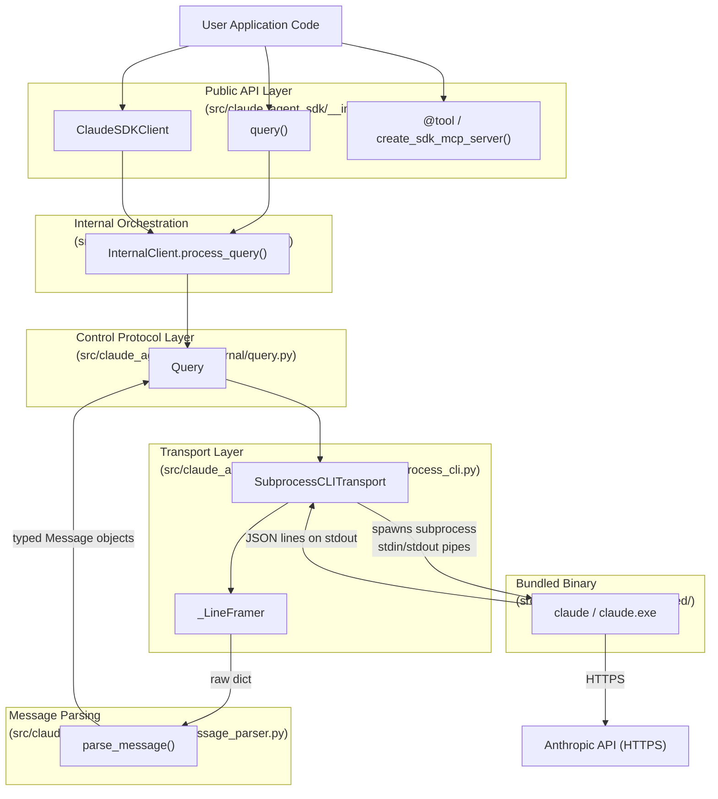
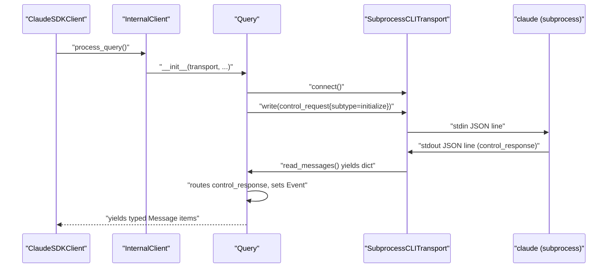

<!-- source: DeepWiki mcp.deepwiki.com · repo anthropics/claude-agent-sdk-python · page 2.1 Architecture Overview · fetched 2026-10-26 -->

# Architecture Overview

Relevant source files

The following files were used as context for generating this wiki page:

- [e2e-tests/test_run_end.py](e2e-tests/test_run_end.py)
- [src/claude_agent_sdk/_internal/client.py](src/claude_agent_sdk/_internal/client.py)
- [src/claude_agent_sdk/_internal/query.py](src/claude_agent_sdk/_internal/query.py)
- [tests/test_run_end_subprocess.py](tests/test_run_end_subprocess.py)

This page describes the full layered architecture of the `claude-agent-sdk` Python package: how user code flows down through the public API, the internal orchestration layer, the bidirectional control protocol layer, the subprocess transport, and ultimately reaches the bundled Claude CLI binary and the Anthropic API.

For field-level documentation of `ClaudeAgentOptions`, see [2.3](). For details on the message type hierarchy, see [2.2](). For the transport internals, see [4.1]() and [4.2]().

---

## Purpose and Scope

The SDK does not call the Anthropic API directly. Instead, it delegates all API communication to a bundled Claude CLI binary, communicating with it over a subprocess's `stdin`/`stdout` pipes using a JSON-line streaming protocol [src/claude_agent_sdk/_internal/transport/subprocess_cli.py:1-3](). This architecture means:

- The SDK is a thin orchestration layer above the CLI binary.
- Business logic for model selection, tool use, permission gating, session management, and cost accounting lives in the CLI.
- The Python SDK's role is to spawn the CLI via `SubprocessCLITransport` [src/claude_agent_sdk/_internal/transport/subprocess_cli.py:111-135](), serialize configuration and prompts into the wire format via `Query` [src/claude_agent_sdk/_internal/query.py:146-176](), deserialize typed responses using `parse_message` [src/claude_agent_sdk/_internal/message_parser.py:1-30](), and manage the bidirectional control protocol.

Sources: [src/claude_agent_sdk/_internal/transport/subprocess_cli.py:1-3](), [src/claude_agent_sdk/_internal/query.py:146-176]()

---

## Layer Overview

### System to Code Entity Mapping

Sources: [src/claude_agent_sdk/_internal/client.py:28-72](), [src/claude_agent_sdk/_internal/query.py:146-176](), [src/claude_agent_sdk/_internal/transport/subprocess_cli.py:111-145]()

---

## Layers in Detail

### Layer 1 — Public API and Internal Client

The public entry points delegate execution to `InternalClient` [src/claude_agent_sdk/_internal/client.py:28-40]() located in `client.py`:

| Symbol | Location | Role |
|--------|----------|------|
| `query()` | `query.py` | Async generator for one-shot queries, wrapping `ClaudeSDKClient`. |
| `ClaudeSDKClient` | `client.py` | Stateful bidirectional session managing connection, queries, and control methods. |
| `InternalClient` | `client.py` | Coordinates session resume materialization, configuration validation, and `Query` setup [src/claude_agent_sdk/_internal/client.py:34-72](). |
| `@tool` | `__init__.py` | Decorator creating an `SdkMcpTool` dataclass from a Python async function. |

Sources: [src/claude_agent_sdk/_internal/client.py:28-72](), [src/claude_agent_sdk/_internal/query.py:61-102]()

---

### Layer 2 — Configuration (`ClaudeAgentOptions`)

`ClaudeAgentOptions` (defined in `types.py`) is the single configuration object threaded through every layer. It holds parameters such as model selection, tools, permissions, hooks, and MCP server definitions. It is consumed by `SubprocessCLITransport` to construct subprocess command arguments and environment variables [src/claude_agent_sdk/_internal/transport/subprocess_cli.py:117-150]().

Sources: [src/claude_agent_sdk/_internal/transport/subprocess_cli.py:117-150](), [src/claude_agent_sdk/types.py:1-50]()

---

### Layer 3 — Control Protocol Layer (`Query`)

`Query` ([src/claude_agent_sdk/_internal/query.py:146]()) manages bidirectional control communication over `Transport`:

- **Initialization handshake**: sends an `initialize` control request containing hooks, skills, and agent definitions [src/claude_agent_sdk/_internal/query.py:172-248]().
- **Outgoing control requests**: handles methods like `interrupt()`, `set_permission_mode()`, `set_model()`, and `rewind_files()`.
- **Incoming control request handling**: processes subtypes such as `can_use_tool`, `hook_callback`, and `mcp_message` [src/claude_agent_sdk/_internal/query.py:344-389]().
- **Message routing**: separates control traffic from regular SDK messages, placing regular messages into an `anyio` memory object stream [src/claude_agent_sdk/_internal/query.py:121-123]().

### Query Control Flow

Sources: [src/claude_agent_sdk/_internal/client.py:73-156](), [src/claude_agent_sdk/_internal/query.py:146-248]()

---

### Layer 4 — Transport Layer (`SubprocessCLITransport`)

`SubprocessCLITransport` ([src/claude_agent_sdk/_internal/transport/subprocess_cli.py:111]()) manages the subprocess lifecycle:

| Method | Responsibility |
|--------|----------------|
| `_find_cli()` | Locates the CLI binary: bundled binary → `shutil.which("claude")` → fixed fallback paths [src/claude_agent_sdk/_internal/transport/subprocess_cli.py:142-173](). |
| `_build_command()` | Translates `ClaudeAgentOptions` fields into CLI arguments (e.g., `--output-format stream-json`). |
| `connect()` | Spawns subprocess via `anyio.open_process()`, validates CLI version, and opens pipes. |
| `write(data)` | Writes a JSON line to subprocess stdin, protected by an `anyio.Lock` [src/claude_agent_sdk/_internal/transport/subprocess_cli.py:140-140](). |
| `read_messages()` | Uses `_LineFramer` to reassemble complete JSON lines from raw stream chunks. |

Sources: [src/claude_agent_sdk/_internal/transport/subprocess_cli.py:50-188]()

---

### Layer 5 — Message Parsing and Buffering

The SDK utilizes `_LineFramer` to parse NDJSON output streams from the CLI stdout, handling chunked reads and buffering constraints robustly. Parsed dictionaries are passed to `parse_message()` to instantiate strongly-typed `Message` objects [src/claude_agent_sdk/_internal/message_parser.py:1-30]().

Sources: [src/claude_agent_sdk/_internal/transport/subprocess_cli.py:50-85](), [src/claude_agent_sdk/_internal/message_parser.py:1-30]()

---

### Layer 6 — Bundled CLI Binary

The Claude CLI binary resides in `src/claude_agent_sdk/_bundled/claude` (or `claude.exe` on Windows), tracking versions via `_cli_version.py` [src/claude_agent_sdk/_cli_version.py:3-3](). On connection, `SubprocessCLITransport` checks compatibility against `MINIMUM_CLAUDE_CODE_VERSION` [src/claude_agent_sdk/_internal/transport/subprocess_cli.py:31-31]().

Sources: [src/claude_agent_sdk/_cli_version.py:3-3](), [src/claude_agent_sdk/_internal/transport/subprocess_cli.py:31-31]()

---

## Key Design Decisions

| Decision | Rationale |
|----------|-----------|
| CLI subprocess abstraction | Avoids duplicating complex Anthropic API integration logic and session handling in Python. |
| Internal streaming mode | Enforces streaming mode internally to allow rich configuration (agents, hooks) via `initialize` requests [src/claude_agent_sdk/_internal/client.py:138-142](). |
| `anyio` memory object streams in `Query` | Decouples background message-reading coroutines from consumer iteration. |
| `anyio.Lock` on `write()` | Prevents concurrent write corruption on subprocess stdin pipes [src/claude_agent_sdk/_internal/transport/subprocess_cli.py:140-140](). |

Sources: [src/claude_agent_sdk/_internal/client.py:138-142](), [src/claude_agent_sdk/_internal/query.py:121-123](), [src/claude_agent_sdk/_internal/transport/subprocess_cli.py:140-140]()

---

