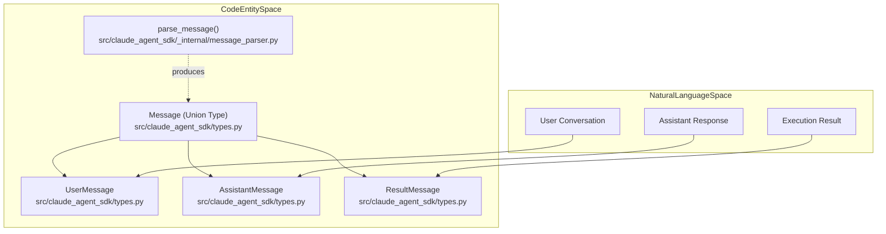
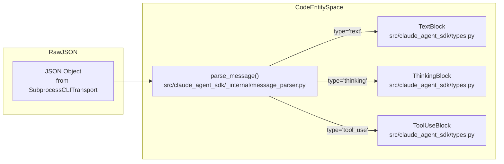
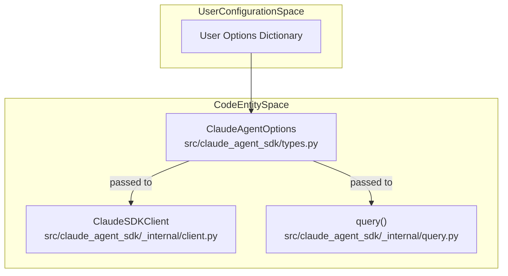

<!-- source: DeepWiki mcp.deepwiki.com · repo anthropics/claude-agent-sdk-python · page 2.2 Type System and Message Architecture · fetched 2026-10-26 -->

# Type System and Message Architecture

<details>
<summary>Relevant source files</summary>

The following files were used as context for generating this wiki page:

- [e2e-tests/test_verbatim_prompts.py](e2e-tests/test_verbatim_prompts.py)
- [src/claude_agent_sdk/types.py](src/claude_agent_sdk/types.py)
- [tests/test_types.py](tests/test_types.py)
- [tests/test_verbatim_prompts.py](tests/test_verbatim_prompts.py)

</details>


## Purpose and Scope

This document provides a technical reference for the SDK's type system, covering all message types, content block subtypes, configuration objects, and control protocol structures defined in `types.py`. The SDK uses Python dataclasses and `TypedDict`s to provide a strongly-typed API surface that serves as the contract between all SDK layers and the underlying JSON protocol with the Claude CLI.

The type system is designed for forward compatibility; the message parser is explicitly tested to return `None` for unknown message types rather than crashing, allowing the SDK to operate with newer CLI versions that might introduce new event types.

Sources: `[src/claude_agent_sdk/types.py:1-74]`, `[tests/test_rate_limit_event_repro.py:85-94]`

## Message Type Hierarchy

The SDK defines a discriminated union of message types that represent all communication between the application, SDK, and Claude CLI. These types are parsed from JSON frames in `_internal/message_parser.py`.

### Core Message Union

```python
Message = (
    UserMessage
    | AssistantMessage
    | SystemMessage
    | ResultMessage
    | StreamEvent
    | TaskStartedMessage
    | TaskProgressMessage
    | TaskNotificationMessage
    | RateLimitEvent
    | HookEventMessage
    | MirrorErrorMessage
)
```

Diagram: Message Union to Code Entities


Sources: `[src/claude_agent_sdk/types.py:607-618]`, `[src/claude_agent_sdk/_internal/message_parser.py:34-195]`

### UserMessage

Represents input from the user or application to Claude. Can contain plain text or structured content blocks.

| Field | Type | Description |
|-------|------|-------------|
| `content` | `str \| list[ContentBlock]` | User input as text or structured blocks |
| `uuid` | `str \| None` | Message identifier for file checkpointing |
| `parent_tool_use_id` | `str \| None` | Tool use ID if message is from a subagent |
| `tool_use_result` | `dict[str, Any] \| None` | Metadata about tool execution |

Sources: `[src/claude_agent_sdk/types.py:566-572]`, `[tests/test_message_parser.py:30-166]`

### AssistantMessage

Represents Claude's responses, including text, tool invocations, and reasoning.

| Field | Type | Description |
|-------|------|-------------|
| `content` | `list[ContentBlock]` | Always a list of content blocks |
| `model` | `str` | Model identifier |
| `parent_tool_use_id` | `str \| None` | Tool use ID if in subagent context |
| `error` | `AssistantMessageError \| None` | API error type if request failed |
| `usage` | `dict[str, Any] \| None` | Token usage for this specific message |

Sources: `[src/claude_agent_sdk/types.py:555-585]`

### RateLimitEvent

A specialized message type emitted when rate limit status changes.

| Field | Type | Description |
|-------|------|-------------|
| `rate_limit_info` | `RateLimitInfo` | Detailed status and reset times |
| `session_id` | `str` | Associated session |

Sources: `[src/claude_agent_sdk/types.py:255-285]`, `[tests/test_rate_limit_event_repro.py:19-47]`

## Content Block Types

Content blocks are the atomic units within message content.

### ContentBlock Union

```python
ContentBlock = (
    TextBlock 
    | ThinkingBlock 
    | ToolUseBlock 
    | ToolResultBlock 
    | ServerToolUseBlock 
    | ServerToolResultBlock
)
```

Diagram: Content Block Parsing Flow


Sources: `[src/claude_agent_sdk/types.py:517-551]`, `[src/claude_agent_sdk/_internal/message_parser.py:128-171]`

### ThinkingBlock

Extended thinking output when using models with reasoning capabilities.

| Field | Type | Description |
|-------|------|-------------|
| `thinking` | `str` | Claude's internal reasoning string |
| `signature` | `str` | Cryptographic signature for the thinking block |

Sources: `[src/claude_agent_sdk/types.py:525-530]`, `[tests/test_types.py:91-99]`

## Configuration Type System

The SDK uses `ClaudeAgentOptions` as the central configuration object.

### ClaudeAgentOptions Structure

Diagram: Configuration Mapping to Code Entities


Sources: `[src/claude_agent_sdk/types.py:622-686]`

### System Prompt Presets
The SDK supports advanced system prompt configurations via `SystemPromptPreset`, allowing dynamic section stripping for cross-user prompt caching, as well as `SystemPromptFile` for loading prompts from disk.

Sources: `[src/claude_agent_sdk/types.py:36-87]`

## Control Protocol Types

The control protocol enables bidirectional communication where the CLI sends requests to the SDK for tool permissions, hook execution, or MCP routing.

### SDKControlRequest Union

The `SDKControlRequest` is a `TypedDict` containing a `request_id` and a nested `request` object.

| Subtype | Purpose |
|---------|---------|
| `interrupt` | CLI notification to stop processing |
| `can_use_tool` | Request for tool permission |
| `initialize` | Registration of hooks and capabilities |
| `hook_callback` | Triggering a registered lifecycle hook |
| `mcp_message` | Routing messages to in-process SDK MCP servers |

Sources: `[src/claude_agent_sdk/types.py:689-743]`

### Permission Updates

Permissions can be dynamically updated via `PermissionUpdate` objects. These objects support operations like `addRules`, `setMode`, and `addDirectories`, and include logic to serialize to the TypeScript-compatible wire format.

Sources: `[src/claude_agent_sdk/types.py:121-193]`, `[tests/test_types.py:35-74]`

## Type Discrimination and Parsing

The `parse_message` function in `_internal/message_parser.py` serves as the primary entry point for converting raw JSON from the CLI stdout into the SDK's type hierarchy.

- **Hook Events:** Messages with `type: system` and subtypes `hook_started` or `hook_response` are routed to `HookEventMessage`.
- **System Subtypes:** Generic `system` messages are further discriminated into `TaskStartedMessage`, `TaskProgressMessage`, and `TaskNotificationMessage`.
- **Error Handling:** Missing required fields raise a `MessageParseError`.
- **Forward Compatibility:** Unknown `type` fields return `None` to ensure resilience against newer CLI payloads.

Sources: `[src/claude_agent_sdk/_internal/message_parser.py:34-255]`, `[tests/test_message_parser.py:27-166]`

---

