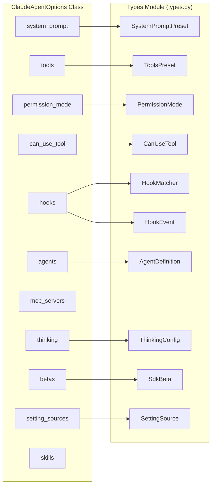

<!-- source: DeepWiki mcp.deepwiki.com · repo anthropics/claude-agent-sdk-python · page 2.3 ClaudeAgentOptions Configuration Reference · fetched 2026-10-26 -->

# ClaudeAgentOptions Configuration Reference

Relevant source files

The following files were used as context for generating this wiki page:

- [examples/system_prompt.py](examples/system_prompt.py)
- [src/claude_agent_sdk/types.py](src/claude_agent_sdk/types.py)
- [tests/test_option_warnings.py](tests/test_option_warnings.py)

`ClaudeAgentOptions` is the single configuration object passed to both `query()` and `ClaudeSDKClient`. Every behavioral setting — model selection, tool access, permission callbacks, session management, hooks, sandbox, and transport details — is expressed through fields on this dataclass.

This page provides a comprehensive, field-by-field reference for every attribute of `ClaudeAgentOptions`. For how options flow into the subprocess command line, see [Subprocess CLI Transport](4.1). For how `can_use_tool` and `hooks` operate at runtime, see [Permission System](5.2) and [Lifecycle Hooks](5.3). For session-level concepts like `resume` and `fork_session`, see [Session Management](6.1).

---

## Location and Type

`ClaudeAgentOptions` is defined as a Python `dataclass` in `src/claude_agent_sdk/types.py` [src/claude_agent_sdk/types.py:732-800](). It is re-exported from `claude_agent_sdk.__init__` and serves as the primary configuration surface for all SDK entry points.

The following diagram maps the dataclass fields to the CLI flags and internal subsystems they control, bridging natural language requirements to precise code entities.

---

## Field-to-Subsystem Map

**Diagram: ClaudeAgentOptions field routing to CLI flags and internal handlers**

```mermaid
graph TD
    CAO["ClaudeAgentOptions"]

    subgraph cli_flags["CLI Flags (SubprocessCLITransport._build_command)"]
        F1["--system-prompt / --append-system-prompt / --system-prompt-file"]
        F2["--allowedTools / --disallowedTools / --tools"]
        F3["--model / --fallback-model"]
        F4["--permission-mode"]
        F5["--max-turns"]
        F6["--continue / --resume"]
        F7["--max-thinking-tokens / --thinking / --effort"]
        F8["--mcp-config"]
        F9["--settings"]
        F10["--add-dir"]
        F11["--output-format"]
        F12["--betas"]
        F13["--max-budget-tokens"]
        F14["--skills"]
        F15["--strict-mcp-config"]
        F16["--include-hook-events"]
    end

    subgraph control_protocol["Control Protocol (Query._handle_control_request)"]
        CP1["SDKControlInitializeRequest"]
        CP2["can_use_tool callback"]
        CP3["SDKHookCallbackRequest"]
    end

    subgraph transport_config["Transport Configuration"]
        TC1["cli_path resolution"]
        TC2["cwd for subprocess"]
        TC3["env vars merge"]
        TC4["max_buffer_size guard"]
        TC5["user override"]
        TC6["stderr callback"]
    end

    CAO --> F1
    CAO --> F2
    CAO --> F3
    CAO --> F4
    CAO --> F5
    CAO --> F6
    CAO --> F7
    CAO --> F8
    CAO --> F9
    CAO --> F10
    CAO --> F11
    CAO --> F12
    CAO --> F13
    CAO --> F14
    CAO --> F15
    CAO --> F16

    CAO --> CP1
    CAO --> CP2
    CAO --> CP3

    CAO --> TC1
    CAO --> TC2
    CAO --> TC3
    CAO --> TC4
    CAO --> TC5
    CAO --> TC6
```

Sources: [src/claude_agent_sdk/types.py:732-800](), [src/claude_agent_sdk/_internal/transport/subprocess_cli.py:190-300](), [tests/test_transport.py:67-126]()

---

## Complete Field Reference

### System Prompt

| Field | Type | Default | CLI flag |
|-------|------|---------|----------|
| `system_prompt` | `str \| SystemPromptPreset \| SystemPromptFile \| None` | `None` | `--system-prompt`, `--append-system-prompt`, or `--system-prompt-file` |

Controls the system prompt sent to Claude.

- **`str`**: Passed verbatim as `--system-prompt <value>` [src/claude_agent_sdk/_internal/transport/subprocess_cli.py:196-197]().
- **`SystemPromptPreset`**: Uses the built-in Claude Code system prompt. If an `append` key is present, `--append-system-prompt <value>` is added [src/claude_agent_sdk/_internal/transport/subprocess_cli.py:199-205](). The `exclude_dynamic_sections` field allows stripping per-user content (git status, working directory) to improve prompt-caching hits across users [src/claude_agent_sdk/types.py:43-54]().
- **`SystemPromptFile`**: Uses a prompt stored in a file via `--system-prompt-file <path>` [src/claude_agent_sdk/_internal/transport/subprocess_cli.py:207-209]().
- **`None`** (default): Passes `--system-prompt ""` — an empty system prompt [src/claude_agent_sdk/_internal/transport/subprocess_cli.py:194-195]().

`SystemPromptPreset` and `SystemPromptFile` are defined in `src/claude_agent_sdk/types.py` [src/claude_agent_sdk/types.py:37-87]().

Sources: [src/claude_agent_sdk/types.py:37-87](), [src/claude_agent_sdk/_internal/transport/subprocess_cli.py:190-215](), [examples/system_prompt.py:1-87]()

---

### Tool Selection and Skills

| Field | Type | Default | CLI flag |
|-------|------|---------|----------|
| `tools` | `list[str] \| ToolsPreset \| None` | `None` | `--tools` |
| `allowed_tools` | `list[str]` | `[]` | `--allowedTools` |
| `disallowed_tools` | `list[str]` | `[]` | `--disallowedTools` |
| `skills` | `Literal["all"] \| list[str] \| None` | `None` | `--skills` |

- **`tools`**: Controls the base set of available built-in tools [src/claude_agent_sdk/_internal/transport/subprocess_cli.py:217-225]().
- **`allowed_tools`**: Comma-joined list passed as `--allowedTools` [src/claude_agent_sdk/_internal/transport/subprocess_cli.py:228-230]().
- **`disallowed_tools`**: Comma-joined list passed as `--disallowedTools` [src/claude_agent_sdk/_internal/transport/subprocess_cli.py:233-235]().
- **`skills`**: Configures high-level capabilities. Passed as a comma-separated list to `--skills` [src/claude_agent_sdk/_internal/transport/subprocess_cli.py:291-293](). Setting this to `[]` suppresses all skills [src/claude_agent_sdk/types.py:795]().

Sources: [src/claude_agent_sdk/types.py:732-800](), [src/claude_agent_sdk/_internal/transport/subprocess_cli.py:217-295](), [tests/test_option_warnings.py:155-171]()

---

### Model Selection

| Field | Type | Default | CLI flag |
|-------|------|---------|----------|
| `model` | `str \| None` | `None` | `--model` |
| `fallback_model` | `str \| None` | `None` | `--fallback-model` |

- **`model`**: Sets the primary model identifier [src/claude_agent_sdk/_internal/transport/subprocess_cli.py:238-239]().
- **`fallback_model`**: Provides an alternative model if the primary is unavailable [src/claude_agent_sdk/_internal/transport/subprocess_cli.py:241-242]().

Sources: [src/claude_agent_sdk/_internal/transport/subprocess_cli.py:238-245]()

---

### Permission Mode and Callbacks

| Field | Type | Default | CLI flag |
|-------|------|---------|----------|
| `permission_mode` | `PermissionMode \| None` | `None` | `--permission-mode` |
| `can_use_tool` | `CanUseTool \| None` | `None` | N/A |

- **`permission_mode`**: A `PermissionMode` literal defined as `"default"`, `"acceptEdits"`, `"plan"`, `"bypassPermissions"`, `"dontAsk"`, or `"auto"` [src/claude_agent_sdk/types.py:25-27]().
- **`can_use_tool`**: An async callable invoked by the control protocol whenever the CLI requests permission to execute a tool [src/claude_agent_sdk/types.py:226-228]().

Sources: [src/claude_agent_sdk/types.py:25-27](), [tests/test_option_warnings.py:1-35]()

---

### Lifecycle Hooks and Agents

| Field | Type | Default |
|-------|------|---------|
| `hooks` | `dict[HookEvent, list[HookMatcher]] \| None` | `None` |
| `agents` | `dict[str, AgentDefinition] \| None` | `None` |
| `include_hook_events` | `bool` | `False` |

- **`hooks`**: Maps event names (e.g., `"PreToolUse"`) to lists of matchers [src/claude_agent_sdk/types.py:232-244]().
- **`agents`**: Defines inline sub-agents with specific prompts, tools, and configurations [src/claude_agent_sdk/types.py:108-127]().
- **`include_hook_events`**: When `True`, passes the `--include-hook-events` flag to the CLI, ensuring hook telemetry is streamed [src/claude_agent_sdk/_internal/transport/subprocess_cli.py:287-289]().

Sources: [src/claude_agent_sdk/types.py:108-127](), [src/claude_agent_sdk/_internal/transport/subprocess_cli.py:287-289]()

---

### Session and Resource Limits

| Field | Type | Default | CLI flag |
|-------|------|---------|----------|
| `continue_conversation` | `bool` | `False` | `--continue` |
| `resume` | `str \| None` | `None` | `--resume <session_id>` |
| `max_turns` | `int \| None` | `None` | `--max-turns` |
| `max_budget_usd` | `float \| None` | `None` | `--max-budget-usd` |
| `task_budget` | `TaskBudget \| None` | `None` | `--max-budget-tokens` |

- **`max_budget_usd`**: Hard spending limit in USD for the session [src/claude_agent_sdk/_internal/transport/subprocess_cli.py:300-301]().
- **`task_budget`**: Token-based budget sent via API beta headers [src/claude_agent_sdk/types.py:88-98]().

Sources: [src/claude_agent_sdk/types.py:88-98](), [src/claude_agent_sdk/_internal/transport/subprocess_cli.py:300-310]()

---

### Thinking Configuration

| Field | Type | Default | CLI flag |
|-------|------|---------|----------|
| `thinking` | `ThinkingConfig \| None` | `None` | `--thinking` |
| `effort` | `EffortLevel \| int \| None` | `None` | `--effort` |
| `max_thinking_tokens` | `int \| None` | `None` | `--max-thinking-tokens` |

- **`thinking`**: Handles adaptive or fixed token budgets for reasoning models [src/claude_agent_sdk/types.py:715-728]().
- **`effort`**: Specifies reasoning effort level (`"low"`, `"medium"`, `"high"`, `"xhigh"`, `"max"`) [src/claude_agent_sdk/types.py:37]().

Sources: [src/claude_agent_sdk/types.py:37](), [src/claude_agent_sdk/types.py:715-728]()

---

### Environment and Sources

| Field | Type | Default | CLI flag |
|-------|------|---------|----------|
| `setting_sources` | `list[SettingSource] \| None` | `None` | N/A |
| `mcp_servers` | `dict[str, McpServerConfig] \| str \| Path` | `{}` | `--mcp-config` |
| `strict_mcp_config` | `bool` | `False` | `--strict-mcp-config` |

- **`setting_sources`**: Controls which settings configuration files are loaded (`"user"`, `"project"`, `"local"`) [src/claude_agent_sdk/types.py:33]().
- **`strict_mcp_config`**: Forces the CLI to restrict available MCP servers exclusively to those provided via `mcp_servers`, ignoring external environment settings [src/claude_agent_sdk/_internal/transport/subprocess_cli.py:244-245]().

Sources: [src/claude_agent_sdk/types.py:33](), [src/claude_agent_sdk/_internal/transport/subprocess_cli.py:244-245]()

---

## Field-to-Code Entity Diagram

**Diagram: ClaudeAgentOptions field mapping to type definitions in types.py**

Sources: [src/claude_agent_sdk/types.py:1-800](), [src/claude_agent_sdk/_internal/transport/subprocess_cli.py:190-300](), [tests/test_types.py:135-214]()

---

