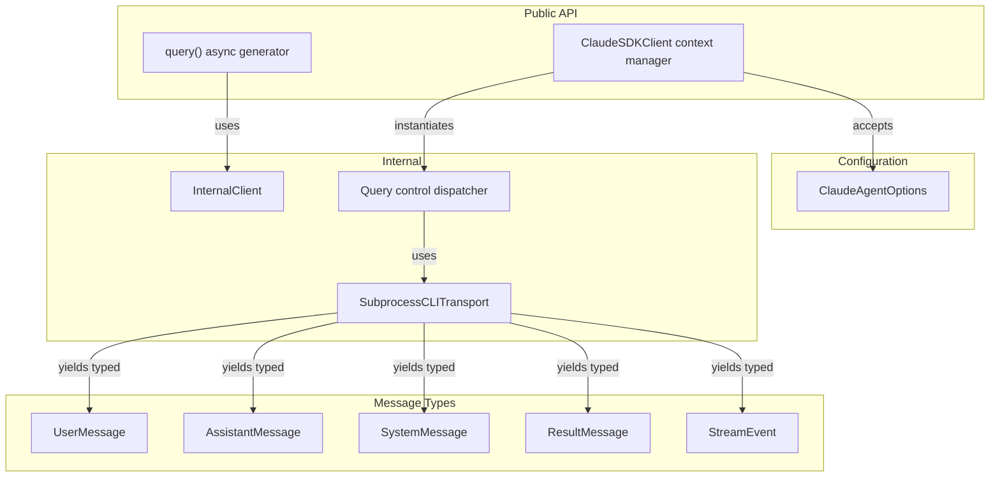
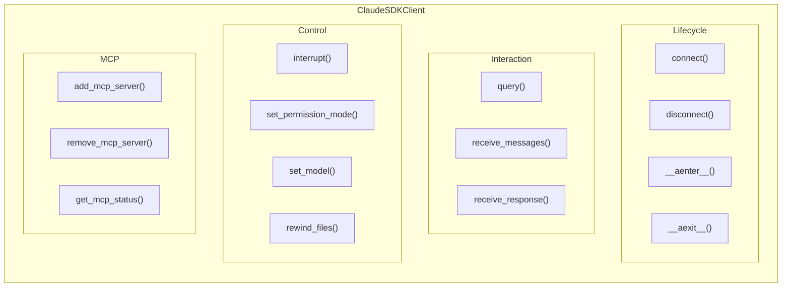

<!-- source: DeepWiki mcp.deepwiki.com · repo anthropics/claude-agent-sdk-python · page 3 Basic Usage · fetched 2026-10-26 -->

# Basic Usage

Relevant source files

The following files were used as context for generating this wiki page:

- [src/claude_agent_sdk/_internal/transport/__init__.py](src/claude_agent_sdk/_internal/transport/__init__.py)
- [src/claude_agent_sdk/query.py](src/claude_agent_sdk/query.py)
- [tests/test_close_cancellation.py](tests/test_close_cancellation.py)

This section covers the two primary entry points for interacting with Claude through the SDK — the `query()` async generator and the `ClaudeSDKClient` stateful session client — along with the message and content block types that both return.

For detailed reference on configuration options, see [ClaudeAgentOptions Configuration Reference](#2.3). For defining custom tools, see [Custom Tools (SDK MCP Servers)](#5.1). For error handling patterns, see [Error Handling Patterns](#7.3).

---

## Choosing Between `query()` and `ClaudeSDKClient`

The SDK exposes two distinct interaction models. The right choice depends on the complexity of the interaction required.

| Capability | `query()` | `ClaudeSDKClient` |
|---|---|---|
| Single-turn or simple iteration | ✓ | ✓ |
| Custom in-process tools (`@tool`) | — | ✓ |
| Lifecycle hooks | — | ✓ |
| Interrupt a running query | — | ✓ |
| Change permission mode mid-session | — | ✓ |
| Change model mid-session | — | ✓ |
| Rewind file state | — | ✓ |
| Async context manager | — | ✓ |
| Minimal boilerplate | ✓ | — |

`query()` is a convenience wrapper that internally instantiates an `InternalClient` to process the request [src/claude_agent_sdk/query.py:121-126](). While `query()` is ideal for fire-and-forget automation or simple scripts [src/claude_agent_sdk/query.py:30-35](), `ClaudeSDKClient` is preferred for building interactive applications, maintaining conversation context, or providing real-time user interrupts [src/claude_agent_sdk/client.py:40-46]().

Sources: [src/claude_agent_sdk/query.py:11-43](), [src/claude_agent_sdk/query.py:124-131]()

---

## How Both APIs Fit Into the System

The following diagram maps the public API surface to the internal code entities.

**Diagram: Public API to Internal Layer Mapping**

Sources: [src/claude_agent_sdk/query.py:124-131]()

---

## `query()` — Simple Async Generator

`query()` is the simplest way to start a conversation. It handles the lifecycle of the connection and yields messages as they arrive from the CLI. It supports both simple string prompts and complex `AsyncIterable` message streams [src/claude_agent_sdk/query.py:45-53]().

For full details on signature, prompt types, options, and yielded messages, see [query() Function](#3.1).

Sources: [src/claude_agent_sdk/query.py:11-132]()

---

## `ClaudeSDKClient` — Stateful Session Client

`ClaudeSDKClient` manages a persistent bidirectional session. It is required for advanced features like `can_use_tool` callbacks, `hooks`, and mid-session control requests.

**Diagram: ClaudeSDKClient Method Surface**

For the full method reference and state management details, see [ClaudeSDKClient](#3.2).

Sources: [src/claude_agent_sdk/_internal/transport/__init__.py:8-70]()

---

## Message Types and Content Blocks

All communication with Claude is typed via the `Message` union and `ContentBlock` variants. These types act as the strict contract between the CLI subprocess transport and user-facing application code.

For complete field definitions of each concrete message type and ContentBlock subtype, plus the `parse_message` dispatcher, see [Message Types and Content Blocks](#3.3).

Sources: [src/claude_agent_sdk/query.py:8-10]()

---

