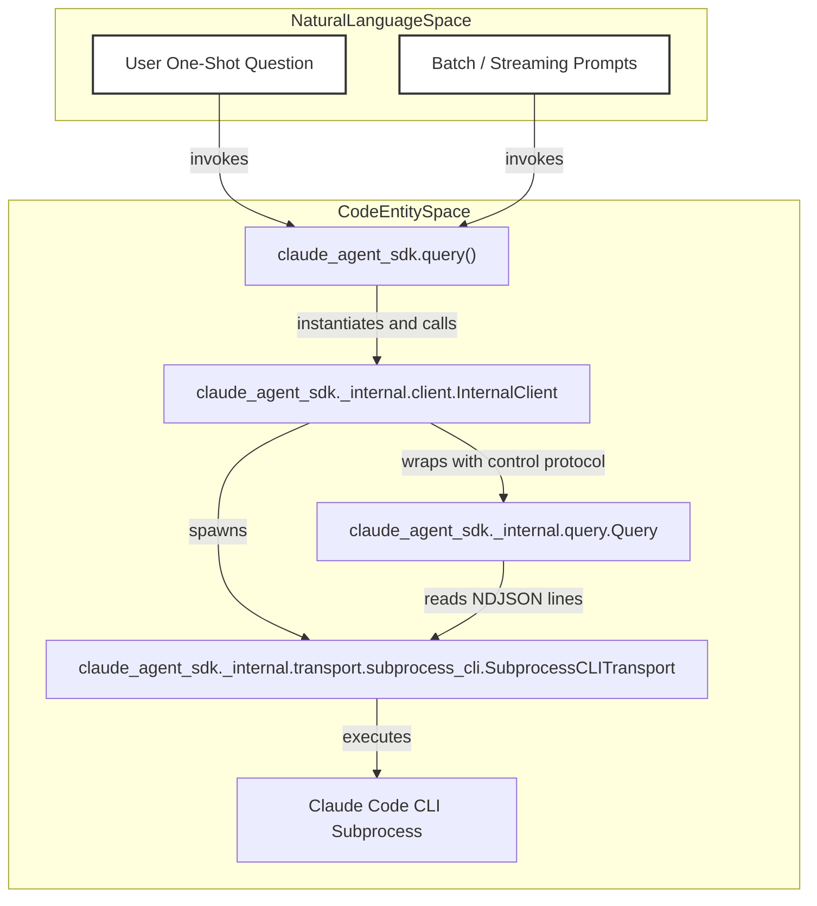
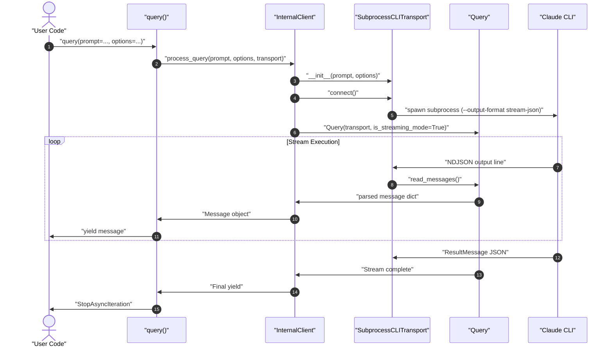

<!-- source: DeepWiki mcp.deepwiki.com · repo anthropics/claude-agent-sdk-python · page 3.1 query() Function · fetched 2026-10-26 -->

# query() Function

<details>
<summary>Relevant source files</summary>

The following files were used as context for generating this wiki page:

- [README.md](README.md)
- [src/claude_agent_sdk/_internal/transport/__init__.py](src/claude_agent_sdk/_internal/transport/__init__.py)
- [src/claude_agent_sdk/query.py](src/claude_agent_sdk/query.py)
- [tests/test_close_cancellation.py](tests/test_close_cancellation.py)
- [tests/test_query.py](tests/test_query.py)

</details>


This page documents the `query()` function, which provides a simple, one-shot interface for querying Claude Code [src/claude_agent_sdk/query.py:1-1]. It is designed for stateless operations where you have all inputs upfront and want to process a single request-response cycle [src/claude_agent_sdk/query.py:20-26]. For interactive, multi-turn conversations with bidirectional communication, hooks, or custom tools, see [ClaudeSDKClient](3.2) [src/claude_agent_sdk/query.py:20-29].

**Scope:**
- Function signature and parameters [src/claude_agent_sdk/query.py:11-16], [src/claude_agent_sdk/query.py:44-71].
- Message iteration patterns and return types [src/claude_agent_sdk/query.py:11-16], [src/claude_agent_sdk/query.py:72-74].
- Configuration through `ClaudeAgentOptions` [src/claude_agent_sdk/query.py:14].
- Internal execution flow wrapping `InternalClient` and `Transport` [src/claude_agent_sdk/query.py:127-132], [src/claude_agent_sdk/_internal/transport/__init__.py:8-86].
- When to use `query()` versus `ClaudeSDKClient` [src/claude_agent_sdk/query.py:20-43].

**Related pages:**
- For interactive sessions: [ClaudeSDKClient](3.2) [src/claude_agent_sdk/query.py:21-22]
- For configuration options: [ClaudeAgentOptions Configuration](2.3) [README.md:48-51]
- For message types: [Message Types and Content Blocks](3.3) [src/claude_agent_sdk/query.py:8]

---

## Function Signature

```python
async def query(
    *,
    prompt: str | AsyncIterable[dict[str, Any]],
    options: ClaudeAgentOptions | None = None,
    transport: Transport | None = None,
) -> AsyncIterator[Message]:
```

The `query()` function is an asynchronous generator function that yields `Message` objects representing the conversation stream with the Claude CLI subprocess [src/claude_agent_sdk/query.py:11-16]. It manages the complete invocation lifecycle: resolving options, instantiating an `InternalClient`, dispatching via `process_query()`, streaming output chunks, and tearing down resources [src/claude_agent_sdk/query.py:124-132].

Sources: [src/claude_agent_sdk/query.py:11-16], [src/claude_agent_sdk/query.py:124-132]

---

## Parameters

### prompt Parameter

- **Type:** `str | AsyncIterable[dict[str, Any]]`
- **Required:** Yes [src/claude_agent_sdk/query.py:13]

The `prompt` parameter accepts two distinct forms:
1. **Plain `str`**: A single-shot prompt string sent directly to the CLI subprocess [src/claude_agent_sdk/query.py:45-46].
2. **`AsyncIterable[dict[str, Any]]`**: An async iterable yielding structured message dictionaries for streaming/continuous prompt scenarios [src/claude_agent_sdk/query.py:46-53]. Each dict conforms to user message schemas containing keys like `"type": "user"`, `"message": {"role": "user", "content": "..."}`, and optional session metadata [src/claude_agent_sdk/query.py:47-53].

### options Parameter

- **Type:** `ClaudeAgentOptions | None`
- **Required:** No (defaults to `ClaudeAgentOptions()` if `None`) [src/claude_agent_sdk/query.py:14], [src/claude_agent_sdk/query.py:124-125]

Allows configuring runtime behavior, permissions, tools, working directory (`cwd`), model selection, and budgets [src/claude_agent_sdk/query.py:54-62].

### transport Parameter

- **Type:** `Transport | None`
- **Required:** No [src/claude_agent_sdk/query.py:15]

Allows injecting a custom `Transport` implementation instead of the default `SubprocessCLITransport` [src/claude_agent_sdk/query.py:63-65]. When provided, the SDK calls `connect()`, delivers the prompt via `write()`, and routes initialization capabilities over the control protocol, while bypassing command-line flags and store-backed session resumption [src/claude_agent_sdk/query.py:63-70].

Sources: [src/claude_agent_sdk/query.py:13-15], [src/claude_agent_sdk/query.py:44-70], [src/claude_agent_sdk/query.py:124-125]

---

## Return Value and Message Iteration

`query()` returns an `AsyncIterator[Message]` [src/claude_agent_sdk/query.py:16]. The stream yields concrete subclasses of `Message` as they are decoded from the CLI stdout NDJSON stream:

| Message Class | Role / Purpose | Code Reference |
| --- | --- | --- |
| `AssistantMessage` | Contains Claude's generated blocks (text, thinking, tool calls). | [tests/test_query.py:19](), [src/claude_agent_sdk/types.py:14-23]() |
| `SystemMessage` | Administrative events, session ID notifications, and init states. | [tests/test_query.py:23](), [src/claude_agent_sdk/types.py:14-23]() |
| `ResultMessage` | Termination summary providing execution status, turn counts, and `total_cost_usd`. | [tests/test_query.py:22](), [src/claude_agent_sdk/types.py:14-23]() |

Sources: [src/claude_agent_sdk/query.py:11-16], [tests/test_query.py:19-23]

---

## Internal Architecture and Execution Flow

The `query()` function serves as the high-level entrypoint in Natural Language Space, bridging user requests to the core subsystems (`InternalClient`, `Query`, and `SubprocessCLITransport`) in Code Entity Space.

### Component Architecture: Natural Language to Code Entity Space



Sources: [src/claude_agent_sdk/query.py:11-16], [src/claude_agent_sdk/query.py:127-132], [src/claude_agent_sdk/_internal/transport/__init__.py:8-86]

### Message Streaming Sequence Flow



Sources: [src/claude_agent_sdk/query.py:127-132], [src/claude_agent_sdk/_internal/transport/__init__.py:21-46], [tests/test_query.py:110-139]

---

## When to Use `query()` vs `ClaudeSDKClient`

| Dimension | `query()` | `ClaudeSDKClient` |
| --- | --- | --- |
| **API Pattern** | Async generator function (`async for msg in query(...)`) | Async context manager (`async with ClaudeSDKClient() as client:`) |
| **Communication Flow** | Unidirectional (send prompt upfront, read responses) [src/claude_agent_sdk/query.py:24-26] | Bidirectional (interactive read/write cycles, multi-turn follow-ups) [README.md:99-100] |
| **State Management** | Stateless per invocation [src/claude_agent_sdk/query.py:26] | Stateful conversation sessions [README.md:101-102] |
| **Custom Tools (`@tool`)** | Not supported [README.md:102] | Fully supported via in-process SDK MCP servers [README.md:102-108] |
| **Hooks** | Not supported [README.md:102] | Supported (`HookMatcher`) [README.md:102] |
| **Interrupts** | Cannot interrupt mid-flight [src/claude_agent_sdk/query.py:28] | Supported via `client.interrupt()` [README.md:40-41] |
| **Target Use Cases** | Simple questions, batch processing, CI/CD pipelines [src/claude_agent_sdk/query.py:30-35] | Chat applications, REPL interfaces, complex agent loops [src/claude_agent_sdk/query.py:37-42] |

Sources: [src/claude_agent_sdk/query.py:20-43], [README.md:99-102], [README.md:40-41]

---

## Error Handling

When interacting with `query()`, several SDK exceptions may be raised depending on transport and execution failures [src/claude_agent_sdk/_errors.py:1-1]:
- `CLINotFoundError`: Raised if the CLI binary cannot be located [README.md:15-18].
- `CLIConnectionError`: Raised if communication fails during connection setup [src/claude_agent_sdk/_errors.py:28].
- `ProcessError`: Raised if the underlying subprocess exits abnormally [src/claude_agent_sdk/_errors.py:28].
- `CLIJSONDecodeError`: Raised if stdout lines cannot be parsed as valid JSON [src/claude_agent_sdk/_internal/transport/__init__.py:40-45].

Sources: [src/claude_agent_sdk/_errors.py:28], [src/claude_agent_sdk/_internal/transport/__init__.py:40-45], [README.md:15-18]

---

