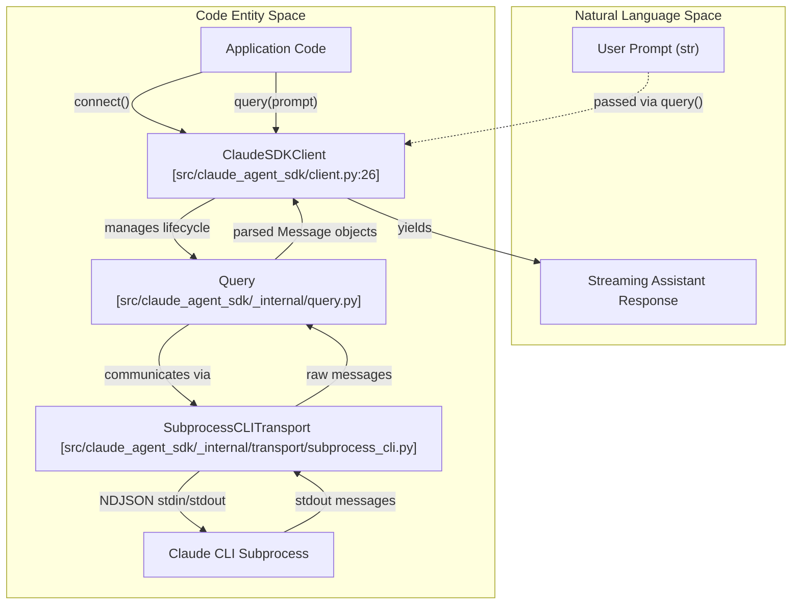
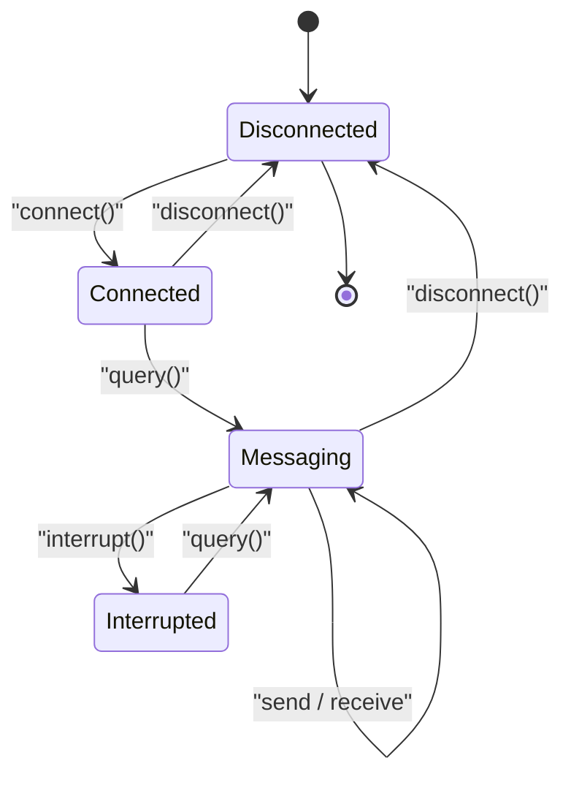
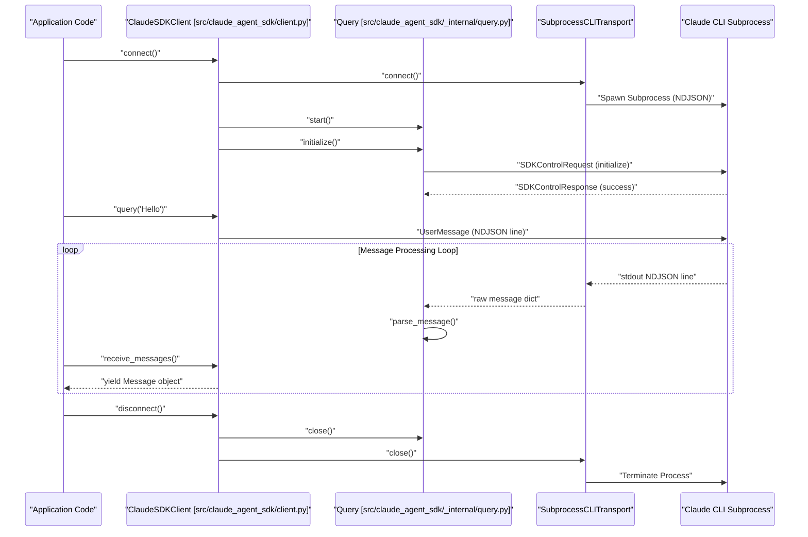

<!-- source: DeepWiki mcp.deepwiki.com · repo anthropics/claude-agent-sdk-python · page 3.2 ClaudeSDKClient · fetched 2026-10-26 -->

# ClaudeSDKClient

<details>
<summary>Relevant source files</summary>

The following files were used as context for generating this wiki page:

- [examples/max_budget_usd.py](examples/max_budget_usd.py)
- [examples/streaming_mode.py](examples/streaming_mode.py)
- [examples/streaming_mode_ipython.py](examples/streaming_mode_ipython.py)
- [src/claude_agent_sdk/client.py](src/claude_agent_sdk/client.py)
- [tests/test_client.py](tests/test_client.py)
- [tests/test_integration.py](tests/test_integration.py)
- [tests/test_streaming_client.py](tests/test_streaming_client.py)

</details>


## Purpose and Scope

This document provides the full technical specification for `ClaudeSDKClient`, the core client class defined in `[src/claude_agent_sdk/client.py]()` that enables bidirectional, stateful, and interactive communication with the Claude Code CLI. Unlike the high-level `query()` function designed for one-off tasks, `ClaudeSDKClient` maintains a persistent subprocess connection and background task group, supporting streaming message consumption, dynamic model switching, task interruption, file rewinding, tool authorization callbacks, and Model Context Protocol (MCP) server management.

Sources: `[src/claude_agent_sdk/client.py:27-65]()`

## Overview

`ClaudeSDKClient` acts as the primary programmatic driver for long-lived agentic sessions [src/claude_agent_sdk/client.py:27-38](). It bridges high-level user intentions and raw CLI subprocess interactions by wrapping an internal `Query` controller [src/claude_agent_sdk/client.py:87]() and a transport layer (`SubprocessCLITransport` or custom transport) [src/claude_agent_sdk/client.py:70]().



**Diagram**: ClaudeSDKClient Architecture Bridge - Connecting natural language inputs and streaming responses to internal SDK code entities.

Sources: `[src/claude_agent_sdk/client.py:27-90]()`, `[src/claude_agent_sdk/client.py:153-164]()`

## Client Lifecycle

The client lifecycle encompasses instantiation, asynchronous connection, interactive message exchange, and teardown [src/claude_agent_sdk/client.py:67-140]().

### Context Manager Usage
The standard pattern utilizes an asynchronous context manager which automatically invokes `connect()` on entry and `disconnect()` on exit [src/claude_agent_sdk/client.py:171-177]():

```python
async with ClaudeSDKClient(options=options) as client:
    await client.query("Analyze current directory")
    async for msg in client.receive_response():
        # Handle message stream
        pass
```

### Manual Lifecycle Management
For fine-grained control, `connect()` and `disconnect()` can be invoked explicitly [src/claude_agent_sdk/client.py:93-139]()`:

```python
client = ClaudeSDKClient(options=options)
await client.connect()
try:
    await client.query("Hello")
    async for msg in client.receive_messages():
        # Process messages
        break
finally:
    await client.disconnect()
```

### Runtime Context Constraint
`ClaudeSDKClient` maintains a persistent `anyio` task group internally for reading asynchronous message streams from `connect()` until `disconnect()` [src/claude_agent_sdk/client.py:59-65](). Consequently, all operations on a client instance must execute within the identical async runtime context (e.g., the same event loop or nursery) where `connect()` was called [src/claude_agent_sdk/client.py:58-64]().



**Diagram**: ClaudeSDKClient State Machine - Lifecycle states and transition methods.

Sources: `[src/claude_agent_sdk/client.py:58-65]()`, `[src/claude_agent_sdk/client.py:93-140]()`, `[tests/test_streaming_client.py:162-178]()`

## Core Methods

### query()
`async def query(prompt: str | AsyncIterable[dict[str, Any]]) -> None`

Sends a prompt or stream of structured message dictionaries into the active session [src/claude_agent_sdk/client.py:261-297](). String prompts are automatically stamped and wrapped into `UserMessage` payload structures before writing to the transport [src/claude_agent_sdk/client.py:288-294]().

### receive_messages()
`async def receive_messages() -> AsyncIterator[Message]`

An async generator yielding all parsed `Message` instances (such as `AssistantMessage`, `ToolUseBlock`, `SystemMessage`, and `ResultMessage`) as they arrive from the CLI subprocess [src/claude_agent_sdk/client.py:315-325]().

### receive_response()
`async def receive_response() -> AsyncIterator[Message]`

A high-level convenience iterator that wraps `receive_messages()` and automatically terminates iteration when a terminal `ResultMessage` is encountered for the current turn [src/claude_agent_sdk/client.py:327-338]().

### interrupt()
`async def interrupt() -> None`

Sends an asynchronous control request (`subtype: interrupt`) to halt ongoing model generation or active tool execution [src/claude_agent_sdk/client.py:340-344]().

Sources: `[src/claude_agent_sdk/client.py:261-344]()`, `[examples/streaming_mode.py:63-70]()`

## Session, Model, and File Control

`ClaudeSDKClient` provides dedicated methods for modifying session parameters dynamically at runtime:

| Method | Signature | Description |
| :--- | :--- | :--- |
| `set_model` | `async def set_model(model: str) -> None` | Switches the active LLM model mid-session [src/claude_agent_sdk/client.py:347-351](). |
| `set_permission_mode` | `async def set_permission_mode(mode: PermissionMode) -> None` | Updates tool authorization mode (`AlwaysAllow`, `AlwaysDeny`, `Notify`) [src/claude_agent_sdk/client.py:353-357](). |
| `stop_task` | `async def stop_task() -> None` | Signals the CLI to stop the current task execution [src/claude_agent_sdk/client.py:450-454](). |
| `rewind_files` | `async def rewind_files(user_message_id: str) -> None` | Reverts file modifications back to the checkpoint associated with a specific `UserMessage` UUID [src/claude_agent_sdk/client.py:444-448](). Requires file checkpointing enabled in options. |
| `get_context_usage` | `async def get_context_usage() -> ContextUsageResponse` | Fetches token usage statistics for the current session [src/claude_agent_sdk/client.py:457-461](). |

Sources: `[src/claude_agent_sdk/client.py:347-358]`, `[src/claude_agent_sdk/client.py:444-461]`

## MCP Server Management

The client interfaces with Model Context Protocol (MCP) servers through control protocol messages, enabling runtime introspection and management:

| Method | Signature | Description |
| :--- | :--- | :--- |
| `get_mcp_status` | `async def get_mcp_status() -> McpStatusResponse` | Retrieves connection status and telemetry for all configured MCP servers [src/claude_agent_sdk/client.py:360-374](). |
| `add_mcp_server` | `async def add_mcp_server(name: str, config: McpServerConfig) -> None` | Dynamically registers and starts a new MCP server [src/claude_agent_sdk/client.py:376-389](). |
| `remove_mcp_server` | `async def remove_mcp_server(name: str) -> None` | Unregisters and stops an existing MCP server by name [src/claude_agent_sdk/client.py:391-403](). |
| `reconnect_mcp_server`| `async def reconnect_mcp_server(name: str) -> None` | Forces a reconnection cycle for a specific MCP server [src/claude_agent_sdk/client.py:405-415](). |
| `toggle_mcp_server` | `async def toggle_mcp_server(name: str, enabled: bool) -> None` | Enables or disables an MCP server without purging its configuration [src/claude_agent_sdk/client.py:417-428](). |
| `get_server_info` | `async def get_server_info(name: str) -> dict[str, Any]` | Inspects initialization parameters and output styles for a server [src/claude_agent_sdk/client.py:430-442](). |

Sources: `[src/claude_agent_sdk/client.py:360-442]()`

## Implementation Details & Data Flow

When `connect()` is executed, the client validates session store configuration, prepares resume materialization if specified, and spawns the underlying subprocess transport [src/claude_agent_sdk/client.py:93-139](). It then instantiates the `Query` control coordinator, initiates the handshake protocol, and starts background reader tasks.



**Diagram**: ClaudeSDKClient Connection, Query, and Message Streaming Flow - Tracing data flow from application calls down to subprocess NDJSON communication.

Sources: `[src/claude_agent_sdk/client.py:100-185]()`, `[tests/test_streaming_client.py:48-106]()`

---

