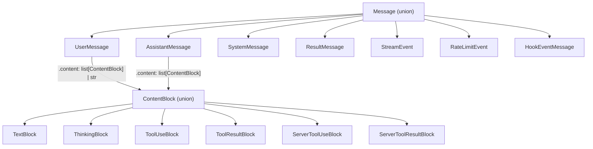
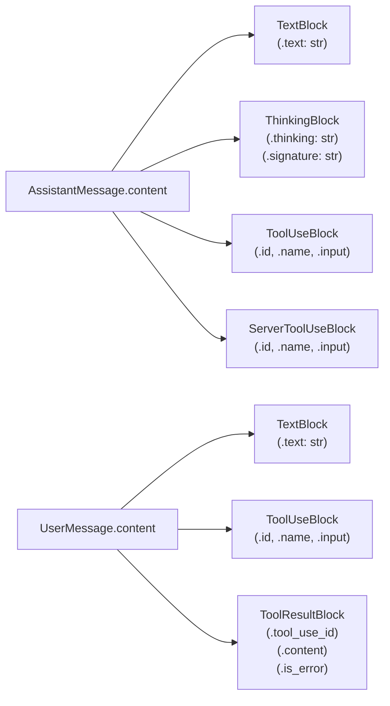
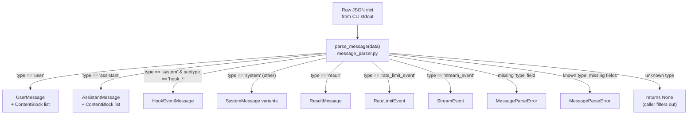

<!-- source: DeepWiki mcp.deepwiki.com · repo anthropics/claude-agent-sdk-python · page 3.3 Message Types and Content Blocks · fetched 2026-10-26 -->

# Message Types and Content Blocks

<details>
<summary>Relevant source files</summary>

The following files were used as context for generating this wiki page:

- [e2e-tests/test_message_origin.py](e2e-tests/test_message_origin.py)
- [src/claude_agent_sdk/_internal/message_parser.py](src/claude_agent_sdk/_internal/message_parser.py)
- [tests/test_message_parser.py](tests/test_message_parser.py)
- [tests/test_rate_limit_event_repro.py](tests/test_rate_limit_event_repro.py)

</details>


This page documents the typed message and content block classes that the SDK yields to application code. These types are the primary data structures you interact with when consuming the `query()` async generator or `ClaudeSDKClient.receive_messages()`.

For the parsing logic that converts raw CLI JSON into these types, see page 4.3. For the configuration options that affect which message types are emitted (e.g., `include_partial_messages`), see page 2.3.

---

## Overview

All types are defined in [src/claude_agent_sdk/types.py:594-718]() and parsed by `parse_message()` in [src/claude_agent_sdk/_internal/message_parser.py:50-231](). The top-level union type is:

```python
Message = (
    UserMessage 
    | AssistantMessage 
    | SystemMessage 
    | ResultMessage 
    | StreamEvent 
    | RateLimitEvent
    | HookEventMessage
)
```

Content blocks appear nested inside `UserMessage` and `AssistantMessage`:

```python
ContentBlock = (
    TextBlock 
    | ThinkingBlock 
    | ToolUseBlock 
    | ToolResultBlock 
    | ServerToolUseBlock 
    | ServerToolResultBlock
)
```

**Type Taxonomy Diagram**



Sources: [src/claude_agent_sdk/types.py:594-718](), [src/claude_agent_sdk/_internal/message_parser.py:7-32]()

---

## Message Types

### UserMessage

[src/claude_agent_sdk/types.py:642-649]()

Represents a user turn in the conversation. Emitted when the CLI echoes back a user message, including when tool results are fed back into the conversation.

| Field | Type | Description |
|---|---|---|
| `content` | `str \| list[ContentBlock]` | Message body. A plain string when the user sent a text prompt; a list of `ContentBlock` objects when the message includes tool use or tool results. |
| `uuid` | `str \| None` | Unique identifier for this message. Used as the argument to `rewind_files()` for file checkpointing [tests/test_message_parser.py:45-57](). |
| `parent_tool_use_id` | `str \| None` | Set when this message originates from inside a subagent. Identifies the tool use that spawned the subagent. |
| `tool_use_result` | `dict \| None` | Raw metadata about a tool execution result (e.g., file edit details: `filePath`, `oldString`, `newString`, `structuredPatch`). |
| `origin` | `MessageOrigin \| None` | Origin metadata (e.g., `{"kind": "human"}`) [tests/test_message_parser.py:60-78](), echoed back on result messages [e2e-tests/test_message_origin.py:34-58](). |

**When it appears:** Once per user turn, mirroring the prompt sent to Claude. Also appears after tool results are delivered back to the model [src/claude_agent_sdk/_internal/message_parser.py:96-150]().

Sources: [src/claude_agent_sdk/types.py:642-649](), [src/claude_agent_sdk/_internal/message_parser.py:96-150](), [tests/test_message_parser.py:33-111]()

---

### AssistantMessage

[src/claude_agent_sdk/types.py:652-659]()

Represents a complete assistant turn. Contains one or more content blocks.

| Field | Type | Description |
|---|---|---|
| `content` | `list[ContentBlock]` | One or more blocks: text, thinking, tool use, or tool result. |
| `model` | `str` | The model identifier that produced this message (e.g., `"claude-3-5-sonnet-20241022"`). |
| `parent_tool_use_id` | `str \| None` | Non-null when this message comes from a subagent. |
| `error` | `AssistantMessageError \| None` | Set when the API returned an error. See error values below. |
| `usage` | `dict \| None` | Token usage for this specific assistant turn. |
| `message_id` | `str \| None` | The underlying Anthropic API message ID. |
| `stop_reason` | `str \| None` | Why the model stopped generating (e.g., `"end_turn"`, `"tool_use"`). |

**`AssistantMessageError` values** ([src/claude_agent_sdk/types.py:632-639]()):

| Value | Meaning |
|---|---|
| `"authentication_failed"` | Invalid or missing API key |
| `"billing_error"` | Billing issue on the account |
| `"rate_limit"` | API rate limit exceeded |
| `"invalid_request"` | Malformed request sent to API |
| `"server_error"` | Internal server error from the API |
| `"unknown"` | Any other API error (details in text content) |

Sources: [src/claude_agent_sdk/types.py:632-639](), [src/claude_agent_sdk/types.py:652-659]()

---

### SystemMessage

[src/claude_agent_sdk/types.py:662-667]()

Carries metadata events emitted by the CLI itself, not by the model. This is the base class for specialized task messages.

| Field | Type | Description |
|---|---|---|
| `subtype` | `str` | Event kind (e.g., `"init"`, `"task_started"`, `"task_progress"`, `"task_notification"`). |
| `data` | `dict[str, Any]` | The full raw JSON dict from the CLI for this event. |

**Specialized System Subtypes:**
- **TaskStartedMessage**: Emitted when a subagent or long-running task begins [src/claude_agent_sdk/types.py:721-730]().
- **TaskProgressMessage**: Emitted periodically to update status and usage [src/claude_agent_sdk/types.py:733-743]().
- **TaskNotificationMessage**: Emitted for task completions or summaries [src/claude_agent_sdk/types.py:746-756]().
- **TaskUpdatedMessage**: Emitted when task metadata changes [src/claude_agent_sdk/types.py:759-766]().

Sources: [src/claude_agent_sdk/types.py:662-667](), [src/claude_agent_sdk/types.py:721-766]()

---

### ResultMessage

[src/claude_agent_sdk/types.py:670-683]()

The final message in any query. Summarizes cost, timing, and turn count.

| Field | Type | Description |
|---|---|---|
| `subtype` | `str` | Either `"success"` or `"error"`. |
| `duration_ms` | `int` | Wall-clock time for the full session in milliseconds. |
| `duration_api_ms` | `int` | Time spent waiting on the Anthropic API in milliseconds. |
| `is_error` | `bool` | `True` if the session ended with an error. |
| `num_turns` | `int` | Number of conversation turns completed. |
| `session_id` | `str` | Unique session identifier. |
| `total_cost_usd` | `float \| None` | Estimated cost of the session in USD. |
| `usage` | `dict \| None` | Cumulative token usage breakdown. |
| `result` | `str \| None` | Plain-text result when using non-streaming mode. |
| `structured_output` | `Any` | Populated when `output_format` is used. |
| `origin` | `MessageOrigin \| None` | Echoed origin metadata from the initiating prompt [e2e-tests/test_message_origin.py:34-58](). |

Sources: [src/claude_agent_sdk/types.py:670-683](), [e2e-tests/test_message_origin.py:34-58]()

---

### StreamEvent

[src/claude_agent_sdk/types.py:686-693]()

A partial message update emitted during streaming. Only produced when `include_partial_messages=True` is set in `ClaudeAgentOptions`.

| Field | Type | Description |
|---|---|---|
| `uuid` | `str` | Identifier for the in-progress message being streamed. |
| `session_id` | `str` | Current session identifier. |
| `event` | `dict[str, Any]` | Raw Anthropic API streaming event payload. |
| `parent_tool_use_id` | `str \| None` | Non-null if the event originated inside a subagent. |

Sources: [src/claude_agent_sdk/types.py:686-693]()

---

### RateLimitEvent

[src/claude_agent_sdk/types.py:711-718]()

Emitted when the CLI detects changes in rate limit status (e.g., warnings for claude.ai subscription users). Added to handle `rate_limit_event` messages introduced in CLI v2.1.45+ [tests/test_rate_limit_event_repro.py:1-10]().

| Field | Type | Description |
|---|---|---|
| `rate_limit_info` | `RateLimitInfo` | Detailed info: `status`, `resets_at`, `utilization`, etc. |
| `uuid` | `str` | Unique event ID. |
| `session_id` | `str` | Current session identifier. |

**RateLimitInfo Fields** ([src/claude_agent_sdk/types.py:699-708]()):
- `status`: `"allowed"`, `"allowed_warning"`, or `"rejected"` [tests/test_rate_limit_event_repro.py:20-24]().
- `resets_at`: Unix timestamp of when limits reset [tests/test_rate_limit_event_repro.py:42]().
- `utilization`: Float (0.0 to 1.0) indicating current quota usage [tests/test_rate_limit_event_repro.py:44]().
- `raw`: Dictionary containing any additional unmodeled fields [tests/test_rate_limit_event_repro.py:46]().

Sources: [src/claude_agent_sdk/types.py:699-718](), [tests/test_rate_limit_event_repro.py:19-47]()

---

## Content Block Types

Content blocks appear in the `content` list of `UserMessage` and `AssistantMessage`.

**Content Block Usage by Message Type**



Sources: [src/claude_agent_sdk/types.py:594-628](), [src/claude_agent_sdk/_internal/message_parser.py:96-185]()

---

### TextBlock

[src/claude_agent_sdk/types.py:595-599]()

| Field | Type | Description |
|---|---|---|
| `text` | `str` | Plain text content of the block. |

Sources: [src/claude_agent_sdk/types.py:595-599]()

---

### ThinkingBlock

[src/claude_agent_sdk/types.py:602-607]()

Represents extended reasoning content when Claude uses the Thinking feature.

| Field | Type | Description |
|---|---|---|
| `thinking` | `str` | The model's internal reasoning text. |
| `signature` | `str` | Cryptographic signature allowing the block to be passed back to the API. |

Sources: [src/claude_agent_sdk/types.py:602-607]()

---

### ToolUseBlock

[src/claude_agent_sdk/types.py:610-616]()

Represents a call to a standard tool (e.g., local CLI tools).

| Field | Type | Description |
|---|---|---|
| `id` | `str` | Unique tool call identifier. |
| `name` | `str` | Name of the tool being called (e.g., `"Bash"`, `"LS"`). |
| `input` | `dict[str, Any]` | Arguments passed to the tool. |

Sources: [src/claude_agent_sdk/types.py:610-616]()

---

### ToolResultBlock

[src/claude_agent_sdk/types.py:619-625]()

| Field | Type | Description |
|---|---|---|
| `tool_use_id` | `str` | Matches the `id` on the corresponding `ToolUseBlock`. |
| `content` | `str \| list[dict] \| None` | The result returned by the tool. |
| `is_error` | `bool \| None` | `True` if the tool execution failed. |

Sources: [src/claude_agent_sdk/types.py:619-625]()

---

### ServerToolUseBlock / ServerToolResultBlock

[src/claude_agent_sdk/types.py:628-630]()

Used for tools executed on the server side or by advisors. `ServerToolUseBlock` mirrors `ToolUseBlock` structure, while `ServerToolResultBlock` is used specifically for advisor tool results [src/claude_agent_sdk/_internal/message_parser.py:176-185]().

Sources: [src/claude_agent_sdk/types.py:628-630](), [src/claude_agent_sdk/_internal/message_parser.py:176-185]()

---

## Parsing and Forward Compatibility

**Parse Flow Diagram**



Sources: [src/claude_agent_sdk/_internal/message_parser.py:50-231](), [tests/test_rate_limit_event_repro.py:85-94]()

The `parse_message()` function defined in [src/claude_agent_sdk/_internal/message_parser.py:50]() is the single entry point for converting raw CLI JSON into typed objects. It uses a `match` statement on the `type` field to determine which class to instantiate.

- **Forward Compatibility**: If the CLI emits a message type unknown to the SDK version, `parse_message` returns `None` instead of crashing [tests/test_rate_limit_event_repro.py:85-94](). This allows the SDK to be resilient to new CLI features.
- **Hook Routing**: Messages with type `system` and subtypes `hook_started` or `hook_response` are routed to `HookEventMessage` before generic `SystemMessage` handling [src/claude_agent_sdk/_internal/message_parser.py:73-89]().
- **Error Handling**: Missing required fields for known types raise `MessageParseError`, wrapping the underlying `KeyError` [src/claude_agent_sdk/_internal/message_parser.py:146-149]().

Sources: [src/claude_agent_sdk/_internal/message_parser.py:50-231](), [tests/test_message_parser.py:30-182](), [tests/test_rate_limit_event_repro.py:16-95]()

---

