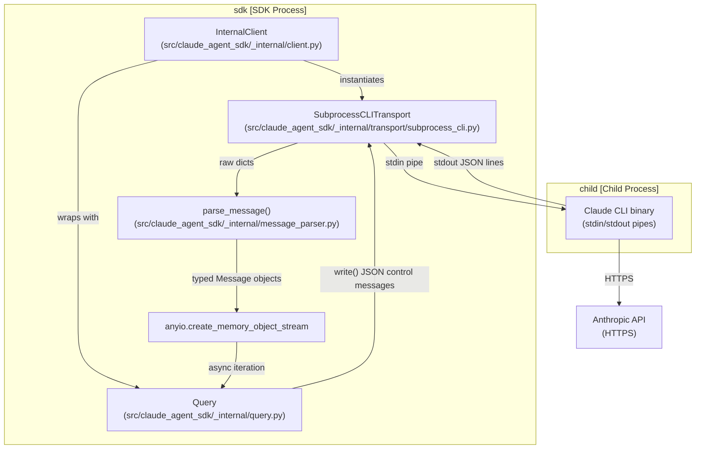
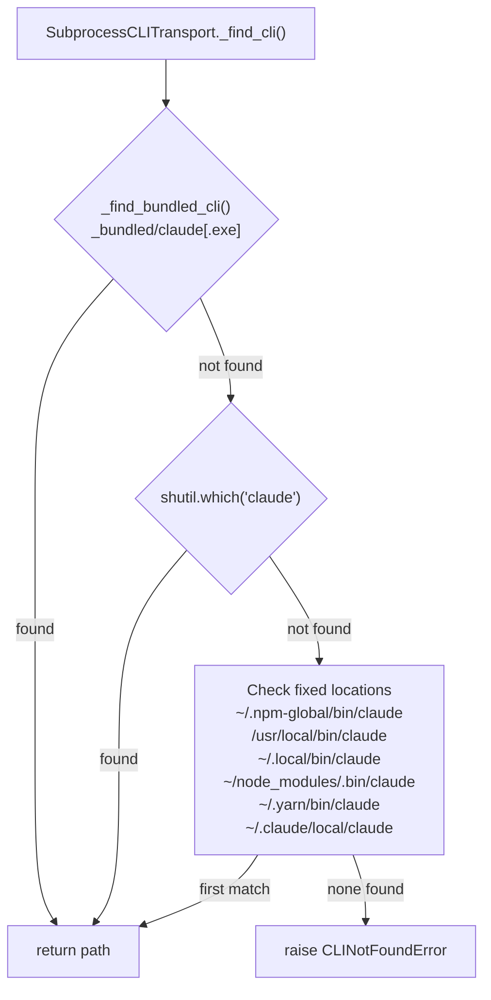
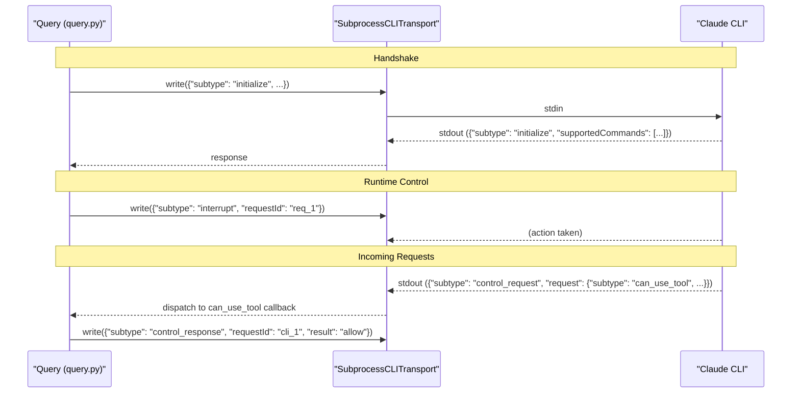

<!-- source: DeepWiki mcp.deepwiki.com · repo anthropics/claude-agent-sdk-python · page 4 Transport and Communication · fetched 2026-10-26 -->

# Transport and Communication

Relevant source files

The following files were used as context for generating this wiki page:

- [src/claude_agent_sdk/_internal/transport/subprocess_cli.py](src/claude_agent_sdk/_internal/transport/subprocess_cli.py)
- [tests/test_subprocess_buffering.py](tests/test_subprocess_buffering.py)
- [tests/test_transport.py](tests/test_transport.py)

This section documents how the SDK communicates with the Claude CLI subprocess: the transport mechanism that spawns and manages the process, the bidirectional control protocol that sits on top of it, and the JSON streaming pipeline that converts raw stdout bytes into typed message objects.

For details on the public-facing client APIs that consume messages produced by this layer, see [ClaudeSDKClient](#3.2). For the typed message objects themselves, see [Message Types and Content Blocks](#3.3).

---

## Overview

The SDK does not communicate with the Anthropic API directly. Instead, it delegates all API interaction to a Claude CLI binary, which it launches as a subprocess. The transport layer owns the full lifecycle of that subprocess: discovery, spawn, I/O, and teardown.

**Transport layer diagram:**

Sources: [src/claude_agent_sdk/_internal/client.py:127-175](), [src/claude_agent_sdk/_internal/transport/subprocess_cli.py:111-140](), [src/claude_agent_sdk/_internal/query.py:61-131](), [src/claude_agent_sdk/_internal/message_parser.py:12-40]()

---

## Transport Abstraction

The transport layer is defined by a `Transport` base interface. `SubprocessCLITransport` is the primary concrete implementation used by the SDK. It manages the underlying `anyio.abc.Process` and provides high-level methods for bidirectional communication.

| Method | Purpose |
|---|---|
| `connect()` | Version-check CLI, spawn subprocess, open stdio streams |
| `write(data)` | Send a JSON string to CLI stdin, serialized under an `anyio.Lock` |
| `end_input()` | Close stdin to signal no more input |
| `read_messages()` | Return an async iterator of parsed JSON dicts from stdout |
| `close()` | Terminate subprocess, release all streams and task groups |

For details, see [Subprocess CLI Transport](#4.1).

Sources: [src/claude_agent_sdk/_internal/transport/subprocess_cli.py:111-140](), [src/claude_agent_sdk/_internal/transport/subprocess_cli.py:335-410](), [src/claude_agent_sdk/_internal/transport/subprocess_cli.py:530-610]()

---

## CLI Discovery

When `options.cli_path` is not set, `SubprocessCLITransport._find_cli()` searches for the binary in a fixed priority order. It first checks for a bundled binary within the package `_bundled` directory before falling back to `shutil.which` and common installation paths.

**CLI discovery order:**

Sources: [src/claude_agent_sdk/_internal/transport/subprocess_cli.py:142-188](), [tests/test_transport.py:29-52]()

---

## Control Protocol

The `Query` class manages a bidirectional control protocol over the transport's stdin/stdout. This protocol handles the initial `initialize` handshake, allows the SDK to send control requests (like `interrupt` or `set_model`), and enables the CLI to request permissions (`can_use_tool`) or invoke lifecycle `hooks`.

**Control protocol sequence:**

For details, see [Control Protocol](#4.2).

Sources: [src/claude_agent_sdk/_internal/query.py:61-141](), [src/claude_agent_sdk/_internal/query.py:172-230](), [src/claude_agent_sdk/_internal/query.py:330-400]()

---

## Message Streaming and Buffering

The CLI writes newline-delimited JSON to stdout. However, pipe buffering can cause JSON objects to be fragmented across multiple reads or concatenated into a single read. `SubprocessCLITransport` uses a `_LineFramer` to reassemble these fragments into complete lines before parsing them as JSON.

**Buffering logic:**
1. Read chunk from `TextReceiveStream`.
2. `_LineFramer.push(chunk)` accumulates fragments and splits on `\n`.
3. `_parse_stdout_line(line)` attempts `json.loads(line)`.
4. If the line starts with `{`, it must parse or it raises `CLIJSONDecodeError`.
5. Valid dictionaries are yielded to the `Query` read loop.

For details, see [Message Streaming and Buffering](#4.3).

Sources: [src/claude_agent_sdk/_internal/transport/subprocess_cli.py:50-85](), [src/claude_agent_sdk/_internal/transport/subprocess_cli.py:86-109](), [tests/test_subprocess_buffering.py:46-184]()

---

## Subprocess Lifecycle and Safety

The transport manages the subprocess lifecycle from `connect()` to `close()`. It uses an `anyio.Lock` (`_write_lock`) to ensure that writes to `stdin` are thread-safe and that the stream is not corrupted by concurrent access.

Environment variables injected at spawn time include `CLAUDE_CODE_ENTRYPOINT="sdk-py"` and `CLAUDE_AGENT_SDK_VERSION`. To prevent orphaned processes, the SDK uses an `atexit` handler (`_kill_active_children`) to terminate any active child processes stored in `_ACTIVE_CHILDREN` if the parent Python process exits unexpectedly.

Sources: [src/claude_agent_sdk/_internal/transport/subprocess_cli.py:33-47](), [src/claude_agent_sdk/_internal/transport/subprocess_cli.py:140](), [src/claude_agent_sdk/_internal/transport/subprocess_cli.py:335-410](), [src/claude_agent_sdk/_internal/transport/subprocess_cli.py:481-505]()

---

## Child Pages

| Section | Topic |
|---|---|
| [Subprocess CLI Transport](#4.1) | Deep-dive into discovery, command construction, subprocess management, and error types like `CLINotFoundError`. |
| [Control Protocol](#4.2) | Explanation of the `Query` class, the `initialize` handshake, request ID correlation, and bidirectional requests. |
| [Message Streaming and Buffering](#4.3) | Technical details on handling fragmented JSON, the `_LineFramer` mechanism, and `CLIJSONDecodeError`. |

---

