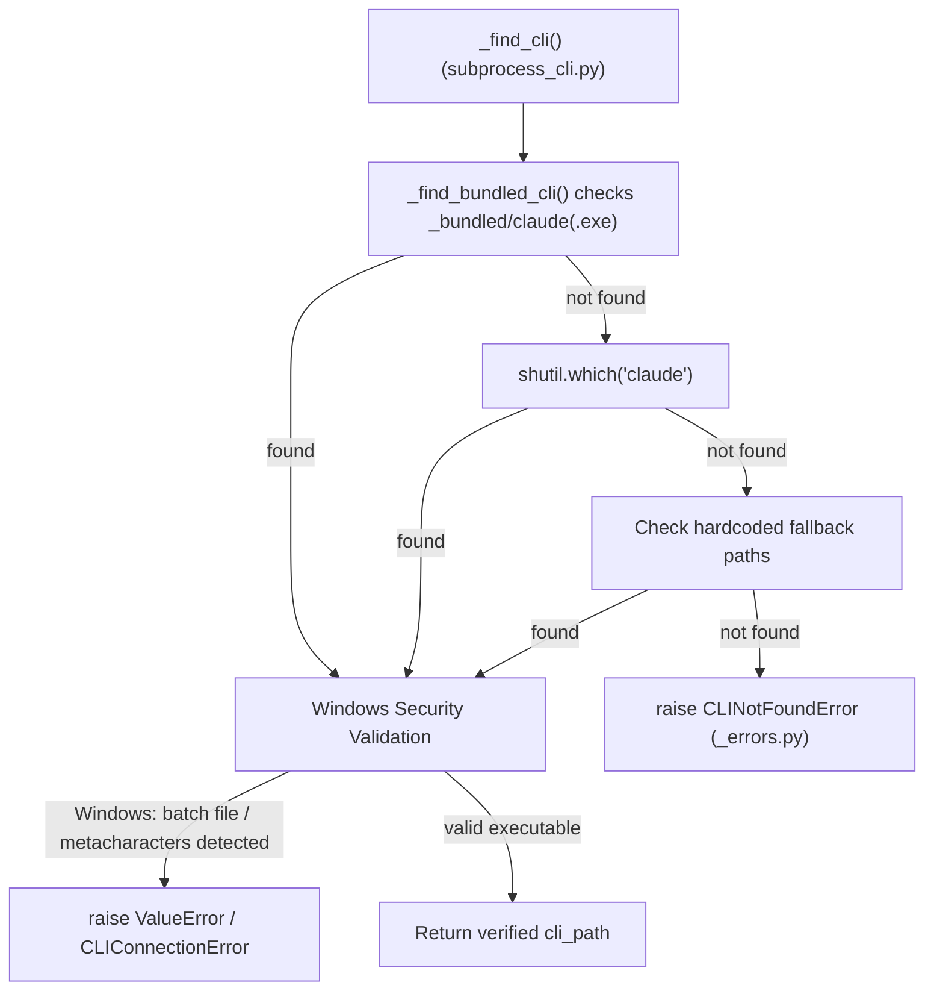
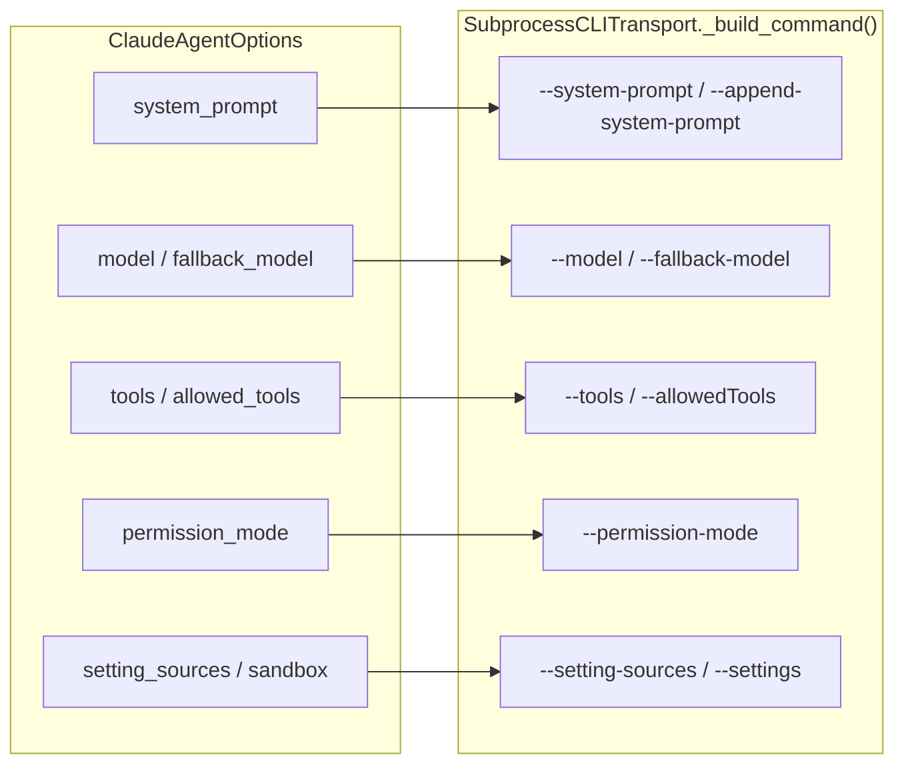
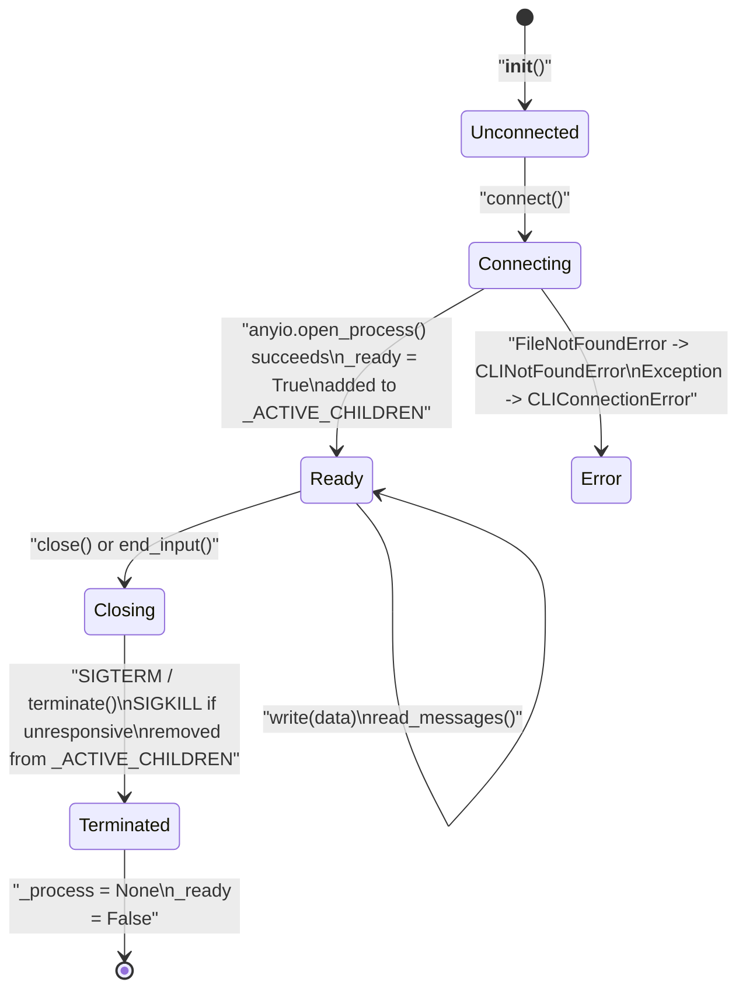

<!-- source: DeepWiki mcp.deepwiki.com · repo anthropics/claude-agent-sdk-python · page 4.1 Subprocess CLI Transport · fetched 2026-10-26 -->

# Subprocess CLI Transport

<details>
<summary>Relevant source files</summary>

The following files were used as context for generating this wiki page:

- [src/claude_agent_sdk/_internal/transport/__init__.py](src/claude_agent_sdk/_internal/transport/__init__.py)
- [src/claude_agent_sdk/_internal/transport/subprocess_cli.py](src/claude_agent_sdk/_internal/transport/subprocess_cli.py)
- [src/claude_agent_sdk/query.py](src/claude_agent_sdk/query.py)
- [tests/test_close_cancellation.py](tests/test_close_cancellation.py)
- [tests/test_subprocess_buffering.py](tests/test_subprocess_buffering.py)
- [tests/test_transport.py](tests/test_transport.py)

</details>


This page documents `SubprocessCLITransport`, the internal component responsible for spawning the Claude CLI binary, managing its lifecycle, constructing command-line arguments, executing Windows security validation, handling child process reaping, and streaming NDJSON data over standard input/output pipes [src/claude_agent_sdk/_internal/transport/subprocess_cli.py:1-1228](). For message framing and NDJSON parsing details, see [4.3](). For control protocol request/response handling, see [4.2]().

---

## 1. Role in the Architecture

`SubprocessCLITransport` implements the abstract `Transport` interface defined in `src/claude_agent_sdk/_internal/transport/__init__.py` [src/claude_agent_sdk/_internal/transport/__init__.py:8-86](). It forms the communication bridge between the `Query` / `InternalClient` orchestration layer and the physical Claude CLI executable [src/claude_agent_sdk/query.py:127-131](), [src/claude_agent_sdk/_internal/transport/subprocess_cli.py:1-33]().

**Diagram: Transport Layer and Code Entity Mapping**

```mermaid
flowchart TD
    QueryCls["Query (src/claude_agent_sdk/query.py)"]
    InternalClientCls["InternalClient (src/claude_agent_sdk/_internal/client.py)"]
    TransportInterface["Transport (src/claude_agent_sdk/_internal/transport/__init__.py)"]
    SubprocessCLITransportCls["SubprocessCLITransport (src/claude_agent_sdk/_internal/transport/subprocess_cli.py)"]
    LineFramerCls["_LineFramer (src/claude_agent_sdk/_internal/transport/subprocess_cli.py)"]
    CLIProc["Claude CLI Subprocess (stdin/stdout/stderr pipes)"]

    QueryCls -->|"invokes"| InternalClientCls
    InternalClientCls -->|"implements connect(), write(), read_messages(), close()"| TransportInterface
    TransportInterface <|-- SubprocessCLITransportCls
    SubprocessCLITransportCls -->|"spawns via anyio.open_process()"| CLIProc
    CLIProc -->|"chunks via TextReceiveStream"| LineFramerCls
    LineFramerCls -->|"yields raw dicts"| SubprocessCLITransportCls
```

Sources: [src/claude_agent_sdk/_internal/transport/__init__.py:8-86](), [src/claude_agent_sdk/_internal/transport/subprocess_cli.py:1-33](), [src/claude_agent_sdk/query.py:127-131]()

---

## 2. CLI Discovery and Windows Security Checks

When `ClaudeAgentOptions.cli_path` is not specified (`None`), `SubprocessCLITransport` searches for the binary using `_find_cli()`, checking bundled assets, the system `PATH` via `shutil.which()`, and known fallback directories [src/claude_agent_sdk/_internal/transport/subprocess_cli.py:142-188]().

On Windows platforms, `SubprocessCLITransport` executes security checks (`_reject_windows_batch_cli` and `_reject_windows_cmd_metacharacters`) to prevent arbitrary command execution or unexpected `cmd.exe` shell interpretation [src/claude_agent_sdk/_internal/transport/subprocess_cli.py:46-53](). It explicitly rejects batch script wrappers (`.bat`, `.cmd`) and arguments containing cmd.exe metacharacters (`&|<>^%!"`) when passed unquoted [src/claude_agent_sdk/_internal/transport/subprocess_cli.py:46-53]().

**Diagram: CLI Discovery and Validation Flow**



Sources: [src/claude_agent_sdk/_internal/transport/subprocess_cli.py:46-188](), [tests/test_transport.py:29-53]()

---

## 3. Version Checking

Prior to spawning the main persistent subprocess, `connect()` executes `_check_claude_version()` unless the environment variable `CLAUDE_AGENT_SDK_SKIP_VERSION_CHECK` is present [src/claude_agent_sdk/_internal/transport/subprocess_cli.py:480-490](). 

This check spawns a temporary process with `[cli_path, "-v"]`, bounded by a 2-second `anyio.fail_after` timeout [src/claude_agent_sdk/_internal/transport/subprocess_cli.py:688-726](). It parses the output semver string and validates compatibility against `MINIMUM_CLAUDE_CODE_VERSION = "2.0.0"` [src/claude_agent_sdk/_internal/transport/subprocess_cli.py:37-37](). If the version check fails or times out, a warning is logged or suppressed to prevent blocking offline or air-gapped environments [src/claude_agent_sdk/_internal/transport/subprocess_cli.py:688-726]().

Sources: [src/claude_agent_sdk/_internal/transport/subprocess_cli.py:37-37](), [src/claude_agent_sdk/_internal/transport/subprocess_cli.py:480-490](), [src/claude_agent_sdk/_internal/transport/subprocess_cli.py:688-726]()

---

## 4. Command Construction

`_build_command()` translates fields from `ClaudeAgentOptions` into CLI arguments for `anyio.open_process()` [src/claude_agent_sdk/_internal/transport/subprocess_cli.py:287-434]().

**Diagram: Option Translation Mapping**



Sources: [src/claude_agent_sdk/_internal/transport/subprocess_cli.py:287-434](), [tests/test_transport.py:67-200]()

Key command arguments include `--output-format stream-json`, `--input-format stream-json`, and structured formatting flags for session resumption, budget limits, thinking tokens, and hook event dispatching [src/claude_agent_sdk/_internal/transport/subprocess_cli.py:287-434]().

Sources: [src/claude_agent_sdk/_internal/transport/subprocess_cli.py:287-434]()

---

## 5. Subprocess Lifecycle, Child Reaping, and Cancellation

`SubprocessCLITransport` manages the full lifecycle of the Claude CLI subprocess through asynchronous methods and global tracking mechanisms [src/claude_agent_sdk/_internal/transport/subprocess_cli.py:436-615]().



Sources: [src/claude_agent_sdk/_internal/transport/subprocess_cli.py:436-686]()

### Child Reaping and Parent-Exit Cleanup
To prevent orphaned processes when the host Python process crashes or exits prematurely, active child subprocesses are tracked in the module-level set `_ACTIVE_CHILDREN` [src/claude_agent_sdk/_internal/transport/subprocess_cli.py:58-69](). An `atexit` hook `_kill_active_children()` iterates over live processes and sends `SIGTERM` (or calls `terminate()` on Windows) [src/claude_agent_sdk/_internal/transport/subprocess_cli.py:61-68]().

Furthermore, `close()` is executed within cancellation shields to ensure that task cancellations or timeout expirations do not bypass cleanup and orphan the CLI subprocess [tests/test_close_cancellation.py:1-188]().

Sources: [src/claude_agent_sdk/_internal/transport/subprocess_cli.py:58-69](), [tests/test_close_cancellation.py:1-188]()

---

## 6. Error Types and Concurrency

### Error Classes
The transport layer maps low-level subprocess and I/O failures to SDK exception types:
- `CLINotFoundError`: Raised when the CLI executable cannot be located [src/claude_agent_sdk/_errors.py:10-50]().
- `CLIConnectionError`: Raised when process startup fails or communication cannot be established [src/claude_agent_sdk/_errors.py:10-50]().
- `ProcessError`: Raised when the CLI process terminates with a non-zero exit code [src/claude_agent_sdk/_errors.py:10-50]().
- `SDKJSONDecodeError` (`CLIJSONDecodeError`): Raised when NDJSON parsing fails or when internal buffer limits (`_DEFAULT_MAX_BUFFER_SIZE`) are exceeded [src/claude_agent_sdk/_internal/transport/subprocess_cli.py:21-36]().

Sources: [src/claude_agent_sdk/_errors.py:10-50](), [src/claude_agent_sdk/_internal/transport/subprocess_cli.py:21-36]()

### Concurrency Control
All write operations, input terminations, and close calls are serialized using an internal `anyio.Lock` (`_write_lock`) [src/claude_agent_sdk/_internal/transport/subprocess_cli.py:582-606](). This prevents concurrent coroutines from triggering `BusyResourceError` on underlying `anyio` text streams [src/claude_agent_sdk/_internal/transport/subprocess_cli.py:582-606]().

Sources: [src/claude_agent_sdk/_internal/transport/subprocess_cli.py:582-606]()

---

