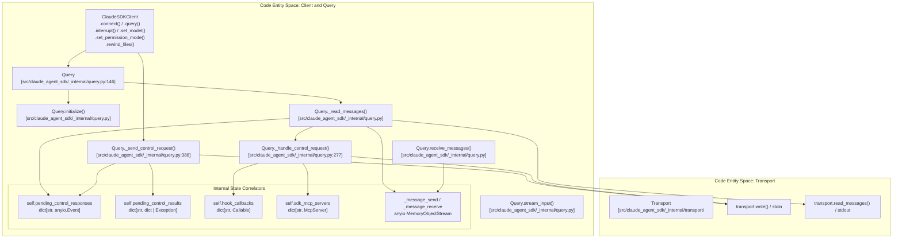
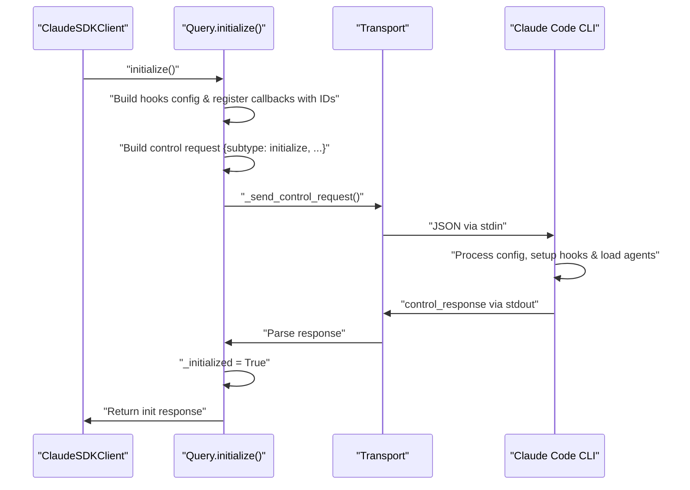
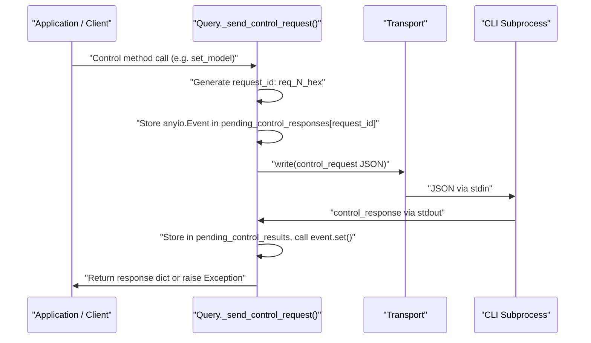
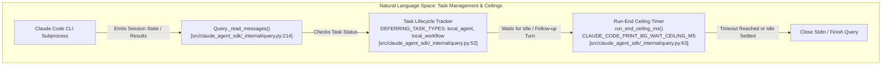

<!-- source: DeepWiki mcp.deepwiki.com · repo anthropics/claude-agent-sdk-python · page 4.2 Control Protocol · fetched 2026-10-26 -->

# Control Protocol

Relevant source files

The following files were used as context for generating this wiki page:

- [e2e-tests/test_dynamic_control.py](e2e-tests/test_dynamic_control.py)
- [e2e-tests/test_run_end.py](e2e-tests/test_run_end.py)
- [src/claude_agent_sdk/_internal/client.py](src/claude_agent_sdk/_internal/client.py)
- [src/claude_agent_sdk/_internal/query.py](src/claude_agent_sdk/_internal/query.py)
- [tests/test_run_end_subprocess.py](tests/test_run_end_subprocess.py)

The control protocol implements bidirectional communication between the SDK and the Claude Code CLI subprocess. It enables runtime control features (interrupts, model switching, permission changes), callback-based extensibility (hooks and permission checks), in-process MCP server integration, task lifecycle tracking, and run-end ceiling management. This protocol operates on top of the subprocess transport layer and provides type-safe message routing using request IDs for correlation.

Sources: [src/claude_agent_sdk/_internal/query.py:1-29]()

## Protocol Architecture

The control protocol is implemented by the `Query` class (`[src/claude_agent_sdk/_internal/query.py:146-176]()`) and operates as a layer above the `Transport` interface. It maintains separate channels for control messages and regular SDK messages, routing each appropriately.

### Diagram: Protocol Layer and Query Subsystems

Sources: [src/claude_agent_sdk/_internal/query.py:146-176](), [src/claude_agent_sdk/client.py:55-177]()

### Message Type Routing

The protocol distinguishes between message categories in the reader loop (`Query._read_messages()`):

| `type` field | Direction | Purpose | Routing Mechanism |
|---|---|---|---|
| `control_response` | CLI → SDK | Response to an SDK-initiated control request | Matched by `request_id` in `pending_control_responses`; result stored in `pending_control_results` [src/claude_agent_sdk/_internal/query.py:224-234]() |
| `control_request` | CLI → SDK | Request from CLI requiring an SDK callback (permission, hook, MCP) | Dispatched to `_handle_control_request()` via `spawn_detached()` [src/claude_agent_sdk/_internal/query.py:236-241]() |
| `control_cancel_request` | CLI → SDK | Cancel a pending control request | Reserved/Ignored |
| `result` | CLI → SDK | Signals the end of a model turn | Sets `_first_result_event`; forwarded to message stream [src/claude_agent_sdk/_internal/query.py:243-254]() |
| (other types) | CLI → SDK | `user`, `assistant`, `system`, stream events | Forwarded to `_message_send` for application consumption via `receive_messages()` [src/claude_agent_sdk/_internal/query.py:256-258]() |

Sources: [src/claude_agent_sdk/_internal/query.py:214-275]()

## Initialization Handshake

Before processing queries, `Query` performs an initialization handshake in streaming mode, transmitting hooks, agents, and MCP server configurations over the control channel.

Sources: [src/claude_agent_sdk/_internal/query.py:172-212](), [src/claude_agent_sdk/client.py:143-177]()

## Outgoing and Incoming Control Requests

### Outgoing Control Requests (`_send_control_request`)
All SDK-initiated control requests (`interrupt`, `set_model`, `set_permission_mode`, `rewind_files`, `stop_task`, etc.) flow through `_send_control_request()`. They are correlated using unique request IDs and `anyio.Event` primitives.

Sources: [src/claude_agent_sdk/_internal/query.py:388-433]()

### Incoming Control Requests (`_handle_control_request`)
The CLI sends `control_request` messages back to the SDK for permission checks (`can_use_tool`), hook execution (`hook_callback`), and in-process MCP message routing (`mcp_message`).

| `subtype` | Handler Method / Target | Purpose |
|---|---|---|
| `can_use_tool` | `can_use_tool` callback | Invokes user permission verification with `ToolPermissionContext` [src/claude_agent_sdk/_internal/query.py:286-327]() |
| `hook_callback` | `self.hook_callbacks` | Executes registered hook functions, converting Python-safe field names (`async_`, `continue_`) to CLI expectations (`async`, `continue`) [src/claude_agent_sdk/_internal/query.py:42-58](), [src/claude_agent_sdk/_internal/query.py:329-343]() |
| `mcp_message` | `_handle_sdk_mcp_request()` | Routes JSON-RPC requests (`initialize`, `tools/list`, `tools/call`) to in-process SDK MCP servers [src/claude_agent_sdk/_internal/query.py:345-365](), [src/claude_agent_sdk/_internal/query.py:435-571]() |

Sources: [src/claude_agent_sdk/_internal/query.py:277-386](), [src/claude_agent_sdk/types.py:788-843]()

## Request ID Correlation

Concurrency and request correlation are managed via instance-level dictionaries on `Query`:
- `self._request_counter`: An incrementing integer counter `[src/claude_agent_sdk/_internal/query.py:399]()`.
- `self.pending_control_responses`: Maps `request_id` strings to `anyio.Event` instances `[src/claude_agent_sdk/_internal/query.py:114-115]()`.
- `self.pending_control_results`: Stores the response payload or exception received from the CLI before an event is triggered `[src/claude_agent_sdk/_internal/query.py:115]()`.

When a response arrives, `_read_messages()` extracts the `request_id`, places the response data into `pending_control_results`, and wakes up the waiting coroutine by setting the event `[src/claude_agent_sdk/_internal/query.py:224-234]()`.

Sources: [src/claude_agent_sdk/_internal/query.py:114-115](), [src/claude_agent_sdk/_internal/query.py:224-234](), [src/claude_agent_sdk/_internal/query.py:399-405]()

## Task Lifecycle Tracking and Run-End Ceiling

### Task Lifecycle Tracking
The SDK tracks long-running agent tasks and subtasks to determine when stdin can safely be closed. Tasks whose completion triggers follow-up turns are classified under `DEFERRING_TASK_TYPES` (`frozenset({"local_agent", "local_workflow"})`) `[src/claude_agent_sdk/_internal/query.py:52]()`. These tasks ensure that the control channel remains open for subsequent hooks, permissions, or MCP calls even after an initial model turn result frame is received (`[tests/test_run_end_subprocess.py:1-13]()`, `[e2e-tests/test_run_end.py:1-10]()`).

### Run-End Ceiling and Timeouts
The SDK bounds its wait for the CLI's idle state using the run-end ceiling configuration (`run_end_ceiling_ms`) `[src/claude_agent_sdk/_internal/query.py:54-83]()`. 
- It inspects the `CLAUDE_CODE_PRINT_BG_WAIT_CEILING_MS` environment variable (falling back to `DEFAULT_RUN_END_CEILING_MS` of 600,000 ms / 10 minutes) `[src/claude_agent_sdk/_internal/query.py:56-82]()`.
- `ClaudeAgentOptions.env` overrides inherited environment variables for the subprocess, ensuring consistent timeout enforcement (`[src/claude_agent_sdk/_internal/query.py:63-83]()`).

### Diagram: Task Lifecycle and Run-End Ceiling

Sources: [src/claude_agent_sdk/_internal/query.py:52-83](), [src/claude_agent_sdk/_internal/query.py:214-275]()

## Error Handling

The control protocol provides robust error propagation across transport boundaries:
- **Control Request Timeouts**: If a request exceeds its timeout (default 60s), `anyio.fail_after` raises an exception `[src/claude_agent_sdk/_internal/query.py:418-420]()`.
- **Stored Exception Propagation**: If the result object stored in `pending_control_results` is an `Exception`, it is re-raised in the calling task (`[src/claude_agent_sdk/_internal/query.py:421-426]()`).
- **Control Error Responses**: When an incoming CLI control request handler fails, the SDK replies with an `error` subtype control response containing the error message string (`[src/claude_agent_sdk/_internal/query.py:376-386]()`, `[src/claude_agent_sdk/types.py:845-859]()`).
- **Reader Failures**: Unhandled reader exceptions populate all pending control responses with the error, emit an error message into the message stream, and shut down gracefully (`[src/claude_agent_sdk/_internal/query.py:260-275]()`).

Sources: [src/claude_agent_sdk/_internal/query.py:260-275](), [src/claude_agent_sdk/_internal/query.py:376-386](), [src/claude_agent_sdk/_internal/query.py:418-433]()

---

