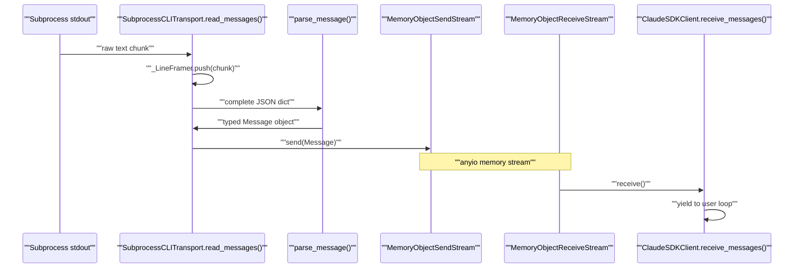

<!-- source: DeepWiki mcp.deepwiki.com · repo anthropics/claude-agent-sdk-python · page 4.3 Message Streaming and Buffering · fetched 2026-10-26 -->

# Message Streaming and Buffering

<details>
<summary>Relevant source files</summary>

The following files were used as context for generating this wiki page:

- [.github/scripts/e2e-failure-summary.sh](.github/scripts/e2e-failure-summary.sh)
- [.github/scripts/run-e2e-firewalled-macos.sh](.github/scripts/run-e2e-firewalled-macos.sh)
- [e2e-tests/test_include_partial_messages.py](e2e-tests/test_include_partial_messages.py)
- [examples/include_partial_messages.py](examples/include_partial_messages.py)
- [examples/streaming_mode_trio.py](examples/streaming_mode_trio.py)
- [src/claude_agent_sdk/_internal/transport/subprocess_cli.py](src/claude_agent_sdk/_internal/transport/subprocess_cli.py)
- [tests/test_subprocess_buffering.py](tests/test_subprocess_buffering.py)
- [tests/test_transport.py](tests/test_transport.py)

</details>


This page covers how raw bytes from the Claude CLI subprocess stdout are accumulated into complete JSON objects, how those objects are parsed into typed `Message` instances, and how the `anyio` memory stream decouples the production of parsed messages from their consumption by user code.

For the subprocess lifecycle (spawning, stdin/stdout pipes, process teardown), see [Subprocess CLI Transport](#4.1). For the control protocol that dispatches parsed messages to hooks and permission callbacks, see [Control Protocol](#4.2). For the full `Message` type hierarchy, see [Message Types and Content Blocks](#3.3).

---

## Overview

The CLI process writes newline-delimited JSON (JSON Lines) to stdout. However, in practice the stream does not arrive as clean one-object-per-read chunks. The transport must handle:

- **Fragmented JSON** — a single JSON object split across multiple stream reads [tests/test_subprocess_buffering.py:142-184]().
- **Concatenated JSON** — multiple JSON objects delivered in a single read, separated by embedded `\n` characters [tests/test_subprocess_buffering.py:49-84]().
- **Mixed cases** — a mix of complete objects and fragments within the same read batch [tests/test_subprocess_buffering.py:1-545]().

Once a complete JSON object is decoded, it is handed to `parse_message()`, which converts the raw dictionary into a typed `Message` (or `None` for unknown types). Parsed messages are placed into an `anyio` memory stream so that the produce-and-parse loop can run independently from the consumer iterating over messages.

Sources: [src/claude_agent_sdk/_internal/transport/subprocess_cli.py:1-168](), [tests/test_subprocess_buffering.py:46-184]()

---

## JSON Accumulation and Parsing Pipeline

**Diagram: Data flow from CLI stdout to typed Messages**

```mermaid
flowchart TD
    cli[""Claude CLI process (stdout)""]
    trs[""TextReceiveStream (_stdout_stream)""]
    framer[""_LineFramer (push/flush)""]
    loop[""SubprocessCLITransport.read_messages() async for chunk""]
    parse_line[""_parse_stdout_line(line)""]
    buf[""_LineFramer._pending list""]
    guard[""pending_len > max_buffer_size?""]
    err[""raise SDKJSONDecodeError""]
    attempt[""json.loads(line)""]
    ok[""yield data dict""]
    parser[""parse_message(data) -> Message | None""]
    query[""InternalClient.process_query""]

    cli -->|"raw bytes"| trs
    trs -->|"text chunk"| loop
    loop -->|"push(chunk)"| framer
    framer --> buf
    buf --> guard
    guard -->|"yes"| err
    framer -->|"complete lines"| parse_line
    parse_line -->|"json.loads"| attempt
    attempt -->|"success"| ok
    ok --> parser
    parser -->|"Message or None"| query
```

Sources: [src/claude_agent_sdk/_internal/transport/subprocess_cli.py:1-168](), [tests/test_subprocess_buffering.py:46-184]()

---

## The JSON Buffering Loop

The accumulation logic utilizes a helper class `_LineFramer` to reassemble complete lines from arbitrary stream chunks [src/claude_agent_sdk/_internal/transport/subprocess_cli.py:163-168]().

### Line Framing Strategy
`_LineFramer` maintains a `_pending` list of string fragments [src/claude_agent_sdk/_internal/transport/subprocess_cli.py:163-168](). When a new chunk arrives:
1. It is appended to the internal buffer tracking list [src/claude_agent_sdk/_internal/transport/subprocess_cli.py:1-168]().
2. If the chunk contains a newline, the fragments are joined and split on `\n` [src/claude_agent_sdk/_internal/transport/subprocess_cli.py:1-168]().
3. Complete lines are returned, and any trailing fragment is kept in `_pending` for the next chunk [src/claude_agent_sdk/_internal/transport/subprocess_cli.py:1-168]().

### Speculative Parsing
Once a line is framed, `_parse_stdout_line` attempts to convert it to a dictionary [src/claude_agent_sdk/_internal/transport/subprocess_cli.py:1-168]().
- **Stripping**: Surrounding whitespace (like `\r` in CRLF) is stripped from complete lines.
- **Non-JSON Filter**: Lines not starting with `{` (e.g., CLI debug logs) are logged and skipped.
- **Strict Decoding**: If a line looks like JSON but fails to parse, a `CLIJSONDecodeError` (aliased as `SDKJSONDecodeError`) is raised immediately [src/claude_agent_sdk/_internal/transport/subprocess_cli.py:21-23]().

Sources: [src/claude_agent_sdk/_internal/transport/subprocess_cli.py:21-168]()

---

## Buffer Size Limit

The constant `_DEFAULT_MAX_BUFFER_SIZE` is set to `1024 * 1024` bytes (1 MB) [src/claude_agent_sdk/_internal/transport/subprocess_cli.py:36]().

This limit is configurable via `ClaudeAgentOptions.max_buffer_size`. When `max_buffer_size` is `None`, the default 1 MB applies.

| Configuration | Default | How to override |
|---|---|---|
| `_DEFAULT_MAX_BUFFER_SIZE` | `1_048_576` (1 MB) | Set `ClaudeAgentOptions(max_buffer_size=N)` [src/claude_agent_sdk/_internal/transport/subprocess_cli.py:36]() |
| Error raised | `CLIJSONDecodeError` (`SDKJSONDecodeError`) | [src/claude_agent_sdk/_internal/transport/subprocess_cli.py:22]() |

The `_LineFramer` tracks pending data length and the transport raises an error if this exceeds the threshold, preventing memory exhaustion from malicious or malformed CLI output [src/claude_agent_sdk/_internal/transport/subprocess_cli.py:1-168]().

Sources: [src/claude_agent_sdk/_internal/transport/subprocess_cli.py:21-36]()

---

## Message Parser

Once a complete `dict` is yielded from the transport, it is processed into typed messages by `parse_message()`.

### Forward Compatibility: Returning `None`
The message parsing logic is designed to be forward-compatible. If the CLI emits a message type that the SDK does not yet recognize, the parser returns `None` rather than raising an error. This allows the SDK to gracefully skip unknown events while maintaining compatibility with newer CLI versions.

### Specific Type Handling
The parser handles various message types including:
- **`user`**: Parses content blocks including `text`, `tool_use`, and `tool_result`. It also handles the `uuid` field required for file checkpointing.
- **`assistant`**: Parses content blocks (including `thinking` blocks via `StreamEvent` or direct blocks) and metadata like `usage` and `model`.
- **`system`**: Handles task lifecycle events (`task_started`, `task_progress`, `task_notification`) and initialization.
- **`rate_limit_event`**: Parses subscription and overage status into `RateLimitEvent`.
- **`StreamEvent`**: When `include_partial_messages=True` is configured, raw incremental streaming events (`message_start`, `content_block_start`, `content_block_delta`, `content_block_stop`, `message_stop`) are parsed and yielded [e2e-tests/test_include_partial_messages.py:26-91]().

Sources: [e2e-tests/test_include_partial_messages.py:26-91]()

---

## anyio Memory Stream: Decoupling Production from Consumption

The transport layer reads from the subprocess stdout in an async loop. User code consuming messages via `ClaudeSDKClient.receive_messages()` or the `query()` generator has its own async context [examples/streaming_mode_trio.py:46-77]().

An **`anyio` memory object stream** (a pair of `MemoryObjectSendStream` / `MemoryObjectReceiveStream`) is used to decouple these layers.

**Diagram: Entity mapping for Streaming Concurrency**



The send end is driven by the background task that reads the subprocess; the receive end is iterated by the user. This means the producer never blocks waiting for the consumer to finish processing, and the consumer never needs to interleave raw I/O concerns with business logic.

Sources: [examples/streaming_mode_trio.py:46-77]()

---

## Error Conditions Summary

| Condition | Exception | Where raised |
|---|---|---|
| Buffer grows beyond `max_buffer_size` | `CLIJSONDecodeError` (`SDKJSONDecodeError`) | `_LineFramer` / Transport logic [src/claude_agent_sdk/_internal/transport/subprocess_cli.py:22]() |
| Invalid JSON structure on a framed line | `CLIJSONDecodeError` (`SDKJSONDecodeError`) | `_parse_stdout_line()` [src/claude_agent_sdk/_internal/transport/subprocess_cli.py:22]() |
| Message data is not a dictionary | `MessageParseError` | `parse_message()` |
| Missing required fields in User message | `MessageParseError` | `parse_message()` |

Sources: [src/claude_agent_sdk/_internal/transport/subprocess_cli.py:21-23]()

---

## Tested Buffering Scenarios

The test file `tests/test_subprocess_buffering.py` covers the following edge cases:

| Test | Scenario |
|---|---|
| `test_multiple_json_objects_on_single_line` | Two JSON objects concatenated with an embedded `\n` in a single read [tests/test_subprocess_buffering.py:49-82]() |
| `test_json_with_embedded_newlines` | JSON string values that contain `\n` characters [tests/test_subprocess_buffering.py:86-112]() |
| `test_multiple_newlines_between_objects` | Multiple blank lines between objects [tests/test_subprocess_buffering.py:114-140]() |
| `test_split_json_across_multiple_reads` | One JSON object fragmented across three separate reads [tests/test_subprocess_buffering.py:142-184]() |

Sources: [tests/test_subprocess_buffering.py:46-184]()

---

