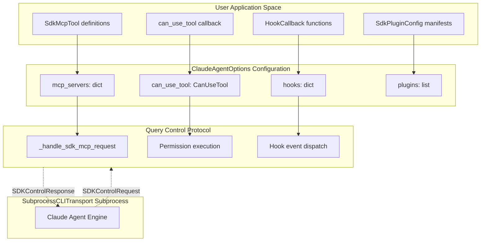
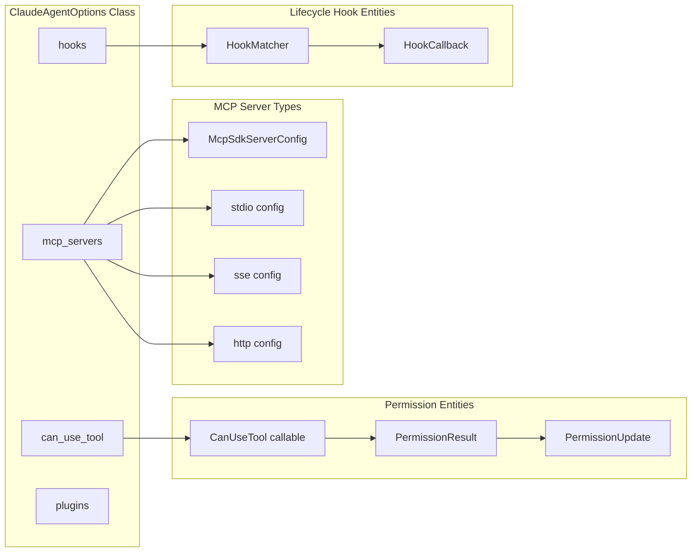
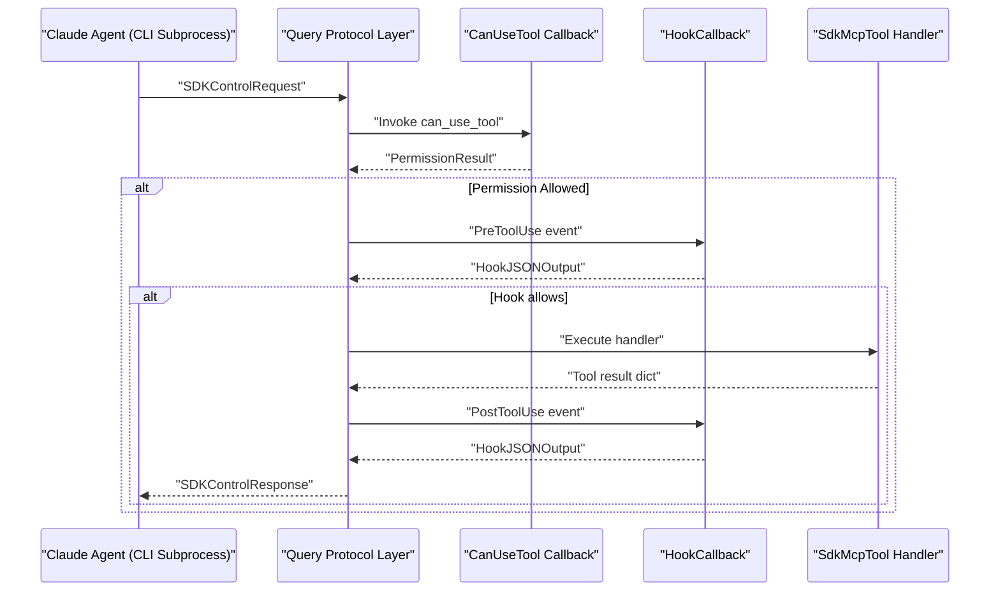

<!-- source: DeepWiki mcp.deepwiki.com · repo anthropics/claude-agent-sdk-python · page 5 Extension Points · fetched 2026-10-26 -->

# Extension Points

<details>
<summary>Relevant source files</summary>

The following files were used as context for generating this wiki page:

- [src/claude_agent_sdk/__init__.py](src/claude_agent_sdk/__init__.py)
- [tests/test_mcp_large_output.py](tests/test_mcp_large_output.py)
- [tests/test_sdk_mcp_integration.py](tests/test_sdk_mcp_integration.py)

</details>


## Purpose and Scope

This page documents the SDK's extensibility mechanisms that allow developers to customize and extend Claude's behavior. The SDK provides four primary extension points for injecting custom functionality:

- **SDK MCP Servers** - In-process tools that extend Claude's capabilities via the `@tool` decorator and `create_sdk_mcp_server()`. For details, see [Custom Tools (SDK MCP Servers)](#5.1).
- **Permission System and Callbacks** - Dynamic permission control for tool execution using `can_use_tool`. For details, see [Permission System and Callbacks](#5.2).  
- **Lifecycle Hooks** - Event-driven interception of agent operations using `HookMatcher` and `HookCallback`. For details, see [Lifecycle Hooks](#5.3).
- **Plugins and External MCP Servers** - External process integration via `SdkPluginConfig` and `mcp_servers`. For details, see [Plugins and External MCP Servers](#5.4).

For basic SDK usage without extensions, see [Basic Usage](#3). For configuration details, see [ClaudeAgentOptions Configuration Reference](#2.3).

Sources: [src/claude_agent_sdk/__init__.py:71-194]()

---

## Extension Mechanism Overview

The SDK provides extension points at multiple levels of the execution stack:

| Extension Type | Integration Method | Execution Context | Use Case |
|---------------|-------------------|-------------------|----------|
| SDK MCP Servers | `@tool` decorator + `create_sdk_mcp_server()` | In-process Python | Custom capabilities, application state access |
| Permission Callbacks | `ClaudeAgentOptions.can_use_tool` | In-process Python | Dynamic tool authorization |
| Lifecycle Hooks | `ClaudeAgentOptions.hooks` | In-process Python | Behavior monitoring and control |
| External MCP Servers | `McpServerConfig` (stdio/SSE/HTTP) | Subprocess/remote | Third-party tools, language-agnostic services |
| Plugins | `SdkPluginConfig` | External process | Packaged extensions |

Sources: [src/claude_agent_sdk/__init__.py:71-194]()

---

## Extension Architecture

### Diagram: Component Integration Space



Sources: [src/claude_agent_sdk/__init__.py:71-194](), [tests/test_sdk_mcp_integration.py:52-108]()

---

## Extension Configuration

All extension points are configured through `ClaudeAgentOptions` before starting a session:

### Diagram: Configuration Entity Tree



Sources: [src/claude_agent_sdk/__init__.py:71-194]()

---

## Type System for Extensions

The SDK provides strongly-typed interfaces for all extension points:

### Core Extension Types

| Type | Purpose | Key Fields | Defined At |
|------|---------|-----------|------------|
| `ToolAnnotations` | Tool behavior hints and limits | `readOnlyHint`, `maxResultSizeChars` | [src/claude_agent_sdk/__init__.py:213-228]() |
| `McpSdkServerConfig` | SDK server configuration | `type="sdk"`, `name`, `instance` | [src/claude_agent_sdk/__init__.py:99-100]() |
| `CanUseTool` | Permission callback signature | `(tool_name, input, context) -> PermissionResult` | [src/claude_agent_sdk/__init__.py:77-77]() |
| `HookCallback` | Hook callback signature | `(input, tool_use_id, context) -> HookJSONOutput` | [src/claude_agent_sdk/__init__.py:92-92]() |
| `HookMatcher` | Hook pattern matcher | `matcher`, `hooks`, `timeout` | [src/claude_agent_sdk/__init__.py:98-98]() |
| `PermissionUpdate` | Permission update configuration | `type`, `rules`, `behavior`, `mode` | [src/claude_agent_sdk/__init__.py:123-123]() |

Sources: [src/claude_agent_sdk/__init__.py:71-228]()

---

## Execution Flow with Extensions

### Diagram: Tool Execution Path with Extension Points



Sources: [src/claude_agent_sdk/__init__.py:71-194](), [tests/test_sdk_mcp_integration.py:52-108]()

---

## Extension Point Selection Guide

### Decision Matrix

| Requirement | Recommended Extension | Rationale |
|-------------|----------------------|-----------|
| Access application state/variables | SDK MCP Server | In-process execution, direct memory access |
| Call external APIs/services | SDK MCP Server | Async handler, native Python integration |
| Validate tool inputs before execution | Permission Callback | Synchronous gate before tool runs |
| Enforce security policies | Permission Callback | Direct allow/deny/modify control |
| Log/audit agent actions | Lifecycle Hooks | Event-driven, non-blocking |
| Add context to agent reasoning | Lifecycle Hooks | `additionalContext` in hook output |
| Integrate third-party tools | External MCP Server | Language-agnostic, subprocess isolation |
| Package reusable extensions | Plugin System | Distribution and discovery |

Sources: [src/claude_agent_sdk/__init__.py:71-194]()

---

## Extension Registration Patterns

### SDK MCP Server Registration

```python
from claude_agent_sdk import create_sdk_mcp_server, ClaudeAgentOptions

# Tools are defined using decorators and registered into an SDK MCP server config
server_config = create_sdk_mcp_server(
    name="my-server",
    version="1.0.0",
    tools=[]
)

options = ClaudeAgentOptions(
    mcp_servers={"my-server": server_config}
)
```

Sources: [src/claude_agent_sdk/__init__.py:40-41](), [tests/test_sdk_mcp_integration.py:128-141]()

---

## Next Steps

- **Custom Tools**: Learn how to create SDK MCP servers in detail ([Custom Tools (SDK MCP Servers)](#5.1))
- **Permission System**: Implement dynamic authorization ([Permission System and Callbacks](#5.2))
- **Lifecycle Hooks**: Monitor and control agent behavior ([Lifecycle Hooks](#5.3))
- **External Integration**: Connect external MCP servers and plugins ([Plugins and External MCP Servers](#5.4))

---

