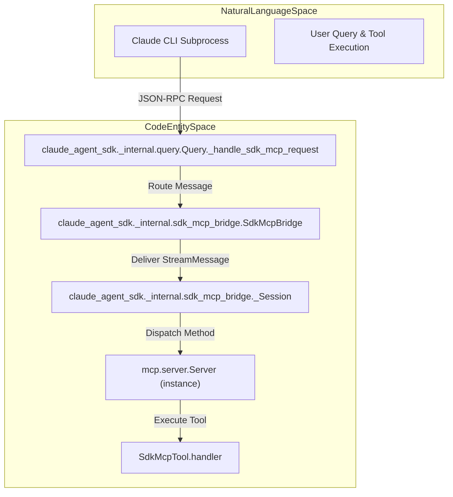
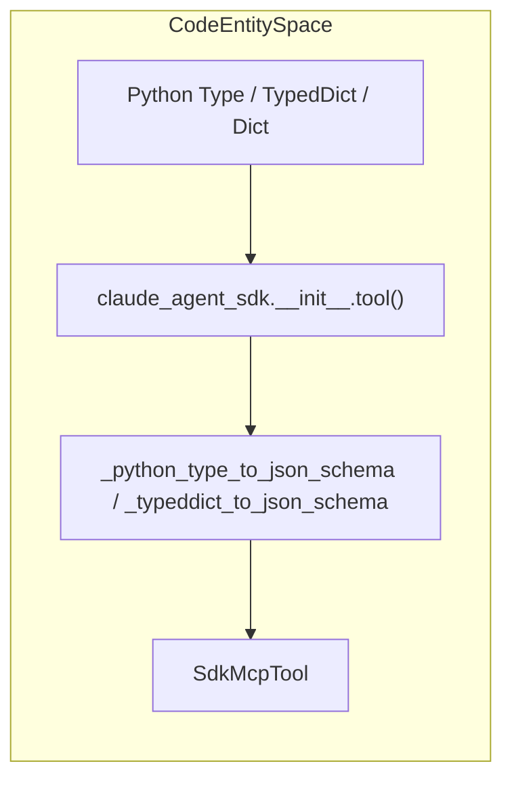
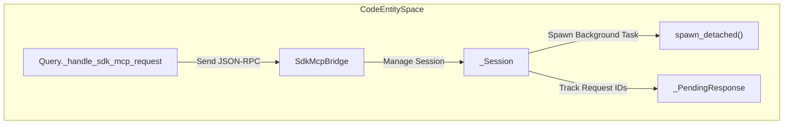

<!-- source: DeepWiki mcp.deepwiki.com · repo anthropics/claude-agent-sdk-python · page 5.1 Custom Tools (SDK MCP Servers) · fetched 2026-10-26 -->

# Custom Tools (SDK MCP Servers)

<details>
<summary>Relevant source files</summary>

The following files were used as context for generating this wiki page:

- [examples/tools_option.py](examples/tools_option.py)
- [src/claude_agent_sdk/__init__.py](src/claude_agent_sdk/__init__.py)
- [src/claude_agent_sdk/_internal/_mcp_compat.py](src/claude_agent_sdk/_internal/_mcp_compat.py)
- [src/claude_agent_sdk/_internal/_task_compat.py](src/claude_agent_sdk/_internal/_task_compat.py)
- [src/claude_agent_sdk/_internal/sdk_mcp_bridge.py](src/claude_agent_sdk/_internal/sdk_mcp_bridge.py)
- [tests/test_mcp_large_output.py](tests/test_mcp_large_output.py)
- [tests/test_sdk_mcp_integration.py](tests/test_sdk_mcp_integration.py)
- [tests/test_task_compat.py](tests/test_task_compat.py)

</details>


## Purpose and Scope

This page details the implementation of **SDK MCP (Model Context Protocol) servers** within the `claude-agent-sdk-python` library. SDK MCP servers allow developers to define custom tools as native asynchronous Python functions using the `@tool` decorator, bundle them with `create_sdk_mcp_server()`, and execute them entirely in-process via `SdkMcpBridge` without requiring external subprocesses, network sockets, or IPC overhead.

This mechanism bridges the Claude CLI's JSON-RPC control requests (`mcp_message`) directly to Python callables, supporting both `mcp` library major versions (1.x and 2.x) through a compatibility layer (`_mcp_compat.py`).

Sources: [src/claude_agent_sdk/__init__.py:1-41](), [src/claude_agent_sdk/_internal/sdk_mcp_bridge.py:1-22](), [src/claude_agent_sdk/_internal/_mcp_compat.py:1-18]()

---

## Architecture and Bridge Flow

When the Claude CLI needs to interact with an SDK MCP server, it transmits JSON-RPC requests through the SDK's control channel. The SDK intercepts these messages in `Query` and routes them into the in-process memory stream via `SdkMcpBridge` and `_Session`.

### Diagram: Natural Language Space to Code Entity Space (`SdkMcpBridge` Integration)



Sources: [src/claude_agent_sdk/_internal/sdk_mcp_bridge.py:1-22](), [tests/test_sdk_mcp_integration.py:52-67]()

---

## Core Types and Annotations

### SdkMcpTool and ToolAnnotations
The SDK defines specialized classes for handling tool definitions and hints:

| Class / Symbol | Defined In | Role / Description |
|----------------|------------|--------------------|
| `SdkMcpTool` | `src/claude_agent_sdk/__init__.py` | Dataclass representing an individual tool (`name`, `description`, `input_schema`, `handler`, `annotations`). |
| `ToolAnnotations` | `src/claude_agent_sdk/__init__.py` | Extends `_McpToolAnnotations` supporting both camelCase (1.x) and snake_case (2.x) hint spellings (`read_only_hint`, `destructive_hint`, `idempotent_hint`, `open_world_hint`, `max_result_size_chars`). |
| `McpSdkServerConfig` | `src/claude_agent_sdk/types.py` | TypedDict configuration schema for registering SDK servers (`type: "sdk"`, `name`, `instance`). |

The `ToolAnnotations` class maps snake_case hint names to wire camelCase equivalents using `_HINT_WIRE_NAMES`:

```python
_HINT_WIRE_NAMES = {
    "read_only_hint": "readOnlyHint",
    "destructive_hint": "destructiveHint",
    "idempotent_hint": "idempotentHint",
    "open_world_hint": "openWorldHint",
    "max_result_size_chars": "maxResultSizeChars",
}
```

Sources: [src/claude_agent_sdk/__init__.py:199-228](), [src/claude_agent_sdk/types.py:75-75]()

---

## Defining Tools with the `@tool` Decorator

The `@tool` decorator transforms an asynchronous Python function into an `SdkMcpTool` instance. 

### Schema Translation and Conversion
Tool input schemas can be defined using:
1. **Simple Dictionaries**: Mapping argument names to Python types (e.g., `str`, `int`).
2. **JSON Schema Dictionaries**: Full dictionary conformance to JSON Schema standards.
3. **TypedDict Classes**: Inspected automatically via `_typeddict_to_json_schema`.

### Diagram: Schema Translation Data Flow



Sources: [src/claude_agent_sdk/__init__.py:36-40](), [tests/test_sdk_mcp_integration.py:144-160]()

---

## Server Creation and Compatibility Layer (`create_sdk_mcp_server`)

`create_sdk_mcp_server()` instantiates an in-memory MCP server instance using `build_tool_server` from `_mcp_compat.py`. This isolates differences between `mcp` 1.x and 2.x (such as legacy decorator registration vs. constructor callbacks).

### Compatibility Routing (`_mcp_compat.py`)
- **MCP Major 2**: Uses constructor parameters (`on_list_tools`, `on_call_tool`) and `jsonrpc_message_adapter`.
- **MCP Major 1**: Uses legacy `.list_tools()` and `.call_tool(validate_input=False)` decorators, tracking cancel-safe servers via a `weakref.WeakSet`.

Sources: [src/claude_agent_sdk/_internal/_mcp_compat.py:36-154]()

---

## In-Process Invocation via `SdkMcpBridge`

The `SdkMcpBridge` coordinates message flow between the CLI control handler and the in-process `mcp.server.Server` using `create_client_server_memory_streams()`.

### Diagram: Session Lifecycle and Request Correlation



Each session runs as a single detached background task (`spawn_detached`) managing streams, request ID tables (`_PendingResponse`), and lifecycle timeouts (`SHUTDOWN_GRACE_SECONDS = 5.0`).

Sources: [src/claude_agent_sdk/_internal/sdk_mcp_bridge.py:43-155](), [src/claude_agent_sdk/_internal/_task_compat.py:147-184]()

---

## Large Output Handling and `maxResultSizeChars`

SDK MCP tool results interact with two independent spill thresholds inside the Claude CLI:
1. **Layer 1 (MCP-specific Token Limit)**: Governed by the `MAX_MCP_OUTPUT_TOKENS` environment variable (default ~25,000 tokens). The SDK automatically passes this through `SubprocessCLITransport`.
2. **Layer 2 (Generic Tool Result Character Limit)**: Hardcoded at 50,000 characters (`_LAYER2_THRESHOLD_CHARS`). Tools declaring `maxResultSizeChars` in `ToolAnnotations` are subject to persistence clamping if outputs exceed this threshold, returning a `<persisted-output>` tag with a 2 KB preview.

Sources: [src/claude_agent_sdk/__init__.py:209-227](), [tests/test_mcp_large_output.py:1-49]()

---

## Error Handling and Cancellation

- **Tool Error Flag**: Handlers can return `{"content": [...], "is_error": True}`, which maps to `CallToolResult.isError`.
- **Exception Propagation**: Unhandled exceptions raised within tool handlers are caught by the underlying `mcp` server wrapper and returned as JSON-RPC error responses.
- **Cancellation**: Request cancellation safety is verified via `can_cancel_requests(server)`, allowing MCP 2.x and SDK-built MCP 1.x servers to process client cancellations cleanly.

Sources: [src/claude_agent_sdk/_internal/_mcp_compat.py:98-110](), [tests/test_sdk_mcp_integration.py:100-103]()

---

