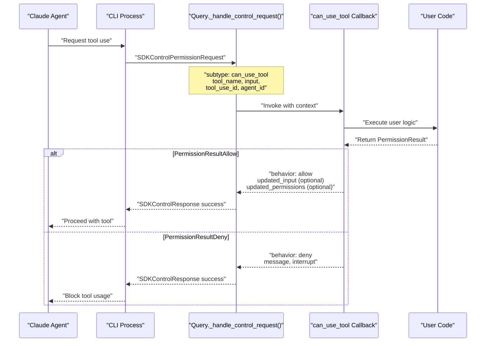
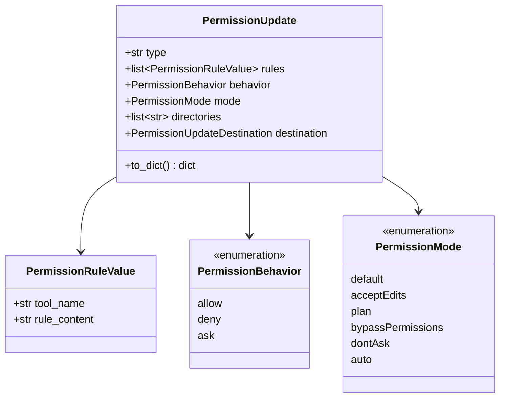

<!-- source: DeepWiki mcp.deepwiki.com · repo anthropics/claude-agent-sdk-python · page 5.2 Permission System and Callbacks · fetched 2026-10-26 -->

# Permission System and Callbacks

<details>
<summary>Relevant source files</summary>

The following files were used as context for generating this wiki page:

- [e2e-tests/test_sdk_mcp_tools.py](e2e-tests/test_sdk_mcp_tools.py)
- [e2e-tests/test_tool_permissions.py](e2e-tests/test_tool_permissions.py)
- [examples/mcp_calculator.py](examples/mcp_calculator.py)
- [examples/tool_permission_callback.py](examples/tool_permission_callback.py)
- [src/claude_agent_sdk/types.py](src/claude_agent_sdk/types.py)

</details>


This document covers the SDK's permission system, which enables fine-grained control over tool usage through callbacks and dynamic permission updates. For information about lifecycle hooks that intercept agent events, see [Lifecycle Hooks](5.3). For sandbox settings that control bash command isolation, see [Sandbox Settings](6.5).

## Overview

The permission system provides two mechanisms for controlling tool usage:

1. **Permission Callback (`can_use_tool`)**: An async callback that intercepts tool use requests, allowing you to approve, deny, or modify tool invocations at runtime.
2. **Permission Updates**: Structured updates that dynamically modify permission rules, modes, and allowed directories.

The permission callback is invoked through the bidirectional control protocol whenever the CLI agent needs permission to execute a tool. Your callback can inspect the tool name and input, then return a decision with optional modifications.

Sources: [src/claude_agent_sdk/types.py:25-27](), [src/claude_agent_sdk/types.py:146-198](), [e2e-tests/test_tool_permissions.py:34-43]()

## Permission Callback Architecture

The following diagram illustrates the flow from a tool request within the CLI to the user-defined callback in the SDK.

### Sequence: Tool Permission Request Flow



Sources: [src/claude_agent_sdk/types.py:146-198](), [e2e-tests/test_tool_permissions.py:34-43](), [examples/tool_permission_callback.py:26-94]()

## The can_use_tool Callback

### Callback Signature

The `can_use_tool` callback is defined as a `Callable` in `ClaudeAgentOptions`:

```python
# Defined via ClaudeAgentOptions
can_use_tool: Callable[
    [str, dict[str, Any], ToolPermissionContext], 
    Awaitable[PermissionResultAllow | PermissionResultDeny]
] | None
```

**Parameters:**
1. `tool_name: str`: Name of the tool being requested (e.g., `"Bash"`, `"Edit"`, `"Read"`).
2. `input_data: dict[str, Any]`: Tool input parameters.
3. `context: ToolPermissionContext`: Additional context including permission suggestions and IDs.

**Returns:** Either `PermissionResultAllow` or `PermissionResultDeny`.

Sources: [src/claude_agent_sdk/types.py:25-27](), [e2e-tests/test_tool_permissions.py:34-43]()

### ToolPermissionContext

The `ToolPermissionContext` provides metadata for making permission decisions:

| Field | Type | Description |
| :--- | :--- | :--- |
| `signal` | `Any | None` | Reserved for future abort signal support. |
| `suggestions` | `list[PermissionUpdate]` | Permission suggestions from the CLI based on blocked paths or rules. |
| `tool_use_id` | `str | None` | Unique identifier for this specific tool call within the assistant message. |
| `agent_id` | `str | None` | If running within a sub-agent, the sub-agent's ID. |

The `suggestions` field is populated when the CLI encounters a blocked operation and recommends specific permission updates. `tool_use_id` allows correlating permission requests with specific tool use events in the message stream.

Sources: [src/claude_agent_sdk/types.py:146-198](), [examples/tool_permission_callback.py:37]()

## Permission Result Types

### PermissionResultAllow

Grants permission for the tool to execute, with optional modifications:

| Field | Type | Default | Description |
| :--- | :--- | :--- | :--- |
| `behavior` | `Literal["allow"]` | `"allow"` | Explicitly allow the tool. |
| `updated_input` | `dict[str, Any] | None` | `None` | Modified tool input parameters (e.g., changing a file path). |
| `updated_permissions` | `list[PermissionUpdate] | None` | `None` | Permission rules to apply to the session or settings. |

Sources: [src/claude_agent_sdk/types.py:146-198](), [examples/tool_permission_callback.py:63-65]()

### PermissionResultDeny

Denies permission for the tool to execute:

| Field | Type | Default | Description |
| :--- | :--- | :--- | :--- |
| `behavior` | `Literal["deny"]` | `"deny"` | Explicitly deny the tool. |
| `message` | `str` | `""` | Explanation shown to the agent for the denial. |
| `interrupt` | `bool` | `False` | If `True`, stops the entire task execution. |

Sources: [src/claude_agent_sdk/types.py:146-198](), [examples/tool_permission_callback.py:53-55]()

## Permission Updates

`PermissionUpdate` enables dynamic modification of permission rules, modes, and directories.

### PermissionUpdate Structure



Sources: [src/claude_agent_sdk/types.py:25-27](), [src/claude_agent_sdk/types.py:130-162]()

### Update Types

The `type` field determines the update action:

| Type | Purpose |
| :--- | :--- |
| `"addRules"` | Append new rules to existing permissions. |
| `"replaceRules"` | Replace all existing rules. |
| `"removeRules"` | Remove matching rules. |
| `"setMode"` | Switch between modes (e.g., `default` to `bypassPermissions`). |
| `"addDirectories"` | Grant access to additional file system directories. |
| `"removeDirectories"` | Revoke access to directories. |

Sources: [src/claude_agent_sdk/types.py:149-156]()

### Serialization

The `to_dict()` method converts `PermissionUpdate` to the camelCase format expected by the CLI control protocol (e.g., `tool_name` becomes `toolName`, `rule_content` becomes `ruleContent`).

Sources: [src/claude_agent_sdk/types.py:163-197]()

## Permission Modes

Permission modes control the default behavior for tool usage:

| Mode | Behavior |
| :--- | :--- |
| `"default"` | Prompt for each tool use (invokes `can_use_tool`). |
| `"acceptEdits"` | Auto-approve Edit/Write/MultiEdit tools. |
| `"plan"` | Agent plans without executing (read-only mode). |
| `"bypassPermissions"` | Skip all permission checks (use with caution). |
| `"dontAsk"` | Do not prompt the user; rely on existing rules. |
| `"auto"` | Automatic mode selection based on context. |

Sources: [src/claude_agent_sdk/types.py:25-27]()

## Practical Patterns

### Allowing, Denying, and Modifying Input

The following pattern demonstrates how to implement a custom permission callback that handles read-only tools, system write protections, path redirection, and bash command safety checks:

```python
async def my_permission_callback(
    tool_name: str,
    input_data: dict,
    context: ToolPermissionContext
) -> PermissionResultAllow | PermissionResultDeny:
    # 1. ALLOW: Always allow read operations
    if tool_name in ["Read", "Glob", "Grep"]:
        return PermissionResultAllow()

    # 2. DENY: Block writes to system directories
    if tool_name in ["Write", "Edit", "MultiEdit"]:
        file_path = input_data.get("file_path", "")
        if file_path.startswith("/etc/") or file_path.startswith("/usr/"):
            return PermissionResultDeny(
                message=f"Cannot write to system directory: {file_path}"
            )

        # 3. MODIFY: Redirect writes to a safe directory
        if not file_path.startswith("/tmp/") and not file_path.startswith("./"):
            modified_input = input_data.copy()
            modified_input["file_path"] = f"./safe_output/{file_path.split('/')[-1]}"
            return PermissionResultAllow(updated_input=modified_input)

    # 4. BASH SAFETY: Check for dangerous commands
    if tool_name == "Bash":
        command = input_data.get("command", "")
        if "rm -rf /" in command:
            return PermissionResultDeny(message="Destructive command blocked")

    return PermissionResultAllow()
```

Sources: [examples/tool_permission_callback.py:26-94](), [e2e-tests/test_tool_permissions.py:34-43]()

---

