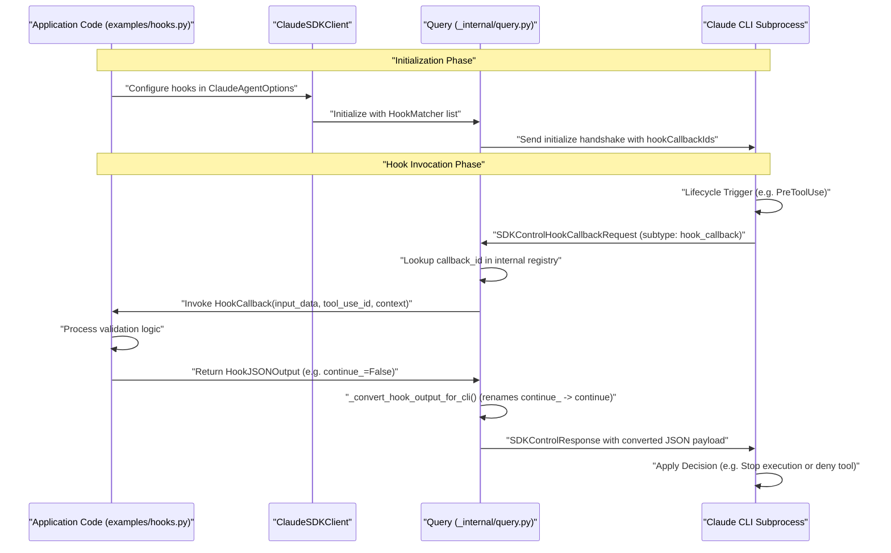
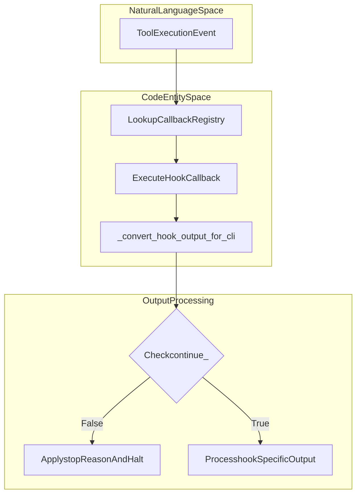

<!-- source: DeepWiki mcp.deepwiki.com · repo anthropics/claude-agent-sdk-python · page 5.3 Lifecycle Hooks · fetched 2026-10-26 -->

# Lifecycle Hooks

<details>
<summary>Relevant source files</summary>

The following files were used as context for generating this wiki page:

- [e2e-tests/conftest.py](e2e-tests/conftest.py)
- [e2e-tests/test_hook_events.py](e2e-tests/test_hook_events.py)
- [e2e-tests/test_hooks.py](e2e-tests/test_hooks.py)
- [e2e-tests/test_structured_output.py](e2e-tests/test_structured_output.py)
- [examples/hooks.py](examples/hooks.py)
- [tests/test_tool_callbacks.py](tests/test_tool_callbacks.py)

</details>


This page documents the lifecycle hook system that allows Python callbacks to be invoked at key events during Claude agent execution. Hooks enable deterministic processing, automated validation, and fine-grained control over agent behavior by intercepting communication between the SDK and the underlying Claude CLI.

For information about tool permission control, see [Permission System and Callbacks](5.2). For custom tool definitions, see [Custom Tools (SDK MCP Servers)](5.1).

---

## Overview

The hook system provides callback invocation at critical lifecycle events in the Claude agent loop. Each hook receives strongly-typed input data and can return output that controls execution flow, blocks operations, or provides additional context to Claude.

**Key Capabilities:**
- Intercept tool invocations before and after execution via `PreToolUse`, `PostToolUse`, and `PostToolUseFailure`.
- Validate and modify tool inputs or decisions.
- Block tool usage based on custom logic using `permissionDecision: "deny"` or `continue_: False`.
- Inject additional context into the conversation using `additionalContext`.
- Monitor agent events (notifications, subagent lifecycle).
- Stop or pause agent execution with a custom `stopReason`.

Sources: [examples/hooks.py:46-70](), [e2e-tests/test_hooks.py:17-48](), [e2e-tests/test_hook_events.py:19-39]()

---

## Hook Event Types

The SDK supports various hook events configured through the options dictionary and handled via matchers:

| Event | Trigger | Primary Use Case |
|-------|---------|------------------|
| `PreToolUse` | Before tool execution | Validate/modify tool inputs, permission decisions |
| `PostToolUse` | After successful tool execution | Log results, inject context, monitor outputs |
| `PostToolUseFailure` | After tool execution failure | Handle errors, retry logic, warnings |
| `UserPromptSubmit` | When user submits a prompt | Validate user input, inject context |
| `Stop` | When agent stops | Cleanup, save state |
| `SubagentStop` | When subagent completes | Track subagent results |
| `PreCompact` | Before conversation compaction | Control compaction behavior |
| `Notification` | When agent sends notification | Monitor agent actions |
| `SubagentStart` | When subagent launches | Track subagent initialization |
| `PermissionRequest` | When permission is requested | Custom permission logic |

Sources: [examples/hooks.py:46-154](), [e2e-tests/test_hook_events.py:19-142]()

---

## Hook Configuration

Hooks are configured through the `hooks` field in `ClaudeAgentOptions`, which maps each `HookEvent` name to a list of `HookMatcher` objects.

### HookMatcher Configuration

```python
@dataclass
class HookMatcher:
    matcher: str | None = None  # Pattern to match (e.g., "Bash", "Read|Write")
    hooks: list[HookCallback] = field(default_factory=list)  # Callback functions
    timeout: float | None = None  # Timeout in seconds (default: 60)
```

The `matcher` field uses patterns specific to each hook event:
- A tool name like `"Bash"` or `"Write"`.
- A combination of tool names like `"Write|MultiEdit|Edit"`.
- `None` to match all events of that type.

Sources: [examples/hooks.py:161-169](), [e2e-tests/test_hooks.py:50-57]()

---

## Hook Callback Interface and HookInput Unions

Hook callbacks must match the `HookCallback` type signature, accepting input data, an optional tool use ID, and a context object.

```python
HookCallback = Callable[
    [HookInput, str | None, HookContext],
    Awaitable[HookJSONOutput]
]
```

### Parameters
- `input_data`: `HookInput` — Strongly-typed input containing session metadata, working directory (`cwd`), transcript path, and event-specific fields (such as `tool_name`, `tool_input`, `tool_response`, or `notification_type`).
- `tool_use_id`: `str | None` — Optional tool use identifier present for tool-related hooks (`PreToolUse`, `PostToolUse`).
- `context`: `HookContext` — Context object providing execution controls.

Sources: [examples/hooks.py:46-48](), [e2e-tests/test_hook_events.py:23-25]()

---

## Hook JSON Output and Field Renaming for the CLI

Hook callbacks return `HookJSONOutput`, which can control execution flow and provide feedback to Claude. 

### Output Fields and Python-to-CLI Field Renaming
To avoid Python keyword conflicts, the SDK uses trailing underscores (`async_`, `continue_`) in Python TypedDict definitions. Before sending data to the Claude CLI subprocess, these fields are renamed:
- `continue_` becomes `continue`
- `async_` becomes `async`

### Synchronous Hook Output Structure
- `continue_`: `bool` — Whether to proceed with execution (default: `True`).
- `suppressOutput`: `bool` — Hide output from transcript.
- `stopReason`: `str` — Message shown when `continue_` is `False`.
- `systemMessage`: `str` — Warning message displayed to the user.
- `reason`: `str` — Feedback for Claude's reasoning loop.
- `hookSpecificOutput`: Dictionary supporting event-specific options:
  - **PreToolUse**: `permissionDecision` (`"allow"` / `"deny"`), `permissionDecisionReason`, `additionalContext`.
  - **PostToolUse / Notification / SessionStart**: `additionalContext`.

Sources: [examples/hooks.py:62-68](), [examples/hooks.py:147-153](), [e2e-tests/test_hooks.py:30-48](), [e2e-tests/test_hooks.py:85-91]()

---

## Hook Execution and Control Flow Diagrams

The following diagrams bridge the Natural Language lifecycle events to the internal SDK `Query` and transport execution logic, mapping how hook inputs and outputs flow through the system.

### Diagram: Lifecycle Hook Invocation Sequence



Sources: [examples/hooks.py:161-169](), [e2e-tests/test_hooks.py:50-57]()

### Diagram: Hook Output Control Flow



Sources: [examples/hooks.py:62-68](), [examples/hooks.py:147-153](), [e2e-tests/test_hooks.py:30-48]()

---

## Common Usage Patterns

### Blocking Specific Commands (`PreToolUse`)
Using `PreToolUse` to intercept and block specific bash commands based on pattern matching:

```python
async def check_bash_command(input_data: HookInput, tool_use_id: str | None, context: HookContext) -> HookJSONOutput:
    tool_name = input_data.get("tool_name")
    tool_input = input_data.get("tool_input", {})
    if tool_name == "Bash" and "foo.sh" in tool_input.get("command", ""):
        return {
            "continue_": False,
            "stopReason": "Dangerous command blocked by policy",
            "hookSpecificOutput": {
                "hookEventName": "PreToolUse",
                "permissionDecision": "deny",
                "permissionDecisionReason": "Security policy blocks destructive commands",
            },
        }
    return {"continue_": True}
```

Sources: [examples/hooks.py:46-70](), [e2e-tests/test_hooks.py:17-48]()

### Stopping on Critical Errors (`PostToolUse`)
Using `continue_ = False` to halt execution when critical error strings appear in tool output:

```python
async def stop_on_error_hook(input_data: HookInput, tool_use_id: str | None, context: HookContext) -> HookJSONOutput:
    tool_response = input_data.get("tool_response", "")
    if "critical" in str(tool_response).lower():
        return {
            "continue_": False,
            "stopReason": "Critical error detected - execution halted for safety",
            "systemMessage": "🛑 Execution stopped due to critical error",
        }
    return {"continue_": True}
```

Sources: [examples/hooks.py:138-153](), [e2e-tests/test_hooks.py:74-91]()

### Providing Additional Context (`PostToolUse`)
Injecting monitoring details and additional context into the agent loop:

```python
async def context_hook(input_data: HookInput, tool_use_id: str | None, context: HookContext) -> HookJSONOutput:
    return {
        "systemMessage": "Additional context provided by hook",
        "reason": "Hook providing monitoring feedback",
        "hookSpecificOutput": {
            "hookEventName": "PostToolUse",
            "additionalContext": "The command executed successfully with hook monitoring",
        },
    }
```

Sources: [examples/hooks.py:85-102](), [e2e-tests/test_hooks.py:117-136]()

---

