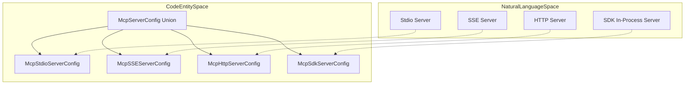
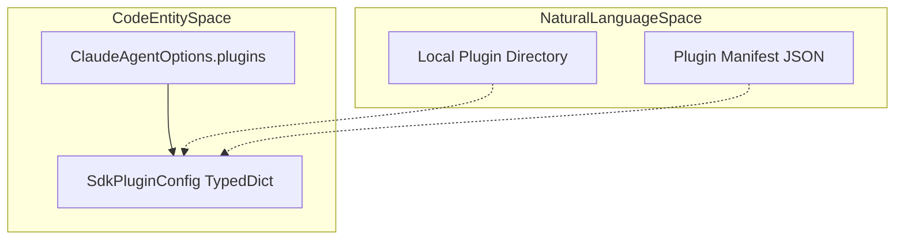
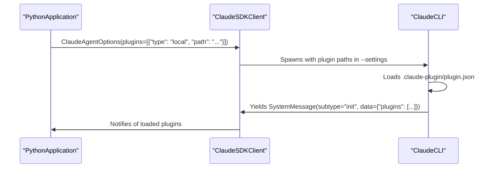
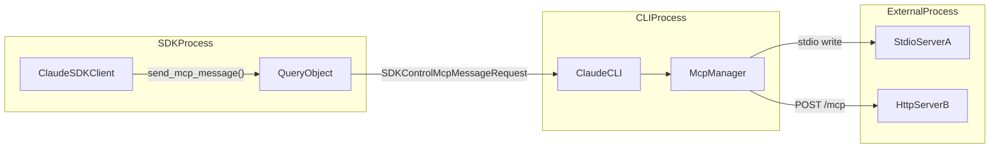

<!-- source: DeepWiki mcp.deepwiki.com · repo anthropics/claude-agent-sdk-python · page 5.4 Plugins and External MCP Servers · fetched 2026-10-26 -->

# Plugins and External MCP Servers

Relevant source files

The following files were used as context for generating this wiki page:

- [examples/plugin_example.py](examples/plugin_example.py)
- [examples/plugins/demo-plugin/.claude-plugin/plugin.json](examples/plugins/demo-plugin/.claude-plugin/plugin.json)
- [examples/plugins/demo-plugin/commands/greet.md](examples/plugins/demo-plugin/commands/greet.md)
- [src/claude_agent_sdk/types.py](src/claude_agent_sdk/types.py)

## Purpose and Scope

This page documents how to integrate external MCP (Model Context Protocol) servers and plugins with the Claude Agent SDK. External MCP servers run as separate processes or network services, enabling Claude to access tools and resources beyond the built-in toolset. For in-process SDK MCP servers using the `@tool` decorator, see [5.1 Custom Tools (SDK MCP Servers)]().

**Key Distinction:**
- **SDK MCP Servers**: In-process Python tools defined using the `@tool` decorator [src/claude_agent_sdk/__init__.py:170-175]() and `create_sdk_mcp_server()` [src/claude_agent_sdk/client.py:46-47](). These eliminate subprocess management and IPC overhead by running within the SDK's environment.
- **External MCP Servers**: Standalone servers communicating via `stdio`, `sse`, or `http` [src/claude_agent_sdk/types.py:468-491]().
- **Plugins**: Custom command and agent extensions loaded from a local directory [src/claude_agent_sdk/types.py:507-515]().

Sources: [src/claude_agent_sdk/types.py:468-515](), [src/claude_agent_sdk/client.py:46-47](), [src/claude_agent_sdk/__init__.py:170-175]()

## MCP Server Configuration Types

The SDK supports four types of MCP server connections, defined as a discriminated union in `McpServerConfig` [src/claude_agent_sdk/types.py:503-504]():

### Entity Mapping: Configuration to Code

The following diagram maps the conceptual configuration types to their respective `TypedDict` and `dataclass` definitions in the codebase.

Title: MCP Configuration Type Mapping

Sources: [src/claude_agent_sdk/types.py:468-504]()

### Configuration Details

| Class / Type | `type` Literal | Key Fields | Purpose |
| :--- | :--- | :--- | :--- |
| `McpStdioServerConfig` | `"stdio"` | `command`, `args`, `env` | Subprocess-based servers communicating via standard I/O [src/claude_agent_sdk/types.py:469-476](). |
| `McpSSEServerConfig` | `"sse"` | `url`, `headers` | Server-Sent Events over HTTP for real-time updates [src/claude_agent_sdk/types.py:478-483](). |
| `McpHttpServerConfig` | `"http"` | `url`, `headers` | Standard stateless HTTP MCP endpoint [src/claude_agent_sdk/types.py:486-491](). |
| `McpSdkServerConfig` | `"sdk"` | `name`, `instance` | In-process `mcp.server.Server` instance [src/claude_agent_sdk/types.py:494-500](). |

The `McpStdioServerConfig` allows passing environment variables via the `env` field [src/claude_agent_sdk/types.py:475](). This is critical for servers requiring API keys or specific runtime paths. Additionally, environment variables can be passed globally via `ClaudeAgentOptions.env` [src/claude_agent_sdk/types.py:772](), which the `SubprocessCLITransport` merges with the system environment [tests/test_mcp_large_output.py:147-152]().

Sources: [src/claude_agent_sdk/types.py:469-500](), [src/claude_agent_sdk/types.py:772](), [tests/test_mcp_large_output.py:147-152]()

## Configuration Formats for `mcp_servers`

The `mcp_servers` field in `ClaudeAgentOptions` [src/claude_agent_sdk/types.py:722]() is polymorphic and supports three primary input formats.

### 1. Dictionary Configuration
A `dict[str, McpServerConfig]` where keys are server names and values are the configurations described above.
- **Implementation**: The SDK serializes this into the `--settings` argument for the CLI [src/claude_agent_sdk/types.py:722]().
- **Integration**: `create_sdk_mcp_server` produces a config of type `"sdk"` that can be included in this dictionary [tests/test_sdk_mcp_integration.py:46-51]().

### 2. File Path Configuration
A `str` or `Path` pointing to a `.json` file containing MCP configurations (similar to `claude_desktop_config.json`).
- **Implementation**: The SDK passes the path to the CLI, which reads the file directly [src/claude_agent_sdk/types.py:722]().

### 3. JSON String Configuration
A raw JSON string starting with `{` containing the MCP server definitions.

Sources: [src/claude_agent_sdk/types.py:722](), [tests/test_sdk_mcp_integration.py:46-51]()

## Plugin System

Plugins allow extending the bundled Claude CLI with custom commands (e.g., `/greet`), agents, and skills. They are configured via the `plugins` field in `ClaudeAgentOptions` [src/claude_agent_sdk/types.py:770]().

### SdkPluginConfig and Entity Mapping
Currently, the SDK supports local plugins defined via manifest structures [src/claude_agent_sdk/types.py:507-515]():
- `type`: Must be `"local"`.
- `path`: Absolute or relative path to the plugin directory containing a `.claude-plugin/plugin.json` manifest [examples/plugins/demo-plugin/.claude-plugin/plugin.json:1-8]().

Title: Plugin Configuration Type Mapping

Sources: [src/claude_agent_sdk/types.py:507-515](), [examples/plugins/demo-plugin/.claude-plugin/plugin.json:1-8]()

### Plugin Data Flow
When a plugin is loaded, its metadata (name, path) is included in the `SystemMessage` with `subtype="init"` under the `data["plugins"]` key [examples/plugin_example.py:45-55]().

Title: Plugin Loading Sequence

Sources: [src/claude_agent_sdk/types.py:507-515](), [examples/plugin_example.py:23-62](), [examples/plugins/demo-plugin/.claude-plugin/plugin.json:1-8]()

## Integration with Control Protocol

External MCP servers are managed by the bundled CLI, but the SDK can interact with them via the bidirectional control protocol.

### MCP Message Routing
The `SDKControlMcpMessageRequest` [src/claude_agent_sdk/types.py:820-824]() allows the SDK to send messages to a specific named MCP server via the `send_mcp_message` method on the client.

Title: MCP Message Routing through Control Protocol

- **Server Names**: The `server_name` in the control request must match the key provided in the `mcp_servers` dictionary [src/claude_agent_sdk/types.py:822]().
- **Opaque Messages**: The `message` field is a `dict[str, Any]` representing the raw MCP protocol message [src/claude_agent_sdk/types.py:823]().

Sources: [src/claude_agent_sdk/types.py:820-824]()

## Large Output Handling

When an MCP server returns a large result, the bundled CLI may apply two layers of "spilling" or persistence [tests/test_mcp_large_output.py:3-17]():

1.  **Layer 1 (Token Limit)**: Governed by `MAX_MCP_OUTPUT_TOKENS` environment variable (default ~25,000 tokens). If exceeded, it spills to a plain error string [tests/test_mcp_large_output.py:6-9]().
2.  **Layer 2 (Character Limit)**: Hardcoded threshold of 50,000 characters. If exceeded, it persists the output and provides a `<persisted-output>` tag with a 2KB preview [tests/test_mcp_large_output.py:11-17]().

The SDK message parser surfaces these `<persisted-output>` tags unchanged so callers can detect degraded paths [tests/test_mcp_large_output.py:33-34]().

Sources: [tests/test_mcp_large_output.py:3-34]()

## Summary of Differences

| Feature | SDK MCP Servers (In-Process) | External MCP Servers |
| :--- | :--- | :--- |
| **Location** | Same Python process as SDK | Separate process or remote service |
| **Definition** | `@tool` decorator [src/claude_agent_sdk/__init__.py:170-175]() | External executable or URL [src/claude_agent_sdk/types.py:468-491]() |
| **Config Class** | `McpSdkServerConfig` | `McpStdio/SSE/HttpServerConfig` |
| **Communication** | Direct function calls via Control Protocol | Stdio pipes or Network (HTTP/SSE) |
| **Lifecycle** | Managed by Python application | Managed by Claude CLI subprocess |

Sources: [src/claude_agent_sdk/types.py:468-504](), [src/claude_agent_sdk/client.py:46-55](), [src/claude_agent_sdk/__init__.py:170-175]()

---

