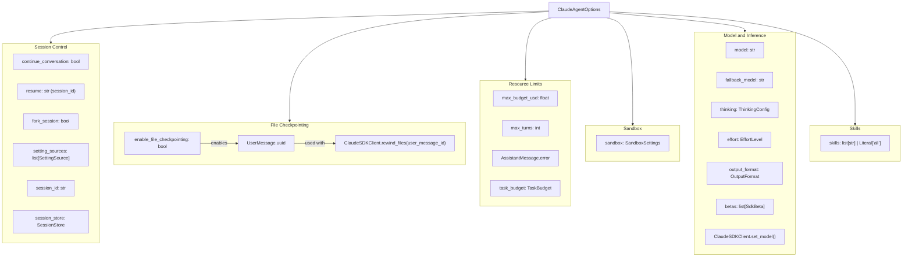
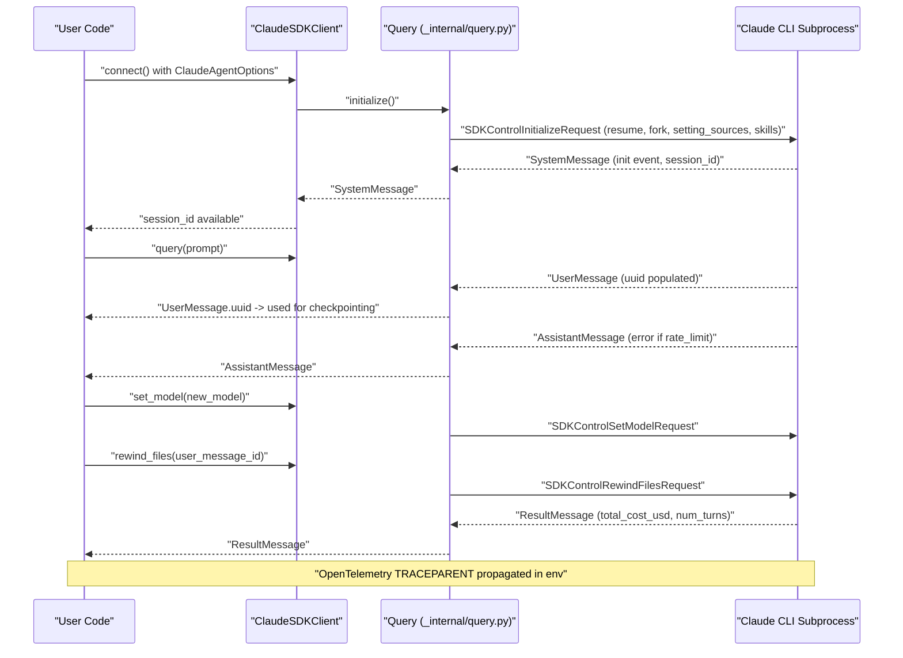

<!-- source: DeepWiki mcp.deepwiki.com · repo anthropics/claude-agent-sdk-python · page 6 Advanced Features · fetched 2026-10-26 -->

# Advanced Features

Relevant source files

The following files were used as context for generating this wiki page:

- [e2e-tests/test_parallel_tool_session_reads.py](e2e-tests/test_parallel_tool_session_reads.py)
- [src/claude_agent_sdk/_internal/sessions.py](src/claude_agent_sdk/_internal/sessions.py)
- [tests/test_session_helpers_store.py](tests/test_session_helpers_store.py)
- [tests/test_sessions.py](tests/test_sessions.py)

This section covers the less-common but important capabilities of the SDK that go beyond basic prompt-response interaction. Topics include session continuity and branching, transcript persistence, filesystem checkpointing, resource limits, sandboxing, model/thinking configuration, skills, and distributed tracing.

For foundational configuration fields like `system_prompt`, `tools`, and `permission_mode`, see [ClaudeAgentOptions Configuration Reference](#2.3). For custom tool integration and hooks, see [Extension Points](#5).

Sources: [src/claude_agent_sdk/types.py:441-558](), [src/claude_agent_sdk/client.py:26-65]()

---

## Feature Overview

The advanced features in this section are all controlled through fields on `ClaudeAgentOptions` (defined in `src/claude_agent_sdk/types.py`) or through methods on `ClaudeSDKClient` (defined in `src/claude_agent_sdk/client.py`). The table below maps each capability to its primary API surface.

| Capability | Primary API | Detail Page |
|---|---|---|
| Session continuation | `ClaudeAgentOptions.continue_conversation` | [Session Management and Forking](#6.1) |
| Session resumption by ID | `ClaudeAgentOptions.resume` | [Session Management and Forking](#6.1) |
| Session forking | `ClaudeAgentOptions.fork_session` | [Session Management and Forking](#6.1) |
| Settings isolation | `ClaudeAgentOptions.setting_sources` | [Session Management and Forking](#6.1) |
| Transcript Persistence | `SessionStore` Protocol | [SessionStore: Transcript Persistence](#6.2) |
| File checkpointing | `ClaudeAgentOptions.enable_file_checkpointing` | [File Checkpointing and Rewinding](#6.3) |
| File rewind | `ClaudeSDKClient.rewind_files()` | [File Checkpointing and Rewinding](#6.3) |
| Spending cap | `ClaudeAgentOptions.max_budget_usd` | [Resource Limits and Cost Control](#6.4) |
| Turn limit | `ClaudeAgentOptions.max_turns` | [Resource Limits and Cost Control](#6.4) |
| Rate limit detection | `AssistantMessage.error` | [Resource Limits and Cost Control](#6.4) |
| Sandbox restrictions | `ClaudeAgentOptions.sandbox` | [Sandbox Settings](#6.5) |
| Model selection | `ClaudeAgentOptions.model` / `ClaudeSDKClient.set_model()` | [Model Selection, Thinking, and Output Formats](#6.6) |
| Thinking depth | `ClaudeAgentOptions.thinking` / `ClaudeAgentOptions.effort` | [Model Selection, Thinking, and Output Formats](#6.6) |
| Structured output | `ClaudeAgentOptions.output_format` | [Model Selection, Thinking, and Output Formats](#6.6) |
| Extended context | `ClaudeAgentOptions.betas` | [Model Selection, Thinking, and Output Formats](#6.6) |
| Skills system | `ClaudeAgentOptions.skills` | [Skills System](#6.7) |
| Distributed tracing | `pip install claude-agent-sdk[otel]` | [Distributed Tracing (OpenTelemetry)](#6.8) |

Sources: [src/claude_agent_sdk/types.py:441-558](), [src/claude_agent_sdk/client.py:26-65](), [src/claude_agent_sdk/types.py:615-635]()

---

## How Advanced Features Relate to ClaudeAgentOptions

The `ClaudeAgentOptions` class serves as the central configuration hub. Advanced behaviors are toggled by populating specific fields before passing the options to a `ClaudeSDKClient` or the `query()` function.

**Diagram: ClaudeAgentOptions Advanced Fields**

Sources: [src/claude_agent_sdk/types.py:441-558](), [src/claude_agent_sdk/client.py:314-319](), [src/claude_agent_sdk/types.py:62-71]()

---

## Runtime Interaction of Advanced Features

Several of these features interact at runtime rather than only at initialization. For instance, the SDK manages a bidirectional control protocol to update models or rewind state while a session is active.

**Diagram: Runtime Feature Interaction**

Sources: [src/claude_agent_sdk/client.py:99-135](), [src/claude_agent_sdk/client.py:314-329](), [src/claude_agent_sdk/types.py:410-438]()

---

## Subsection Summaries

### Session Management and Forking
Covered in [Session Management and Forking](#6.1). Addresses how to continue an existing conversation (`continue_conversation`), resume a specific past session by its ID (`resume`), branch a session into multiple threads (`fork_session`), and control which filesystem settings directories are loaded (`setting_sources`). 
*   **Key Types**: `SettingSource` [src/claude_agent_sdk/types.py:33-33](), `SystemMessage` [src/claude_agent_sdk/types.py:236-250]().

Sources: [src/claude_agent_sdk/_internal/sessions.py:1-50]()

### SessionStore: Transcript Persistence
Covered in [SessionStore: Transcript Persistence](#6.2). Documents the `SessionStore` protocol [src/claude_agent_sdk/types.py:615-635]() for persisting conversation transcripts to external backends like S3, Redis, or Postgres. It covers the `SessionKey` structure, `InMemorySessionStore` implementation, and the `TranscriptMirrorBatcher` for handling transcript synchronization.

Sources: [src/claude_agent_sdk/types.py:615-635]()

### File Checkpointing and Rewinding
Covered in [File Checkpointing and Rewinding](#6.3). Addresses how `enable_file_checkpointing` [src/claude_agent_sdk/types.py:537-537]() activates file state capture per message turn. `UserMessage.uuid` [src/claude_agent_sdk/types.py:221-221]() identifies the checkpoint, and `ClaudeSDKClient.rewind_files(user_message_id)` [src/claude_agent_sdk/client.py:314-319]() restores filesystem state to that point.

Sources: [src/claude_agent_sdk/types.py:537-537](), [src/claude_agent_sdk/client.py:314-319]()

### Resource Limits and Cost Control
Covered in [Resource Limits and Cost Control](#6.4). Addresses `max_budget_usd` [src/claude_agent_sdk/types.py:553-553]() for a session-level spending cap, `max_turns` [src/claude_agent_sdk/types.py:554-554]() to limit conversation length, and the `AssistantMessage.error` [src/claude_agent_sdk/types.py:263-263]() field for detecting API-level errors. Also covers `TaskBudget` [src/claude_agent_sdk/types.py:64-75]() for model-aware token pacing.

Sources: [src/claude_agent_sdk/types.py:553-554](), [src/claude_agent_sdk/types.py:64-75]()

### Sandbox Settings
Covered in [Sandbox Settings](#6.5). The `SandboxSettings` [src/claude_agent_sdk/types.py:356-368]() TypedDict controls which shell commands are excluded, network access restrictions via `SandboxNetworkConfig` [src/claude_agent_sdk/types.py:339-346](), and whether sandbox violations terminate the session.

Sources: [src/claude_agent_sdk/types.py:339-368]()

### Model Selection, Thinking, and Output Formats
Covered in [Model Selection, Thinking, and Output Formats](#6.6). Addresses the `model` and `fallback_model` fields, the `thinking` field (`ThinkingConfigAdaptive`, etc.) [src/claude_agent_sdk/types.py:382-396]() for reasoning control, the `effort` field [src/claude_agent_sdk/types.py:378-378](), `output_format` [src/claude_agent_sdk/types.py:402-407]() for structured JSON outputs, and `betas` [src/claude_agent_sdk/types.py:30-30]() for API feature flags.

Sources: [src/claude_agent_sdk/types.py:378-407]()

### Skills System
Covered in [Skills System](#6.7). The `skills` parameter in `ClaudeAgentOptions` [src/claude_agent_sdk/types.py:549-549]() provides a high-level way to enable discovered skills (e.g., `pdf`, `docx`) without manually configuring tools. Setting `skills="all"` enables every discovered skill.

Sources: [src/claude_agent_sdk/types.py:549-549]()

### Distributed Tracing (OpenTelemetry)
Covered in [Distributed Tracing (OpenTelemetry)](#6.8). The SDK supports propagating W3C trace context (`TRACEPARENT`/`TRACESTATE`) to the CLI subprocess when an OpenTelemetry span is active. This enables end-to-end observability from the SDK through the CLI. Requires the `[otel]` extra.

Sources: [src/claude_agent_sdk/client.py:99-135]()

---

