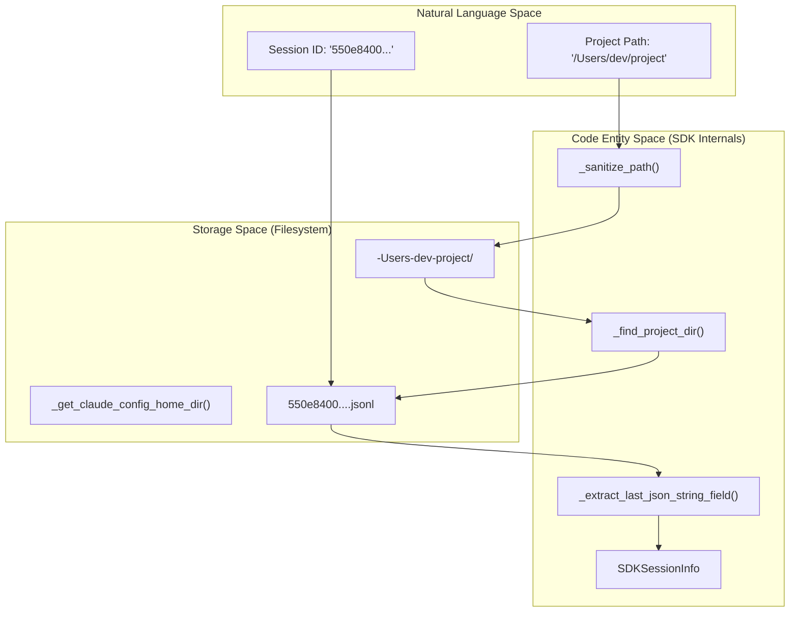
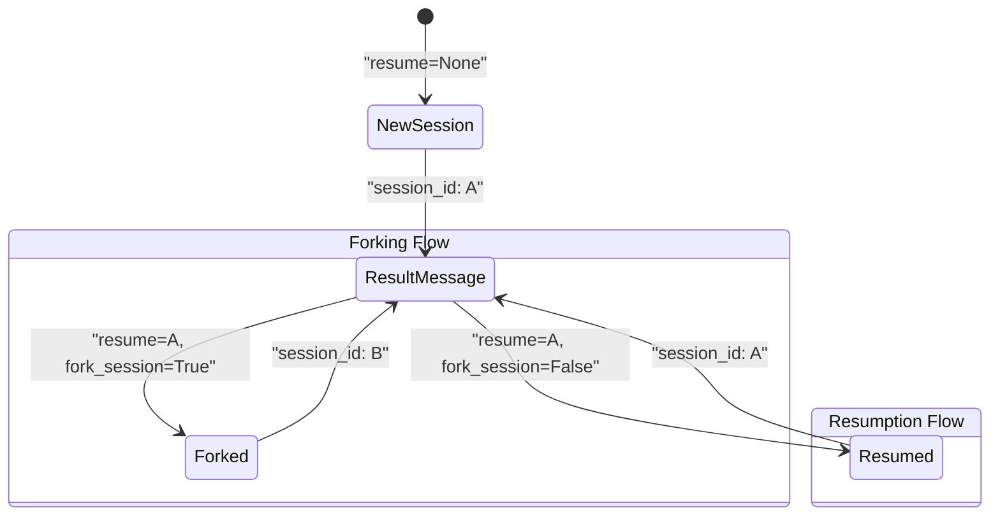
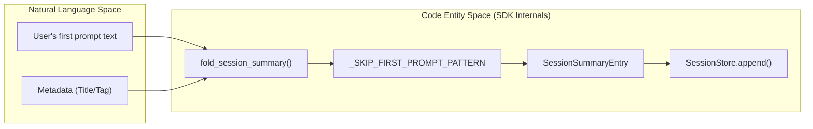

<!-- source: DeepWiki mcp.deepwiki.com · repo anthropics/claude-agent-sdk-python · page 6.1 Session Management and Forking · fetched 2026-10-26 -->

# Session Management and Forking

<details>
<summary>Relevant source files</summary>

The following files were used as context for generating this wiki page:

- [e2e-tests/test_parallel_tool_session_reads.py](e2e-tests/test_parallel_tool_session_reads.py)
- [e2e-tests/test_session_store_resume_settings.py](e2e-tests/test_session_store_resume_settings.py)
- [e2e-tests/test_truncating_resume.py](e2e-tests/test_truncating_resume.py)
- [src/claude_agent_sdk/_internal/session_mutations.py](src/claude_agent_sdk/_internal/session_mutations.py)
- [src/claude_agent_sdk/_internal/session_resume.py](src/claude_agent_sdk/_internal/session_resume.py)
- [src/claude_agent_sdk/_internal/session_store_validation.py](src/claude_agent_sdk/_internal/session_store_validation.py)
- [src/claude_agent_sdk/_internal/sessions.py](src/claude_agent_sdk/_internal/sessions.py)
- [tests/test_session_helpers_store.py](tests/test_session_helpers_store.py)
- [tests/test_session_mutations.py](tests/test_session_mutations.py)
- [tests/test_session_resume.py](tests/test_session_resume.py)
- [tests/test_session_store_conformance.py](tests/test_session_store_conformance.py)
- [tests/test_sessions.py](tests/test_sessions.py)

</details>


## Purpose and Scope

This document explains how the Claude Agent SDK manages sessions, including listing, renaming, tagging, deletion, resumption, forking, and session resume materialization when using external session stores. Sessions enable multi-turn conversations while preserving context, allowing you to continue previous interactions or branch into alternative conversation paths.

The SDK provides both high-level session mutation functions for metadata management and `ClaudeAgentOptions` parameters for conversation flow control and store-backed resume synchronization.

Sources: [src/claude_agent_sdk/_internal/sessions.py:1-5](), [src/claude_agent_sdk/_internal/session_mutations.py:1-17](), [src/claude_agent_sdk/_internal/session_resume.py:1-12]()

## What Are Sessions?

A **session** represents a conversation thread with Claude, maintaining the complete message history, file state, and context across multiple interactions. Each session is identified by a unique UUID session ID [src/claude_agent_sdk/_internal/sessions.py:45-48]().

Sessions are persisted as `.jsonl` files within project-specific directories under the Claude configuration home (typically `~/.claude/projects/` or the path defined by `CLAUDE_CONFIG_DIR`) [src/claude_agent_sdk/_internal/sessions.py:122-130]().

### Session Identification and Metadata
Sessions are identified by a UUID. Metadata such as custom titles and tags are stored as trailing JSON lines within the session's `.jsonl` file to ensure the SDK can retrieve them efficiently without parsing the entire history [src/claude_agent_sdk/_internal/session_mutations.py:1-6]().

| Metadata Type | Field in JSONL | Function |
| :--- | :--- | :--- |
| **Custom Title** | `customTitle` | `rename_session()` |
| **Tag** | `tag` | `tag_session()` |
| **Summary** | `summary` | Generated by CLI |

Sources: [src/claude_agent_sdk/_internal/sessions.py:3-6](), [src/claude_agent_sdk/_internal/session_mutations.py:1-17](), [src/claude_agent_sdk/types.py:588-601]()

## Session Discovery and Listing

The SDK can scan the filesystem to list available sessions. This is implemented in `list_sessions()`, which performs "lite" reads (scanning the head and tail of files) to extract metadata without parsing the entire conversation history [src/claude_agent_sdk/_internal/sessions.py:1-5]().

### `list_sessions()`
Returns a list of `SDKSessionInfo` objects.

```python
async def list_sessions(
    directory: str | None = None,
    limit: int | None = None
) -> list[SDKSessionInfo]:
    ...
```

**Session Discovery Logic**
1. **Directory Resolution**: If `directory` is provided, the SDK sanitizes the path to find the corresponding project folder in `~/.claude/projects/` [src/claude_agent_sdk/_internal/sessions.py:130-145]().
2. **Path Sanitization**: Paths are sanitized by replacing non-alphanumeric characters with hyphens. Long paths (>200 chars) are truncated and appended with a 32-bit hash to match the CLI's directory naming [src/claude_agent_sdk/_internal/sessions.py:104-114]().
3. **Metadata Extraction**: The SDK reads a buffer (default 64KB, `LITE_READ_BUF_SIZE`) from the head (to find the initial user prompt) and the tail (to find the latest title, tag, or summary) [src/claude_agent_sdk/_internal/sessions.py:31-33]().

**Natural Language to Code Entity Mapping: Session Discovery**


Sources: [src/claude_agent_sdk/_internal/sessions.py:104-114](), [src/claude_agent_sdk/_internal/sessions.py:157-184](), [src/claude_agent_sdk/_internal/sessions.py:205-210]()

## Session Mutations

You can modify session metadata or delete sessions without starting a full CLI process. These functions directly manipulate the session files on disk using `O_APPEND` semantics to ensure compatibility with concurrent CLI writers [src/claude_agent_sdk/_internal/session_mutations.py:12-17]().

### `rename_session(session_id, title, directory=None)`
Appends a `{type: "custom-title", "customTitle": title}` entry to the JSONL file [src/claude_agent_sdk/_internal/session_mutations.py:97-107](). The `list_sessions` function always returns the *last* title found in the file tail [src/claude_agent_sdk/_internal/session_mutations.py:60-61]().

### `tag_session(session_id, tag, directory=None)`
Appends a `{type: "tag", "tag": tag}` entry [src/claude_agent_sdk/_internal/session_mutations.py:167-177](). Passing `None` as the tag clears it by appending an empty string, which the SDK treats as cleared [src/claude_agent_sdk/_internal/session_mutations.py:121-123]().

### `delete_session(session_id, directory=None)`
Performs a hard delete of the `{session_id}.jsonl` file and its associated subagent transcript directory (the sibling `{session_id}/` folder) [src/claude_agent_sdk/_internal/session_mutations.py:182-192]().

Sources: [src/claude_agent_sdk/_internal/session_mutations.py:53-109](), [src/claude_agent_sdk/_internal/session_mutations.py:112-179](), [src/claude_agent_sdk/_internal/session_mutations.py:182-212]()

## Resumption, Forking, and Resume Materialization

Session flow is controlled via `ClaudeAgentOptions` when initializing a `ClaudeSDKClient` or calling `query()`.

### Session Resumption
Continues an existing conversation. New messages are appended to the same session ID.
*   **Config**: `resume="<session_id>"` [src/claude_agent_sdk/types.py:659]()
*   **Behavior**: The CLI loads the history from the project directory and continues the thread.

### Session Forking
Creates a new session branching from an existing one.
*   **Config**: `resume="<session_id>"`, `fork_session=True` [src/claude_agent_sdk/types.py:661]()
*   **Behavior**: The CLI creates a new session ID and copies the transcript history up to the point of resumption into the new file [src/claude_agent_sdk/_internal/session_mutations.py:3-5]().

### Session Resume Materialization (`session_store`)
When `options.resume` or `options.continue_conversation` is paired with an external `options.session_store`, the session transcript does not exist on local disk. The SDK bridges this by materializing the store-backed session into a temporary `CLAUDE_CONFIG_DIR` directory layout prior to spawning the CLI subprocess [src/claude_agent_sdk/_internal/session_resume.py:1-12]().

- **`materialize_resume_session(options)`**: Loads the session entries from the store, writes them to a temporary path, copies necessary credential files (with sensitive tokens redacted), and returns a `MaterializedResume` container [src/claude_agent_sdk/_internal/session_resume.py:59-75]().
- **`apply_materialized_options(options, materialized)`**: Updates `CLAUDE_CONFIG_DIR` in the process environment and sets the resolved `resume` session ID [src/claude_agent_sdk/_internal/session_resume.py:77-94]().

**Session State Transitions**


Sources: [src/claude_agent_sdk/types.py:659-661](), [src/claude_agent_sdk/_internal/session_mutations.py:3-5](), [src/claude_agent_sdk/_internal/session_resume.py:59-94]()

## SystemMessage Init Event

When a session starts, the SDK emits a `SystemMessage` with `subtype="init"` [src/claude_agent_sdk/types.py:431](). This message communicates the environment state and configuration to the agent.

Key data fields in the `init` event [src/claude_agent_sdk/types.py:433-443]():
*   **`session_id`**: The UUID for the current session.
*   **`agents`**: List of available subagents defined in `ClaudeAgentOptions`.
*   **`mcp_servers`**: List of connected MCP servers.
*   **`config`**: The active configuration, including `setting_sources`.
*   **`slash_commands`**: Custom slash commands available to the session.

Sources: [src/claude_agent_sdk/types.py:431-443](), [e2e-tests/test_agents_and_settings.py:61-69]()

## Implementation Details: `setting_sources`

The `setting_sources` parameter (type `list[SettingSource]`) controls which configuration files are loaded for the session [src/claude_agent_sdk/types.py:663]().

| Source | Description |
| :--- | :--- |
| `"user"` | Global settings (e.g., `~/.claude/config.json`) |
| `"project"` | Project-level settings (`.claude/` in project) |
| `"local"` | Local gitignored settings (`.claude-local/`) |

This is critical for loading filesystem-based agents or custom slash commands. Passing an empty list `[]` disables all filesystem setting sources [e2e-tests/test_agents_and_settings.py:178-183]().

Sources: [src/claude_agent_sdk/types.py:663](), [e2e-tests/test_agents_and_settings.py:142-154]()

## Retrieval of History and Subagents

To retrieve message history and subagent data, the SDK provides functions to parse the JSONL transcripts stored in the `.claude` directory or mirrored in a session store.

### `get_session_messages(session_id)`
Performs a full parse of the session's `.jsonl` file, reconstructing the conversation chain of `SessionMessage` objects [src/claude_agent_sdk/_internal/sessions.py:23]().

### `get_session_info(session_id)`
Fetches summary metadata for a single session [src/claude_agent_sdk/_internal/sessions.py:23]().

### `list_subagents(session_id)`
Lists all subagents that were spawned during the parent session by scanning the sibling directory `{session_id}/subagents/` [src/claude_agent_sdk/_internal/session_import.py:89-91]().

### `get_subagent_messages(session_id, subagent_id)`
Retrieves the full message transcript for a specific subagent call by reading its specific JSONL file within the subagent directory [src/claude_agent_sdk/_internal/session_import.py:92-104]().

**Natural Language to Code Entity Mapping: Transcript Folding and Retrieval**


Sources: [src/claude_agent_sdk/_internal/sessions.py:23](), [src/claude_agent_sdk/_internal/session_summary.py:1-10](), [src/claude_agent_sdk/_internal/session_import.py:28-67]()

---

